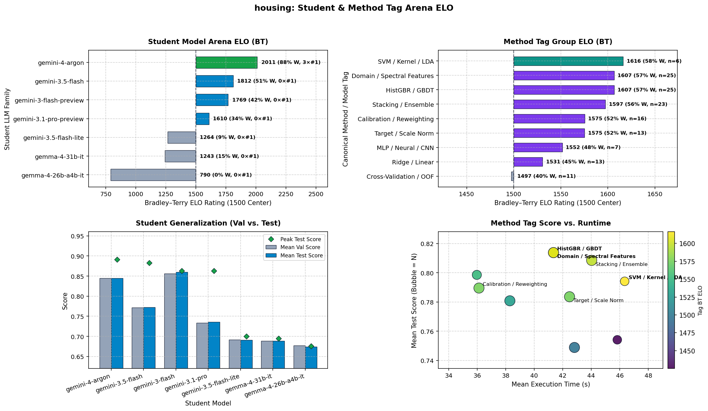

# California Housing Price Regression

[](https://colab.research.google.com/github/google-research/codegen-classroom/blob/main/codegen_classroom/tasks/housing/housing.ipynb)

## Overview

Predict `median_house_value` (in USD) for 1990 California census block groups.
This benchmark evaluates autonomous LLM student agents on a classic spatial and
tabular regression task featuring strong non-linear geographic effects,
extensive-count totals (`total_rooms`, `total_bedrooms`, `population`,
`households`), right-skewed income distributions, and a hard target ceiling at
`$500,001`.

Because the composite score weights both **R²** (sensitive to high-value squared
errors near the `$500,001` cap) and **MAPE** (sensitive to relative percentage
errors on low-priced inland homes), achieving a top score requires combining
spatial feature engineering with multi-loss modeling.

## Files

-   [`config.py`](config.py): Task constants (`RUN_DEFAULTS`,
    `DEFAULT_METRIC_WEIGHTS`), student prompt template
    (`STUDENT_INSTRUCTIONS_TEMPLATE`), and refinement strategies.
-   [`data_loader.py`](data_loader.py): Dataset download/staging
    (`download_housing_data`, `ensure_data`), preprocessing
    (`load_preprocessed_housing_data`), and deterministic splitting
    (`load_housing_data`).
-   [`run_housing.py`](run_housing.py): Headless classroom runner, held-out test
    evaluator, report generator, and solution exporter.
-   [`run_housing_test.py`](run_housing_test.py): Hermetic unit tests covering
    data preprocessing, split invariants, prompt structure, and leaderboard
    export.
-   [`housing.ipynb`](housing.ipynb): Interactive Jupyter/Colab companion
    notebook.
-   [`leaderboard.tsv`](leaderboard.tsv): Benchmark leaderboard tracking
    validation and held-out test metrics across runs.
-   [`solutions/`](solutions/): Archived top run reports and progress plots.

## Dataset

-   **Code License:** Apache License 2.0 (see repository root `LICENSE`).
-   **Dataset License:** Public Domain (U.S. Bureau of the Census, 1990; CC0 compatible).
-   **Citation:** Pace, R. Kelley and Ronald Barry, "Sparse Spatial Autoregressions," *Statistics & Probability Letters*, 33(3): 291-297, 1997.
-   **Source:** 1990 California Census block groups (Pace & Barry, 1997; 10
    columns including categorical `ocean_proximity` from the *Hands-On Machine
    Learning* mirror).
-   **Samples:** 20,433 complete rows (20,640 raw rows minus 207 rows with
    missing `total_bedrooms`).
-   **Features (12 columns after preprocessing):**
    *   **Geographic (2):** `longitude`, `latitude`.
    *   **Physical & Demographic (6):** `housing_median_age`, `total_rooms`,
        `total_bedrooms`, `population`, `households`, `median_income` (in tens
        of thousands USD, capped at `15.0`).
    *   **Categorical (4):** `ocean_proximity` one-hot encoded with
        `drop_first=True` (`<1H OCEAN` as reference baseline), yielding
        `ocean_proximity_INLAND`, `ocean_proximity_ISLAND`,
        `ocean_proximity_NEAR_BAY`, and `ocean_proximity_NEAR_OCEAN`.
-   **Target:** `median_house_value` (USD, range `$14,999` to `$500,001`).
-   **Splits (`VAL_SEED = 42`):**
    *   **Learning Set (80%, 16,346 rows):** Partitioned into **Train** (80% of
        learning = 13,076 rows) and **Validation** (20% of learning = 3,270
        rows) during iterative learning cycles.
    *   **Held-Out Final Test Set (20%, 4,087 rows):** Evaluated once at the end
        after refitting on the full 16,346-row learning set.

## Scoring

Students maximize a weighted composite score across accuracy, relative error,
rank correlation, and runtime efficiency:

```text
Score = (1.00 * R² + 0.50 * (1 - MAPE) + 0.50 * r_pearson + 0.01 / (1 + exec_time_s)) / 2.01
```

## Configuration

| Constant | Value | Rationale |
| :--- | :--- | :--- |
| `DEFAULT_NUM_STUDENTS` | `6` | Heterogeneous classroom (Gemini 4 Argon, Gemini Pro, Flash, Flash-Lite, Gemma 4 26B, Gemma 4 31B) |
| `DEFAULT_NUM_CYCLES` | `12` | Enough cycles to progress from baselines to spatial features and multi-loss ensembles |
| `DEFAULT_TIMEOUT_S` | `60` | Per-cycle validation budget; allows spatial clustering and multi-model ensembles on 13k rows |
| `FINAL_EVAL_TIMEOUT_S` | `180` | 3x per-cycle budget for final fit on the full 16.3k-row learning set |
| `DEFAULT_MAX_OUTPUT_TOKENS` | `32768` | Prevents code truncation on feature-rich pipelines |

## Results

| Model / Run | Test R² | Test MAPE | Test Pearson | Overall Score |
| :--- | :---: | :---: | :---: | :---: |
| Ridge Regression Baseline | ~0.650 | ~28.0% | ~0.806 | ~0.580 |
| HistGradientBoosting Baseline (Cycle 0) | ~0.838 | ~14.5% | ~0.916 | ~0.662 |
| `housing_4s_12c` (`gemini-4-argon`, Cycle 10) | 0.886 | 12.50% | 0.942 | 0.701 |
| `housing_6s_12c` (`gemini-4-argon`, Cycle 8, single model) | 0.888 | 12.64% | 0.943 | 0.702 |
| `housing_6s_12c_v2` (`gemini-4-argon`, Cycle 9) | **0.890** | **12.20%** | **0.944** | **0.704** |



-   **Student Leaderboard:** Across 16 runs, `gemini-4-argon` leads
    Bradley–Terry Arena ELO (`2011`, `88%` win rate, peak Test R² `0.891`),
    followed by `gemini-3.5-flash` (`1812`) and `gemini-3-flash-preview`
    (`1769`), with near-zero validation-to-test generalization gap.
-   **Top Strategies:** High-ELO solutions combine
    `HistGradientBoostingRegressor` with spatial feature engineering (rotated
    coordinates, coastline polyline and metro Haversine distances, RBF cluster
    kernels, and out-of-fold `cKDTree` KNN aggregations), household/income
    ratios, and either a single power-transformed target (`p = 0.35`, `14.9 s`)
    or compact multi-loss (`L2` + `L1`) calibration.

## Quickstart

```bash
# 1. Stage dataset (also downloads automatically on first run):
python -m codegen_classroom.tasks.housing.data_loader data/

# 2. Run unit tests:
pytest codegen_classroom/tasks/housing/run_housing_test.py

# 3. Run fast offline smoke test with mock students (1 cycle):
python -m codegen_classroom.tasks.housing.run_housing \
  --mock_students \
  --num_cycles=1 \
  --experiment_name=smoke_test

# 4. Run full 6-student, 12-cycle classroom benchmark:
python -m codegen_classroom.tasks.housing.run_housing \
  --num_students=6 \
  --num_cycles=12 \
  --experiment_name=housing_6s_12c

# 5. Verify task readiness:
python -m codegen_classroom.verify_task --task housing --strict
```
