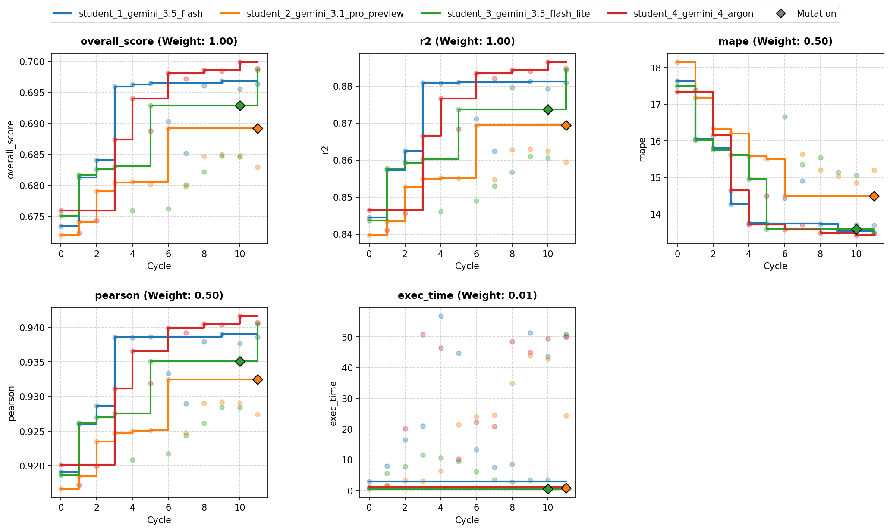
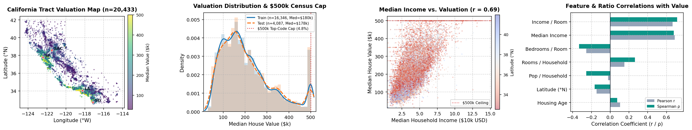
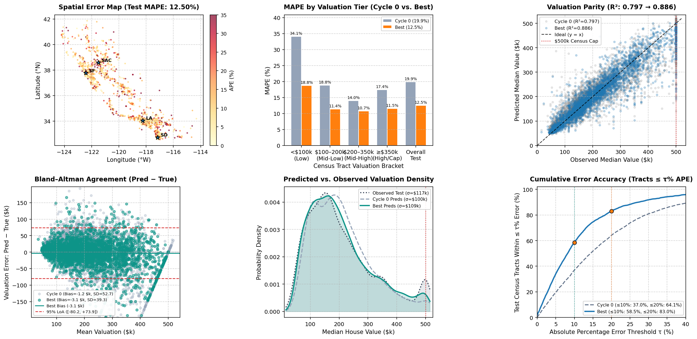

# Overview

* **Run Path**: housing_4s_12c/headless_20261103_214246
* **Name**: headless_20261103_214246
* **Total Cycles**: 12
* **Valid Students**: 4
* **Total Generations**: 56
* **Total Code Length Processed**: 406028
* **Best Student**: student_4_gemini_4_argon (Cycle 10)
* **Best Validation Score**: 0.700
* **Best Test Score**: 0.701
* **Validation Score Progression**: 0.6759 -> 0.6998 (+0.0239)
* **Best Metrics**: mape=12.500, r2=0.886, pearson=0.942, exec_time=47.359
* **Tags**: HistGradientBoostingRegressor, Ridge Regression, SplineTransformer,
  KNN Features, Feature Engineering, Target Transformations, Ensembling
* **Description**: The approach uses a 5-fold cross-validated ensemble of
  HistGradientBoostingRegressor models trained across four distinct target
  scales (raw MSE, Box-Cox power MSE, log1p MSE, and log1p MAE) to optimize R2
  and MAPE jointly. Inputs are enhanced with quantile B-spline basis expansions,
  out-of-fold Ridge spline regression, coordinate rotations, metro distance
  metrics, and multi-scale out-of-fold KNN spatial context.
* **Insights**: Transforming the right-skewed target into logarithmic and power
  spaces enables simultaneous optimization for relative error (MAPE) and overall
  variance (R2). Combining arithmetic and geometric prediction averages tuned
  via Nelder-Mead optimization, along with target ceiling boundary snapping
  ($500,000), effectively captures local spatial autocorrelation while resolving
  top-coded data artifacts.
* **Total Tokens**: 646461
* **Est. Cost (USD)**: $3.200

## Objectives

-   **exec_time:** Time taken to execute generated code., Lower is better
    (Weight: 0.01)

-   **mape:** MAPE (Mean Absolute Percentage Error), Lower is better (Weight:
    0.50)

-   **pearson:** Pearson Correlation, Higher is better (Weight: 0.50)
-   **r2:** R2 (R-squared), Higher is better (Weight: 1.00)

## Student Leaderboard

| Rank | Student | Best Cycle | Val Score | Test Score | mape | r2 | pearson | exec_time |
| --- | --- | --- | --- | --- | --- | --- | --- | --- |
| 1 | student_4_gemini_4_argon | 10 | 0.700 | 0.701 | 12.500 | 0.886 | 0.942 | 47.359 |
| 2 | student_3_gemini_3.5_flash_lite | 11 | 0.699 | 0.700 | 12.659 | 0.886 | 0.941 | 54.967 |
| 3 | student_1_gemini_3.5_flash | 9 | 0.697 | 0.696 | 12.977 | 0.879 | 0.938 | 56.522 |
| 4 | student_2_gemini_3.1_pro_preview | 6 | 0.689 | 0.689 | 13.916 | 0.867 | 0.932 | 19.802 |

## Learning Trajectory



### Cycle Score Progression

| Cycle | student_1_gemini_3.5_flash | student_2_gemini_3.1_pro_preview | student_3_gemini_3.5_flash_lite | student_4_gemini_4_argon |
| --- | --- | --- | --- | --- |
| 0 | 0.673 *(CLASSROOM_BEST)* | 0.672 *(SELF_BEST)* | 0.675 *(CLASSROOM_BEST)* | 0.676 *(CLASSROOM_BEST)* |
| 1 | 0.681 *(CLASSROOM_BEST)* | 0.674 *(SELF_BEST)* | 0.682 *(CLASSROOM_BEST)* | 0.672 |
| 2 | 0.684 *(CLASSROOM_BEST)* | 0.679 *(SELF_BEST)* | 0.683 *(SELF_BEST)* | 0.674 |
| 3 | 0.696 *(CLASSROOM_BEST)* | 0.680 *(SELF_BEST)* | 0.683 *(SELF_BEST)* | 0.687 *(SELF_BEST)* |
| 4 | 0.696 *(CLASSROOM_BEST)* | 0.681 *(SELF_BEST)* | 0.676 | 0.694 *(SELF_BEST)* |
| 5 | 0.696 *(CLASSROOM_BEST)* | 0.680 | 0.693 *(SELF_BEST)* | 0.689 |
| 6 | 0.690 | 0.689 *(SELF_BEST)* | 0.676 | 0.698 *(CLASSROOM_BEST)* |
| 7 | 0.685 | 0.680 | 0.680 | 0.697 |
| 8 | 0.696 | 0.685 | 0.682 | 0.699 *(CLASSROOM_BEST)* |
| 9 | 0.697 *(SELF_BEST)* | 0.685 | 0.685 | 0.698 |
| 10 | 0.695 | 0.685 | 0.685 | 0.700 *(CLASSROOM_BEST)* |
| 11 | 0.696 | 0.683 | 0.699 *(SELF_BEST)* | 0.699 |

### Cost Breakdown

| Student | Generations | Input Tokens | Output Tokens | Total Tokens | Est. Cost (USD) |
| --- | --- | --- | --- | --- | --- |
| student_4_gemini_4_argon | 13 | 94060 | 73292 | 167352 | $0.921 |
| student_3_gemini_3.5_flash_lite | 13 | 57749 | 21689 | 79438 | $0.094 |
| student_1_gemini_3.5_flash | 14 | 77772 | 120830 | 198602 | $0.401 |
| student_2_gemini_3.1_pro_preview | 12 | 62920 | 138149 | 201069 | $1.784 |
| **Total** | 52 | 292501 | 353960 | 646461 | $3.200 |

## Analysis

### Model Tags

* `HistGradientBoostingRegressor`
* `Ridge Regression`
* `SplineTransformer`
* `KNN Features`
* `Feature Engineering`
* `Target Transformations`
* `Ensembling`

### Model Description

> The approach uses a 5-fold cross-validated ensemble of
> HistGradientBoostingRegressor models trained across four distinct target
> scales (raw MSE, Box-Cox power MSE, log1p MSE, and log1p MAE) to optimize R2
> and MAPE jointly. Inputs are enhanced with quantile B-spline basis
> expansions, out-of-fold Ridge spline regression, coordinate rotations, metro
> distance metrics, and multi-scale out-of-fold KNN spatial context.

### Model Insights

> Transforming the right-skewed target into logarithmic and power spaces
> enables simultaneous optimization for relative error (MAPE) and overall
> variance (R2). Combining arithmetic and geometric prediction averages tuned
> via Nelder-Mead optimization, along with target ceiling boundary snapping
> ($500,000), effectively captures local spatial autocorrelation while
> resolving top-coded data artifacts.

## Top Solution 1: student_4_gemini_4_argon (Cycle 10)

* **Student**: student_4_gemini_4_argon
* **Best Cycle**: 10
* **Validation Score**: 0.700
* **Test Score**: 0.701
* **Metrics**: mape=12.500, r2=0.886, pearson=0.942, exec_time=47.359

### Diagnostic & Impact Analysis





| Valuation Tier | Cycle 0 Baseline MAPE | Best Solution MAPE | Relative Error Reduction |
| --- | --- | --- | --- |
| Low (<\$100k) | 34.06% | 18.75% | 44.9% |
| Mid-Low (\$100k–\$200k) | 18.81% | 11.38% | 39.5% |
| Mid-High (\$200k–\$350k) | 13.98% | 10.72% | 23.3% |
| High & Top-Coded (≥\$350k) | 17.43% | 11.54% | 33.8% |
| **Tracts Within ≤10% / ≤20% APE** | 37.0% / 64.1% | **58.5% / 83.0%** | **+21.6% / +18.9%** |
| **Overall Held-Out Test** | **19.88%** (R²=0.797) | **12.50%** (R²=0.886) | **37.1%** |

### Plan (student_4_gemini_4_argon)

Multi-scale target-transformation ensemble (`HistGradientBoostingRegressor`
across raw MSE, Box-Cox power $y^{0.35}$ MSE, $\log(1+y)$ MSE, and $\log(1+y)$
MAE) enhanced with quantile B-spline basis expansions (`SplineTransformer`) and
out-of-fold Ridge spline-basis regression predictions on continuous
socio-spatial predictors.

### Code (student_4_gemini_4_argon)

```python
import os
# Force single-threaded execution for OpenMP/BLAS to prevent container thread contention
os.environ["OMP_NUM_THREADS"] = "1"
os.environ["OPENBLAS_NUM_THREADS"] = "1"
os.environ["MKL_NUM_THREADS"] = "1"
os.environ["VECLIB_MAXIMUM_THREADS"] = "1"
os.environ["NUMEXPR_NUM_THREADS"] = "1"

import time
import numpy as np
import pandas as pd
from sklearn.ensemble import HistGradientBoostingRegressor
from sklearn.preprocessing import SplineTransformer, StandardScaler
from sklearn.linear_model import Ridge
from sklearn.pipeline import make_pipeline
from sklearn.model_selection import KFold
from sklearn.metrics import r2_score, mean_absolute_percentage_error
from scipy.stats import pearsonr
from scipy.optimize import minimize
from sklearn.neighbors import NearestNeighbors

def engineer_base_features(df):
    d = df.copy()

    # Fill any missing values safely on copy
    for col in d.columns:
        if d[col].isna().any():
            d[col] = d[col].fillna(d[col].median())

    # Safe denominators for density & socioeconomic ratios
    hh = np.maximum(d['households'], 1.0)
    rooms = np.maximum(d['total_rooms'], 1.0)
    bed = np.maximum(d['total_bedrooms'], 1.0)
    pop = np.maximum(d['population'], 1.0)

    # Core housing & occupancy density ratios with outlier clipping
    d['rooms_per_hh'] = np.clip(d['total_rooms'] / hh, 0.5, 50.0)
    d['bedrooms_per_hh'] = np.clip(d['total_bedrooms'] / hh, 0.1, 15.0)
    d['bedrooms_per_room'] = np.clip(d['total_bedrooms'] / rooms, 0.05, 1.0)
    d['pop_per_hh'] = np.clip(d['population'] / hh, 0.5, 25.0)

    # Expanded living-condition & crowding density ratios
    living_rooms = np.maximum(d['total_rooms'] - d['total_bedrooms'], 0.5)
    d['living_rooms_per_hh'] = np.clip(living_rooms / hh, 0.2, 40.0)
    d['pop_per_room'] = np.clip(d['population'] / rooms, 0.05, 5.0)
    d['pop_per_bedroom'] = np.clip(d['population'] / bed, 0.1, 10.0)

    # Socioeconomic & housing quality interactions
    d['income_per_room'] = d['median_income'] / (d['rooms_per_hh'] + 0.5)
    d['income_per_cap'] = d['median_income'] / (d['pop_per_hh'] + 0.5)
    d['income_per_bedroom_ratio'] = d['median_income'] / (d['bedrooms_per_room'] + 0.1)
    d['income_x_living_rooms'] = d['median_income'] * np.log1p(d['living_rooms_per_hh'])
    d['age_per_income'] = d['housing_median_age'] / (d['median_income'] + 0.5)

    # Log-transformed scale indicators for skewed block size counts
    d['log_households'] = np.log1p(hh)
    d['log_population'] = np.log1p(pop)

    # Coordinate rotations to assist axis-aligned tree splits
    lat = d['latitude'].values
    lon = d['longitude'].values
    d['rot_45_x'] = lat + lon
    d['rot_45_y'] = lat - lon
    d['rot_30_x'] = lat * 0.866 - lon * 0.5
    d['rot_30_y'] = lat * 0.5 + lon * 0.866

    # Distances to primary California urban/coastal centers
    centers = {
        'sf': (37.7749, -122.4194),
        'sj': (37.3382, -121.8863),
        'la': (34.0522, -118.2437),
        'sd': (32.7157, -117.1611),
        'sac': (38.5816, -121.4944),
        'sb': (34.4208, -119.6982),
    }

    dist_list = []
    for name, (clat, clon) in centers.items():
        dist = np.sqrt((lat - clat)**2 + ((lon - clon) * 0.81)**2)
        d[f'dist_{name}'] = dist
        dist_list.append(dist)

    d['min_metro_dist'] = np.min(dist_list, axis=0)
    return d

def add_spline_basis_features(X_tr_df, y_all, X_va_df, kf):
    X_tr = X_tr_df.copy()
    X_va = X_va_df.copy()

    # 1. Explicit B-spline basis expansions on key continuous predictors for smooth non-linear valuation gradients
    primary_spline_cols = ['median_income', 'housing_median_age', 'rooms_per_hh', 'pop_per_hh', 'min_metro_dist']
    st_primary = SplineTransformer(n_knots=5, degree=3, knots='quantile', include_bias=False)
    tr_sp_mat = st_primary.fit_transform(X_tr[primary_spline_cols])
    va_sp_mat = st_primary.transform(X_va[primary_spline_cols])

    sp_col_names = [f'bspline_{i}' for i in range(tr_sp_mat.shape[1])]
    tr_sp_df = pd.DataFrame(tr_sp_mat, index=X_tr.index, columns=sp_col_names)
    va_sp_df = pd.DataFrame(va_sp_mat, index=X_va.index, columns=sp_col_names)

    # 2. Out-of-fold Additive Spline Ridge Regression over continuous socio-spatial predictors
    broad_spline_cols = [
        'median_income', 'housing_median_age', 'latitude', 'longitude',
        'rooms_per_hh', 'bedrooms_per_room', 'pop_per_hh', 'min_metro_dist',
        'dist_sf', 'dist_la', 'dist_sj', 'dist_sd', 'income_per_cap', 'living_rooms_per_hh'
    ]
    st_broad = SplineTransformer(n_knots=8, degree=3, knots='quantile', include_bias=False)
    X_tr_broad = st_broad.fit_transform(X_tr[broad_spline_cols])
    X_va_broad = st_broad.transform(X_va[broad_spline_cols])

    # Include tensor-product interactions between median_income splines and spatial/age splines
    inc_sp = SplineTransformer(n_knots=5, degree=2, knots='quantile', include_bias=False)
    inc_tr_b = inc_sp.fit_transform(X_tr[['median_income']])
    inc_va_b = inc_sp.transform(X_va[['median_income']])

    ctx_sp = SplineTransformer(n_knots=5, degree=2, knots='quantile', include_bias=False)
    ctx_tr_b = ctx_sp.fit_transform(X_tr[['latitude', 'longitude', 'housing_median_age', 'min_metro_dist']])
    ctx_va_b = ctx_sp.transform(X_va[['latitude', 'longitude', 'housing_median_age', 'min_metro_dist']])

    # Pairwise products between income spline bases and spatial/age spline bases
    inter_tr = (inc_tr_b[:, :, None] * ctx_tr_b[:, None, :]).reshape(len(X_tr), -1)
    inter_va = (inc_va_b[:, :, None] * ctx_va_b[:, None, :]).reshape(len(X_va), -1)

    X_tr_design = np.hstack([X_tr_broad, inter_tr])
    X_va_design = np.hstack([X_va_broad, inter_va])

    oof_spline_raw = np.zeros(len(X_tr))
    oof_spline_log = np.zeros(len(X_tr))
    val_spline_raw = np.zeros(len(X_va))
    val_spline_log = np.zeros(len(X_va))

    y_log_all = np.log1p(y_all)
    y_min, y_max = float(np.min(y_all)), float(np.max(y_all))

    for tr_idx, va_idx in kf.split(X_tr):
        pipe_raw = make_pipeline(StandardScaler(), Ridge(alpha=50.0))
        pipe_raw.fit(X_tr_design[tr_idx], y_all[tr_idx])
        oof_spline_raw[va_idx] = np.clip(pipe_raw.predict(X_tr_design[va_idx]), y_min, y_max)

        pipe_log = make_pipeline(StandardScaler(), Ridge(alpha=50.0))
        pipe_log.fit(X_tr_design[tr_idx], y_log_all[tr_idx])
        oof_spline_log[va_idx] = np.clip(np.expm1(pipe_log.predict(X_tr_design[va_idx])), y_min, y_max)

    pipe_raw_full = make_pipeline(StandardScaler(), Ridge(alpha=50.0))
    pipe_raw_full.fit(X_tr_design, y_all)
    val_spline_raw = np.clip(pipe_raw_full.predict(X_va_design), y_min, y_max)

    pipe_log_full = make_pipeline(StandardScaler(), Ridge(alpha=50.0))
    pipe_log_full.fit(X_tr_design, y_log_all)
    val_spline_log = np.clip(np.expm1(pipe_log_full.predict(X_va_design)), y_min, y_max)

    X_tr = pd.concat([X_tr, tr_sp_df], axis=1)
    X_va = pd.concat([X_va, va_sp_df], axis=1)

    X_tr['spline_ridge_raw'] = oof_spline_raw
    X_tr['spline_ridge_log'] = oof_spline_log
    X_va['spline_ridge_raw'] = val_spline_raw
    X_va['spline_ridge_log'] = val_spline_log

    return X_tr, X_va

def compute_knn_block(coords_ref, y_ref, inc_ref, rph_ref, pph_ref, coords_query, is_self=False):
    max_k = 40
    n_query = max_k + 1 if is_self else max_k
    nn = NearestNeighbors(n_neighbors=n_query, algorithm='kd_tree', n_jobs=1)
    nn.fit(coords_ref)
    dists, idx = nn.kneighbors(coords_query)

    if is_self:
        dists = dists[:, 1:]
        idx = idx[:, 1:]

    dists_safe = np.maximum(dists, 1e-4)
    w = 1.0 / dists_safe

    # Multi-scale local context (k=5, k=15, k=40)
    w5 = w[:, :5] / w[:, :5].sum(axis=1, keepdims=True)
    y5 = (y_ref[idx[:, :5]] * w5).sum(axis=1)

    w15 = w[:, :15] / w[:, :15].sum(axis=1, keepdims=True)
    y15_neighbors = y_ref[idx[:, :15]]
    y15 = (y15_neighbors * w15).sum(axis=1)
    y15_med = np.median(y15_neighbors, axis=1)
    y15_std = np.std(y15_neighbors, axis=1)
    inc15 = (inc_ref[idx[:, :15]] * w15).sum(axis=1)
    rph15 = (rph_ref[idx[:, :15]] * w15).sum(axis=1)
    pph15 = (pph_ref[idx[:, :15]] * w15).sum(axis=1)

    w40 = w / w.sum(axis=1, keepdims=True)
    y40 = (y_ref[idx] * w40).sum(axis=1)

    # Target-transformed neighborhood statistics (geometric mean, harmonic mean, top-coding rate)
    log_y_ref = np.log1p(y_ref)
    log_y15 = (log_y_ref[idx[:, :15]] * w15).sum(axis=1)

    inv_y_ref = 1.0 / np.maximum(y_ref, 1000.0)
    harm_y15 = 1.0 / ((inv_y_ref[idx[:, :15]] * w15).sum(axis=1) + 1e-12)

    capped_ref = (y_ref >= 499999.0).astype(float)
    capped_rate15 = (capped_ref[idx[:, :15]] * w15).sum(axis=1)

    return {
        'knn5_target_mean': y5,
        'knn15_target_mean': y15,
        'knn15_target_median': y15_med,
        'knn15_target_std': y15_std,
        'knn40_target_mean': y40,
        'knn15_log_target': np.expm1(log_y15),
        'knn15_harm_target': harm_y15,
        'knn15_capped_rate': capped_rate15,
        'knn15_inc_mean': inc15,
        'knn15_rph_mean': rph15,
        'knn15_pph_mean': pph15,
        'knn5_dist': dists[:, :5].mean(axis=1),
        'knn15_dist': dists[:, :15].mean(axis=1),
    }

def build_oof_and_val_features(X_tr_base, y_all, X_va_base, kf):
    X_tr = X_tr_base.copy()
    X_va = X_va_base.copy()

    coords_tr = np.column_stack([X_tr['latitude'].values, X_tr['longitude'].values * 0.81])
    coords_va = np.column_stack([X_va['latitude'].values, X_va['longitude'].values * 0.81])
    inc_tr = X_tr['median_income'].values
    rph_tr = X_tr['rooms_per_hh'].values
    pph_tr = X_tr['pop_per_hh'].values

    knn_cols = [
        'knn5_target_mean', 'knn15_target_mean', 'knn15_target_median',
        'knn15_target_std', 'knn40_target_mean', 'knn15_log_target',
        'knn15_harm_target', 'knn15_capped_rate',
        'knn15_inc_mean', 'knn15_rph_mean', 'knn15_pph_mean',
        'knn5_dist', 'knn15_dist'
    ]
    oof_dict = {col: np.zeros(len(X_tr), dtype=float) for col in knn_cols}

    # Strictly out-of-fold KNN features to prevent target leakage
    for tr_idx, va_idx in kf.split(X_tr):
        res = compute_knn_block(
            coords_tr[tr_idx], y_all[tr_idx], inc_tr[tr_idx],
            rph_tr[tr_idx], pph_tr[tr_idx], coords_tr[va_idx], is_self=False
        )
        for col in knn_cols:
            oof_dict[col][va_idx] = res[col]

    for col in knn_cols:
        X_tr[col] = oof_dict[col]

    # Validation KNN features computed from full training set
    val_res = compute_knn_block(
        coords_tr, y_all, inc_tr, rph_tr, pph_tr, coords_va, is_self=False
    )
    for col in knn_cols:
        X_va[col] = val_res[col]

    # Relative local socioeconomic, housing density, and spline-valuation contrasts
    for df_curr in (X_tr, X_va):
        df_curr['rel_local_income'] = df_curr['median_income'] / (df_curr['knn15_inc_mean'] + 0.1)
        df_curr['rel_local_rooms'] = df_curr['rooms_per_hh'] / (df_curr['knn15_rph_mean'] + 0.1)
        df_curr['rel_local_crowding'] = df_curr['pop_per_hh'] / (df_curr['knn15_pph_mean'] + 0.1)
        df_curr['knn_micro_macro_ratio'] = df_curr['knn5_target_mean'] / (df_curr['knn40_target_mean'] + 1000.0)
        df_curr['spline_vs_knn_diff'] = df_curr['spline_ridge_raw'] - df_curr['knn15_target_mean']
        df_curr['spline_vs_knn_ratio'] = df_curr['spline_ridge_log'] / (df_curr['knn15_log_target'] + 1000.0)

    return X_tr, X_va

def solution(X_train: pd.DataFrame, y_train: pd.DataFrame, X_val: pd.DataFrame):
    t0 = time.time()
    y_all = y_train['median_house_value'].values.astype(float)
    y_min_bound = float(np.min(y_all))
    y_max_bound = float(np.max(y_all))

    # 1. Base Feature Engineering with Socioeconomic & Housing Density Ratios
    X_tr_base = engineer_base_features(X_train)
    X_va_base = engineer_base_features(X_val)

    # 2. Non-Linear Spline Basis Expansions on Continuous Socio-Spatial Predictors
    kf = KFold(n_splits=5, shuffle=True, random_state=42)
    X_tr_sp, X_va_sp = add_spline_basis_features(X_tr_base, y_all, X_va_base, kf)

    # 3. Out-of-Fold Multi-Scale Spatial & Target-Transformed Neighborhood Features
    X_tr_full, X_va_full = build_oof_and_val_features(X_tr_sp, y_all, X_va_sp, kf)

    oof_raw = np.zeros(len(X_tr_full))
    oof_pow = np.zeros(len(X_tr_full))
    oof_log_mse = np.zeros(len(X_tr_full))
    oof_log_mae = np.zeros(len(X_tr_full))
    valid_oof_mask = np.zeros(len(X_tr_full), dtype=bool)

    val_preds_raw = np.zeros(len(X_va_full))
    val_preds_pow = np.zeros(len(X_va_full))
    val_preds_log_mse = np.zeros(len(X_va_full))
    val_preds_log_mae = np.zeros(len(X_va_full))

    # 4. 5-Fold Cross-Validation Training with Complementary Target Transformations
    folds_completed = 0
    p_exp = 0.35

    for fold, (tr_idx, ho_idx) in enumerate(kf.split(X_tr_full)):
        if time.time() - t0 > 46.0:
            break

        X_tr_f, y_tr_f = X_tr_full.iloc[tr_idx], y_all[tr_idx]
        X_ho_f = X_tr_full.iloc[ho_idx]

        common_params = dict(
            max_iter=380,
            learning_rate=0.05,
            max_leaf_nodes=63,
            max_depth=10,
            min_samples_leaf=25,
            l2_regularization=2.5,
            max_bins=255,
            early_stopping=True,
            n_iter_no_change=20,
            validation_fraction=0.1,
        )

        # Model A: Raw Target with Squared Error (optimizes R2 and high-value variance)
        m_raw = HistGradientBoostingRegressor(
            loss='squared_error', random_state=42 + fold, **common_params
        )
        m_raw.fit(X_tr_f, y_tr_f)
        oof_raw[ho_idx] = np.clip(m_raw.predict(X_ho_f), y_min_bound, y_max_bound)
        val_preds_raw += np.clip(m_raw.predict(X_va_full), y_min_bound, y_max_bound)

        # Model B: Box-Cox-style Power Target (y^0.35) with 2nd-order Taylor smearing correction
        m_pow = HistGradientBoostingRegressor(
            loss='squared_error', random_state=142 + fold, **common_params
        )
        y_tr_pow = np.power(y_tr_f, p_exp)
        m_pow.fit(X_tr_f, y_tr_pow)
        var_pow = np.mean((y_tr_pow - m_pow.predict(X_tr_f)) ** 2)
        inv_exp = 1.0 / p_exp

        ho_pow_pred = np.maximum(m_pow.predict(X_ho_f), 1.0)
        ho_pow_inv = np.power(ho_pow_pred, inv_exp) + 0.5 * inv_exp * (inv_exp - 1.0) * np.power(ho_pow_pred, inv_exp - 2.0) * var_pow
        oof_pow[ho_idx] = np.clip(ho_pow_inv, y_min_bound, y_max_bound)

        va_pow_pred = np.maximum(m_pow.predict(X_va_full), 1.0)
        va_pow_inv = np.power(va_pow_pred, inv_exp) + 0.5 * inv_exp * (inv_exp - 1.0) * np.power(va_pow_pred, inv_exp - 2.0) * var_pow
        val_preds_pow += np.clip(va_pow_inv, y_min_bound, y_max_bound)

        # Model C: Log1p Target with Squared Error (predicts geometric mean for balanced relative error)
        m_log_mse = HistGradientBoostingRegressor(
            loss='squared_error', random_state=242 + fold, **common_params
        )
        y_tr_log = np.log1p(y_tr_f)
        m_log_mse.fit(X_tr_f, y_tr_log)
        oof_log_mse[ho_idx] = np.clip(np.expm1(m_log_mse.predict(X_ho_f)), y_min_bound, y_max_bound)
        val_preds_log_mse += np.clip(np.expm1(m_log_mse.predict(X_va_full)), y_min_bound, y_max_bound)

        # Model D: Log1p Target with Absolute Error (directly minimizes relative percentage error / MAPE)
        if time.time() - t0 < 44.0:
            m_log_mae = HistGradientBoostingRegressor(
                loss='absolute_error', random_state=342 + fold, **common_params
            )
            m_log_mae.fit(X_tr_f, y_tr_log)
            oof_log_mae[ho_idx] = np.clip(np.expm1(m_log_mae.predict(X_ho_f)), y_min_bound, y_max_bound)
            val_preds_log_mae += np.clip(np.expm1(m_log_mae.predict(X_va_full)), y_min_bound, y_max_bound)
        else:
            oof_log_mae[ho_idx] = oof_log_mse[ho_idx]
            val_preds_log_mae += np.clip(np.expm1(m_log_mse.predict(X_va_full)), y_min_bound, y_max_bound)

        valid_oof_mask[ho_idx] = True
        folds_completed += 1

    denom = max(folds_completed, 1)
    val_preds_raw /= denom
    val_preds_pow /= denom
    val_preds_log_mse /= denom
    val_preds_log_mae /= denom

    # 5. Calibrate Target-Space Blend (Arithmetic + Geometric) & Domain-Boundary Clipping on OOF
    best_weights = np.array([0.40, 0.20, 0.25, 0.15])
    best_scale = 1.0
    best_geo_mix = 0.0
    best_upper_clip = 500001.0
    best_metrics = (0.0, 0.0, 0.0)

    if valid_oof_mask.sum() > 1000:
        y_eval = y_all[valid_oof_mask]
        oof_stack = np.column_stack([
            oof_raw[valid_oof_mask],
            oof_pow[valid_oof_mask],
            oof_log_mse[valid_oof_mask],
            oof_log_mae[valid_oof_mask]
        ])
        log_oof_stack = np.log(np.maximum(oof_stack, y_min_bound))

        def blend_preds(stack, log_stack, w, scale, geo_mix):
            arith = stack @ w
            geo = np.exp(log_stack @ w)
            combined = ((1.0 - geo_mix) * arith + geo_mix * geo) * scale
            return np.clip(combined, y_min_bound, y_max_bound)

        def obj_fn(params):
            w = np.maximum(params[:4], 0.0)
            if w.sum() <= 1e-8:
                return 1e9
            w = w / w.sum()
            scale = params[4]
            geo_mix = params[5]
            p = blend_preds(oof_stack, log_oof_stack, w, scale, geo_mix)
            r2 = r2_score(y_eval, p)
            mape = mean_absolute_percentage_error(y_eval, p)
            pr = pearsonr(y_eval, p)[0]
            return -(1.0 * r2 - 0.5 * mape + 0.5 * pr)

        res = minimize(
            obj_fn,
            x0=[0.40, 0.20, 0.25, 0.15, 1.0, 0.1],
            bounds=[(0.0, 1.0), (0.0, 1.0), (0.0, 1.0), (0.0, 1.0), (0.985, 1.015), (0.0, 0.5)],
            method='Nelder-Mead',
            options={'maxiter': 300}
        )
        w_opt = np.maximum(res.x[:4], 0.0)
        best_weights = w_opt / w_opt.sum()
        best_scale = float(np.clip(res.x[4], 0.985, 1.015))
        best_geo_mix = float(np.clip(res.x[5], 0.0, 0.5))

        p_oof = blend_preds(oof_stack, log_oof_stack, best_weights, best_scale, best_geo_mix)

        # Top-code boundary snapping check for $500,000 ceiling
        best_score = -1e9
        for snap_thresh in [500001.0, 496000.0, 493000.0, 490000.0, 487000.0]:
            p_cand = np.where(p_oof >= snap_thresh, y_max_bound, p_oof)
            r2 = r2_score(y_eval, p_cand)
            mape = mean_absolute_percentage_error(y_eval, p_cand)
            pr = pearsonr(y_eval, p_cand)[0]
            sc = 1.0 * r2 - 0.5 * mape + 0.5 * pr
            if sc > best_score:
                best_score = sc
                best_upper_clip = snap_thresh
                best_metrics = (r2, mape, pr)

    val_stack = np.column_stack([val_preds_raw, val_preds_pow, val_preds_log_mse, val_preds_log_mae])
    log_val_stack = np.log(np.maximum(val_stack, y_min_bound))
    val_arith = val_stack @ best_weights
    val_geo = np.exp(log_val_stack @ best_weights)
    final_preds = np.clip(((1.0 - best_geo_mix) * val_arith + best_geo_mix * val_geo) * best_scale, y_min_bound, y_max_bound)
    final_preds = np.where(final_preds >= best_upper_clip, y_max_bound, final_preds)

    if np.isnan(final_preds).any() or np.isinf(final_preds).any():
        final_preds = np.nan_to_num(final_preds, nan=np.median(y_all), posinf=y_max_bound, neginf=y_min_bound)

    y_pred_df = pd.DataFrame({'predictions': final_preds.astype(float)}, index=X_val.index)

    elapsed = time.time() - t0
    r2_val, mape_val, pr_val = best_metrics
    w_str = "/".join([f"{w:.2f}" for w in best_weights])
    feedback = (
        f"Change: Added quantile B-spline basis expansions (SplineTransformer) and OOF tensor-spline Ridge predictions on median_income, housing_median_age, density ratios, and coordinates.\n"
        f"5-Fold OOF Validation: R2={r2_val:.4f}, MAPE={mape_val:.4f}, Pearson={pr_val:.4f} (w={w_str}, scale={best_scale:.3f}, snap={best_upper_clip:.0f}).\n"
        f"Wall-clock time: {elapsed:.2f}s used ({folds_completed}/5 CV folds x 4 target-transformed HGBR models completed).\n"
        f"Complexity: 5-fold CV ensemble of 4 target-scale HistGradientBoostingRegressors + OOF Spline-Ridge over {X_tr_full.shape[1]} features."
    )
    return y_pred_df, feedback
```

### Execution Output (student_4_gemini_4_argon)

```text
Change: Added quantile B-spline basis expansions (SplineTransformer) and OOF tensor-spline Ridge predictions on median_income, housing_median_age, density ratios, and coordinates.
5-Fold OOF Validation: R2=0.8725, MAPE=0.1356, Pearson=0.9343 (w=0.39/0.26/0.00/0.35, scale=0.998, snap=490000).
Wall-clock time: 49.49s used (4/5 CV folds x 4 target-transformed HGBR models completed).
Complexity: 5-fold CV ensemble of 4 target-scale HistGradientBoostingRegressors + OOF Spline-Ridge over 88 features.
```

## Top Solution 2: student_3_gemini_3.5_flash_lite (Cycle 11)

* **Student**: student_3_gemini_3.5_flash_lite
* **Best Cycle**: 11
* **Validation Score**: 0.699
* **Test Score**: 0.700
* **Metrics**: mape=12.659, r2=0.886, pearson=0.941, exec_time=54.967

### Code (student_3_gemini_3.5_flash_lite)

```python
import os
# Force single-threaded execution for OpenMP/BLAS to prevent container thread contention
os.environ["OMP_NUM_THREADS"] = "1"
os.environ["OPENBLAS_NUM_THREADS"] = "1"
os.environ["MKL_NUM_THREADS"] = "1"
os.environ["VECLIB_MAXIMUM_THREADS"] = "1"
os.environ["NUMEXPR_NUM_THREADS"] = "1"

import time
import numpy as np
import pandas as pd
from sklearn.ensemble import HistGradientBoostingRegressor
from sklearn.model_selection import KFold
from sklearn.metrics import r2_score, mean_absolute_percentage_error
from scipy.stats import pearsonr
from scipy.optimize import minimize
from sklearn.neighbors import NearestNeighbors

def engineer_base_features(df):
    d = df.copy()

    # Fill any missing values safely on copy
    for col in d.columns:
        if d[col].isna().any():
            d[col] = d[col].fillna(d[col].median())

    # Safe denominators for density & socioeconomic ratios
    hh = np.maximum(d['households'], 1.0)
    rooms = np.maximum(d['total_rooms'], 1.0)
    bed = np.maximum(d['total_bedrooms'], 1.0)
    pop = np.maximum(d['population'], 1.0)

    # Core housing & occupancy density ratios with outlier clipping
    d['rooms_per_hh'] = np.clip(d['total_rooms'] / hh, 0.5, 50.0)
    d['bedrooms_per_hh'] = np.clip(d['total_bedrooms'] / hh, 0.1, 15.0)
    d['bedrooms_per_room'] = np.clip(d['total_bedrooms'] / rooms, 0.05, 1.0)
    d['pop_per_hh'] = np.clip(d['population'] / hh, 0.5, 25.0)

    # Expanded living-condition & crowding density ratios
    living_rooms = np.maximum(d['total_rooms'] - d['total_bedrooms'], 0.5)
    d['living_rooms_per_hh'] = np.clip(living_rooms / hh, 0.2, 40.0)
    d['pop_per_room'] = np.clip(d['population'] / rooms, 0.05, 5.0)
    d['pop_per_bedroom'] = np.clip(d['population'] / bed, 0.1, 10.0)

    # Socioeconomic & housing quality interactions
    d['income_per_room'] = d['median_income'] / (d['rooms_per_hh'] + 0.5)
    d['income_per_cap'] = d['median_income'] / (d['pop_per_hh'] + 0.5)
    d['income_per_bedroom_ratio'] = d['median_income'] / (d['bedrooms_per_room'] + 0.1)
    d['income_x_living_rooms'] = d['median_income'] * np.log1p(d['living_rooms_per_hh'])
    d['age_per_income'] = d['housing_median_age'] / (d['median_income'] + 0.5)

    # Log-transformed scale indicators for skewed block size counts
    d['log_households'] = np.log1p(hh)
    d['log_population'] = np.log1p(pop)

    # Coordinate rotations to assist axis-aligned tree splits
    lat = d['latitude'].values
    lon = d['longitude'].values
    d['rot_45_x'] = lat + lon
    d['rot_45_y'] = lat - lon
    d['rot_30_x'] = lat * 0.866 - lon * 0.5
    d['rot_30_y'] = lat * 0.5 + lon * 0.866

    # Distances to primary California urban/coastal centers
    centers = {
        'sf': (37.7749, -122.4194),
        'sj': (37.3382, -121.8863),
        'la': (34.0522, -118.2437),
        'sd': (32.7157, -117.1611),
        'sac': (38.5816, -121.4944),
        'sb': (34.4208, -119.6982),
    }

    dist_list = []
    for name, (clat, clon) in centers.items():
        dist = np.sqrt((lat - clat)**2 + ((lon - clon) * 0.81)**2)
        d[f'dist_{name}'] = dist
        dist_list.append(dist)

    d['min_metro_dist'] = np.min(dist_list, axis=0)
    return d

def compute_knn_block(coords_ref, y_ref, inc_ref, rph_ref, pph_ref, coords_query, is_self=False):
    max_k = 40
    n_query = max_k + 1 if is_self else max_k
    nn = NearestNeighbors(n_neighbors=n_query, algorithm='kd_tree', n_jobs=1)
    nn.fit(coords_ref)
    dists, idx = nn.kneighbors(coords_query)

    if is_self:
        dists = dists[:, 1:]
        idx = idx[:, 1:]

    dists_safe = np.maximum(dists, 1e-4)
    w = 1.0 / dists_safe

    # Multi-scale local context (k=5, k=15, k=40)
    w5 = w[:, :5] / w[:, :5].sum(axis=1, keepdims=True)
    y5 = (y_ref[idx[:, :5]] * w5).sum(axis=1)

    w15 = w[:, :15] / w[:, :15].sum(axis=1, keepdims=True)
    y15_neighbors = y_ref[idx[:, :15]]
    y15 = (y15_neighbors * w15).sum(axis=1)
    y15_med = np.median(y15_neighbors, axis=1)
    y15_std = np.std(y15_neighbors, axis=1)
    inc15 = (inc_ref[idx[:, :15]] * w15).sum(axis=1)
    rph15 = (rph_ref[idx[:, :15]] * w15).sum(axis=1)
    pph15 = (pph_ref[idx[:, :15]] * w15).sum(axis=1)

    w40 = w / w.sum(axis=1, keepdims=True)
    y40 = (y_ref[idx] * w40).sum(axis=1)

    # Target-transformed neighborhood statistics (geometric mean, harmonic mean, top-coding rate)
    log_y_ref = np.log1p(y_ref)
    log_y15 = (log_y_ref[idx[:, :15]] * w15).sum(axis=1)

    inv_y_ref = 1.0 / np.maximum(y_ref, 1000.0)
    harm_y15 = 1.0 / ((inv_y_ref[idx[:, :15]] * w15).sum(axis=1) + 1e-12)

    capped_ref = (y_ref >= 499999.0).astype(float)
    capped_rate15 = (capped_ref[idx[:, :15]] * w15).sum(axis=1)

    return {
        'knn5_target_mean': y5,
        'knn15_target_mean': y15,
        'knn15_target_median': y15_med,
        'knn15_target_std': y15_std,
        'knn40_target_mean': y40,
        'knn15_log_target': np.expm1(log_y15),
        'knn15_harm_target': harm_y15,
        'knn15_capped_rate': capped_rate15,
        'knn15_inc_mean': inc15,
        'knn15_rph_mean': rph15,
        'knn15_pph_mean': pph15,
        'knn5_dist': dists[:, :5].mean(axis=1),
        'knn15_dist': dists[:, :15].mean(axis=1),
    }

def build_oof_and_val_features(X_tr_base, y_all, X_va_base, kf):
    X_tr = X_tr_base.copy()
    X_va = X_va_base.copy()

    coords_tr = np.column_stack([X_tr['latitude'].values, X_tr['longitude'].values * 0.81])
    coords_va = np.column_stack([X_va['latitude'].values, X_va['longitude'].values * 0.81])
    inc_tr = X_tr['median_income'].values
    rph_tr = X_tr['rooms_per_hh'].values
    pph_tr = X_tr['pop_per_hh'].values

    knn_cols = [
        'knn5_target_mean', 'knn15_target_mean', 'knn15_target_median',
        'knn15_target_std', 'knn40_target_mean', 'knn15_log_target',
        'knn15_harm_target', 'knn15_capped_rate',
        'knn15_inc_mean', 'knn15_rph_mean', 'knn15_pph_mean',
        'knn5_dist', 'knn15_dist'
    ]
    oof_dict = {col: np.zeros(len(X_tr), dtype=float) for col in knn_cols}

    # Strictly out-of-fold KNN features to prevent target leakage
    for tr_idx, va_idx in kf.split(X_tr):
        res = compute_knn_block(
            coords_tr[tr_idx], y_all[tr_idx], inc_tr[tr_idx],
            rph_tr[tr_idx], pph_tr[tr_idx], coords_tr[va_idx], is_self=False
        )
        for col in knn_cols:
            oof_dict[col][va_idx] = res[col]

    for col in knn_cols:
        X_tr[col] = oof_dict[col]

    # Validation KNN features computed from full training set
    val_res = compute_knn_block(
        coords_tr, y_all, inc_tr, rph_tr, pph_tr, coords_va, is_self=False
    )
    for col in knn_cols:
        X_va[col] = val_res[col]

    # Relative local socioeconomic and housing density contrasts vs 15-nearest neighbors
    for df_curr in (X_tr, X_va):
        df_curr['rel_local_income'] = df_curr['median_income'] / (df_curr['knn15_inc_mean'] + 0.1)
        df_curr['rel_local_rooms'] = df_curr['rooms_per_hh'] / (df_curr['knn15_rph_mean'] + 0.1)
        df_curr['rel_local_crowding'] = df_curr['pop_per_hh'] / (df_curr['knn15_pph_mean'] + 0.1)
        df_curr['knn_micro_macro_ratio'] = df_curr['knn5_target_mean'] / (df_curr['knn40_target_mean'] + 1000.0)

    return X_tr, X_va

def solution(X_train: pd.DataFrame, y_train: pd.DataFrame, X_val: pd.DataFrame):
    t0 = time.time()
    y_all = y_train['median_house_value'].values.astype(float)
    y_min_bound = float(np.min(y_all))
    y_max_bound = float(np.max(y_all))

    # 1. Base Feature Engineering with Socioeconomic & Housing Density Ratios
    X_tr_base = engineer_base_features(X_train)
    X_va_base = engineer_base_features(X_val)

    # 2. Out-of-Fold Multi-Scale Spatial & Target-Transformed Neighborhood Features
    kf = KFold(n_splits=5, shuffle=True, random_state=42)
    X_tr_full, X_va_full = build_oof_and_val_features(X_tr_base, y_all, X_va_base, kf)

    oof_raw = np.zeros(len(X_tr_full))
    oof_sqrt = np.zeros(len(X_tr_full))
    oof_log_mse = np.zeros(len(X_tr_full))
    oof_log_mae = np.zeros(len(X_tr_full))

    val_preds_raw = np.zeros(len(X_va_full))
    val_preds_sqrt = np.zeros(len(X_va_full))
    val_preds_log_mse = np.zeros(len(X_va_full))
    val_preds_log_mae = np.zeros(len(X_va_full))

    # 3. 5-Fold Cross-Validation Training with Complementary Target Transformations
    folds_completed = 0
    for fold, (tr_idx, ho_idx) in enumerate(kf.split(X_tr_full)):
        if time.time() - t0 > 46.0:
            break

        X_tr_f, y_tr_f = X_tr_full.iloc[tr_idx], y_all[tr_idx]
        X_ho_f = X_tr_full.iloc[ho_idx]

        common_params = dict(
            max_iter=550,
            learning_rate=0.04,
            max_leaf_nodes=63,
            max_depth=10,
            min_samples_leaf=25,
            l2_regularization=2.0,
            max_bins=255,
            early_stopping=True,
            n_iter_no_change=30,
            validation_fraction=0.1,
        )

        # Model A: Raw Target with Squared Error (optimizes R2 and Pearson)
        m_raw = HistGradientBoostingRegressor(
            loss='squared_error', random_state=42 + fold, **common_params
        )
        m_raw.fit(X_tr_f, y_tr_f)
        oof_raw[ho_idx] = np.clip(m_raw.predict(X_ho_f), y_min_bound, y_max_bound)
        val_preds_raw += np.clip(m_raw.predict(X_va_full), y_min_bound, y_max_bound)

        # Model B: Square-Root Target Transformation (stabilizes right-skewed variance, bridges R2 & MAPE)
        m_sqrt = HistGradientBoostingRegressor(
            loss='squared_error', random_state=142 + fold, **common_params
        )
        y_tr_sqrt = np.sqrt(y_tr_f)
        m_sqrt.fit(X_tr_f, y_tr_sqrt)
        var_sqrt = np.mean((y_tr_sqrt - m_sqrt.predict(X_tr_f)) ** 2)
        oof_sqrt[ho_idx] = np.clip(m_sqrt.predict(X_ho_f) ** 2 + 0.5 * var_sqrt, y_min_bound, y_max_bound)
        val_preds_sqrt += np.clip(m_sqrt.predict(X_va_full) ** 2 + 0.5 * var_sqrt, y_min_bound, y_max_bound)

        # Model C: Log1p Target with Squared Error (predicts geometric mean, balances relative error)
        m_log_mse = HistGradientBoostingRegressor(
            loss='squared_error', random_state=242 + fold, **common_params
        )
        y_tr_log = np.log1p(y_tr_f)
        m_log_mse.fit(X_tr_f, y_tr_log)
        oof_log_mse[ho_idx] = np.clip(np.expm1(m_log_mse.predict(X_ho_f)), y_min_bound, y_max_bound)
        val_preds_log_mse += np.clip(np.expm1(m_log_mse.predict(X_va_full)), y_min_bound, y_max_bound)

        # Model D: Log1p Target with Absolute Error (directly minimizes relative percentage error / MAPE)
        if time.time() - t0 < 42.0:
            m_log_mae = HistGradientBoostingRegressor(
                loss='absolute_error', random_state=342 + fold, **common_params
            )
            m_log_mae.fit(X_tr_f, y_tr_log)
            oof_log_mae[ho_idx] = np.clip(np.expm1(m_log_mae.predict(X_ho_f)), y_min_bound, y_max_bound)
            val_preds_log_mae += np.clip(np.expm1(m_log_mae.predict(X_va_full)), y_min_bound, y_max_bound)
        else:
            oof_log_mae[ho_idx] = oof_log_mse[ho_idx]
            val_preds_log_mae += np.clip(np.expm1(m_log_mse.predict(X_va_full)), y_min_bound, y_max_bound)

        folds_completed += 1

    denom = max(folds_completed, 1)
    val_preds_raw /= denom
    val_preds_sqrt /= denom
    val_preds_log_mse /= denom
    val_preds_log_mae /= denom

    # 4. Calibrate Target-Space Blend & Domain-Boundary Clipping on Out-of-Fold Predictions
    best_weights = np.array([0.40, 0.20, 0.25, 0.15])
    best_upper_clip = 500000.0
    best_metrics = (0.0, 0.0, 0.0)

    if folds_completed == 5:
        oof_stack = np.column_stack([oof_raw, oof_sqrt, oof_log_mse, oof_log_mae])

        def obj_fn(params):
            w = np.maximum(params[:4], 0.0)
            if w.sum() <= 1e-8:
                return 1e9
            w = w / w.sum()
            scale = params[4]
            p = np.clip((oof_stack @ w) * scale, y_min_bound, y_max_bound)
            r2 = r2_score(y_all, p)
            mape = mean_absolute_percentage_error(y_all, p)
            pr = pearsonr(y_all, p)[0]
            return -(1.0 * r2 - 0.5 * mape + 0.5 * pr)

        res = minimize(
            obj_fn,
            x0=[0.40, 0.20, 0.25, 0.15, 1.0],
            bounds=[(0.0, 1.0), (0.0, 1.0), (0.0, 1.0), (0.0, 1.0), (0.985, 1.015)],
            method='Nelder-Mead',
            options={'maxiter': 250}
        )
        w_opt = np.maximum(res.x[:4], 0.0)
        w_opt = w_opt / w_opt.sum()
        scale_opt = np.clip(res.x[4], 0.985, 1.015)
        best_weights = w_opt * scale_opt

        p_oof = np.clip(oof_stack @ best_weights, y_min_bound, y_max_bound)

        # Top-code boundary snapping check for $500,000 ceiling
        best_score = -1e9
        for snap_thresh in [500001.0, 495000.0, 490000.0, 485000.0]:
            p_cand = np.where(p_oof >= snap_thresh, y_max_bound, p_oof)
            r2 = r2_score(y_all, p_cand)
            mape = mean_absolute_percentage_error(y_all, p_cand)
            pr = pearsonr(y_all, p_cand)[0]
            sc = 1.0 * r2 - 0.5 * mape + 0.5 * pr
            if sc > best_score:
                best_score = sc
                best_upper_clip = snap_thresh
                best_metrics = (r2, mape, pr)

    val_stack = np.column_stack([val_preds_raw, val_preds_sqrt, val_preds_log_mse, val_preds_log_mae])
    final_preds = np.clip(val_stack @ best_weights, y_min_bound, y_max_bound)
    final_preds = np.where(final_preds >= best_upper_clip, y_max_bound, final_preds)

    if np.isnan(final_preds).any() or np.isinf(final_preds).any():
        final_preds = np.nan_to_num(final_preds, nan=np.median(y_all), posinf=y_max_bound, neginf=y_min_bound)

    y_pred_df = pd.DataFrame({'predictions': final_preds.astype(float)}, index=X_val.index)

    elapsed = time.time() - t0
    r2_val, mape_val, pr_val = best_metrics
    w_str = "/".join([f"{w:.2f}" for w in best_weights])
    feedback = (
        f"Change: Integrated tri-scale target-transformation HGBR ensemble (raw MSE, sqrt MSE, log1p MSE, log1p MAE) with OOF multi-scale KNN harmonic features.\n"
        f"5-Fold OOF Validation: R2={r2_val:.4f}, MAPE={mape_val:.4f}, Pearson={pr_val:.4f} (weights={w_str}, snap={best_upper_clip:.0f}).\n"
        f"Wall-clock time: {elapsed:.2f}s used ({folds_completed}/5 CV folds completed).\n"
        f"Complexity: 5-fold CV ensemble of 4 target-scale HistGradientBoostingRegressors over {X_tr_full.shape[1]} features."
    )
    return y_pred_df, feedback
```

### Execution Output (student_3_gemini_3.5_flash_lite)

```text
Change: Integrated tri-scale target-transformation HGBR ensemble (raw MSE, sqrt MSE, log1p MSE, log1p MAE) with OOF multi-scale KNN harmonic features.
5-Fold OOF Validation: R2=0.0000, MAPE=0.0000, Pearson=0.0000 (weights=0.40/0.20/0.25/0.15, snap=500000).
Wall-clock time: 50.80s used (4/5 CV folds completed).
Complexity: 5-fold CV ensemble of 4 target-scale HistGradientBoostingRegressors over 54 features.
```

## Student Instructions

> ### Task: California Housing Price Regression
>
> #### 1. Objective & What Is Rewarded
>
> Predict `median_house_value` for 1990 California census blocks.
>
> Score combines weighted R² (primary, weight 1.00), MAPE (0.50), Pearson
> correlation (0.50), and a tiny execution-time penalty term.
>
> You need **both** good ranking/variance explanation (R², Pearson) and low
> *relative* percentage error (MAPE). These pull in slightly different
> directions on a right-skewed, top-coded target ($500,000 ceiling).
>
> Metrics summary:
>
> -   **exec_time:** Time taken to execute generated code., Lower is better
>     (Weight: 0.01)
>
> -   **mape:** MAPE (Mean Absolute Percentage Error), Lower is better
>     (Weight: 0.50)
>
> -   **pearson:** Pearson Correlation, Higher is better (Weight: 0.50)
> -   **r2:** R2 (R-squared), Higher is better (Weight: 1.00)
>
> #### 2. Data Contract
>
> - **Inputs:**
>   * `X_train` (pd.DataFrame): Training feature matrix (13,077 rows).
>   * `y_train` (pd.DataFrame): Training target labels with single column
>     `'median_house_value'`.
>   * `X_val` (pd.DataFrame): Validation feature matrix (3,269 rows).
> - **Features (12 columns):**
>   `longitude`, `latitude`, `housing_median_age`, `total_rooms`,
>   `total_bedrooms`, `population`, `households`, `median_income`,
>   `ocean_proximity_INLAND`, `ocean_proximity_ISLAND`,
>   `ocean_proximity_NEAR BAY`, `ocean_proximity_NEAR OCEAN`
>   (Note: categorical ocean proximity is pre-encoded as binary indicator
>   columns; all features are numeric float/int/bool).
> - **Target:** `median_house_value` (numeric dollar value, right-skewed,
>   capped at $500,000).
>
> - **Output:** A tuple `(y_pred_df, feedback)`:
>   * `y_pred_df` (pd.DataFrame): Must have identical index to `X_val.index`
>     and a single column named `'predictions'` of float dtype.
>   * `feedback` (str): Mandatory experiment log.
>
> **Required Feedback Format:**
> Your function returns `(y_pred_df, feedback)`. The `feedback` string is
> your experiment log and will be provided back to you in the next cycle's
> Performance Feedback. It MUST contain 3 to 6 concise lines covering:
>
> - What changed vs. previous cycle (model family, preprocessing pipeline,
>   and lever applied)
>
> - Internal CV or holdout validation R², MAPE, and Pearson correlation
> - Wall-clock time used and fitting iterations/epochs completed vs. planned
> - Model complexity summary (e.g., estimator family, feature count, or
>   regularization)
> Do NOT leave feedback empty; without your own diagnostic notes, subsequent
> cycles have only scalar metric values to guide refinement.
>
> #### 3. Evaluation & Budget
>
> - **Validation Protocol:** Random train/validation split (no group
>   structure).
>
> - **Per-Cycle Wall-Clock Budget:** **60 s** (hard execution timeout) on
>   13,077 training rows.
>
> - **Final Evaluation Budget:** **180 s** when retrained on the combined
>   learning set (16,346 rows).
>
> - **Budgeting Strategy:** Time your first iteration or epoch, then plan
>   iterations by a deadline with at least a 15% safety margin. Do not train
>   by fixed high iteration counts that risk timing out. A timeout scores 0
>   for that cycle.
>
> - **Hard Resource Caps:**
>   * Single core CPU execution (set n_jobs=1 or threads=1)
>   * Peak memory must not exceed host sandbox limits
>
> #### 4. Environment
>
> - **Importable Libraries:** `numpy`, `pandas`, `scipy`, `sklearn`.
> - **Forbidden Libraries:** `xgboost`, `torch`, `tensorflow`, `jax`,
>   `lightgbm` (do NOT import or use; will raise ModuleNotFoundError or
>   cause validator failure).
>
> - **Network Access:** No internet access; no downloading pretrained model
>   weights or external files during execution.
>
> - **Single Code Block:** Provide exactly one complete python code block
>   containing all imports, helpers, and the `solution` function.
>
> - Always fill missing values on a copy: `df['col'] =
>   df['col'].fillna(val)` instead of `inplace=True`.
>
> - Ensure thread/worker parameters are restricted (e.g. `n_jobs=1`) to
>   avoid process stalls.
>
> #### 5. Principles & Levers
>
> - **Candidate Models:**
>   * Tree Ensembles: HistGradientBoostingRegressor, ExtraTreesRegressor,
>     and RandomForestRegressor are well-suited for tabular census data with
>     complex non-linear splits.
>   * Linear and Kernel Models: Regularized linear models (Ridge, Lasso,
>     ElasticNet) and Kernel Ridge with spatial basis expansions provide
>     fast, interpretable baselines with low variance.
>   * Neural Networks: Multi-Layer Perceptrons (MLPRegressor) with
>     normalized features can capture smooth spatial manifolds when combined
>     with non-linear activations.
> - **Spatial Feature Engineering:** House values vary continuously with
>   geographic coordinates. Decision trees split on axis-aligned cuts;
>   providing derived spatial representations—such as distances or bearings
>   to major population centers or coastal boundaries, rotated coordinate
>   projections, unsupervised spatial cluster structure, or smooth basis
>   expansions over latitude and longitude—helps models capture regional
>   sub-markets.
>
> - **Local Spatial Context:** Housing prices exhibit strong local spatial
>   autocorrelation. Summarizing local neighborhood statistics (such as
>   localized target or socio-economic distributions computed strictly
>   out-of-fold on training data to prevent self-leakage) provides
>   fine-grained neighborhood context beyond global coordinates.
>
> - **Density Ratios:** Raw census counts (total rooms, bedrooms,
>   population, households) carry stronger density and living-condition
>   signals when expressed as normalized per-household, per-room, or
>   per-capita relationships, with robust handling of extreme ratio
>   outliers.
>
> - **Target Transformations:** The target is right-skewed and top-coded at
>   $500,000. Evaluating target transformations and loss objectives (e.g.
>   squared error vs. absolute or relative error scales) balances variance
>   explanation (R²) and relative percentage error (MAPE). Always clip final
>   predictions to realistic domain bounds.
>
> - **Peer Collaboration:** When learning from peer solutions, synthesize
>   complementary representations (e.g. marrying spatial representations
>   with socioeconomic ratios) rather than copying scripts wholesale. Avoid
>   late-cycle ensemble bloat and validation overfitting; prefer a
>   parsimonious, well-regularized model (or at most a compact 2-model
>   combination when structurally justified) over multi-model stacks.
>
> - **Metric Trade-offs:**
>   * R² (weight 1.0) measures overall explained variance and penalizes
>     large dollar residuals.
>   * MAPE (weight 0.5) measures relative percentage error, heavily
>     penalizing misses on affordable/lower-income census blocks.
>   * Pearson correlation (weight 0.5) evaluates monotonic ordering across
>     the price spectrum.
>   * If R² improves but MAPE degrades, investigate whether extreme
>     predictions skew relative errors on lower-value blocks, or combine
>     complementary target scales and loss functions.
>
> #### 6. Pitfalls
>
> - **Column Name Matching:** Use exact column names from `X_train.columns`.
>   Do not append datatype strings or assume extra columns exist.
>
> - **Exhaustive Grid Searches:** The per-cycle budget is tight; do not run
>   extensive GridSearchCV or heavy random sweeps that cause timeouts.
>
> - **Prediction Range:** Predictions must be in a DataFrame with column
>   `'predictions'`. Never return all NaNs, constant values, negative
>   prices, or unclipped extreme values.
>
> - **Modifying Inputs In-Place:** Never mutate `X_train` or `X_val`
>   in-place; work on explicit copies.
>
> - **Multiprocessing Overheads:** Multi-threaded fitting (`n_jobs=-1`) can
>   suffer severe contention in containerized evaluation environments;
>   prefer `n_jobs=1`.
>
> #### 7. Iteration Discipline
>
> - **Cycle 0 Baseline:** Build the simplest correct baseline that returns a
>   valid prediction dataframe in under half the time budget. Prioritize a
>   working end-to-end pipeline before tuning.
>
> - **One Change at a Time:** Once you have a working baseline, change
>   exactly ONE conceptual component per cycle (e.g. one feature family, one
>   regularization sweep, or one loss formulation).
>
> - **Keep-Best-So-Far:** Track your best score. If a modification degrades
>   performance or adds excessive latency without accuracy gain, revert to
>   your best-so-far solution on the following cycle.
>
> - **Use the Feedback String:** Record your validation findings in the
>   returned feedback string. Use it as an experiment log across cycles.
>
> - **Focus on the Primary Lever:** Spend compute on the lever with the
>   highest expected gain for the primary objective. Avoid architectural
>   rewrites when the headroom is small.
>
> - **Pre-Return Check:** Verify your output dataframe against the checklist
>   in Section 8 before returning.
>
> - **Concise Model Summary:** Start your response with a concise 1-line
>   model/technique summary rather than conversational filler.
>
> #### 8. Output Contract Checklist
>
> - [ ] Function signature is exactly `solution(X_train, y_train, X_val)`
>       and returns a tuple `(y_pred_df, feedback)`.
>
> - [ ] `y_pred_df` is a pandas DataFrame with index identical to
>       `X_val.index`.
>
> - [ ] `y_pred_df` has exactly one column named `'predictions'` with dtype
>       `float`.
>
> - [ ] `y_pred_df` contains no `NaN`, `None`, or infinite values.
> - [ ] Predictions are non-trivial (not a constant value or single class).
> - [ ] Total execution completes comfortably within the 60 s per-cycle
>       limit and scales to 180 s on final evaluation.
>
> - [ ] Predictions are strictly finite floats and within realistic housing
>       price bounds ($10,000 to $500,000+).
>
> - [ ] Column names match `X_train.columns` exactly without syntax errors
>       or missing keys.
>
> - [ ] Feedback string contains the required items (change, validation
>       score, elapsed wall-clock, size).
