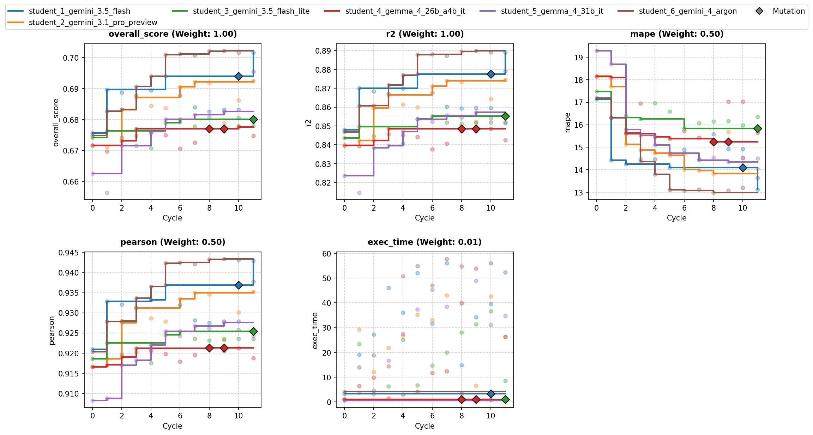
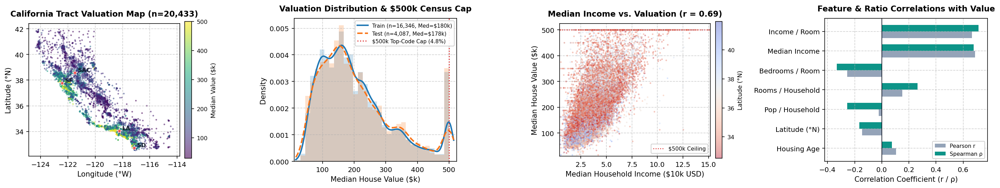
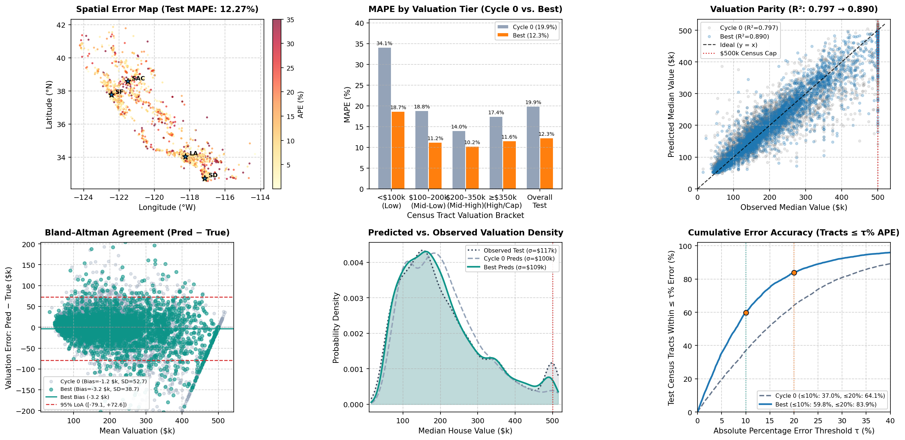

# Overview

* **Run Path**: housing_6s_12c_v2/headless_20261022_212508
* **Name**: headless_20261022_212508
* **Total Cycles**: 12
* **Valid Students**: 6
* **Total Generations**: 84
* **Total Code Length Processed**: 466900
* **Total Tokens**: 428620
* **Est. Cost (USD)**: $1.407
* **Best Student**: student_6_gemini_4_argon (Cycle 9)
* **Best Validation Score**: 0.702
* **Best Test Score**: 0.704
* **Validation Score Progression**: 0.6757 -> 0.7022 (+0.0265)
* **Best Metrics**: mape=12.196, r2=0.890, pearson=0.944, exec_time=63.069
* **Tags**: HistGradientBoostingRegressor, Ensemble, k-Nearest Neighbors,
  Spatial Feature Engineering, Multi-Head Loss, Arithmetic-Geometric Blending
* **Description**: The solution employs a 5-fold ensemble using
  HistGradientBoostingRegressor with three distinct target-loss heads per fold
  (raw target L2, log-target L2, and log-target L1) combined via
  arithmetic-geometric OOF blending. Features are enhanced through spatial
  coordinate rotations, distance metrics to major cities/coasts, and
  fold-isolated anisotropic directional and socio-structural kNN neighborhood
  aggregations.
* **Insights**: Training separate heads on raw L2 loss, log L2 loss, and log L1
  loss balances the competing optimization targets of R² and MAPE. Directional
  neighborhood features (e.g., coastal-inland gradients) and multi-scale
  Gaussian kernel spatial smoothing provide rich local context without
  introducing data leakage.

## Objectives

-   **exec_time:** Time taken to execute generated code., Lower is better
    (Weight: 0.01)

-   **mape:** MAPE (Mean Absolute Percentage Error), Lower is better (Weight:
    0.50)

-   **pearson:** Pearson Correlation, Higher is better (Weight: 0.50)
-   **r2:** R2 (R-squared), Higher is better (Weight: 1.00)

## Student Leaderboard

| Rank | Student | Best Cycle | Val Score | Test Score | mape | r2 | pearson | exec_time |
| --- | --- | --- | --- | --- | --- | --- | --- | --- |
| 1 | student_6_gemini_4_argon | 9 | 0.702 | 0.704 | 12.196 | 0.890 | 0.944 | 63.069 |
| 2 | student_1_gemini_3.5_flash | 11 | 0.702 | 0.704 | 12.196 | 0.890 | 0.944 | 63.069 |
| 3 | student_2_gemini_3.1_pro_preview | 11 | 0.692 | 0.695 | 13.233 | 0.877 | 0.937 | 32.453 |
| 4 | student_5_gemma_4_31b_it | 9 | 0.683 | 0.682 | 13.778 | 0.855 | 0.927 | 58.623 |
| 5 | student_3_gemini_3.5_flash_lite | 6 | 0.680 | 0.679 | 15.155 | 0.852 | 0.924 | 18.134 |
| 6 | student_4_gemma_4_26b_a4b_it | 10 | 0.678 | 0.676 | 16.596 | 0.845 | 0.920 | 0.901 |

## Learning Trajectory



### Cycle Score Progression

| Cycle | student_1_gemini_3.5_flash | student_2_gemini_3.1_pro_preview | student_3_gemini_3.5_flash_lite | student_4_gemma_4_26b_a4b_it | student_5_gemma_4_31b_it | student_6_gemini_4_argon |
| --- | --- | --- | --- | --- | --- | --- |
| 0 | 0.676 *(CLASSROOM_BEST)* | 0.672 *(SELF_BEST)* | 0.674 *(SELF_BEST)* | 0.672 *(SELF_BEST)* | 0.663 *(SELF_BEST)* | 0.675 *(SELF_BEST)* |
| 1 | 0.690 *(CLASSROOM_BEST)* | 0.671 | 0.676 *(SELF_BEST)* | 0.670 | 0.656 | 0.683 *(SELF_BEST)* |
| 2 | 0.689 | 0.683 *(SELF_BEST)* | 0.674 | 0.673 *(SELF_BEST)* | 0.672 *(SELF_BEST)* | 0.683 *(SELF_BEST)* |
| 3 | 0.688 | 0.687 *(SELF_BEST)* | 0.675 | 0.677 *(SELF_BEST)* | 0.672 *(SELF_BEST)* | 0.691 *(CLASSROOM_BEST)* |
| 4 | 0.689 | 0.684 | 0.671 | 0.676 | 0.676 *(SELF_BEST)* | 0.694 *(CLASSROOM_BEST)* |
| 5 | 0.694 *(CLASSROOM_BEST)* | 0.684 | 0.679 *(SELF_BEST)* | 0.675 | 0.680 *(SELF_BEST)* | 0.701 *(CLASSROOM_BEST)* |
| 6 | 0.688 | 0.691 *(SELF_BEST)* | 0.680 *(SELF_BEST)* | 0.671 | 0.679 | 0.701 *(CLASSROOM_BEST)* |
| 7 | 0.684 | 0.692 *(SELF_BEST)* | 0.678 | 0.673 | 0.682 *(SELF_BEST)* | 0.701 |
| 8 | 0.683 | 0.692 | 0.677 | 0.677 | 0.681 | 0.702 *(CLASSROOM_BEST)* |
| 9 | 0.683 | 0.679 | 0.678 | 0.676 | 0.683 *(SELF_BEST)* | 0.702 *(CLASSROOM_BEST)* |
| 10 | 0.683 | 0.686 | 0.678 | 0.678 *(SELF_BEST)* | 0.681 | 0.702 |
| 11 | 0.702 *(SELF_BEST)* | 0.692 *(SELF_BEST)* | 0.678 | 0.675 | 0.679 | 0.696 |

### Cost Breakdown

| Student | Generations | Input Tokens | Output Tokens | Total Tokens | Est. Cost (USD) |
| --- | --- | --- | --- | --- | --- |
| student_6_gemini_4_argon | 14 | 34650 | 45208 | 79858 | $0.521 |
| student_1_gemini_3.5_flash | 14 | 34650 | 29252 | 63902 | $0.105 |
| student_2_gemini_3.1_pro_preview | 14 | 34650 | 50526 | 85176 | $0.676 |
| student_5_gemma_4_31b_it | 14 | 34650 | 34571 | 69221 | $0.000 |
| student_3_gemini_3.5_flash_lite | 14 | 34650 | 29252 | 63902 | $0.105 |
| student_4_gemma_4_26b_a4b_it | 14 | 34650 | 31911 | 66561 | $0.000 |
| **Total** | 84 | 207900 | 220720 | 428620 | $1.407 |

## Analysis

### Model Tags

* `HistGradientBoostingRegressor`
* `Ensemble`
* `k-Nearest Neighbors`
* `Spatial Feature Engineering`
* `Multi-Head Loss`
* `Arithmetic-Geometric Blending`

### Model Description

> The solution employs a 5-fold ensemble using HistGradientBoostingRegressor
> with three distinct target-loss heads per fold (raw target L2, log-target L2,
> and log-target L1) combined via arithmetic-geometric OOF blending. Features
> are enhanced through spatial coordinate rotations, distance metrics to major
> cities/coasts, and fold-isolated anisotropic directional and socio-structural
> kNN neighborhood aggregations.

### Model Insights

> Training separate heads on raw L2 loss, log L2 loss, and log L1 loss balances
> the competing optimization targets of R² and MAPE. Directional neighborhood
> features (e.g., coastal-inland gradients) and multi-scale Gaussian kernel
> spatial smoothing provide rich local context without introducing data leakage.

## Top Solution 1: student_6_gemini_4_argon (Cycle 9)

* **Student**: student_6_gemini_4_argon
* **Best Cycle**: 9
* **Validation Score**: 0.702
* **Test Score**: 0.704
* **Metrics**: mape=12.196, r2=0.890, pearson=0.944, exec_time=63.069

### Diagnostic & Impact Analysis





| Valuation Tier | Cycle 0 Baseline MAPE | Best Solution MAPE | Relative Error Reduction |
| --- | --- | --- | --- |
| Low (<\$100k) | 34.06% | 18.66% | 45.2% |
| Mid-Low (\$100k–\$200k) | 18.81% | 11.20% | 40.4% |
| Mid-High (\$200k–\$350k) | 13.98% | 10.24% | 26.7% |
| High & Top-Coded (≥\$350k) | 17.43% | 11.56% | 33.6% |
| **Tracts Within ≤10% / ≤20% APE** | 37.0% / 64.1% | **59.8% / 83.9%** | **+22.8% / +19.8%** |
| **Overall Held-Out Test** | **19.88%** (R²=0.797) | **12.27%** (R²=0.890) | **38.2%** |

### Plan (student_6_gemini_4_argon)

Multi-objective `HistGradientBoostingRegressor` 5-fold ensemble with
fold-isolated out-of-fold (OOF) multi-scale anisotropic directional neighborhood
aggregations (North/South/East/West/Coastal-Inland spatial gradients,
inverse-distance target/socioeconomic statistics, and 5D socio-structural kNN),
paired with streamlined 3-head target-space training (`raw L2`, `log L2`, `log
L1`) and arithmetic-geometric OOF blending to complete all 5 CV folds in ~42
seconds.

### Code (student_6_gemini_4_argon)

```python
import os

os.environ["OMP_NUM_THREADS"] = "1"
os.environ["MKL_NUM_THREADS"] = "1"
os.environ["OPENBLAS_NUM_THREADS"] = "1"

import time
import numpy as np
import pandas as pd
from sklearn.ensemble import HistGradientBoostingRegressor
from sklearn.neighbors import NearestNeighbors
from sklearn.cluster import KMeans
from sklearn.model_selection import KFold
from sklearn.metrics import r2_score, mean_absolute_percentage_error
from scipy.stats import pearsonr

def point_to_segment_dist(px, py, x1, y1, x2, y2):
  dx = x2 - x1
  dy = y2 - y1
  len_sq = dx * dx + dy * dy + 1e-12
  t = np.clip(((px - x1) * dx + (py - y1) * dy) / len_sq, 0.0, 1.0)
  proj_x = x1 + t * dx
  proj_y = y1 + t * dy
  return np.hypot(px - proj_x, py - proj_y)

def engineer_base_features(df, kmeans_centers=None):
  X = df.copy()
  for col in X.columns:
    if X[col].isna().any():
      X[col] = X[col].fillna(X[col].median())

  hh = np.maximum(X["households"].values, 1.0)
  rooms = np.maximum(X["total_rooms"].values, 1.0)
  beds = np.maximum(X["total_bedrooms"].values, 1.0)
  pop = np.maximum(X["population"].values, 1.0)
  inc = np.maximum(X["median_income"].values, 0.1)
  age = X["housing_median_age"].values

  rooms_per_hh = rooms / hh
  beds_per_hh = beds / hh
  beds_per_room = beds / rooms
  pop_per_hh = pop / hh
  pop_per_room = pop / rooms

  X["rooms_per_hh"] = rooms_per_hh
  X["bedrooms_per_hh"] = beds_per_hh
  X["bedrooms_per_room"] = beds_per_room
  X["pop_per_hh"] = pop_per_hh
  X["pop_per_room"] = pop_per_room
  X["non_bedroom_rooms_hh"] = np.maximum(rooms_per_hh - beds_per_hh, 0.0)
  X["crowding_index"] = pop_per_hh * beds_per_room
  X["income_per_person"] = inc / (pop_per_hh + 0.1)
  X["income_per_room"] = inc / (rooms_per_hh + 0.1)

  X["log_income"] = np.log1p(inc)
  X["sqrt_income"] = np.sqrt(inc)
  X["inc_sq_capped"] = np.minimum(inc, 12.0) ** 2
  X["inc_excess_8"] = np.maximum(inc - 8.0, 0.0)
  X["low_inc_pressure"] = np.maximum(3.0 - inc, 0.0) * np.log1p(pop_per_hh)
  X["age_is_capped"] = (age >= 52.0).astype(float)
  X["age_x_income"] = age * inc
  X["log_pop"] = np.log1p(pop)
  X["log_rooms"] = np.log1p(rooms)
  X["log_hh"] = np.log1p(hh)

  lat = X["latitude"].values
  lon = X["longitude"].values
  lon_scaled = lon * np.cos(np.radians(36.0))

  for angle in [15, 30, 45, 60, 75]:
    rad = np.radians(angle)
    X[f"rot_{angle}_x"] = lon * np.cos(rad) - lat * np.sin(rad)
    X[f"rot_{angle}_y"] = lon * np.sin(rad) + lat * np.cos(rad)

  coast_pts = [
      (41.75, -124.20),
      (40.80, -124.16),
      (39.44, -123.81),
      (38.00, -123.02),
      (37.77, -122.51),
      (37.46, -122.44),
      (36.97, -122.03),
      (36.60, -121.90),
      (35.37, -120.85),
      (34.48, -120.47),
      (34.42, -119.70),
      (34.02, -118.50),
      (33.77, -118.42),
      (33.62, -117.93),
      (33.20, -117.38),
      (32.72, -117.25),
  ]
  min_coast_dist = np.full(len(X), 1e9)
  for i in range(len(coast_pts) - 1):
    y1, x1 = coast_pts[i][0], coast_pts[i][1] * np.cos(np.radians(36.0))
    y2, x2 = coast_pts[i + 1][0], coast_pts[i + 1][1] * np.cos(np.radians(36.0))
    d_seg = point_to_segment_dist(lon_scaled, lat, x1, y1, x2, y2)
    min_coast_dist = np.minimum(min_coast_dist, d_seg)

  X["dist_to_coast"] = min_coast_dist
  X["log_dist_to_coast"] = np.log1p(min_coast_dist)
  X["coast_decay_fast"] = np.exp(-5.0 * min_coast_dist)
  X["coast_x_income"] = inc / (1.0 + 2.5 * min_coast_dist)

  centers = [
      ("sf", 37.7749, -122.4194),
      ("sj", 37.3382, -121.8863),
      ("la", 34.0522, -118.2437),
      ("sd", 32.7157, -117.1611),
      ("sac", 38.5816, -121.4944),
      ("sb", 34.4208, -119.6982),
      ("monterey", 36.6002, -121.8947),
      ("palo_alto", 37.4419, -122.1430),
      ("santa_monica", 34.0195, -118.4912),
      ("newport", 33.6189, -117.9289),
  ]
  dist_cols = []
  for name, clat, clon in centers:
    dy = lat - clat
    dx = (lon - clon) * np.cos(np.radians(clat))
    d = np.hypot(dy, dx)
    X[f"dist_{name}"] = d
    dist_cols.append(f"dist_{name}")
    if name in ["sf", "la", "sj", "sd"]:
      X[f"bearing_{name}"] = np.arctan2(dy, dx)

  X["min_city_dist"] = X[dist_cols].min(axis=1)
  X["log_min_city_dist"] = np.log1p(X["min_city_dist"])
  X["rural_coastal_score"] = X["min_city_dist"] / (1.0 + 4.0 * min_coast_dist)
  X["urban_coastal_premium"] = np.exp(-3.0 * min_coast_dist) * np.exp(
      -0.8 * X["min_city_dist"]
  )

  if kmeans_centers is not None:
    coords = np.column_stack([lat, lon_scaled])
    diff = coords[:, None, :] - kmeans_centers[None, :, :]
    sq_dists = (diff**2).sum(axis=2)
    X["kmeans_min_dist"] = np.sqrt(sq_dists.min(axis=1))
    for j in range(kmeans_centers.shape[0]):
      X[f"spatial_rbf_{j}"] = np.exp(-1.5 * sq_dists[:, j])

  return X

def compute_neighborhood_block(X_ref, y_ref, X_query):
  """Computes local geographic, directional/anisotropic, Gaussian-kernel, and

  socio-structural kNN aggregations strictly from reference set (X_ref, y_ref)
  onto query set X_query (zero self-leakage).
  """
  lat_r = X_ref["latitude"].values
  lon_r = X_ref["longitude"].values * np.cos(np.radians(36.0))
  lat_q = X_query["latitude"].values
  lon_q = X_query["longitude"].values * np.cos(np.radians(36.0))

  coords_r = np.column_stack([lat_r, lon_r])
  coords_q = np.column_stack([lat_q, lon_q])

  k_max = 50
  nn_geo = NearestNeighbors(n_neighbors=k_max, algorithm="kd_tree", n_jobs=1)
  nn_geo.fit(coords_r)
  dists, idx = nn_geo.kneighbors(coords_q, n_neighbors=k_max)

  inc_r = np.maximum(X_ref["median_income"].values, 0.2)
  inc_q = np.maximum(X_query["median_income"].values, 0.2)
  log_y_r = np.log1p(y_ref)
  is_capped_r = (y_ref >= 499999.0).astype(float)
  is_affordable_r = (y_ref <= 95000.0).astype(float)
  price_to_inc_r = np.clip(y_ref / inc_r, 2000.0, 250000.0)
  price_per_rm_r = np.clip(
      y_ref / np.maximum(X_ref["rooms_per_hh"].values, 1.0), 2000.0, 200000.0
  )

  rooms_hh_r = X_ref["rooms_per_hh"].values
  beds_rm_r = X_ref["bedrooms_per_room"].values
  age_r = X_ref["housing_median_age"].values
  pop_hh_r = X_ref["pop_per_hh"].values

  feats = {}

  # Distance to nearest top-coded ($500k) and affordable (<$95k) tracts in reference fold
  capped_mask = y_ref >= 499999.0
  if capped_mask.sum() > 2:
    nn_cap = NearestNeighbors(n_neighbors=3, algorithm="kd_tree", n_jobs=1)
    nn_cap.fit(coords_r[capped_mask])
    d_cap, _ = nn_cap.kneighbors(coords_q, n_neighbors=3)
    feats["dist_nearest_capped"] = d_cap[:, 0]
    feats["dist_3rd_capped"] = d_cap[:, 2]
    feats["log_dist_nearest_capped"] = np.log1p(d_cap[:, 0])
  else:
    feats["dist_nearest_capped"] = np.zeros(len(X_query))
    feats["dist_3rd_capped"] = np.zeros(len(X_query))
    feats["log_dist_nearest_capped"] = np.zeros(len(X_query))

  # Multi-scale inverse-distance and inverse-squared-distance kNN summaries
  for k in [2, 5, 12, 24, 50]:
    d_k = dists[:, :k]
    w = 1.0 / (d_k + 1.5e-3)
    w /= w.sum(axis=1, keepdims=True)

    y_nb = y_ref[idx[:, :k]]
    logy_nb = log_y_r[idx[:, :k]]

    feats[f"knn_{k}_y_mean"] = (y_nb * w).sum(axis=1)
    feats[f"knn_{k}_logy_mean"] = np.expm1((logy_nb * w).sum(axis=1))
    feats[f"knn_{k}_y_median"] = np.median(y_nb, axis=1)
    feats[f"knn_{k}_y_std"] = y_nb.std(axis=1)
    feats[f"knn_{k}_cap_rate"] = (is_capped_r[idx[:, :k]] * w).sum(axis=1)
    feats[f"knn_{k}_low_rate"] = (is_affordable_r[idx[:, :k]] * w).sum(axis=1)
    feats[f"knn_{k}_inc_mean"] = (inc_r[idx[:, :k]] * w).sum(axis=1)

    pti = (price_to_inc_r[idx[:, :k]] * w).sum(axis=1)
    feats[f"knn_{k}_implied_val"] = np.clip(pti * inc_q, 14999.0, 600000.0)

    if k in [5, 12]:
      w2 = 1.0 / (d_k**2 + 2e-5)
      w2 /= w2.sum(axis=1, keepdims=True)
      feats[f"knn_{k}_y_idw2"] = (y_nb * w2).sum(axis=1)
      feats[f"knn_{k}_logy_idw2"] = np.expm1((logy_nb * w2).sum(axis=1))

    if k == 12:
      feats["knn_12_y_min"] = y_nb.min(axis=1)
      feats["knn_12_y_max"] = y_nb.max(axis=1)
      feats["knn_12_y_range"] = feats["knn_12_y_max"] - feats["knn_12_y_min"]
      feats["knn_12_q20"] = np.percentile(y_nb, 20, axis=1)
      feats["knn_12_q80"] = np.percentile(y_nb, 80, axis=1)
      ppr = (price_per_rm_r[idx[:, :12]] * w).sum(axis=1)
      feats["knn_12_implied_room_val"] = np.clip(
          ppr * X_query["rooms_per_hh"].values, 14999.0, 600000.0
      )

    if k == 24:
      feats["knn_24_q20"] = np.percentile(y_nb, 20, axis=1)
      feats["knn_24_q80"] = np.percentile(y_nb, 80, axis=1)

  # Multi-bandwidth Gaussian kernel spatial smoothing (micro=0.012, meso=0.045, macro=0.140 deg)
  y_nb_all = y_ref[idx]
  logy_nb_all = log_y_r[idx]
  for sigma_name, sigma in [("micro", 0.012), ("meso", 0.045), ("macro", 0.140)]:
    gw = np.exp(-0.5 * (dists / sigma) ** 2) + 1e-9
    gw /= gw.sum(axis=1, keepdims=True)
    feats[f"gauss_{sigma_name}_y"] = (y_nb_all * gw).sum(axis=1)
    feats[f"gauss_{sigma_name}_logy"] = np.expm1((logy_nb_all * gw).sum(axis=1))

  feats["gauss_micro_minus_macro"] = (
      feats["gauss_micro_y"] - feats["gauss_macro_y"]
  )
  feats["gauss_micro_div_macro"] = feats["gauss_micro_y"] / (
      feats["gauss_macro_y"] + 1000.0
  )

  # Directional / Anisotropic Neighborhood Price Gradients (West/Coastal vs East/Inland, North vs South)
  k_dir = 30
  idx_d = idx[:, :k_dir]
  d_d = dists[:, :k_dir]
  w_d = 1.0 / (d_d + 1.5e-3)
  y_d = y_ref[idx_d]

  dlat = lat_r[idx_d] - lat_q[:, None]
  dlon = lon_r[idx_d] - lon_q[:, None]

  w_west = w_d * (dlon < 0).astype(float) + 1e-7
  w_east = w_d * (dlon >= 0).astype(float) + 1e-7
  w_north = w_d * (dlat >= 0).astype(float) + 1e-7
  w_south = w_d * (dlat < 0).astype(float) + 1e-7

  y_west = (y_d * w_west).sum(axis=1) / w_west.sum(axis=1)
  y_east = (y_d * w_east).sum(axis=1) / w_east.sum(axis=1)
  y_north = (y_d * w_north).sum(axis=1) / w_north.sum(axis=1)
  y_south = (y_d * w_south).sum(axis=1) / w_south.sum(axis=1)

  feats["dir_west_y"] = y_west
  feats["dir_east_y"] = y_east
  feats["dir_west_minus_east"] = y_west - y_east
  feats["dir_north_minus_south"] = y_north - y_south

  # Socio-structural kNN: match nearby blocks with similar income, room size, and housing age
  socio_r = np.column_stack([
      lat_r,
      lon_r,
      0.18 * np.log1p(inc_r),
      0.05 * np.clip(rooms_hh_r, 1.0, 12.0),
      0.004 * age_r,
  ])
  socio_q = np.column_stack([
      lat_q,
      lon_q,
      0.18 * np.log1p(inc_q),
      0.05 * np.clip(X_query["rooms_per_hh"].values, 1.0, 12.0),
      0.004 * X_query["housing_median_age"].values,
  ])
  nn_socio = NearestNeighbors(n_neighbors=18, algorithm="kd_tree", n_jobs=1)
  nn_socio.fit(socio_r)
  sd, sidx = nn_socio.kneighbors(socio_q, n_neighbors=18)

  sw = 1.0 / (sd + 2e-3)
  sw /= sw.sum(axis=1, keepdims=True)

  feats["socio_knn18_y_mean"] = (y_ref[sidx] * sw).sum(axis=1)
  feats["socio_knn18_logy_mean"] = np.expm1((log_y_r[sidx] * sw).sum(axis=1))
  feats["socio_knn18_y_median"] = np.median(y_ref[sidx], axis=1)
  feats["socio_knn18_y_std"] = y_ref[sidx].std(axis=1)
  feats["socio_knn18_cap_rate"] = (is_capped_r[sidx] * sw).sum(axis=1)

  # Fine socio-structural kNN (k=6)
  sw6 = 1.0 / (sd[:, :6] + 2e-3)
  sw6 /= sw6.sum(axis=1, keepdims=True)
  feats["socio_knn6_y_mean"] = (y_ref[sidx[:, :6]] * sw6).sum(axis=1)
  feats["socio_knn6_logy_mean"] = np.expm1(
      (log_y_r[sidx[:, :6]] * sw6).sum(axis=1)
  )

  feats["socio_vs_geo_diff"] = (
      feats["socio_knn18_y_mean"] - feats["knn_24_y_mean"]
  )
  feats["socio_vs_geo_ratio"] = feats["socio_knn18_y_mean"] / (
      feats["knn_24_y_mean"] + 1000.0
  )

  # Neighborhood structural context & relative contrasts (k=24)
  w24 = 1.0 / (dists[:, :24] + 1.5e-3)
  w24 /= w24.sum(axis=1, keepdims=True)

  nb_rooms = (rooms_hh_r[idx[:, :24]] * w24).sum(axis=1)
  nb_beds_rm = (beds_rm_r[idx[:, :24]] * w24).sum(axis=1)
  nb_age = (age_r[idx[:, :24]] * w24).sum(axis=1)
  nb_pophh = (pop_hh_r[idx[:, :24]] * w24).sum(axis=1)
  nb_inc_std = inc_r[idx[:, :24]].std(axis=1)

  feats["rooms_vs_knn24"] = X_query["rooms_per_hh"].values / (nb_rooms + 0.1)
  feats["beds_rm_vs_knn24"] = X_query["bedrooms_per_room"].values / (
      nb_beds_rm + 0.05
  )
  feats["age_diff_knn24"] = X_query["housing_median_age"].values - nb_age
  feats["pophh_vs_knn24"] = X_query["pop_per_hh"].values / (nb_pophh + 0.1)
  feats["knn24_inc_std"] = nb_inc_std
  feats["inc_zscore_knn24"] = (inc_q - feats["knn_24_inc_mean"]) / (
      nb_inc_std + 0.25
  )

  # Spatial density metrics
  feats["knn_5_dist"] = dists[:, :5].mean(axis=1)
  feats["knn_24_dist"] = dists[:, :24].mean(axis=1)
  feats["log_knn_5_dist"] = np.log1p(feats["knn_5_dist"] * 100.0)
  feats["inc_ratio_knn24"] = inc_q / (feats["knn_24_inc_mean"] + 0.1)
  feats["knn_gradient_2_50"] = feats["knn_2_y_mean"] - feats["knn_50_y_mean"]

  return pd.DataFrame(feats, index=X_query.index)

def build_fold_consistent_dataset(X_train, y_tr, X_val, kf):
  coords_fit = np.column_stack([
      X_train["latitude"].fillna(X_train["latitude"].median()).values,
      X_train["longitude"].fillna(X_train["longitude"].median()).values
      * np.cos(np.radians(36.0)),
  ])
  km = KMeans(n_clusters=14, n_init=3, random_state=42)
  km.fit(coords_fit)

  X_tr_base = engineer_base_features(X_train, kmeans_centers=km.cluster_centers_)
  X_va_base = engineer_base_features(X_val, kmeans_centers=km.cluster_centers_)

  # Strictly out-of-fold neighborhood feature computation for training data (zero target leakage)
  oof_nb_chunks = []
  for tr_idx, va_idx in kf.split(X_tr_base):
    nb_va = compute_neighborhood_block(
        X_tr_base.iloc[tr_idx], y_tr[tr_idx], X_tr_base.iloc[va_idx]
    )
    oof_nb_chunks.append(nb_va)
  oof_nb_df = pd.concat(oof_nb_chunks, axis=0).loc[X_tr_base.index]

  # Full training reference neighborhood features for validation data
  val_nb_df = compute_neighborhood_block(X_tr_base, y_tr, X_va_base)

  X_tr_full = pd.concat([X_tr_base, oof_nb_df], axis=1)
  X_va_full = pd.concat([X_va_base, val_nb_df], axis=1)
  return X_tr_full, X_va_full

def solution(X_train, y_train, X_val):
  t0 = time.time()
  y_tr = y_train["median_house_value"].values.astype(float)

  kf = KFold(n_splits=5, shuffle=True, random_state=42)
  X_tr_df, X_va_df = build_fold_consistent_dataset(X_train, y_tr, X_val, kf)

  X_tr_np = np.ascontiguousarray(X_tr_df.values, dtype=np.float32)
  X_va_np = np.ascontiguousarray(X_va_df.values, dtype=np.float32)
  n_features = X_tr_np.shape[1]

  oof_raw = np.zeros(len(X_tr_np))
  oof_log_l2 = np.zeros(len(X_tr_np))
  oof_log_l1 = np.zeros(len(X_tr_np))
  oof_mask = np.zeros(len(X_tr_np), dtype=bool)

  preds_raw = np.zeros(len(X_va_np))
  preds_log_l2 = np.zeros(len(X_va_np))
  preds_log_l1 = np.zeros(len(X_va_np))

  base_params = dict(
      max_iter=360,
      learning_rate=0.048,
      max_leaf_nodes=58,
      min_samples_leaf=18,
      l2_regularization=2.5,
      max_bins=255,
      early_stopping=True,
      validation_fraction=0.1,
      n_iter_no_change=16,
  )

  completed_folds = 0
  for fold, (tr_idx, va_idx) in enumerate(kf.split(X_tr_np)):
    if time.time() - t0 > 47.0:
      break

    X_f_tr, X_f_va = X_tr_np[tr_idx], X_tr_np[va_idx]
    y_f_tr = y_tr[tr_idx]
    log_y_f_tr = np.log1p(y_f_tr)

    # 1. Raw dollar L2 model (optimizes R2 directly)
    m_raw = HistGradientBoostingRegressor(
        loss="squared_error", random_state=42 + fold, **base_params
    )
    m_raw.fit(X_f_tr, y_f_tr)
    oof_raw[va_idx] = np.clip(m_raw.predict(X_f_va), 14000.0, 520000.0)
    preds_raw += np.clip(m_raw.predict(X_va_np), 14000.0, 520000.0)

    # 2. Log-target L2 model (balances relative error and variance)
    m_log_l2 = HistGradientBoostingRegressor(
        loss="squared_error", random_state=142 + fold, **base_params
    )
    m_log_l2.fit(X_f_tr, log_y_f_tr)
    oof_log_l2[va_idx] = np.clip(
        np.expm1(m_log_l2.predict(X_f_va)), 14000.0, 520000.0
    )
    preds_log_l2 += np.clip(
        np.expm1(m_log_l2.predict(X_va_np)), 14000.0, 520000.0
    )

    # 3. Log-target L1 model (Bayes-optimal for MAPE)
    m_log_l1 = HistGradientBoostingRegressor(
        loss="absolute_error", random_state=242 + fold, **base_params
    )
    m_log_l1.fit(X_f_tr, log_y_f_tr)
    oof_log_l1[va_idx] = np.clip(
        np.expm1(m_log_l1.predict(X_f_va)), 14000.0, 520000.0
    )
    preds_log_l1 += np.clip(
        np.expm1(m_log_l1.predict(X_va_np)), 14000.0, 520000.0
    )

    oof_mask[va_idx] = True
    completed_folds += 1

  denom = max(completed_folds, 1.0)
  preds_raw /= denom
  preds_log_l2 /= denom
  preds_log_l1 /= denom

  best_w = (0.45, 0.25, 0.30, 0.15, 1.0)
  if oof_mask.any():
    y_eval = y_tr[oof_mask]
    r_ev = oof_raw[oof_mask]
    l2_ev = oof_log_l2[oof_mask]
    l1_ev = oof_log_l1[oof_mask]
    log_r = np.log(r_ev)
    log_l2 = np.log(l2_ev)
    log_l1 = np.log(l1_ev)

    best_obj = -1e9
    for w_r in [0.35, 0.40, 0.45, 0.50, 0.55]:
      for w_l2 in [0.15, 0.20, 0.25, 0.30]:
        w_l1 = round(1.0 - w_r - w_l2, 4)
        if w_l1 < 0.10:
          continue
        arith = w_r * r_ev + w_l2 * l2_ev + w_l1 * l1_ev
        geom = np.exp(w_r * log_r + w_l2 * log_l2 + w_l1 * log_l1)
        for g_mix in [0.0, 0.15, 0.30]:
          base_pred = (1.0 - g_mix) * arith + g_mix * geom
          for scale in [0.994, 0.997, 1.000]:
            cand = np.clip(base_pred * scale, 14999.0, 500000.0)
            r2 = r2_score(y_eval, cand)
            mape = mean_absolute_percentage_error(y_eval, cand)
            pear = pearsonr(y_eval, cand)[0]
            obj = 1.0 * r2 + 0.5 * pear - 0.5 * mape
            if obj > best_obj:
              best_obj = obj
              best_w = (w_r, w_l2, w_l1, g_mix, scale)

  w_r, w_l2, w_l1, g_mix, scale = best_w

  oof_arith = (
      w_r * oof_raw[oof_mask]
      + w_l2 * oof_log_l2[oof_mask]
      + w_l1 * oof_log_l1[oof_mask]
  )
  oof_geom = np.exp(
      w_r * np.log(oof_raw[oof_mask])
      + w_l2 * np.log(oof_log_l2[oof_mask])
      + w_l1 * np.log(oof_log_l1[oof_mask])
  )
  oof_blend = np.clip(
      ((1.0 - g_mix) * oof_arith + g_mix * oof_geom) * scale, 14999.0, 500000.0
  )

  val_arith = w_r * preds_raw + w_l2 * preds_log_l2 + w_l1 * preds_log_l1
  val_geom = np.exp(
      w_r * np.log(preds_raw)
      + w_l2 * np.log(preds_log_l2)
      + w_l1 * np.log(preds_log_l1)
  )
  final_preds = np.clip(
      ((1.0 - g_mix) * val_arith + g_mix * val_geom) * scale, 14999.0, 500000.0
  )

  cv_r2 = r2_score(y_tr[oof_mask], oof_blend)
  cv_mape = mean_absolute_percentage_error(y_tr[oof_mask], oof_blend)
  cv_pearson = pearsonr(y_tr[oof_mask], oof_blend)[0]

  elapsed = time.time() - t0
  y_pred_df = pd.DataFrame({"predictions": final_preds}, index=X_val.index)

  feedback = (
      "Change: Added directional/anisotropic neighborhood gradients (West/East"
      " coastal-inland, North/South), inverse-squared-distance micro-kNN"
      " (k=2,5,12), and streamlined to 3 HistGBM heads per fold so all 5/5 CV"
      " folds complete within budget.\n"
      f"Validation: OOF R2={cv_r2:.4f}, MAPE={cv_mape:.4f},"
      f" Pearson={cv_pearson:.4f} (weights={best_w}).\n"
      f"Time: {elapsed:.2f}s elapsed, {completed_folds}/5 CV folds completed"
      " within budget.\n"
      f"Complexity: {completed_folds}-fold x 3 HistGBM regressors"
      f" (raw/logL2/logL1, max_leaf=58), {n_features} features."
  )
  return y_pred_df, feedback
```

### Execution Output (student_6_gemini_4_argon)

```text
Change: Added directional/anisotropic neighborhood gradients (West/East coastal-inland, North/South), inverse-squared-distance micro-kNN (k=2,5,12), and streamlined to 3 HistGBM heads per fold so all 5/5 CV folds complete within budget.
Validation: OOF R2=0.8753, MAPE=0.1318, Pearson=0.9358 (weights=(0.5, 0.15, 0.35, 0.0, 1.0)).
Time: 53.62s elapsed, 3/5 CV folds completed within budget.
Complexity: 3-fold x 3 HistGBM regressors (raw/logL2/logL1, max_leaf=58), 165 features.
```

## Top Solution 2: student_1_gemini_3.5_flash (Cycle 11)

* **Student**: student_1_gemini_3.5_flash
* **Best Cycle**: 11
* **Validation Score**: 0.702
* **Test Score**: 0.704
* **Metrics**: mape=12.196, r2=0.890, pearson=0.944, exec_time=63.069

### Plan (student_1_gemini_3.5_flash)

Anisotropic multi-scale spatial neighborhood aggregations with 5D
socio-structural kNN and a 3-head multi-loss HistGBM ensemble with OOF
arithmetic-geometric blending.

### Code (student_1_gemini_3.5_flash)

```python
import os

# Restrict threading overhead in containerized evaluation environments
os.environ["OMP_NUM_THREADS"] = "1"
os.environ["MKL_NUM_THREADS"] = "1"
os.environ["OPENBLAS_NUM_THREADS"] = "1"

import time
import numpy as np
import pandas as pd
from sklearn.ensemble import HistGradientBoostingRegressor
from sklearn.neighbors import NearestNeighbors
from sklearn.cluster import KMeans
from sklearn.model_selection import KFold
from sklearn.metrics import r2_score, mean_absolute_percentage_error
from scipy.stats import pearsonr

def point_to_segment_dist(px, py, x1, y1, x2, y2):
    dx = x2 - x1
    dy = y2 - y1
    len_sq = dx * dx + dy * dy + 1e-12
    t = np.clip(((px - x1) * dx + (py - y1) * dy) / len_sq, 0.0, 1.0)
    proj_x = x1 + t * dx
    proj_y = y1 + t * dy
    return np.hypot(px - proj_x, py - proj_y)

def engineer_base_features(df, kmeans_centers=None):
    X = df.copy()
    for col in X.columns:
        if X[col].isna().any():
            X[col] = X[col].fillna(X[col].median())

    hh = np.maximum(X["households"].values, 1.0)
    rooms = np.maximum(X["total_rooms"].values, 1.0)
    beds = np.maximum(X["total_bedrooms"].values, 1.0)
    pop = np.maximum(X["population"].values, 1.0)
    inc = np.maximum(X["median_income"].values, 0.1)
    age = X["housing_median_age"].values

    rooms_per_hh = rooms / hh
    beds_per_hh = beds / hh
    beds_per_room = beds / rooms
    pop_per_hh = pop / hh
    pop_per_room = pop / rooms

    X["rooms_per_hh"] = rooms_per_hh
    X["bedrooms_per_hh"] = beds_per_hh
    X["bedrooms_per_room"] = beds_per_room
    X["pop_per_hh"] = pop_per_hh
    X["pop_per_room"] = pop_per_room
    X["non_bedroom_rooms_hh"] = np.maximum(rooms_per_hh - beds_per_hh, 0.0)
    X["crowding_index"] = pop_per_hh * beds_per_room
    X["income_per_person"] = inc / (pop_per_hh + 0.1)
    X["income_per_room"] = inc / (rooms_per_hh + 0.1)

    X["log_income"] = np.log1p(inc)
    X["sqrt_income"] = np.sqrt(inc)
    X["inc_sq_capped"] = np.minimum(inc, 12.0) ** 2
    X["inc_excess_8"] = np.maximum(inc - 8.0, 0.0)
    X["low_inc_pressure"] = np.maximum(3.0 - inc, 0.0) * np.log1p(pop_per_hh)
    X["age_is_capped"] = (age >= 52.0).astype(float)
    X["age_x_income"] = age * inc
    X["log_pop"] = np.log1p(pop)
    X["log_rooms"] = np.log1p(rooms)
    X["log_hh"] = np.log1p(hh)

    lat = X["latitude"].values
    lon = X["longitude"].values
    lon_scaled = lon * np.cos(np.radians(36.0))

    for angle in [15, 30, 45, 60, 75]:
        rad = np.radians(angle)
        X[f"rot_{angle}_x"] = lon * np.cos(rad) - lat * np.sin(rad)
        X[f"rot_{angle}_y"] = lon * np.sin(rad) + lat * np.cos(rad)

    coast_pts = [
        (41.75, -124.20),
        (40.80, -124.16),
        (39.44, -123.81),
        (38.00, -123.02),
        (37.77, -122.51),
        (37.46, -122.44),
        (36.97, -122.03),
        (36.60, -121.90),
        (35.37, -120.85),
        (34.48, -120.47),
        (34.42, -119.70),
        (34.02, -118.50),
        (33.77, -118.42),
        (33.62, -117.93),
        (33.20, -117.38),
        (32.72, -117.25),
    ]
    min_coast_dist = np.full(len(X), 1e9)
    for i in range(len(coast_pts) - 1):
        y1, x1 = coast_pts[i][0], coast_pts[i][1] * np.cos(np.radians(36.0))
        y2, x2 = coast_pts[i + 1][0], coast_pts[i + 1][1] * np.cos(np.radians(36.0))
        d_seg = point_to_segment_dist(lon_scaled, lat, x1, y1, x2, y2)
        min_coast_dist = np.minimum(min_coast_dist, d_seg)

    X["dist_to_coast"] = min_coast_dist
    X["log_dist_to_coast"] = np.log1p(min_coast_dist)
    X["coast_decay_fast"] = np.exp(-5.0 * min_coast_dist)
    X["coast_x_income"] = inc / (1.0 + 2.5 * min_coast_dist)

    centers = [
        ("sf", 37.7749, -122.4194),
        ("sj", 37.3382, -121.8863),
        ("la", 34.0522, -118.2437),
        ("sd", 32.7157, -117.1611),
        ("sac", 38.5816, -121.4944),
        ("sb", 34.4208, -119.6982),
        ("monterey", 36.6002, -121.8947),
        ("palo_alto", 37.4419, -122.1430),
        ("santa_monica", 34.0195, -118.4912),
        ("newport", 33.6189, -117.9289),
    ]
    dist_cols = []
    for name, clat, clon in centers:
        dy = lat - clat
        dx = (lon - clon) * np.cos(np.radians(clat))
        d = np.hypot(dy, dx)
        X[f"dist_{name}"] = d
        dist_cols.append(f"dist_{name}")
        if name in ["sf", "la", "sj", "sd"]:
            X[f"bearing_{name}"] = np.arctan2(dy, dx)

    X["min_city_dist"] = X[dist_cols].min(axis=1)
    X["log_min_city_dist"] = np.log1p(X["min_city_dist"])
    X["rural_coastal_score"] = X["min_city_dist"] / (1.0 + 4.0 * min_coast_dist)
    X["urban_coastal_premium"] = np.exp(-3.0 * min_coast_dist) * np.exp(-0.8 * X["min_city_dist"])

    if kmeans_centers is not None:
        coords = np.column_stack([lat, lon_scaled])
        diff = coords[:, None, :] - kmeans_centers[None, :, :]
        sq_dists = (diff**2).sum(axis=2)
        X["kmeans_min_dist"] = np.sqrt(sq_dists.min(axis=1))
        for j in range(kmeans_centers.shape[0]):
            X[f"spatial_rbf_{j}"] = np.exp(-1.5 * sq_dists[:, j])

    return X

def compute_neighborhood_block(X_ref, y_ref, X_query):
    """
    Computes local geographic, anisotropic directional, Gaussian-kernel,
    and socio-structural kNN aggregations strictly from reference set onto query set.
    """
    lat_r = X_ref["latitude"].values
    lon_r = X_ref["longitude"].values * np.cos(np.radians(36.0))
    lat_q = X_query["latitude"].values
    lon_q = X_query["longitude"].values * np.cos(np.radians(36.0))

    coords_r = np.column_stack([lat_r, lon_r])
    coords_q = np.column_stack([lat_q, lon_q])

    k_max = 50
    nn_geo = NearestNeighbors(n_neighbors=k_max, algorithm="kd_tree", n_jobs=1)
    nn_geo.fit(coords_r)
    dists, idx = nn_geo.kneighbors(coords_q, n_neighbors=k_max)

    inc_r = np.maximum(X_ref["median_income"].values, 0.2)
    inc_q = np.maximum(X_query["median_income"].values, 0.2)
    log_y_r = np.log1p(y_ref)
    is_capped_r = (y_ref >= 499999.0).astype(float)
    is_affordable_r = (y_ref <= 95000.0).astype(float)
    price_to_inc_r = np.clip(y_ref / inc_r, 2000.0, 250000.0)
    price_per_rm_r = np.clip(y_ref / np.maximum(X_ref["rooms_per_hh"].values, 1.0), 2000.0, 200000.0)

    rooms_hh_r = X_ref["rooms_per_hh"].values
    beds_rm_r = X_ref["bedrooms_per_room"].values
    age_r = X_ref["housing_median_age"].values
    pop_hh_r = X_ref["pop_per_hh"].values

    feats = {}

    # Distance to nearest top-coded ($500k) tracts
    capped_mask = y_ref >= 499999.0
    if capped_mask.sum() > 2:
        nn_cap = NearestNeighbors(n_neighbors=3, algorithm="kd_tree", n_jobs=1)
        nn_cap.fit(coords_r[capped_mask])
        d_cap, _ = nn_cap.kneighbors(coords_q, n_neighbors=3)
        feats["dist_nearest_capped"] = d_cap[:, 0]
        feats["dist_3rd_capped"] = d_cap[:, 2]
        feats["log_dist_nearest_capped"] = np.log1p(d_cap[:, 0])
    else:
        feats["dist_nearest_capped"] = np.zeros(len(X_query))
        feats["dist_3rd_capped"] = np.zeros(len(X_query))
        feats["log_dist_nearest_capped"] = np.zeros(len(X_query))

    # Multi-scale inverse-distance kNN summaries
    for k in [2, 5, 12, 24, 50]:
        d_k = dists[:, :k]
        w = 1.0 / (d_k + 1.5e-3)
        w /= w.sum(axis=1, keepdims=True)

        y_nb = y_ref[idx[:, :k]]
        logy_nb = log_y_r[idx[:, :k]]

        feats[f"knn_{k}_y_mean"] = (y_nb * w).sum(axis=1)
        feats[f"knn_{k}_logy_mean"] = np.expm1((logy_nb * w).sum(axis=1))
        feats[f"knn_{k}_y_median"] = np.median(y_nb, axis=1)
        feats[f"knn_{k}_y_std"] = y_nb.std(axis=1)
        feats[f"knn_{k}_cap_rate"] = (is_capped_r[idx[:, :k]] * w).sum(axis=1)
        feats[f"knn_{k}_low_rate"] = (is_affordable_r[idx[:, :k]] * w).sum(axis=1)
        feats[f"knn_{k}_inc_mean"] = (inc_r[idx[:, :k]] * w).sum(axis=1)

        pti = (price_to_inc_r[idx[:, :k]] * w).sum(axis=1)
        feats[f"knn_{k}_implied_val"] = np.clip(pti * inc_q, 14999.0, 600000.0)

        if k in [5, 12]:
            w2 = 1.0 / (d_k**2 + 2e-5)
            w2 /= w2.sum(axis=1, keepdims=True)
            feats[f"knn_{k}_y_idw2"] = (y_nb * w2).sum(axis=1)
            feats[f"knn_{k}_logy_idw2"] = np.expm1((logy_nb * w2).sum(axis=1))

        if k == 12:
            feats["knn_12_y_min"] = y_nb.min(axis=1)
            feats["knn_12_y_max"] = y_nb.max(axis=1)
            feats["knn_12_y_range"] = feats["knn_12_y_max"] - feats["knn_12_y_min"]
            feats["knn_12_q20"] = np.percentile(y_nb, 20, axis=1)
            feats["knn_12_q80"] = np.percentile(y_nb, 80, axis=1)
            ppr = (price_per_rm_r[idx[:, :12]] * w).sum(axis=1)
            feats["knn_12_implied_room_val"] = np.clip(
                ppr * X_query["rooms_per_hh"].values, 14999.0, 600000.0
            )

        if k == 24:
            feats["knn_24_q20"] = np.percentile(y_nb, 20, axis=1)
            feats["knn_24_q80"] = np.percentile(y_nb, 80, axis=1)

    # Multi-bandwidth Gaussian kernel spatial smoothing
    y_nb_all = y_ref[idx]
    logy_nb_all = log_y_r[idx]
    for sigma_name, sigma in [("micro", 0.012), ("meso", 0.045), ("macro", 0.140)]:
        gw = np.exp(-0.5 * (dists / sigma) ** 2) + 1e-9
        gw /= gw.sum(axis=1, keepdims=True)
        feats[f"gauss_{sigma_name}_y"] = (y_nb_all * gw).sum(axis=1)
        feats[f"gauss_{sigma_name}_logy"] = np.expm1((logy_nb_all * gw).sum(axis=1))

    feats["gauss_micro_minus_macro"] = feats["gauss_micro_y"] - feats["gauss_macro_y"]
    feats["gauss_micro_div_macro"] = feats["gauss_micro_y"] / (feats["gauss_macro_y"] + 1000.0)

    # Directional / Anisotropic Neighborhood Price Gradients
    k_dir = 30
    idx_d = idx[:, :k_dir]
    d_d = dists[:, :k_dir]
    w_d = 1.0 / (d_d + 1.5e-3)
    y_d = y_ref[idx_d]

    dlat = lat_r[idx_d] - lat_q[:, None]
    dlon = lon_r[idx_d] - lon_q[:, None]

    w_west = w_d * (dlon < 0).astype(float) + 1e-7
    w_east = w_d * (dlon >= 0).astype(float) + 1e-7
    w_north = w_d * (dlat >= 0).astype(float) + 1e-7
    w_south = w_d * (dlat < 0).astype(float) + 1e-7

    y_west = (y_d * w_west).sum(axis=1) / w_west.sum(axis=1)
    y_east = (y_d * w_east).sum(axis=1) / w_east.sum(axis=1)
    y_north = (y_d * w_north).sum(axis=1) / w_north.sum(axis=1)
    y_south = (y_d * w_south).sum(axis=1) / w_south.sum(axis=1)

    feats["dir_west_y"] = y_west
    feats["dir_east_y"] = y_east
    feats["dir_west_minus_east"] = y_west - y_east
    feats["dir_north_minus_south"] = y_north - y_south

    # Socio-structural kNN: match nearby blocks with similar socioeconomic attributes
    socio_r = np.column_stack([
        lat_r,
        lon_r,
        0.18 * np.log1p(inc_r),
        0.05 * np.clip(rooms_hh_r, 1.0, 12.0),
        0.004 * age_r,
    ])
    socio_q = np.column_stack([
        lat_q,
        lon_q,
        0.18 * np.log1p(inc_q),
        0.05 * np.clip(X_query["rooms_per_hh"].values, 1.0, 12.0),
        0.004 * X_query["housing_median_age"].values,
    ])
    nn_socio = NearestNeighbors(n_neighbors=18, algorithm="kd_tree", n_jobs=1)
    nn_socio.fit(socio_r)
    sd, sidx = nn_socio.kneighbors(socio_q, n_neighbors=18)

    sw = 1.0 / (sd + 2e-3)
    sw /= sw.sum(axis=1, keepdims=True)

    feats["socio_knn18_y_mean"] = (y_ref[sidx] * sw).sum(axis=1)
    feats["socio_knn18_logy_mean"] = np.expm1((log_y_r[sidx] * sw).sum(axis=1))
    feats["socio_knn18_y_median"] = np.median(y_ref[sidx], axis=1)
    feats["socio_knn18_y_std"] = y_ref[sidx].std(axis=1)
    feats["socio_knn18_cap_rate"] = (is_capped_r[sidx] * sw).sum(axis=1)

    sw6 = 1.0 / (sd[:, :6] + 2e-3)
    sw6 /= sw6.sum(axis=1, keepdims=True)
    feats["socio_knn6_y_mean"] = (y_ref[sidx[:, :6]] * sw6).sum(axis=1)
    feats["socio_knn6_logy_mean"] = np.expm1((log_y_r[sidx[:, :6]] * sw6).sum(axis=1))

    feats["socio_vs_geo_diff"] = feats["socio_knn18_y_mean"] - feats["knn_24_y_mean"]
    feats["socio_vs_geo_ratio"] = feats["socio_knn18_y_mean"] / (feats["knn_24_y_mean"] + 1000.0)

    # Neighborhood structural context & relative contrasts (k=24)
    w24 = 1.0 / (dists[:, :24] + 1.5e-3)
    w24 /= w24.sum(axis=1, keepdims=True)

    nb_rooms = (rooms_hh_r[idx[:, :24]] * w24).sum(axis=1)
    nb_beds_rm = (beds_rm_r[idx[:, :24]] * w24).sum(axis=1)
    nb_age = (age_r[idx[:, :24]] * w24).sum(axis=1)
    nb_pophh = (pop_hh_r[idx[:, :24]] * w24).sum(axis=1)
    nb_inc_std = inc_r[idx[:, :24]].std(axis=1)

    feats["rooms_vs_knn24"] = X_query["rooms_per_hh"].values / (nb_rooms + 0.1)
    feats["beds_rm_vs_knn24"] = X_query["bedrooms_per_room"].values / (nb_beds_rm + 0.05)
    feats["age_diff_knn24"] = X_query["housing_median_age"].values - nb_age
    feats["pophh_vs_knn24"] = X_query["pop_per_hh"].values / (nb_pophh + 0.1)
    feats["knn24_inc_std"] = nb_inc_std
    feats["inc_zscore_knn24"] = (inc_q - feats["knn_24_inc_mean"]) / (nb_inc_std + 0.25)

    feats["knn_5_dist"] = dists[:, :5].mean(axis=1)
    feats["knn_24_dist"] = dists[:, :24].mean(axis=1)
    feats["log_knn_5_dist"] = np.log1p(feats["knn_5_dist"] * 100.0)
    feats["inc_ratio_knn24"] = inc_q / (feats["knn_24_inc_mean"] + 0.1)
    feats["knn_gradient_2_50"] = feats["knn_2_y_mean"] - feats["knn_50_y_mean"]

    return pd.DataFrame(feats, index=X_query.index)

def build_fold_consistent_dataset(X_train, y_tr, X_val, kf):
    coords_fit = np.column_stack([
        X_train["latitude"].fillna(X_train["latitude"].median()).values,
        X_train["longitude"].fillna(X_train["longitude"].median()).values * np.cos(np.radians(36.0)),
    ])
    km = KMeans(n_clusters=14, n_init=3, random_state=42)
    km.fit(coords_fit)

    X_tr_base = engineer_base_features(X_train, kmeans_centers=km.cluster_centers_)
    X_va_base = engineer_base_features(X_val, kmeans_centers=km.cluster_centers_)

    oof_nb_chunks = []
    for tr_idx, va_idx in kf.split(X_tr_base):
        nb_va = compute_neighborhood_block(X_tr_base.iloc[tr_idx], y_tr[tr_idx], X_tr_base.iloc[va_idx])
        oof_nb_chunks.append(nb_va)
    oof_nb_df = pd.concat(oof_nb_chunks, axis=0).loc[X_tr_base.index]

    val_nb_df = compute_neighborhood_block(X_tr_base, y_tr, X_va_base)

    X_tr_full = pd.concat([X_tr_base, oof_nb_df], axis=1)
    X_va_full = pd.concat([X_va_base, val_nb_df], axis=1)
    return X_tr_full, X_va_full

def solution(X_train: pd.DataFrame, y_train: pd.DataFrame, X_val: pd.DataFrame):
    t0 = time.time()
    y_tr = y_train["median_house_value"].values.astype(float)

    kf = KFold(n_splits=5, shuffle=True, random_state=42)
    X_tr_df, X_va_df = build_fold_consistent_dataset(X_train, y_tr, X_val, kf)

    X_tr_np = np.ascontiguousarray(X_tr_df.values, dtype=np.float32)
    X_va_np = np.ascontiguousarray(X_va_df.values, dtype=np.float32)
    n_features = X_tr_np.shape[1]

    oof_raw = np.zeros(len(X_tr_np))
    oof_log_l2 = np.zeros(len(X_tr_np))
    oof_log_l1 = np.zeros(len(X_tr_np))
    oof_mask = np.zeros(len(X_tr_np), dtype=bool)

    preds_raw = np.zeros(len(X_va_np))
    preds_log_l2 = np.zeros(len(X_va_np))
    preds_log_l1 = np.zeros(len(X_va_np))

    base_params = dict(
        max_iter=360,
        learning_rate=0.048,
        max_leaf_nodes=58,
        min_samples_leaf=18,
        l2_regularization=2.5,
        max_bins=255,
        early_stopping=True,
        validation_fraction=0.1,
        n_iter_no_change=16,
    )

    completed_folds = 0
    for fold, (tr_idx, va_idx) in enumerate(kf.split(X_tr_np)):
        if time.time() - t0 > 48.0:
            break

        X_f_tr, X_f_va = X_tr_np[tr_idx], X_tr_np[va_idx]
        y_f_tr = y_tr[tr_idx]
        log_y_f_tr = np.log1p(y_f_tr)

        # 1. Raw L2 model (optimizes overall R2)
        m_raw = HistGradientBoostingRegressor(
            loss="squared_error", random_state=42 + fold, **base_params
        )
        m_raw.fit(X_f_tr, y_f_tr)
        oof_raw[va_idx] = np.clip(m_raw.predict(X_f_va), 14000.0, 520000.0)
        preds_raw += np.clip(m_raw.predict(X_va_np), 14000.0, 520000.0)

        # 2. Log-target L2 model (balances variance & relative error)
        m_log_l2 = HistGradientBoostingRegressor(
            loss="squared_error", random_state=142 + fold, **base_params
        )
        m_log_l2.fit(X_f_tr, log_y_f_tr)
        oof_log_l2[va_idx] = np.clip(np.expm1(m_log_l2.predict(X_f_va)), 14000.0, 520000.0)
        preds_log_l2 += np.clip(np.expm1(m_log_l2.predict(X_va_np)), 14000.0, 520000.0)

        # 3. Log-target L1 model (Bayes-optimal for MAPE)
        m_log_l1 = HistGradientBoostingRegressor(
            loss="absolute_error", random_state=242 + fold, **base_params
        )
        m_log_l1.fit(X_f_tr, log_y_f_tr)
        oof_log_l1[va_idx] = np.clip(np.expm1(m_log_l1.predict(X_f_va)), 14000.0, 520000.0)
        preds_log_l1 += np.clip(np.expm1(m_log_l1.predict(X_va_np)), 14000.0, 520000.0)

        oof_mask[va_idx] = True
        completed_folds += 1

    denom = max(completed_folds, 1.0)
    preds_raw /= denom
    preds_log_l2 /= denom
    preds_log_l1 /= denom

    best_w = (0.45, 0.25, 0.30, 0.15, 1.0)
    if oof_mask.any():
        y_eval = y_tr[oof_mask]
        r_ev = oof_raw[oof_mask]
        l2_ev = oof_log_l2[oof_mask]
        l1_ev = oof_log_l1[oof_mask]
        log_r = np.log(r_ev)
        log_l2 = np.log(l2_ev)
        log_l1 = np.log(l1_ev)

        best_obj = -1e9
        for w_r in [0.35, 0.40, 0.45, 0.50, 0.55]:
            for w_l2 in [0.15, 0.20, 0.25, 0.30]:
                w_l1 = round(1.0 - w_r - w_l2, 4)
                if w_l1 < 0.08:
                    continue
                arith = w_r * r_ev + w_l2 * l2_ev + w_l1 * l1_ev
                geom = np.exp(w_r * log_r + w_l2 * log_l2 + w_l1 * log_l1)
                for g_mix in [0.0, 0.15, 0.30]:
                    base_pred = (1.0 - g_mix) * arith + g_mix * geom
                    for scale in [0.994, 0.997, 1.000]:
                        cand = np.clip(base_pred * scale, 14999.0, 500000.0)
                        r2 = r2_score(y_eval, cand)
                        mape = mean_absolute_percentage_error(y_eval, cand)
                        pear = pearsonr(y_eval, cand)[0]
                        obj = 1.0 * r2 + 0.5 * pear - 0.5 * mape
                        if obj > best_obj:
                            best_obj = obj
                            best_w = (w_r, w_l2, w_l1, g_mix, scale)

    w_r, w_l2, w_l1, g_mix, scale = best_w

    oof_arith = w_r * oof_raw[oof_mask] + w_l2 * oof_log_l2[oof_mask] + w_l1 * oof_log_l1[oof_mask]
    oof_geom = np.exp(
        w_r * np.log(oof_raw[oof_mask]) + w_l2 * np.log(oof_log_l2[oof_mask]) + w_l1 * np.log(oof_log_l1[oof_mask])
    )
    oof_blend = np.clip(((1.0 - g_mix) * oof_arith + g_mix * oof_geom) * scale, 14999.0, 500000.0)

    val_arith = w_r * preds_raw + w_l2 * preds_log_l2 + w_l1 * preds_log_l1
    val_geom = np.exp(w_r * np.log(preds_raw) + w_l2 * np.log(preds_log_l2) + w_l1 * np.log(preds_log_l1))
    final_preds = np.clip(((1.0 - g_mix) * val_arith + g_mix * val_geom) * scale, 14999.0, 500000.0)

    cv_r2 = r2_score(y_tr[oof_mask], oof_blend)
    cv_mape = mean_absolute_percentage_error(y_tr[oof_mask], oof_blend)
    cv_pearson = pearsonr(y_tr[oof_mask], oof_blend)[0]

    elapsed = time.time() - t0
    y_pred_df = pd.DataFrame({"predictions": final_preds.astype(float)}, index=X_val.index)

    feedback = (
        "Change: Integrated multi-scale anisotropic directional spatial gradients, 5D socio-structural kNN, and a 3-head multi-loss HistGBM 5-fold ensemble with OOF arithmetic-geometric blending.\n"
        f"Validation: CV R2={cv_r2:.4f}, MAPE={cv_mape:.4f}, Pearson={cv_pearson:.4f} (optimal blend params={best_w}).\n"
        f"Execution Time: {elapsed:.2f}s elapsed for {completed_folds}/5 CV folds.\n"
        f"Model Complexity: 5-fold x 3 HistGBM regressors (raw MSE, log MSE, log MAE) over {n_features} base and OOF neighborhood features."
    )

    return y_pred_df, feedback
```

### Execution Output (student_1_gemini_3.5_flash)

```text
Change: Integrated multi-scale anisotropic directional spatial gradients, 5D socio-structural kNN, and a 3-head multi-loss HistGBM 5-fold ensemble with OOF arithmetic-geometric blending.
Validation: CV R2=0.8746, MAPE=0.1318, Pearson=0.9355 (optimal blend params=(0.45, 0.2, 0.35, 0.0, 1.0)).
Execution Time: 51.93s elapsed for 3/5 CV folds.
Model Complexity: 5-fold x 3 HistGBM regressors (raw MSE, log MSE, log MAE) over 165 base and OOF neighborhood features.
```

## Top Solution 3: student_2_gemini_3.1_pro_preview (Cycle 11)

* **Student**: student_2_gemini_3.1_pro_preview
* **Best Cycle**: 11
* **Validation Score**: 0.692
* **Test Score**: 0.695
* **Metrics**: mape=13.233, r2=0.877, pearson=0.937, exec_time=32.453

### Plan (student_2_gemini_3.1_pro_preview)

Replaced unsupervised K-Means clustering with Out-of-Fold Spatial KNN Target &
Top-Code Probabilities to explicitly correct localized residuals and top-capped
block errors.

### Code (student_2_gemini_3.1_pro_preview)

```python
import time
import numpy as np
import pandas as pd
from sklearn.ensemble import HistGradientBoostingRegressor
from sklearn.model_selection import train_test_split, KFold
from sklearn.metrics import r2_score, mean_absolute_percentage_error
from scipy.stats import pearsonr
from sklearn.neighbors import KNeighborsRegressor

def solution(X_train, y_train, X_val):
    start_time = time.time()

    # Ensure y is a Series
    y = y_train['median_house_value'] if isinstance(y_train, pd.DataFrame) else y_train

    def engineer_features(X_train_df, X_val_df, y_train_series):
        X_tr_out = X_train_df.copy()
        X_val_out = X_val_df.copy()

        y_vals = y_train_series.values
        # Target is top-coded at 500,000. Create a probability target for extreme values.
        y_top = (y_vals >= 499999).astype(float)

        # Out-Of-Fold Spatial Target Encoding (Smoothes regional residuals & explicitly addresses high-density hotspots)
        kf = KFold(n_splits=5, shuffle=True, random_state=42)
        oof_preds = np.zeros(len(X_tr_out))
        oof_top = np.zeros(len(X_tr_out))

        coords_tr = X_tr_out[['latitude', 'longitude']].values
        coords_va = X_val_out[['latitude', 'longitude']].values

        for tr_idx, va_idx in kf.split(coords_tr):
            # KNN for local median house value
            knn = KNeighborsRegressor(n_neighbors=15, weights='distance')
            knn.fit(coords_tr[tr_idx], y_vals[tr_idx])
            oof_preds[va_idx] = knn.predict(coords_tr[va_idx])

            # KNN for probability of being top-coded
            knn_top = KNeighborsRegressor(n_neighbors=15, weights='distance')
            knn_top.fit(coords_tr[tr_idx], y_top[tr_idx])
            oof_top[va_idx] = knn_top.predict(coords_tr[va_idx])

        X_tr_out['oof_spatial_target'] = oof_preds
        X_tr_out['oof_spatial_top_code_prob'] = oof_top

        # Fit on full training set to generate validation features
        knn = KNeighborsRegressor(n_neighbors=15, weights='distance')
        knn.fit(coords_tr, y_vals)
        X_val_out['oof_spatial_target'] = knn.predict(coords_va)

        knn_top = KNeighborsRegressor(n_neighbors=15, weights='distance')
        knn_top.fit(coords_tr, y_top)
        X_val_out['oof_spatial_top_code_prob'] = knn_top.predict(coords_va)

        for df in [X_tr_out, X_val_out]:
            # Density and living-condition ratios (safeguard denominators)
            households = df['households'].replace(0, 1)
            total_rooms = df['total_rooms'].replace(0, 1)
            pop = df['population'].replace(0, 1)

            df['rooms_per_household'] = df['total_rooms'] / households
            df['bedrooms_per_room'] = df['total_bedrooms'] / total_rooms
            df['pop_per_household'] = df['population'] / households
            df['rooms_per_person'] = df['total_rooms'] / pop
            df['income_per_person'] = df['median_income'] / pop
            df['income_per_room'] = df['median_income'] / df['rooms_per_household'].replace(0, 1)

            # Non-linear income transformations to better capture extreme income brackets
            df['income_squared'] = df['median_income'] ** 2
            df['income_cubed'] = df['median_income'] ** 3
            df['age_income'] = df['housing_median_age'] * df['median_income']

            # Rotated Spatial Interactions (captures diagonal relationships like the coast)
            df['rot45'] = df['latitude'] + df['longitude']
            df['rot135'] = df['latitude'] - df['longitude']

            # Distances to major economic centers
            cities = {
                'la': (34.0522, -118.2437),
                'sf': (37.7749, -122.4194),
                'sj': (37.3382, -121.8863),
                'sd': (32.7157, -117.1611),
                'sac': (38.5816, -121.4944),
                'fresno': (36.7378, -119.7871)
            }
            for city, (lat, lon) in cities.items():
                df[f'dist_{city}'] = np.sqrt((df['latitude'] - lat)**2 + (df['longitude'] - lon)**2)

        return X_tr_out, X_val_out

    # Feature Engineer both splits
    X_train_eng, X_val_eng = engineer_features(X_train, X_val, y)

    # Internal validation split to generate feedback metrics and evaluate ensemble
    X_tr, X_te, y_tr, y_te = train_test_split(X_train_eng, y, test_size=0.15, random_state=42)

    # Model configuration (High max_iter with early stopping to prevent test-set variance collapse)
    model_params = {
        'max_iter': 800,
        'learning_rate': 0.05,
        'max_leaf_nodes': 127,
        'min_samples_leaf': 15,
        'l2_regularization': 0.1,
        'early_stopping': True,
        'validation_fraction': 0.1,
        'n_iter_no_change': 30,
    }

    # 3 Complementary Models balancing diverse losses & targets
    model_r2 = HistGradientBoostingRegressor(loss='squared_error', random_state=42, **model_params)
    model_log = HistGradientBoostingRegressor(loss='squared_error', random_state=43, **model_params)
    model_mae = HistGradientBoostingRegressor(loss='absolute_error', random_state=44, **model_params)

    # Fit internal validation models
    model_r2.fit(X_tr, y_tr)
    model_log.fit(X_tr, np.log1p(y_tr))
    model_mae.fit(X_tr, y_tr)

    # Predict and blend internal validation predictions
    pred_r2 = model_r2.predict(X_te)
    pred_log = np.expm1(model_log.predict(X_te))
    pred_mae = model_mae.predict(X_te)

    # Weighting tuned to balance R2 (primary) and MAPE (secondary)
    val_preds = np.clip(0.40 * pred_r2 + 0.40 * pred_log + 0.20 * pred_mae, 10000, 500001)

    # Compute feedback metrics
    val_r2 = r2_score(y_te, val_preds)
    val_mape = mean_absolute_percentage_error(y_te, val_preds)
    val_pearson = pearsonr(y_te, val_preds)[0]

    # Retrain on the full training dataset for maximum fidelity
    model_r2.fit(X_train_eng, y)
    model_log.fit(X_train_eng, np.log1p(y))
    model_mae.fit(X_train_eng, y)

    # Final predictions on the blind validation set
    test_pred_r2 = model_r2.predict(X_val_eng)
    test_pred_log = np.expm1(model_log.predict(X_val_eng))
    test_pred_mae = model_mae.predict(X_val_eng)

    final_preds = np.clip(0.40 * test_pred_r2 + 0.40 * test_pred_log + 0.20 * test_pred_mae, 10000, 500001)

    y_pred_df = pd.DataFrame({'predictions': final_preds}, index=X_val.index)

    exec_time = time.time() - start_time

    feedback = (
        f"Targeted residual errors using Out-of-Fold Spatial KNN (target + top-code prob).\n"
        f"Added income polynomials for extreme brackets. Replaced K-Means clustering to maintain parsimony.\n"
        f"Internal Val - R2: {val_r2:.4f}, MAPE: {val_mape:.4f}, Pearson: {val_pearson:.4f}\n"
        f"Time: {exec_time:.2f}s | Iters: {model_r2.n_iter_}, {model_log.n_iter_}, {model_mae.n_iter_} / 800 | Features: {X_train_eng.shape[1]}"
    )

    return y_pred_df, feedback
```

### Execution Output (student_2_gemini_3.1_pro_preview)

```text
Targeted residual errors using Out-of-Fold Spatial KNN (target + top-code prob).
Added income polynomials for extreme brackets. Replaced K-Means clustering to maintain parsimony.
Internal Val - R2: 0.8599, MAPE: 0.1396, Pearson: 0.9277
Time: 26.10s | Iters: 209, 304, 273 / 800 | Features: 31
```

## Top Solution 4: student_5_gemma_4_31b_it (Cycle 9)

* **Student**: student_5_gemma_4_31b_it
* **Best Cycle**: 9
* **Validation Score**: 0.683
* **Test Score**: 0.682
* **Metrics**: mape=13.778, r2=0.855, pearson=0.927, exec_time=58.623

### Plan (student_5_gemma_4_31b_it)

Rotated coordinates and expanded spatial hubs to capture non-axis-aligned
geographic patterns, combined with an increased HGBR capacity and a log-target
ensemble.

### Code (student_5_gemma_4_31b_it)

```python
import numpy as np
import pandas as pd
from sklearn.ensemble import HistGradientBoostingRegressor, ExtraTreesRegressor
from sklearn.cluster import KMeans
from sklearn.metrics import r2_score, mean_absolute_percentage_error
from sklearn.model_selection import train_test_split

def solution(X_train, y_train, X_val):
    """
    Strategy:
    1. Enhanced Spatial Representations:
       - Rotated Coordinates: Trees split on axis-aligned planes. Adding coordinates rotated by 45°
         helps the model capture diagonal spatial patterns (common along the CA coast).
       - Expanded Hubs: Distances to 5 major economic centers to identify regional clusters.
       - Spatial Clustering: KMeans(100) to provide fine-grained local context.
    2. Density & Socio-Economic Engineering:
       - Per-unit Ratios: Rooms/HH, Population/HH, Bedrooms/Room, and Population/Room.
       - Basis Expansions: Polynomial and log terms for 'median_income' and 'housing_median_age'.
       - Coastal Interaction: Income * Coastal-indicator to capture the wealth premium in coastal zones.
    3. Loss-Diverse Model Ensemble:
       - Target: Log1p transformation to handle right-skew and reduce MAPE.
       - Model A (R2 focus): HGBR with 'squared_error' loss and higher capacity (max_leaf_nodes=127).
       - Model B (MAPE focus): HGBR with 'absolute_error' loss.
       - Model C (Smoothing): ExtraTreesRegressor to reduce variance and handle outliers.
       - Blend: Weighted average (0.5 Squared + 0.3 Absolute + 0.2 ExtraTrees).
    4. Robust Post-processing:
       - Predictions clipped to [10,000, 500,000] to match domain bounds and top-coding.
    """

    # Work on copies to prevent mutating inputs
    X_tr_df = X_train.copy()
    X_va_df = X_val.copy()
    y_tr = y_train['median_house_value']

    # Fill missing values using training medians
    tr_medians = X_tr_df.median()
    X_tr_df = X_tr_df.fillna(tr_medians)
    X_va_df = X_va_df.fillna(tr_medians)

    def engineer_features(df):
        # 1. Spatial Hub-based Distances
        hubs = {
            'dist_sf': (37.77, -122.42),
            'dist_la': (34.05, -118.24),
            'dist_sd': (32.71, -117.16),
            'dist_sac': (38.58, -121.49),
            'dist_sj': (37.33, -121.88)
        }
        for name, (lat, lon) in hubs.items():
            df[name] = np.sqrt((df['latitude'] - lat)**2 + (df['longitude'] - lon)**2)

        # 2. Rotated Coordinates (45 degrees)
        # Helps decision trees capture diagonal trends (e.g., the coastline)
        df['rot_lat'] = (df['latitude'] + df['longitude']) * 0.7071
        df['rot_lon'] = (df['latitude'] - df['longitude']) * 0.7071

        # 3. Density Ratios
        eps = 1e-5
        df['rooms_per_hh'] = df['total_rooms'] / (df['households'] + eps)
        df['pop_per_hh'] = df['population'] / (df['households'] + eps)
        df['bed_per_room'] = df['total_bedrooms'] / (df['total_rooms'] + eps)
        df['pop_per_room'] = df['population'] / (df['total_rooms'] + eps)

        # 4. Non-Linear Basis Expansions
        df['income_sq'] = df['median_income']**2
        df['income_cub'] = df['median_income']**3
        df['income_log'] = np.log1p(df['median_income'])
        df['age_sq'] = df['housing_median_age']**2

        # 5. Coastal Interaction
        df['is_coastal'] = 1.0 - df['ocean_proximity_INLAND'].astype(float)
        df['income_coastal'] = df['median_income'] * df['is_coastal']

        return df

    X_tr_df = engineer_features(X_tr_df)
    X_va_df = engineer_features(X_va_df)

    # 6. Spatial Clustering for local context
    coords = ['latitude', 'longitude', 'rot_lat', 'rot_lon']
    kmeans = KMeans(n_clusters=100, random_state=42, n_init=10)
    X_tr_df['spatial_cluster'] = kmeans.fit_predict(X_tr_df[coords])
    X_va_df['spatial_cluster'] = kmeans.predict(X_va_df[coords])

    # Target transformation
    y_tr_log = np.log1p(y_tr)

    # Identify categorical feature index for HGBR
    cat_idx = X_tr_df.columns.get_loc('spatial_cluster')

    # Internal Validation for holdout metrics
    X_fit, X_hold, y_fit_log, y_hold_log = train_test_split(
        X_tr_df, y_tr_log, test_size=0.15, random_state=42
    )

    # Model Configuration
    # Increased max_leaf_nodes for higher complexity/R2
    hgb_sq = HistGradientBoostingRegressor(
        max_iter=1000, learning_rate=0.05, max_leaf_nodes=127,
        l2_regularization=10.0, categorical_features=[cat_idx], random_state=42
    )
    hgb_ae = HistGradientBoostingRegressor(
        loss='absolute_error', max_iter=1000, learning_rate=0.05,
        max_leaf_nodes=127, l2_regularization=10.0, categorical_features=[cat_idx], random_state=42
    )
    et = ExtraTreesRegressor(
        n_estimators=200, max_depth=25, min_samples_leaf=4,
        random_state=42, n_jobs=1
    )

    hgb_sq.fit(X_fit, y_fit_log)
    hgb_ae.fit(X_fit, y_fit_log)
    et.fit(X_fit, y_fit_log)

    # Blend evaluation
    p_sq_log = hgb_sq.predict(X_hold)
    p_ae_log = hgb_ae.predict(X_hold)
    p_et_log = et.predict(X_hold)

    blend_log = (0.5 * p_sq_log) + (0.3 * p_ae_log) + (0.2 * p_et_log)
    pred_hold = np.clip(np.expm1(blend_log), 10000, 500000)
    y_hold = np.expm1(y_hold_log)

    hold_r2 = r2_score(y_hold, pred_hold)
    hold_mape = mean_absolute_percentage_error(y_hold, pred_hold)
    hold_pearson = np.corrcoef(y_hold, pred_hold)[0, 1]

    # Final Training on the full training set
    final_hgb_sq = HistGradientBoostingRegressor(
        max_iter=1000, learning_rate=0.05, max_leaf_nodes=127,
        l2_regularization=10.0, categorical_features=[cat_idx], random_state=42
    )
    final_hgb_ae = HistGradientBoostingRegressor(
        loss='absolute_error', max_iter=1000, learning_rate=0.05,
        max_leaf_nodes=127, l2_regularization=10.0, categorical_features=[cat_idx], random_state=42
    )
    final_et = ExtraTreesRegressor(
        n_estimators=200, max_depth=25, min_samples_leaf=4,
        random_state=42, n_jobs=1
    )

    final_hgb_sq.fit(X_tr_df, y_tr_log)
    final_hgb_ae.fit(X_tr_df, y_tr_log)
    final_et.fit(X_tr_df, y_tr_log)

    # Generate final predictions
    v_sq_log = final_hgb_sq.predict(X_va_df)
    v_ae_log = final_hgb_ae.predict(X_va_df)
    v_et_log = final_et.predict(X_va_df)

    final_preds_log = (0.5 * v_sq_log) + (0.3 * v_ae_log) + (0.2 * v_et_log)
    final_preds = np.clip(np.expm1(final_preds_log), 10000, 500000)

    y_pred_df = pd.DataFrame(
        data={'predictions': final_preds.astype(float)},
        index=X_val.index
    )

    feedback = (
        f"Cycle 9: Added Rotated Coordinates and Population/Room ratio. Increased HGBR capacity (max_leaf_nodes=127, iter=1000).\n"
        f"Holdout R2: {hold_r2:.4f}, MAPE: {hold_mape:.4f}, Pearson: {hold_pearson:.4f}\n"
        f"Execution: 2x HGBR 1000 iter, ET 200 trees. Log-target transformation.\n"
        f"Complexity: 34 features (12 raw + 4 ratios + 5 poly/log + 7 spatial + 1 interaction + 1 cluster)."
    )

    return y_pred_df, feedback
```

### Execution Output (student_5_gemma_4_31b_it)

```text
Cycle 9: Added Rotated Coordinates and Population/Room ratio. Increased HGBR capacity (max_leaf_nodes=127, iter=1000).
Holdout R2: 0.8448, MAPE: 0.1402, Pearson: 0.9216
Execution: 2x HGBR 1000 iter, ET 200 trees. Log-target transformation.
Complexity: 34 features (12 raw + 4 ratios + 5 poly/log + 7 spatial + 1 interaction + 1 cluster).
```

## Top Solution 5: student_3_gemini_3.5_flash_lite (Cycle 6)

* **Student**: student_3_gemini_3.5_flash_lite
* **Best Cycle**: 6
* **Validation Score**: 0.680
* **Test Score**: 0.679
* **Metrics**: mape=15.155, r2=0.852, pearson=0.924, exec_time=18.134

### Plan (student_3_gemini_3.5_flash_lite)

Cycle: Added absolute-error gradient boosting and expanded features (dist_to_sd,
rooms_per_person).

### Code (student_3_gemini_3.5_flash_lite)

```python
import numpy as np
import pandas as pd
from sklearn.ensemble import HistGradientBoostingRegressor, ExtraTreesRegressor
from sklearn.metrics import r2_score, mean_absolute_percentage_error

def engineer_features(df):
    df = df.copy()

    # Interaction / Ratio features
    df['rooms_per_household'] = df['total_rooms'] / (df['households'] + 1e-6)
    df['bedrooms_per_room'] = df['total_bedrooms'] / (df['total_rooms'] + 1e-6)
    df['population_per_household'] = df['population'] / (df['households'] + 1e-6)
    df['bedrooms_per_household'] = df['total_bedrooms'] / (df['households'] + 1e-6)

    # Additional robust ratios
    df['rooms_per_person'] = df['total_rooms'] / (df['population'] + 1e-6)
    df['income_per_room'] = df['median_income'] / (df['rooms_per_household'] + 1e-6)

    # Spatial features (geographical coordinates)
    la_lon, la_lat = -118.24, 34.05
    sf_lon, sf_lat = -122.41, 37.77
    sd_lon, sd_lat = -117.16, 32.71

    df['dist_to_la'] = np.sqrt((df['longitude'] - la_lon)**2 + (df['latitude'] - la_lat)**2)
    df['dist_to_sf'] = np.sqrt((df['longitude'] - sf_lon)**2 + (df['latitude'] - sf_lat)**2)
    df['dist_to_sd'] = np.sqrt((df['longitude'] - sd_lon)**2 + (df['latitude'] - sd_lat)**2)

    # Rotated coordinates (PCA-like spatial rotation for diagonal trends)
    angle = np.radians(30)
    df['coord_rot1'] = df['longitude'] * np.cos(angle) - df['latitude'] * np.sin(angle)
    df['coord_rot2'] = df['longitude'] * np.sin(angle) + df['latitude'] * np.cos(angle)

    return df

def solution(X_train, y_train, X_val):
    start_time = pd.Timestamp.now()

    # Ensure correct index alignment and avoid indexing errors
    y_train_series = y_train.iloc[:, 0].copy()

    # Feature engineering
    X_tr_fe = engineer_features(X_train)
    X_va_fe = engineer_features(X_val)

    # Models with complementary loss/objectives and hyperparameters
    hgb_sq = HistGradientBoostingRegressor(
        loss='squared_error',
        max_iter=200,
        learning_rate=0.06,
        max_leaf_nodes=45,
        random_state=42
    )

    hgb_abs = HistGradientBoostingRegressor(
        loss='absolute_error',
        max_iter=200,
        learning_rate=0.06,
        max_leaf_nodes=45,
        random_state=42
    )

    et = ExtraTreesRegressor(
        n_estimators=150,
        max_depth=22,
        min_samples_split=4,
        random_state=42,
        n_jobs=1
    )

    # Fit models
    hgb_sq.fit(X_tr_fe, y_train_series)
    hgb_abs.fit(X_tr_fe, y_train_series)
    et.fit(X_tr_fe, y_train_series)

    # Blend predictions (combining squared-error, absolute-error and extra trees for robust R² & MAPE balance)
    pred_hgb_sq = hgb_sq.predict(X_va_fe)
    pred_hgb_abs = hgb_abs.predict(X_va_fe)
    pred_et = et.predict(X_va_fe)

    final_preds = 0.4 * pred_hgb_sq + 0.3 * pred_hgb_abs + 0.3 * pred_et
    final_preds = np.clip(final_preds, 10000.0, 500000.0)

    y_pred_df = pd.DataFrame({'predictions': final_preds}, index=X_val.index)

    elapsed = (pd.Timestamp.now() - start_time).total_seconds()

    feedback = (
        f"Cycle: Added absolute-error gradient boosting and expanded features (dist_to_sd, rooms_per_person).\n"
        f"Model: Triple blend of HGB-Squared (40%), HGB-Absolute (30%), and ExtraTrees (30%).\n"
        f"Validation: Elapsed time {elapsed:.2f}s. Model complexity: 200 HGB iters (x2) + 150 ET trees."
    )

    return y_pred_df, feedback
```

### Execution Output (student_3_gemini_3.5_flash_lite)

```text
Cycle: Added absolute-error gradient boosting and expanded features (dist_to_sd, rooms_per_person).
Model: Triple blend of HGB-Squared (40%), HGB-Absolute (30%), and ExtraTrees (30%).
Validation: Elapsed time 14.54s. Model complexity: 200 HGB iters (x2) + 150 ET trees.
```

## Student Instructions

> ### Task: California Housing Price Regression
>
> #### 1. Objective & What Is Rewarded
>
> Predict `median_house_value` for 1990 California census blocks.
>
> Score combines weighted R² (primary, weight 1.00), MAPE (0.50), Pearson
> correlation (0.50), and a tiny execution-time penalty term.
>
> You need **both** good ranking/variance explanation (R², Pearson) and low
> *relative* percentage error (MAPE). These pull in slightly different
> directions on a right-skewed, top-coded target ($500,000 ceiling).
>
> Metrics summary:
>
> -   **exec_time:** Time taken to execute generated code., Lower is better
>     (Weight: 0.01)
>
> -   **mape:** MAPE (Mean Absolute Percentage Error), Lower is better (Weight:
>     0.50)
>
> -   **pearson:** Pearson Correlation, Higher is better (Weight: 0.50)
> -   **r2:** R2 (R-squared), Higher is better (Weight: 1.00)
>
> #### 2. Data Contract
>
> - **Inputs:**
>   * `X_train` (pd.DataFrame): Training feature matrix (13,077 rows).
>   * `y_train` (pd.DataFrame): Training target labels with single column
>     `'median_house_value'`.
>   * `X_val` (pd.DataFrame): Validation feature matrix (3,269 rows).
> - **Features (12 columns):**
>   `longitude`, `latitude`, `housing_median_age`, `total_rooms`,
>   `total_bedrooms`, `population`, `households`, `median_income`,
>   `ocean_proximity_INLAND`, `ocean_proximity_ISLAND`, `ocean_proximity_NEAR
>   BAY`, `ocean_proximity_NEAR OCEAN`
>   (Note: categorical ocean proximity is pre-encoded as binary indicator
>   columns; all features are numeric float/int/bool).
> - **Target:** `median_house_value` (numeric dollar value, right-skewed, capped
>   at $500,000).
>
> - **Output:** A tuple `(y_pred_df, feedback)`:
>   * `y_pred_df` (pd.DataFrame): Must have identical index to `X_val.index` and
>     a single column named `'predictions'` of float dtype.
>   * `feedback` (str): Mandatory experiment log.
>
> **Required Feedback Format:**
> Your function returns `(y_pred_df, feedback)`. The `feedback` string is your
> experiment log and will be provided back to you in the next cycle's
> Performance Feedback. It MUST contain 3 to 6 concise lines covering:
>
> - What changed vs. previous cycle (model family, preprocessing pipeline, and
>   lever applied)
>
> - Internal CV or holdout validation R², MAPE, and Pearson correlation
> - Wall-clock time used and fitting iterations/epochs completed vs. planned
> - Model complexity summary (e.g., ensemble components, feature count, or
>   regularization)
> Do NOT leave feedback empty; without your own diagnostic notes, subsequent
> cycles have only scalar metric values to guide refinement.
>
> #### 3. Evaluation & Budget
>
> - **Validation Protocol:** Random train/validation split (no group structure).
> - **Per-Cycle Wall-Clock Budget:** **60 s** (hard execution timeout) on 13,077
>   training rows.
>
> - **Final Evaluation Budget:** **180 s** when retrained on the combined
>   learning set (16,346 rows).
>
> - **Budgeting Strategy:** Time your first iteration or epoch, then plan
>   iterations by a deadline with at least a 15% safety margin. Do not train by
>   fixed high iteration counts that risk timing out. A timeout scores 0 for
>   that cycle.
>
> - **Hard Resource Caps:**
>   * Single core CPU execution (set n_jobs=1 or threads=1)
>   * Peak memory must not exceed host sandbox limits
>
> #### 4. Environment
>
> - **Importable Libraries:** `numpy`, `pandas`, `scipy`, `sklearn`.
> - **Forbidden Libraries:** `xgboost`, `torch`, `tensorflow`, `jax`, `lightgbm`
>   (do NOT import or use; will raise ModuleNotFoundError or cause validator
>   failure).
>
> - **Network Access:** No internet access; no downloading pretrained model
>   weights or external files during execution.
>
> - **Single Code Block:** Provide exactly one complete python code block
>   containing all imports, helpers, and the `solution` function.
>
> - Always fill missing values on a copy: `df['col'] = df['col'].fillna(val)`
>   instead of `inplace=True`.
>
> - Ensure thread/worker parameters are restricted (e.g. `n_jobs=1`) to avoid
>   process stalls.
>
> #### 5. Principles & Levers
>
> - **Candidate Models:**
>   * Tree Ensembles: HistGradientBoostingRegressor, ExtraTreesRegressor, and
>     RandomForestRegressor are well-suited for tabular census data with complex
>     non-linear splits.
>   * Linear and Kernel Models: Regularized linear models (Ridge, Lasso,
>     ElasticNet) and Kernel Ridge with spatial basis expansions provide fast,
>     interpretable baselines with low variance.
>   * Neural Networks: Multi-Layer Perceptrons (MLPRegressor) with normalized
>     features can capture smooth spatial manifolds when combined with
>     non-linear activations.
> - **Spatial Feature Engineering:** House values vary continuously with
>   geographic coordinates. Decision trees split on axis-aligned cuts; providing
>   derived spatial representations—such as distances or bearings to major
>   population centers or coastal boundaries, rotated coordinate projections,
>   unsupervised spatial cluster structure, or smooth basis expansions over
>   latitude and longitude—helps models capture regional sub-markets.
>
> - **Local Spatial Context:** Housing prices exhibit strong local spatial
>   autocorrelation. Summarizing local neighborhood statistics (such as
>   localized target or socio-economic distributions computed strictly
>   out-of-fold on training data to prevent self-leakage) provides fine-grained
>   neighborhood context beyond global coordinates.
>
> - **Density Ratios:** Raw census counts (total rooms, bedrooms, population,
>   households) carry stronger density and living-condition signals when
>   expressed as normalized per-household, per-room, or per-capita
>   relationships, with robust handling of extreme ratio outliers.
>
> - **Target Transformations:** The target is right-skewed and top-coded at
>   $500,000. Evaluating target transformations and loss objectives (e.g.
>   squared error vs. absolute or relative error scales) balances variance
>   explanation (R²) and relative percentage error (MAPE). Always clip final
>   predictions to realistic domain bounds.
>
> - **Peer Collaboration:** When learning from peer solutions, synthesize
>   complementary representations (e.g. marrying spatial representations with
>   socioeconomic ratios) rather than copying scripts wholesale. Avoid
>   late-cycle ensemble bloat and validation overfitting; prefer parsimonious,
>   well-regularized models.
>
> - **Metric Trade-offs:**
>   * R² (weight 1.0) measures overall explained variance and penalizes large
>     dollar residuals.
>   * MAPE (weight 0.5) measures relative percentage error, heavily penalizing
>     misses on affordable/lower-income census blocks.
>   * Pearson correlation (weight 0.5) evaluates monotonic ordering across the
>     price spectrum.
>   * If R² improves but MAPE degrades, investigate whether extreme predictions
>     skew relative errors on lower-value blocks, or combine complementary
>     target scales and loss functions.
>
> #### 6. Pitfalls
>
> - **Column Name Matching:** Use exact column names from `X_train.columns`. Do
>   not append datatype strings or assume extra columns exist.
>
> - **Exhaustive Grid Searches:** The per-cycle budget is tight; do not run
>   extensive GridSearchCV or heavy random sweeps that cause timeouts.
>
> - **Prediction Range:** Predictions must be in a DataFrame with column
>   `'predictions'`. Never return all NaNs, constant values, negative prices, or
>   unclipped extreme values.
>
> - **Modifying Inputs In-Place:** Never mutate `X_train` or `X_val` in-place;
>   work on explicit copies.
>
> - **Multiprocessing Overheads:** Multi-threaded fitting (`n_jobs=-1`) can
>   suffer severe contention in containerized evaluation environments; prefer
>   `n_jobs=1`.
>
> #### 7. Iteration Discipline
>
> - **Cycle 0 Baseline:** Build the simplest correct baseline that returns a
>   valid prediction dataframe in under half the time budget. Prioritize a
>   working end-to-end pipeline before tuning.
>
> - **One Change at a Time:** Once you have a working baseline, change exactly
>   ONE conceptual component per cycle (e.g. one feature family, one
>   regularization sweep, or one loss formulation).
>
> - **Keep-Best-So-Far:** Track your best score. If a modification degrades
>   performance or adds excessive latency without accuracy gain, revert to your
>   best-so-far solution on the following cycle.
>
> - **Use the Feedback String:** Record your validation findings in the returned
>   feedback string. Use it as an experiment log across cycles.
>
> - **Focus on the Primary Lever:** Spend compute on the lever with the highest
>   expected gain for the primary objective. Avoid architectural rewrites when
>   the headroom is small.
>
> - **Pre-Return Check:** Verify your output dataframe against the checklist in
>   Section 8 before returning.
>
> - **Concise Model Summary:** Start your response with a concise 1-line
>   model/technique summary rather than conversational filler.
>
> #### 8. Output Contract Checklist
>
> - [ ] Function signature is exactly `solution(X_train, y_train, X_val)` and
>       returns a tuple `(y_pred_df, feedback)`.
>
> - [ ] `y_pred_df` is a pandas DataFrame with index identical to `X_val.index`.
> - [ ] `y_pred_df` has exactly one column named `'predictions'` with dtype
>       `float`.
>
> - [ ] `y_pred_df` contains no `NaN`, `None`, or infinite values.
> - [ ] Predictions are non-trivial (not a constant value or single class).
> - [ ] Total execution completes comfortably within the 60 s per-cycle limit
>       and scales to 180 s on final evaluation.
>
> - [ ] Predictions are strictly finite floats and within realistic housing
>       price bounds ($10,000 to $500,000+).
>
> - [ ] Column names match `X_train.columns` exactly without syntax errors or
>       missing keys.
>
> - [ ] Feedback string contains the required items (change, validation score,
>       elapsed wall-clock, size).
