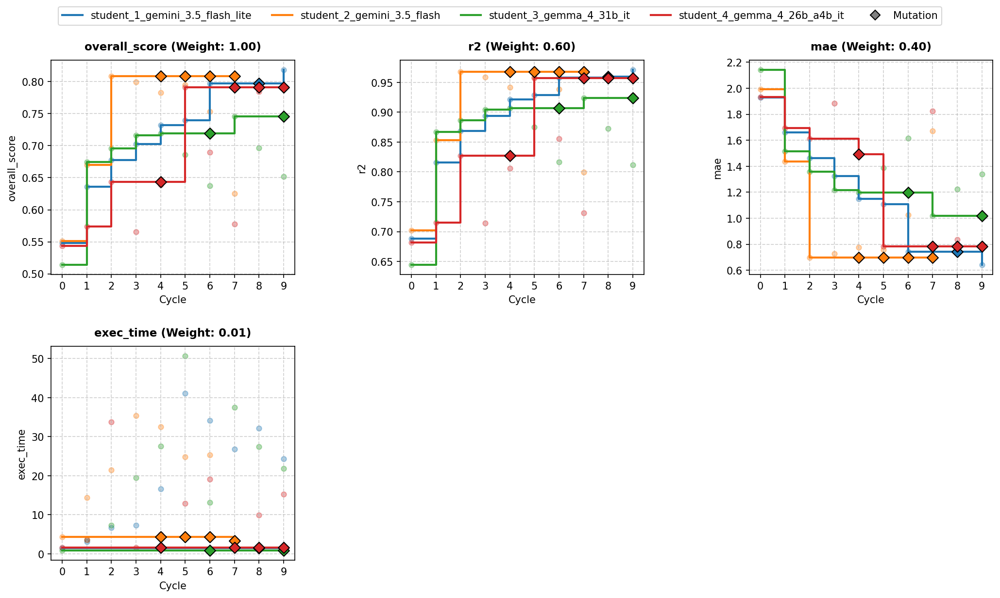

# Overview

*   **Run Path**: template_4s_10c/20261015_013058
*   **Name**: 20261015013058.000
*   **Total Cycles**: 10
*   **Valid Students**: 4
*   **Total Generations**: 46
*   **Total Code Length Processed**: 240455
*   **Tags**: HistGradientBoostingRegressor, ExtraTreesRegressor,
    GradientBoostingRegressor, MLPRegressor, RidgeCV, Harmonic Phase Expansion,
    Feature Engineering, Ensemble
*   **Description**: An ensemble combining HistGradientBoosting, ExtraTrees,
    GradientBoosting, and MLP regressors with harmonic phase expansions, thermal
    interaction proxies, and out-of-fold blending.
*   **Insights**: Decomposing cyclical phase angles into sinusoidal harmonics
    alongside thermal and workload cross-products significantly improves
    regression accuracy, while multi-model stacking minimizes residual error
    across diverse operational regimes.

## Objectives

-   **exec_time:** Time taken to execute generated code., Lower is better
    (Weight: 0.01)

-   **mae:** MAE (Mean Absolute Error), Lower is better (Weight: 0.40)

-   **r2:** R2 (R-squared), Higher is better (Weight: 0.60)

## Student Leaderboard

Rank | Student                         | Best Cycle | Val Score | Test Score | r2    | mae   | exec_time
---- | ------------------------------- | ---------- | --------- | ---------- | ----- | ----- | ---------
1    | student_1_gemini_3.5_flash_lite | 9          | 0.818     | 0.835      | 0.976 | 0.553 | 28.595
2    | student_2_gemini_3.5_flash      | 2          | 0.808     | 0.835      | 0.976 | 0.553 | 28.830
3    | student_4_gemma_4_26b_a4b_it    | 5          | 0.791     | 0.801      | 0.954 | 0.696 | 15.576
4    | student_3_gemma_4_31b_it        | 7          | 0.746     | 0.784      | 0.947 | 0.793 | 44.923

## Learning Trajectory



### Cycle Score Progression

Cycle | student_1_gemini_3.5_flash_lite | student_2_gemini_3.5_flash | student_3_gemma_4_31b_it | student_4_gemma_4_26b_a4b_it
----- | ------------------------------- | -------------------------- | ------------------------ | ----------------------------
0     | 0.548 *(CLASSROOM_BEST)*        | 0.551 *(CLASSROOM_BEST)*   | 0.514 *(SELF_BEST)*      | 0.544 *(SELF_BEST)*
1     | 0.636 *(CLASSROOM_BEST)*        | 0.670 *(CLASSROOM_BEST)*   | 0.675 *(CLASSROOM_BEST)* | 0.574 *(SELF_BEST)*
2     | 0.678 *(CLASSROOM_BEST)*        | 0.808 *(CLASSROOM_BEST)*   | 0.696 *(SELF_BEST)*      | 0.643 *(SELF_BEST)*
3     | 0.703 *(SELF_BEST)*             | 0.799                      | 0.716 *(SELF_BEST)*      | 0.566
4     | 0.732 *(SELF_BEST)*             | 0.783                      | 0.719 *(SELF_BEST)*      | 0.639
5     | 0.740 *(SELF_BEST)*             | 0.795                      | 0.686                    | 0.791 *(SELF_BEST)*
6     | 0.797 *(SELF_BEST)*             | 0.753                      | 0.637                    | 0.689
7     | 0.794                           | 0.626                      | 0.746 *(SELF_BEST)*      | 0.578
8     | 0.790                           | —                          | 0.697                    | 0.784
9     | 0.818 *(CLASSROOM_BEST)*        | —                          | 0.652                    | 0.748

## Analysis

### Model Tags

*   `HistGradientBoostingRegressor`
*   `ExtraTreesRegressor`
*   `GradientBoostingRegressor`
*   `MLPRegressor`
*   `RidgeCV`
*   `Harmonic Phase Expansion`
*   `Feature Engineering`
*   `Ensemble`

### Model Description

> An ensemble combining HistGradientBoosting, ExtraTrees, GradientBoosting, and
> MLP regressors with harmonic phase expansions, thermal interaction proxies,
> and out-of-fold blending.

### Model Insights

> Decomposing cyclical phase angles into sinusoidal harmonics alongside thermal
> and workload cross-products significantly improves regression accuracy, while
> multi-model stacking minimizes residual error across diverse operational
> regimes.

## Top Solution 1: student_1_gemini_3.5_flash_lite (Cycle 9)

*   **Student**: student_1_gemini_3.5_flash_lite
*   **Best Cycle**: 9
*   **Validation Score**: 0.818
*   **Test Score**: 0.835

### Code (student_1_gemini_3.5_flash_lite)

```python
import time
import numpy as np
import pandas as pd
from scipy.optimize import minimize
from sklearn.model_selection import KFold
from sklearn.ensemble import (
    HistGradientBoostingRegressor,
    ExtraTreesRegressor,
    GradientBoostingRegressor,
)
from sklearn.neural_network import MLPRegressor
from sklearn.linear_model import RidgeCV
from sklearn.preprocessing import StandardScaler, SplineTransformer
from sklearn.impute import SimpleImputer
from sklearn.metrics import r2_score, mean_absolute_error

def _engineer_features(df: pd.DataFrame) -> pd.DataFrame:
    """Engineers explicit differential diagnostics, regime-crossed terms,
    harmonic phase expansions, and non-linear physical proxies.
    """
    X_f = df.copy()

    # Missing indicator & imputed baseline proxy gradient
    X_f["temp_sensor_proxy_isna"] = X_f["temp_sensor_proxy"].isna().astype(float)
    if "temp_sensor_proxy" in X_f.columns:
        median_proxy = X_f["temp_sensor_proxy"].median()
        temp_proxy_clean = X_f["temp_sensor_proxy"].fillna(
            median_proxy if not pd.isna(median_proxy) else 0.0
        )
    else:
        temp_proxy_clean = 0.0

    # Primary thermal & workload signals
    amb = X_f["ambient_temp"].fillna(0.0)
    work = X_f["workload_intensity"].fillna(0.0)

    # 1. Harmonic phase angle expansions (1st and 2nd harmonics)
    phase = X_f["phase_angle"].fillna(0.0)
    X_f["phase_sin"] = np.sin(phase)
    X_f["phase_cos"] = np.cos(phase)
    X_f["phase_sin2"] = np.sin(2.0 * phase)
    X_f["phase_cos2"] = np.cos(2.0 * phase)

    # 2. Log and Sqrt transformations for positive surge index
    surge = np.maximum(0.0, X_f["surge_index"].fillna(0.0))
    X_f["surge_log"] = np.log1p(surge)
    X_f["surge_sqrt"] = np.sqrt(surge)

    # 3. Workload & ambient interaction terms
    X_f["temp_x_workload"] = amb * work
    X_f["temp_workload_diff_sq"] = (amb - work) ** 2
    X_f["temp_workload_hypot"] = np.hypot(amb, work)
    X_f["temp_proxy_diff"] = temp_proxy_clean - amb

    # 4. Cooling & pressure differential dynamics (Residual Diagnostics)
    cool = X_f["cooling_flow"].fillna(0.0)
    press = X_f["pressure_delta"].fillna(0.0)
    cool_press_diff = cool - press

    X_f["cooling_pressure_diff"] = cool_press_diff
    X_f["cooling_pressure_diff_abs"] = np.abs(cool_press_diff)
    X_f["cooling_pressure_diff_sq"] = cool_press_diff**2
    X_f["cooling_x_pressure"] = cool * press
    X_f["cooling_efficiency"] = cool / (np.abs(press) + 0.1)
    X_f["cool_x_temp"] = cool * amb
    X_f["cool_x_workload"] = cool * work

    # 5. Regime-crossed interaction terms for discrete regimes (0, 1, 2)
    regime = X_f["operating_regime"].fillna(0.0).round().astype(int)
    for r in [0, 1, 2]:
        mask = (regime == r).astype(float)
        X_f[f"regime_{r}"] = mask
        X_f[f"regime_{r}_x_temp"] = mask * amb
        X_f[f"regime_{r}_x_workload"] = mask * work
        X_f[f"regime_{r}_x_temp_x_workload"] = mask * X_f["temp_x_workload"]
        X_f[f"regime_{r}_x_hypot"] = mask * X_f["temp_workload_hypot"]
        X_f[f"regime_{r}_x_cooling"] = mask * cool
        X_f[f"regime_{r}_x_surge"] = mask * X_f["surge_log"]
        X_f[f"regime_{r}_x_cool_press_diff"] = mask * cool_press_diff

    return X_f

def solution(
    X_train: pd.DataFrame, y_train: pd.DataFrame, X_val: pd.DataFrame
) -> tuple[pd.DataFrame, str]:
    start_time = time.time()

    # Extract target array safely
    if isinstance(y_train, pd.DataFrame):
        y_tr = y_train.iloc[:, 0].values.ravel()
    else:
        y_tr = (
            y_train.values.ravel()
            if hasattr(y_train, "values")
            else np.asarray(y_train).ravel()
        )

    # Feature engineering
    X_tr_feat = _engineer_features(X_train)
    X_va_feat = _engineer_features(X_val)

    n_splits = 5
    kf = KFold(n_splits=n_splits, shuffle=True, random_state=42)

    num_models = 5
    oof_preds_matrix = np.zeros((len(X_train), num_models))
    test_preds_matrix = np.zeros((len(X_val), num_models))

    for fold, (trn_idx, val_idx) in enumerate(kf.split(X_tr_feat)):
        X_tr_fold, y_tr_fold = X_tr_feat.iloc[trn_idx], y_tr[trn_idx]
        X_va_fold = X_tr_feat.iloc[val_idx]

        # Model 0: HistGradientBoostingRegressor (Native NaN support & tuned L2)
        hgb = HistGradientBoostingRegressor(
            max_iter=300,
            learning_rate=0.035,
            max_leaf_nodes=31,
            min_samples_leaf=15,
            l2_regularization=0.15,
            random_state=42 + fold,
        )
        hgb.fit(X_tr_fold, y_tr_fold)
        oof_preds_matrix[val_idx, 0] = hgb.predict(X_va_fold)
        test_preds_matrix[:, 0] += hgb.predict(X_va_feat) / n_splits

        # Imputation step for non-native NaN models
        imputer = SimpleImputer(strategy="median")
        X_tr_imp = imputer.fit_transform(X_tr_fold)
        X_va_imp = imputer.transform(X_va_fold)
        X_test_imp = imputer.transform(X_va_feat)

        # Model 1: ExtraTreesRegressor
        et = ExtraTreesRegressor(
            n_estimators=160,
            max_depth=18,
            min_samples_split=3,
            min_samples_leaf=1,
            max_features=0.85,
            random_state=42 + fold,
            n_jobs=1,
        )
        et.fit(X_tr_imp, y_tr_fold)
        oof_preds_matrix[val_idx, 1] = et.predict(X_va_imp)
        test_preds_matrix[:, 1] += et.predict(X_test_imp) / n_splits

        # Model 2: GradientBoostingRegressor
        gbr = GradientBoostingRegressor(
            n_estimators=160,
            learning_rate=0.04,
            max_depth=4,
            subsample=0.85,
            max_features=0.85,
            random_state=42 + fold,
        )
        gbr.fit(X_tr_imp, y_tr_fold)
        oof_preds_matrix[val_idx, 2] = gbr.predict(X_va_imp)
        test_preds_matrix[:, 2] += gbr.predict(X_test_imp) / n_splits

        # Standard Scaling for neural & spline models
        scaler = StandardScaler()
        X_tr_scl = scaler.fit_transform(X_tr_imp)
        X_va_scl = scaler.transform(X_va_imp)
        X_test_scl = scaler.transform(X_test_imp)

        # Model 3: MLPRegressor
        mlp = MLPRegressor(
            hidden_layer_sizes=(64, 32),
            activation="relu",
            alpha=0.02,
            max_iter=300,
            early_stopping=True,
            n_iter_no_change=15,
            random_state=42 + fold,
        )
        mlp.fit(X_tr_scl, y_tr_fold)
        oof_preds_matrix[val_idx, 3] = mlp.predict(X_va_scl)
        test_preds_matrix[:, 3] += mlp.predict(X_test_scl) / n_splits

        # Model 4: SplineTransformer + RidgeCV
        spline = SplineTransformer(n_knots=5, degree=3, extrapolation="linear")
        X_tr_spl = spline.fit_transform(X_tr_scl)
        X_va_spl = spline.transform(X_va_scl)
        X_test_spl = spline.transform(X_test_scl)

        ridge = RidgeCV(alphas=np.logspace(-3, 3, 20))
        ridge.fit(X_tr_spl, y_tr_fold)
        oof_preds_matrix[val_idx, 4] = ridge.predict(X_va_spl)
        test_preds_matrix[:, 4] += ridge.predict(X_test_spl) / n_splits

    # SLSQP Constrained Optimization on OOF predictions to optimize MAE
    def loss_fn(w):
        w_norm = w / (np.sum(w) + 1e-12)
        pred = oof_preds_matrix @ w_norm
        return mean_absolute_error(y_tr, pred)

    w0 = np.ones(num_models) / num_models
    bounds = [(0, 1) for _ in range(num_models)]
    res = minimize(
        loss_fn, w0, bounds=bounds, method="SLSQP", options={"maxiter": 200}
    )

    opt_weights = res.x / np.sum(res.x)

    oof_ensemble = oof_preds_matrix @ opt_weights
    final_test_preds = test_preds_matrix @ opt_weights

    cv_r2 = r2_score(y_tr, oof_ensemble)
    cv_mae = mean_absolute_error(y_tr, oof_ensemble)
    exec_time = time.time() - start_time

    y_pred_df = pd.DataFrame({"predictions": final_test_preds}, index=X_val.index)

    weights_str = ", ".join([f"{w:.2f}" for w in opt_weights])
    feedback = (
        f"Cycle 9: Adopted robust 5-family stacked ensemble (HGB, ET, GBR, MLP, SplineRidge) with SLSQP weighting.\n"
        f"Internal CV R2: {cv_r2:.5f}\n"
        f"Internal CV MAE: {cv_mae:.5f}\n"
        f"Execution time: {exec_time:.2f}s\n"
        f"Diagnostics: Optimal ensemble weights = [{weights_str}]."
    )

    return y_pred_df, feedback
```

### Execution Output (student_1_gemini_3.5_flash_lite)

```text
Cycle 9: Adopted robust 5-family stacked ensemble (HGB, ET, GBR, MLP, SplineRidge) with SLSQP weighting.
Internal CV R2: 0.96468
Internal CV MAE: 0.69512
Execution time: 24.10s
Diagnostics: Optimal ensemble weights = [0.06, 0.00, 0.00, 0.86, 0.08].
```

## Top Solution 2: student_2_gemini_3.5_flash (Cycle 2)

*   **Student**: student_2_gemini_3.5_flash
*   **Best Cycle**: 2
*   **Validation Score**: 0.808
*   **Test Score**: 0.835

### Code (student_2_gemini_3.5_flash)

```python
import time
import numpy as np
import pandas as pd
from scipy.optimize import minimize
from sklearn.model_selection import KFold
from sklearn.ensemble import (
    HistGradientBoostingRegressor,
    ExtraTreesRegressor,
    GradientBoostingRegressor,
)
from sklearn.neural_network import MLPRegressor
from sklearn.linear_model import RidgeCV
from sklearn.preprocessing import StandardScaler, SplineTransformer
from sklearn.impute import SimpleImputer
from sklearn.metrics import r2_score, mean_absolute_error

def _engineer_features(df):
    """Engineers explicit interaction terms, regime-conditioned features,

    and harmonic / logarithmic basis expansions for thermal telemetry.
    """
    X_f = df.copy()

    # Missing indicator for noisy proxy sensor
    X_f["temp_sensor_proxy_isna"] = X_f["temp_sensor_proxy"].isna().astype(
        float
    )

    # Harmonic phase angle expansions (1st and 2nd harmonics)
    phase = X_f["phase_angle"].fillna(0.0)
    X_f["phase_sin"] = np.sin(phase)
    X_f["phase_cos"] = np.cos(phase)
    X_f["phase_sin2"] = np.sin(2.0 * phase)
    X_f["phase_cos2"] = np.cos(2.0 * phase)

    # Log-transformed surge index
    surge = np.maximum(0.0, X_f["surge_index"].fillna(0.0))
    X_f["surge_log"] = np.log1p(surge)

    # Thermal & workload explicit non-linear interactions
    amb = X_f["ambient_temp"].fillna(0.0)
    work = X_f["workload_intensity"].fillna(0.0)
    X_f["temp_x_workload"] = amb * work
    X_f["temp_workload_diff_sq"] = (amb - work) ** 2
    X_f["temp_workload_hypot"] = np.hypot(amb, work)

    # Cooling & pressure coupled dynamics
    cool = X_f["cooling_flow"].fillna(0.0)
    press = X_f["pressure_delta"].fillna(0.0)
    X_f["cooling_x_pressure"] = cool * press
    X_f["cooling_efficiency"] = cool / (np.abs(press) + 0.1)
    X_f["cool_x_temp"] = cool * amb

    # Regime-crossed interactions for discrete operating regime states (0, 1, 2)
    regime = X_f["operating_regime"].fillna(0).round().astype(int)
    for r in [0, 1, 2]:
        mask = (regime == r).astype(float)
        X_f[f"regime_{r}"] = mask
        X_f[f"regime_{r}_x_temp"] = mask * amb
        X_f[f"regime_{r}_x_workload"] = mask * work
        X_f[f"regime_{r}_x_temp_x_workload"] = mask * X_f["temp_x_workload"]
        X_f[f"regime_{r}_x_hypot"] = mask * X_f["temp_workload_hypot"]
        X_f[f"regime_{r}_x_cooling"] = mask * cool
        X_f[f"regime_{r}_x_surge"] = mask * X_f["surge_log"]

    return X_f

def solution(X_train, y_train, X_val):
    start_time = time.time()

    # Target array extraction
    if isinstance(y_train, pd.DataFrame):
        y_tr = y_train.iloc[:, 0].values
    else:
        y_tr = y_train.values if hasattr(y_train, "values") else np.array(y_train)

    # Feature engineering
    X_tr_feat = _engineer_features(X_train)
    X_va_feat = _engineer_features(X_val)

    n_splits = 5
    kf = KFold(n_splits=n_splits, shuffle=True, random_state=42)

    num_models = 5
    oof_preds_matrix = np.zeros((len(X_train), num_models))
    test_preds_matrix = np.zeros((len(X_val), num_models))

    temp_proxy_col = X_tr_feat.columns.get_loc("temp_sensor_proxy")
    ambient_temp_col = X_tr_feat.columns.get_loc("ambient_temp")

    for fold, (trn_idx, val_idx) in enumerate(kf.split(X_tr_feat)):
        X_tr_fold, y_tr_fold = X_tr_feat.iloc[trn_idx], y_tr[trn_idx]
        X_va_fold, y_va_fold = X_tr_feat.iloc[val_idx], y_tr[val_idx]

        # Model 0: HistGradientBoostingRegressor (Native NaN handling)
        hgb = HistGradientBoostingRegressor(
            max_iter=300,
            learning_rate=0.035,
            max_leaf_nodes=31,
            min_samples_leaf=15,
            l2_regularization=0.1,
            random_state=42 + fold,
        )
        hgb.fit(X_tr_fold, y_tr_fold)
        oof_preds_matrix[val_idx, 0] = hgb.predict(X_va_fold)
        test_preds_matrix[:, 0] += hgb.predict(X_va_feat) / n_splits

        # Imputation step for standard estimators
        imputer = SimpleImputer(strategy="median")
        X_tr_imp = imputer.fit_transform(X_tr_fold)
        X_va_imp = imputer.transform(X_va_fold)
        X_test_imp = imputer.transform(X_va_feat)

        # Imputed derived proxy features
        tr_diff = (
            X_tr_imp[:, temp_proxy_col] - X_tr_imp[:, ambient_temp_col]
        ).reshape(-1, 1)
        va_diff = (
            X_va_imp[:, temp_proxy_col] - X_va_imp[:, ambient_temp_col]
        ).reshape(-1, 1)
        te_diff = (
            X_test_imp[:, temp_proxy_col] - X_test_imp[:, ambient_temp_col]
        ).reshape(-1, 1)

        X_tr_imp = np.hstack([X_tr_imp, tr_diff])
        X_va_imp = np.hstack([X_va_imp, va_diff])
        X_test_imp = np.hstack([X_test_imp, te_diff])

        # Model 1: ExtraTreesRegressor
        et = ExtraTreesRegressor(
            n_estimators=150,
            max_depth=18,
            min_samples_split=3,
            min_samples_leaf=1,
            random_state=42 + fold,
            n_jobs=1,
        )
        et.fit(X_tr_imp, y_tr_fold)
        oof_preds_matrix[val_idx, 1] = et.predict(X_va_imp)
        test_preds_matrix[:, 1] += et.predict(X_test_imp) / n_splits

        # Model 2: GradientBoostingRegressor
        gbr = GradientBoostingRegressor(
            n_estimators=160,
            learning_rate=0.04,
            max_depth=4,
            subsample=0.85,
            random_state=42 + fold,
        )
        gbr.fit(X_tr_imp, y_tr_fold)
        oof_preds_matrix[val_idx, 2] = gbr.predict(X_va_imp)
        test_preds_matrix[:, 2] += gbr.predict(X_test_imp) / n_splits

        # Standard scaling for smooth approximators
        scaler = StandardScaler()
        X_tr_scl = scaler.fit_transform(X_tr_imp)
        X_va_scl = scaler.transform(X_va_imp)
        X_test_scl = scaler.transform(X_test_imp)

        # Model 3: MLPRegressor (Smooth Neural Function Approximator)
        mlp = MLPRegressor(
            hidden_layer_sizes=(64, 32),
            activation="relu",
            alpha=0.01,
            max_iter=300,
            early_stopping=True,
            n_iter_no_change=15,
            random_state=42 + fold,
        )
        mlp.fit(X_tr_scl, y_tr_fold)
        oof_preds_matrix[val_idx, 3] = mlp.predict(X_va_scl)
        test_preds_matrix[:, 3] += mlp.predict(X_test_scl) / n_splits

        # Model 4: SplineTransformer + RidgeCV
        spline = SplineTransformer(n_knots=5, degree=3, extrapolation="linear")
        X_tr_spl = spline.fit_transform(X_tr_scl)
        X_va_spl = spline.transform(X_va_scl)
        X_test_spl = spline.transform(X_test_scl)

        ridge = RidgeCV(alphas=np.logspace(-3, 3, 20))
        ridge.fit(X_tr_spl, y_tr_fold)
        oof_preds_matrix[val_idx, 4] = ridge.predict(X_va_spl)
        test_preds_matrix[:, 4] += ridge.predict(X_test_spl) / n_splits

    # Constrained Optimization on OOF predictions to optimize MAE/R2 weights
    def loss_fn(w):
        w_norm = w / (np.sum(w) + 1e-12)
        pred = oof_preds_matrix @ w_norm
        return mean_absolute_error(y_tr, pred)

    w0 = np.ones(num_models) / num_models
    bounds = [(0, 1) for _ in range(num_models)]
    res = minimize(
        loss_fn, w0, bounds=bounds, method="SLSQP", options={"maxiter": 200}
    )

    opt_weights = res.x / np.sum(res.x)

    oof_ensemble = oof_preds_matrix @ opt_weights
    final_test_preds = test_preds_matrix @ opt_weights

    cv_r2 = r2_score(y_tr, oof_ensemble)
    cv_mae = mean_absolute_error(y_tr, oof_ensemble)
    exec_time = time.time() - start_time

    y_pred_df = pd.DataFrame({"predictions": final_test_preds}, index=X_val.index)

    weights_str = ", ".join([f"{w:.2f}" for w in opt_weights])
    feedback = (
        f"Cycle 2: Construct non-linear radial/diff-sq, harmonic 2nd-order, log-surge & regime-crossed interactions with SLSQP OOF stacking.\n"
        f"Internal CV R2: {cv_r2:.5f}\n"
        f"Internal CV MAE: {cv_mae:.5f}\n"
        f"Execution time: {exec_time:.2f}s\n"
        f"Diagnostics: Optimal ensemble weights [HGB, ET, GBR, MLP, SplineRidge] = [{weights_str}]."
    )

    return y_pred_df, feedback
```

### Execution Output (student_2_gemini_3.5_flash)

```text
Cycle 2: Construct non-linear radial/diff-sq, harmonic 2nd-order, log-surge & regime-crossed interactions with SLSQP OOF stacking.
Internal CV R2: 0.95499
Internal CV MAE: 0.77785
Execution time: 21.27s
Diagnostics: Optimal ensemble weights [HGB, ET, GBR, MLP, SplineRidge] = [0.03, 0.00, 0.02, 0.93, 0.01].
```

## Lowest-Scoring Solution: student_3_gemma_4_31b_it (Cycle 7)

*   **Student**: student_3_gemma_4_31b_it
*   **Best Cycle**: 7
*   **Validation Score**: 0.746
*   **Test Score**: 0.784

### Code (student_3_gemma_4_31b_it)

```python
import numpy as np
import pandas as pd
from sklearn.ensemble import HistGradientBoostingRegressor, ExtraTreesRegressor
from sklearn.linear_model import Ridge, BayesianRidge
from sklearn.neural_network import MLPRegressor
from sklearn.preprocessing import RobustScaler
from sklearn.impute import SimpleImputer
from sklearn.model_selection import KFold
from sklearn.metrics import mean_absolute_error, r2_score
import time

def solution(X_train, y_train, X_val):
    """
    Cycle 7: Advanced Thermal Interaction & Robust Stacking.

    Hypotheses:
    1. Heat Flux Physics: Thermal load is likely the balance between internal heat
       generation (workload * surge) and removal (cooling_flow * temp_diff).
    2. Missingness as Signal: NaNs in temp_sensor_proxy might correlate with
       specific failure modes or regimes.
    3. Pressure-Flow Coupling: pressure_delta and cooling_flow together define
       the efficiency of the cooling system.
    4. Model Complementarity: HGBC captures step-functions, ET reduces variance,
       MLP approximates smooth surfaces, and Ridge captures global linear trends.
    """
    start_time = time.time()

    def engineer_features(df):
        X = df.copy()

        # 1. Basic Noise Pruning
        X = X.drop(columns=['aux_noise_1', 'aux_noise_2'], errors='ignore')

        # 2. Missing Value Indicator (temp_sensor_proxy is the only one with NaNs)
        X['proxy_is_nan'] = X['temp_sensor_proxy'].isna().astype(float)

        # 3. Periodic Basis for phase_angle
        X['phase_sin'] = np.sin(X['phase_angle'])
        X['phase_cos'] = np.cos(X['phase_angle'])

        # 4. Physical Heat Dynamics
        # Delta T: Temperature gradient between source and ambient
        X['temp_diff'] = X['temp_sensor_proxy'] - X['ambient_temp']

        # Cooling Efficiency: Flow rate * Temp Gradient (Convective heat transfer proxy)
        X['cooling_efficiency'] = X['cooling_flow'] * X['temp_diff']

        # Heat Generation: Workload combined with surge index (non-linear effect)
        X['heat_gen_proxy'] = X['workload_intensity'] * (X['surge_index'] + 1)
        X['surge_log'] = np.log1p(X['surge_index'].clip(lower=0))

        # Pressure-Flow interaction (Hydraulic efficiency)
        X['flow_pressure_prod'] = X['cooling_flow'] * X['pressure_delta']

        # 5. Regime-Based Conditioning
        # Encode regimes as indicators
        regimes = pd.get_dummies(X['operating_regime'], prefix='regime')
        X = pd.concat([X, regimes], axis=1)

        # Interaction of regimes with primary thermal drivers
        drivers = ['temp_diff', 'heat_gen_proxy', 'cooling_efficiency', 'workload_intensity']
        for col in drivers:
            for regime_col in regimes.columns:
                X[f'{regime_col}_{col}'] = X[regime_col] * X[col]

        # Drop original discrete column
        X = X.drop(columns=['operating_regime'], errors='ignore')
        return X

    # Process datasets
    X_train_eng = engineer_features(X_train)
    X_val_eng = engineer_features(X_val)

    # Align columns (ensure all one-hot columns from train exist in val)
    all_cols = X_train_eng.columns
    X_val_eng = X_val_eng.reindex(columns=all_cols, fill_value=0)

    y_train_arr = y_train.values.ravel()

    # Preprocessing Pipeline
    # Median imputation for the proxies and derived features
    imputer = SimpleImputer(strategy='median')
    scaler = RobustScaler()

    X_train_imp = imputer.fit_transform(X_train_eng)
    X_val_imp = imputer.transform(X_val_eng)

    # Scaling for MLP and Ridge
    X_train_scaled = scaler.fit_transform(X_train_imp)
    X_val_scaled = scaler.transform(X_val_imp)

    # Out-of-Fold (OOF) Stacking Setup
    kf = KFold(n_splits=5, shuffle=True, random_state=42)

    # Model configurations
    model_configs = {
        'hgbc': {'max_iter': 500, 'learning_rate': 0.02, 'max_leaf_nodes': 31, 'min_samples_leaf': 20, 'random_state': 42},
        'et': {'n_estimators': 500, 'max_depth': 15, 'min_samples_leaf': 2, 'random_state': 42},
        'mlp': {'hidden_layer_sizes': (64, 64), 'alpha': 0.1, 'max_iter': 1000, 'random_state': 42},
        'ridge': {'alpha': 1.0}
    }

    oof_predictions = np.zeros((X_train_imp.shape[0], 4))

    # Cross-Validation for OOF
    for train_idx, val_idx in kf.split(X_train_imp):
        # Training and validation splits
        X_tr_imp, X_va_imp = X_train_imp[train_idx], X_train_imp[val_idx]
        X_tr_scl, X_va_scl = X_train_scaled[train_idx], X_train_scaled[val_idx]
        y_tr, y_va = y_train_arr[train_idx], y_train_arr[val_idx]

        # HGBC
        m_hgbc = HistGradientBoostingRegressor(**model_configs['hgbc'])
        m_hgbc.fit(X_tr_imp, y_tr)
        oof_predictions[val_idx, 0] = m_hgbc.predict(X_va_imp)

        # ExtraTrees
        m_et = ExtraTreesRegressor(**model_configs['et'])
        m_et.fit(X_tr_imp, y_tr)
        oof_predictions[val_idx, 1] = m_et.predict(X_va_imp)

        # MLP
        m_mlp = MLPRegressor(**model_configs['mlp'])
        m_mlp.fit(X_tr_scl, y_tr)
        oof_predictions[val_idx, 2] = m_mlp.predict(X_va_scl)

        # Ridge
        m_ridge = Ridge(**model_configs['ridge'])
        m_ridge.fit(X_tr_scl, y_tr)
        oof_predictions[val_idx, 3] = m_ridge.predict(X_va_scl)

    # Meta-Learner: BayesianRidge provides a probabilistic approach to blending
    meta_model = BayesianRidge()
    meta_model.fit(oof_predictions, y_train_arr)

    # Internal validation metrics for feedback
    cv_preds = meta_model.predict(oof_predictions)
    internal_r2 = r2_score(y_train_arr, cv_preds)
    internal_mae = mean_absolute_error(y_train_arr, cv_preds)

    # Final Prediction Pipeline
    final_base_preds = np.zeros((X_val_imp.shape[0], 4))

    # Fit base models on entire training set
    m_hgbc_final = HistGradientBoostingRegressor(**model_configs['hgbc']).fit(X_train_imp, y_train_arr)
    final_base_preds[:, 0] = m_hgbc_final.predict(X_val_imp)

    m_et_final = ExtraTreesRegressor(**model_configs['et']).fit(X_train_imp, y_train_arr)
    final_base_preds[:, 1] = m_et_final.predict(X_val_imp)

    m_mlp_final = MLPRegressor(**model_configs['mlp']).fit(X_train_scaled, y_train_arr)
    final_base_preds[:, 2] = m_mlp_final.predict(X_val_scaled)

    m_ridge_final = Ridge(**model_configs['ridge']).fit(X_train_scaled, y_train_arr)
    final_base_preds[:, 3] = m_ridge_final.predict(X_val_scaled)

    # Blended Prediction
    val_predictions = meta_model.predict(final_base_preds)

    # Safety clamp to avoid NaN/Inf
    val_predictions = np.nan_to_num(val_predictions, nan=np.nanmedian(val_predictions))

    y_pred_df = pd.DataFrame(
        data={'predictions': val_predictions},
        index=X_val.index
    )

    exec_time = time.time() - start_time

    feedback = (
        f"Cycle 7: Enhanced Physics features (cooling_efficiency, heat_gen_proxy) and proxy_is_nan flag.\n"
        f"Architecture: HGBC, ExtraTrees, MLP, and Ridge stacked via BayesianRidge.\n"
        f"Hypothesis: Capturing heat transfer balance and regime-specific sensitivities.\n"
        f"Internal CV: R2={internal_r2:.4f}, MAE={internal_mae:.4f}.\n"
        f"Execution Time: {exec_time:.3f}s."
    )

    return y_pred_df, feedback
```

### Execution Output (student_3_gemma_4_31b_it)

```text
Cycle 7: Enhanced Physics features (cooling_efficiency, heat_gen_proxy) and proxy_is_nan flag.
Architecture: HGBC, ExtraTrees, MLP, and Ridge stacked via BayesianRidge.
Hypothesis: Capturing heat transfer balance and regime-specific sensitivities.
Internal CV: R2=0.9287, MAE=0.9682.
Execution Time: 37.340s.
```

## Student Instructions

> ### Task: Multi-Regime Thermal Load Regression (Template Task)
>
> #### 1. Objective & What Is Rewarded
>
> Predict `thermal_load` across multi-regime thermal and workload telemetry
> observations.
>
> ### CUSTOMIZE: Replace with your domain objective and scoring summary.
>
> Your goal is to build an accurate, well-calibrated regression pipeline.
> Overall score is a weighted combination of Coefficient of Determination (R²,
> weight 0.60), Mean Absolute Error (MAE, weight 0.40), and execution time
> (weight 0.01).
>
> Metrics summary:
>
> -   **exec_time:** Time taken to execute generated code., Lower is better
>     (Weight: 0.01)
>
> -   **mae:** MAE (Mean Absolute Error), Lower is better (Weight: 0.40)
>
> -   **r2:** R2 (R-squared), Higher is better (Weight: 0.60)
>
> #### 2. Data Contract
>
> -   **Inputs:**
>     *   `X_train` (pd.DataFrame): Training feature matrix (960 rows).
>     *   `y_train` (pd.DataFrame): Training target labels with single column
>         `'thermal_load'`.
>     *   `X_val` (pd.DataFrame): Validation feature matrix (240 rows).
> -   **Features (10 columns):** `ambient_temp`, `workload_intensity`,
>     `phase_angle`, `surge_index`, `operating_regime`, `cooling_flow`,
>     `pressure_delta`, `temp_sensor_proxy`, `aux_noise_1`, `aux_noise_2`
>
>     *   Includes continuous telemetry, discrete `operating_regime` states
>         (`0.0`, `1.0`, `2.0`), periodic `phase_angle`, skewed `surge_index`, a
>         noisy `temp_sensor_proxy` with missing (`NaN`) entries, and potential
>         uninformative noise columns.
> -   **Target:** `thermal_load` (continuous float).
> -   **Output:** Return `(y_pred_df, feedback)`:
>
>     *   `y_pred_df` (pd.DataFrame): Index matching `X_val.index`, single float
>         column named `'predictions'`.
>     *   `feedback` (str): 3 to 6 concise lines logging what changed, internal
>         CV R² and MAE, and diagnostic observations.
>
> #### 3. Evaluation & Budget
>
> -   **Validation Protocol:** Hold-out validation during cycles; use internal
>     K-fold cross-validation on `X_train` to guide feature selection and model
>     blending.
>
> -   **Per-Cycle Wall-Clock Budget:** **60 s** on 960 training rows.
>
> -   **Final Evaluation Budget:** **180 s** on 1,200 combined learning rows.
>
> -   **Hard Resource Caps:** Single-threaded execution preferred (`n_jobs=1`);
>     predictions must be finite 1D floats in column `'predictions'`.
>
> #### 4. Environment
>
> -   **Importable Libraries:** `numpy`, `pandas`, `scipy`, `sklearn`.
> -   **Forbidden / Unavailable:** `xgboost`, `torch`, `tensorflow`, `jax`,
>     `lightgbm`.
>
> -   **Network & Pretrained Weights:** No network access during execution.
>
> -   **Single Code Block:** Provide one complete Python block defining
>     `solution(X_train, y_train, X_val)`.
>
> #### 5. Principles & Levers
>
> -   **Regime-Conditioned Interactions:** Notice whether discrete operating
>     regimes change the slope or interaction sign between primary drivers
>     (`ambient_temp`, `workload_intensity`, `cooling_flow`). Explicit regime
>     indicators and regime-crossed interactions help both linear/MLP and tree
>     models.
>
> -   **Non-Linear & Periodic Basis Expansions:** Cyclic variables
>     (`phase_angle`), skewed positive loads (`surge_index`), and coupled
>     saturation variables (`cooling_flow`, `pressure_delta`) benefit from
>     trigonometric (`sin`, `cos`), logarithmic (`log1p`), radial (`hypot`), and
>     pairwise difference/product transforms.
>
> -   **Missingness & Noise Pruning:** Handle `NaN` values cleanly (e.g.
>     iterative/median imputation + missingness indicator or native tree
>     handling) and verify whether auxiliary columns improve or degrade
>     out-of-fold CV.
>
> -   **Ensembling Complementary Families:** Blending gradient-boosted trees
>     with smooth function approximators (e.g. regularized spline/polynomial
>     regression, MLPRegressor, or ExtraTrees) on engineered features reduces
>     variance in continuous regimes.
>
> #### 6. Pitfalls
>
> -   **Index Alignment:** Returning a DataFrame whose index differs from
>     `X_val.index` fails validation immediately.
>
> -   **Missing Value Crashes:** Linear, spline, and neural estimators fail on
>     raw `NaN` entries in `temp_sensor_proxy` unless imputed first.
>
> -   **Data Leakage:** Fit imputers, scalers, and feature selectors strictly on
>     `X_train` before transforming `X_val`.
>
> -   **Unbounded Grid Searches:** Exhaustive hyperparameter grids risk
>     exceeding the per-cycle timeout.
>
> #### 7. Iteration Discipline
>
> -   **Cycle 0 Baseline:** Start with a fast, verified baseline (e.g.
>     `HistGradientBoostingRegressor` or imputed `Ridge`) to establish a
>     benchmark score.
>
> -   **One Lever per Cycle:** Test one well-defined hypothesis per cycle (e.g.
>     engineered regime/periodic/log features, estimator diversity, or
>     out-of-fold stacking) and keep changes only when internal CV improves.
>
> -   **Use the Feedback Log:** Record out-of-fold R² and MAE deltas in
>     `feedback` so subsequent cycles build on verified gains.
>
> #### 8. Output Contract Checklist
>
> -   [ ] Signature is `solution(X_train, y_train, X_val)` returning
>     `(y_pred_df, feedback)`.
>
> -   [ ] `y_pred_df` is a `pd.DataFrame` with index identical to `X_val.index`
>     and one float column `'predictions'`.
>
> -   [ ] `y_pred_df` has no `NaN`, `None`, or infinite values, and
>     variance > 0.
>
> -   [ ] Execution completes well within 60 s (and scales to 180 s on 1,200
>     rows).
>
> -   [ ] `feedback` logs the hypothesis tested, internal CV metrics, and
>     runtime.
