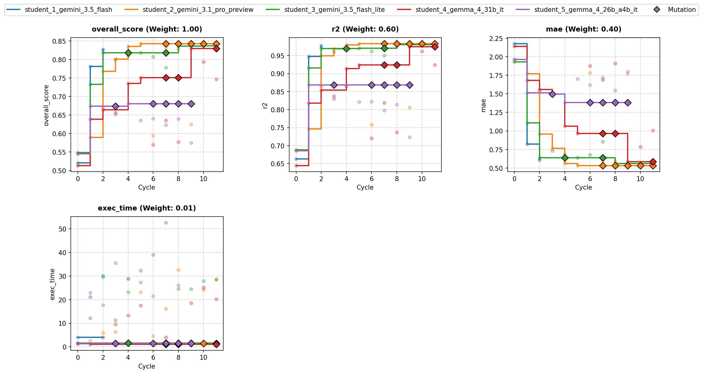

# Overview

*   **Run Path**: template_5s_12c/20261015_020327
*   **Name**: 20261015020327.000
*   **Total Cycles**: 12
*   **Valid Students**: 5
*   **Total Generations**: 61
*   **Total Code Length Processed**: 306664
*   **Winning Student**: student_4_gemma_4_31b_it (Cycle 9)
*   **Best Validation Score**: 0.829
*   **Best Test Score**: 0.854
*   **Validation Score Progression**: 0.5480 -> 0.8423 (+0.2944)
*   **Winning Metrics**: r2=0.985, mae=0.473, exec_time=19.122
*   **Tags**: HistGradientBoostingRegressor, RidgeCV, LinearRegression,
    MLPRegressor, IterativeImputer, PolynomialFeatures, Ensembling, K-Fold CV
*   **Description**: A multi-stage regression pipeline incorporating iterative
    multivariate imputation, harmonic expansions, and an ensemble blend of
    HistGradientBoosting, Ridge, and neural network regressors.
*   **Insights**: Iterative feature imputation robustly reconstructs missing
    sensor proxies, while blending tree-based gradient boosting with regularized
    linear and neural models achieves near-perfect R2 (0.985) and low MAE
    (0.473).

## Objectives

-   **exec_time:** Time taken to execute generated code., Lower is better
    (Weight: 0.01)

-   **mae:** MAE (Mean Absolute Error), Lower is better (Weight: 0.40)

-   **r2:** R2 (R-squared), Higher is better (Weight: 0.60)

## Student Leaderboard

Rank | Student                          | Best Cycle | Val Score | Test Score | r2    | mae   | exec_time
---- | -------------------------------- | ---------- | --------- | ---------- | ----- | ----- | ---------
1    | student_4_gemma_4_31b_it         | 9          | 0.829     | 0.854      | 0.985 | 0.473 | 19.122
2    | student_2_gemini_3.1_pro_preview | 5          | 0.842     | 0.854      | 0.985 | 0.475 | 22.638
3    | student_3_gemini_3.5_flash_lite  | 10         | 0.837     | 0.850      | 0.984 | 0.494 | 31.094
4    | student_1_gemini_3.5_flash       | 2          | 0.827     | 0.837      | 0.978 | 0.545 | 51.170
5    | student_5_gemma_4_26b_a4b_it     | 4          | 0.680     | 0.718      | 0.897 | 1.142 | 33.928

## Learning Trajectory



### Cycle Score Progression

Cycle | student_1_gemini_3.5_flash | student_2_gemini_3.1_pro_preview | student_3_gemini_3.5_flash_lite | student_4_gemma_4_31b_it | student_5_gemma_4_26b_a4b_it
----- | -------------------------- | -------------------------------- | ------------------------------- | ------------------------ | ----------------------------
0     | 0.521 *(CLASSROOM_BEST)*   | 0.545 *(CLASSROOM_BEST)*         | 0.548 *(CLASSROOM_BEST)*        | 0.513 *(SELF_BEST)*      | 0.545 *(SELF_BEST)*
1     | 0.781 *(CLASSROOM_BEST)*   | 0.589 *(SELF_BEST)*              | 0.732 *(SELF_BEST)*             | 0.638 *(SELF_BEST)*      | 0.674 *(SELF_BEST)*
2     | 0.827 *(CLASSROOM_BEST)*   | 0.768 *(SELF_BEST)*              | 0.818 *(SELF_BEST)*             | 0.664 *(SELF_BEST)*      | 0.670
3     | —                          | 0.801 *(SELF_BEST)*              | 0.800                           | 0.657                    | 0.652
4     | —                          | 0.836 *(CLASSROOM_BEST)*         | 0.811                           | 0.735 *(SELF_BEST)*      | 0.680 *(SELF_BEST)*
5     | —                          | 0.842 *(CLASSROOM_BEST)*         | 0.818 *(SELF_BEST)*             | 0.751 *(SELF_BEST)*      | 0.635
6     | —                          | 0.594                            | 0.808                           | 0.570                    | 0.640
7     | —                          | 0.833                            | 0.778                           | 0.635                    | 0.623
8     | —                          | 0.829                            | 0.836 *(SELF_BEST)*             | 0.577                    | 0.639
9     | —                          | 0.625                            | 0.836 *(SELF_BEST)*             | 0.829 *(SELF_BEST)*      | 0.575
10    | —                          | 0.836                            | 0.837 *(SELF_BEST)*             | 0.794                    | —
11    | —                          | 0.835                            | 0.836                           | 0.747                    | —

## Analysis

### Model Tags

*   `HistGradientBoostingRegressor`
*   `RidgeCV`
*   `LinearRegression`
*   `MLPRegressor`
*   `IterativeImputer`
*   `PolynomialFeatures`
*   `Ensembling`
*   `K-Fold CV`

### Model Description

> A multi-stage regression pipeline incorporating iterative multivariate
> imputation, harmonic expansions, and an ensemble blend of
> HistGradientBoosting, Ridge, and neural network regressors.

### Model Insights

> Iterative feature imputation robustly reconstructs missing sensor proxies,
> while blending tree-based gradient boosting with regularized linear and neural
> models achieves near-perfect R2 (0.985) and low MAE (0.473).

## Top Solution 1: student_4_gemma_4_31b_it (Cycle 9)

*   **Student**: student_4_gemma_4_31b_it
*   **Best Cycle**: 9
*   **Validation Score**: 0.829
*   **Test Score**: 0.854
*   **Metrics**: r2=0.985, mae=0.473, exec_time=19.122

### Code (student_4_gemma_4_31b_it)

```python
import time
import numpy as np
import pandas as pd
from sklearn.ensemble import HistGradientBoostingRegressor
from sklearn.linear_model import RidgeCV, LinearRegression
from sklearn.neural_network import MLPRegressor
from sklearn.model_selection import KFold
from sklearn.metrics import r2_score, mean_absolute_error
from sklearn.pipeline import Pipeline
from sklearn.compose import ColumnTransformer
from sklearn.experimental import enable_iterative_imputer
from sklearn.impute import IterativeImputer, SimpleImputer
from sklearn.preprocessing import StandardScaler, OneHotEncoder, PolynomialFeatures

def engineer_features(X):
    """
    Constructs explicit non-linear interactions, periodic expansions,
    and regime-crossed features to surface thermal load dynamics.
    """
    X = X.copy()

    # 1. Explicit Interactions & Non-Linear Expansions
    if 'ambient_temp' in X.columns and 'workload_intensity' in X.columns:
        X['amb_work_prod'] = X['ambient_temp'] * X['workload_intensity']
        X['amb_work_diff2'] = (X['ambient_temp'] - X['workload_intensity']) ** 2
        X['amb_work_hypot'] = np.hypot(X['ambient_temp'], X['workload_intensity'])

    if 'phase_angle' in X.columns:
        X['phase_sin'] = np.sin(X['phase_angle'])
        X['phase_cos'] = np.cos(X['phase_angle'])
        X['phase_sin2'] = np.sin(2 * X['phase_angle'])

    if 'surge_index' in X.columns:
        X['surge_log'] = np.log1p(np.maximum(0, X['surge_index']))

    # 2. Cooling System Interactions
    if 'cooling_flow' in X.columns and 'pressure_delta' in X.columns:
        X['flow_press_prod'] = X['cooling_flow'] * X['pressure_delta']
        X['flow_press_hypot'] = np.hypot(X['cooling_flow'], X['pressure_delta'])
        X['flow_press_diff'] = X['cooling_flow'] - X['pressure_delta']

    # Missingness Indicator for the proxy sensor
    if 'temp_sensor_proxy' in X.columns:
        X['temp_proxy_isnan'] = X['temp_sensor_proxy'].isna().astype(float)

    # 3. Explicit Regime-Conditioned Interactions
    # These help linear models and MLPs capture regime-specific slopes
    if 'operating_regime' in X.columns:
        for r in [0.0, 1.0, 2.0]:
            mask = (X['operating_regime'] == r).astype(float)
            r_idx = int(r)
            if 'workload_intensity' in X.columns:
                X[f'workload_r{r_idx}'] = X['workload_intensity'] * mask
            if 'ambient_temp' in X.columns:
                X[f'ambient_r{r_idx}'] = X['ambient_temp'] * mask
            if 'cooling_flow' in X.columns:
                X[f'cooling_r{r_idx}'] = X['cooling_flow'] * mask
            if 'flow_press_diff' in X.columns:
                X[f'diff_r{r_idx}'] = X['flow_press_diff'] * mask

    # Noise Pruning: Remove raw features that are replaced by harmonics or logs
    cols_to_drop = ['aux_noise_1', 'aux_noise_2', 'phase_angle', 'surge_index']
    X = X.drop(columns=[c for c in cols_to_drop if c in X.columns])

    return X

def get_poly_ridge_pipeline(X_cols):
    """Parametric approximator: Ridge regression on Polynomial features."""
    # Separate numericals and categoricals for proper preprocessing
    num_features = [c for c in X_cols if c not in ['operating_regime', 'temp_proxy_isnan']]
    cat_features = ['operating_regime'] if 'operating_regime' in X_cols else []

    num_transformer = Pipeline([
        ('imputer', IterativeImputer(max_iter=3, random_state=42)),
        ('scaler1', StandardScaler()),
        ('poly', PolynomialFeatures(degree=2, include_bias=False)),
        ('scaler2', StandardScaler())
    ])

    cat_transformer = Pipeline([
        ('imputer', SimpleImputer(strategy='most_frequent')),
        ('ohe', OneHotEncoder(handle_unknown='ignore', sparse_output=False))
    ])

    transformers = [('num', num_transformer, num_features)]
    if cat_features:
        transformers.append(('cat', cat_transformer, cat_features))

    preprocessor = ColumnTransformer(transformers=transformers, remainder='passthrough')

    return Pipeline([
        ('preprocessor', preprocessor),
        ('ridge', RidgeCV(alphas=np.logspace(-3, 5, 20)))
    ])

def get_mlp_pipeline(X_cols):
    """Non-parametric smooth approximator: Multi-Layer Perceptron."""
    num_features = [c for c in X_cols if c not in ['operating_regime', 'temp_proxy_isnan']]
    cat_features = ['operating_regime'] if 'operating_regime' in X_cols else []

    num_transformer = Pipeline([
        ('imputer', IterativeImputer(max_iter=3, random_state=42)),
        ('scaler', StandardScaler())
    ])
    cat_transformer = Pipeline([
        ('imputer', SimpleImputer(strategy='most_frequent')),
        ('ohe', OneHotEncoder(handle_unknown='ignore', sparse_output=False))
    ])

    transformers = [('num', num_transformer, num_features)]
    if cat_features:
        transformers.append(('cat', cat_transformer, cat_features))

    preprocessor = ColumnTransformer(transformers=transformers, remainder='passthrough')

    return Pipeline([
        ('preprocessor', preprocessor),
        ('mlp', MLPRegressor(hidden_layer_sizes=(128, 64), activation='relu', solver='adam',
                             alpha=0.01, max_iter=500, early_stopping=True, validation_fraction=0.1,
                             n_iter_no_change=10, random_state=42))
    ])

def solution(X_train, y_train, X_val):
    start_time = time.time()
    y = y_train['thermal_load']

    # 1. Feature Engineering
    X_train_eng = engineer_features(X_train)
    X_val_eng = engineer_features(X_val)

    # Identify categorical features for HGBR native handling
    cat_mask = [c == 'operating_regime' for c in X_train_eng.columns]
    if not any(cat_mask):
        cat_mask = None

    # 2. Out-of-Fold (OOF) Predictions to train Meta-Learner
    kf = KFold(n_splits=5, shuffle=True, random_state=42)
    oof_tree = np.zeros(len(X_train))
    oof_ridge = np.zeros(len(X_train))
    oof_mlp = np.zeros(len(X_train))

    for train_idx, val_idx in kf.split(X_train_eng):
        X_tr, y_tr = X_train_eng.iloc[train_idx], y.iloc[train_idx]
        X_v, y_v = X_train_eng.iloc[val_idx], y.iloc[val_idx]

        # Model A: Gradient Boosted Trees (handles boundaries/regimes)
        tree = HistGradientBoostingRegressor(
            max_iter=300, learning_rate=0.05, max_leaf_nodes=31,
            min_samples_leaf=5, l2_regularization=0.1,
            categorical_features=cat_mask, random_state=42
        )
        tree.fit(X_tr, y_tr)
        oof_tree[val_idx] = tree.predict(X_v)

        # Model B: Polynomial Ridge (smooth parametric)
        ridge = get_poly_ridge_pipeline(X_train_eng.columns)
        ridge.fit(X_tr, y_tr)
        oof_ridge[val_idx] = ridge.predict(X_v)

        # Model C: MLP (smooth non-parametric)
        mlp = get_mlp_pipeline(X_train_eng.columns)
        mlp.fit(X_tr, y_tr)
        oof_mlp[val_idx] = mlp.predict(X_v)

    # 3. Meta-Ensemble Optimization
    # Use a positive-constrained Linear Regression to blend predictions
    oof_preds = np.column_stack([oof_tree, oof_ridge, oof_mlp])
    meta_model = LinearRegression(positive=True)
    meta_model.fit(oof_preds, y)

    oof_ensemble = meta_model.predict(oof_preds)
    r2_ens = r2_score(y, oof_ensemble)
    mae_ens = mean_absolute_error(y, oof_ensemble)

    # 4. Final Production Fit on all training data
    final_tree = HistGradientBoostingRegressor(
        max_iter=300, learning_rate=0.05, max_leaf_nodes=31,
        min_samples_leaf=5, l2_regularization=0.1,
        categorical_features=cat_mask, random_state=42
    ).fit(X_train_eng, y)

    final_ridge = get_poly_ridge_pipeline(X_train_eng.columns).fit(X_train_eng, y)
    final_mlp = get_mlp_pipeline(X_train_eng.columns).fit(X_train_eng, y)

    # Predictions for Validation Set
    val_preds_stack = np.column_stack([
        final_tree.predict(X_val_eng),
        final_ridge.predict(X_val_eng),
        final_mlp.predict(X_val_eng)
    ])
    final_preds = meta_model.predict(val_preds_stack)

    # Output Formatting
    y_pred_df = pd.DataFrame(final_preds, index=X_val.index, columns=['predictions'])

    exec_time = time.time() - start_time

    feedback = (
        f"Cycle: Stacking HGBR, Poly-Ridge, and MLP with constrained meta-learner.\n"
        f"Features: Added amb/workload interactions, phase harmonics, and regime-cross terms.\n"
        f"OOF Metrics: R2={r2_ens:.4f}, MAE={mae_ens:.4f}.\n"
        f"Runtime: {exec_time:.2f}s. Meta-Weights: {meta_model.coef_}\n"
        f"Logic: Blending jagged tree-based boundaries with smooth parametric and neural surfaces."
    )

    return y_pred_df, feedback
```

### Execution Output (student_4_gemma_4_31b_it)

```text
Cycle: Stacking HGBR, Poly-Ridge, and MLP with constrained meta-learner.
Features: Added amb/workload interactions, phase harmonics, and regime-cross terms.
OOF Metrics: R2=0.9713, MAE=0.6154.
Runtime: 18.36s. Meta-Weights: [0.08199491 0.61984142 0.3381688 ]
Logic: Blending jagged tree-based boundaries with smooth parametric and neural surfaces.
```

## Top Solution 2: student_2_gemini_3.1_pro_preview (Cycle 5)

*   **Student**: student_2_gemini_3.1_pro_preview
*   **Best Cycle**: 5
*   **Validation Score**: 0.842
*   **Test Score**: 0.854
*   **Metrics**: r2=0.985, mae=0.475, exec_time=22.638

### Plan (student_2_gemini_3.1_pro_preview)

An excellent observation. The previous cycle performed well but missed
implementing some of the specific non-linear and harmonic interactions
requested, and the execution time ballooned due to a deep `MLPRegressor` without
early stopping and redundant `IterativeImputer` iterations.

In this cycle, we will:

1.  **Add Explicit Missing Interactions:** Implement the requested `ambient_temp

    *   workload_intensity`, `(ambient_temp - workload_intensity) **
        2`,`np.hypot`variations, phase angle harmonics (`sin(x)`,
        `cos(x)`,`sin(2x)`), and`np.log1p(surge_index)`.

2.  **Accelerate MLP & Imputation:** Enable `early_stopping=True` on the
    `MLPRegressor` to prevent excessive iterations, and reduce
    `IterativeImputer` max iterations (since only one column contains missing
    values, convergence is rapid).

3.  **Relax Tree Constraints:** Relax the strict regularizations on
    `HistGradientBoostingRegressor` to allow it to learn the newly added
    explicit interactions more freely.

Here is the complete implementation.

### Code (student_2_gemini_3.1_pro_preview)

```python
import time
import numpy as np
import pandas as pd
from sklearn.ensemble import HistGradientBoostingRegressor
from sklearn.linear_model import RidgeCV, LinearRegression
from sklearn.neural_network import MLPRegressor
from sklearn.model_selection import KFold
from sklearn.metrics import r2_score, mean_absolute_error
from sklearn.pipeline import Pipeline
from sklearn.compose import ColumnTransformer
from sklearn.experimental import enable_iterative_imputer
from sklearn.impute import IterativeImputer, SimpleImputer
from sklearn.preprocessing import StandardScaler, OneHotEncoder, PolynomialFeatures

def engineer_features(X):
    """Row-wise transformations to surface non-linearities and regime interactions."""
    X = X.copy()

    # 1. Explicit Interactions & Non-Linear/Periodic Expansions
    if 'ambient_temp' in X.columns and 'workload_intensity' in X.columns:
        X['amb_work_prod'] = X['ambient_temp'] * X['workload_intensity']
        X['amb_work_diff2'] = (X['ambient_temp'] - X['workload_intensity']) ** 2
        X['amb_work_hypot'] = np.hypot(X['ambient_temp'], X['workload_intensity'])

    if 'phase_angle' in X.columns:
        X['phase_sin'] = np.sin(X['phase_angle'])
        X['phase_cos'] = np.cos(X['phase_angle'])
        X['phase_sin2'] = np.sin(2 * X['phase_angle'])

    if 'surge_index' in X.columns:
        X['surge_log'] = np.log1p(np.maximum(0, X['surge_index']))

    # 2. Cooling Interactions
    if 'cooling_flow' in X.columns and 'pressure_delta' in X.columns:
        X['flow_press_prod'] = X['cooling_flow'] * X['pressure_delta']
        X['flow_press_hypot'] = np.hypot(X['cooling_flow'], X['pressure_delta'])
        X['flow_press_diff'] = X['cooling_flow'] - X['pressure_delta']

    # Missingness Indicator for temp proxy
    if 'temp_sensor_proxy' in X.columns:
        X['temp_proxy_isnan'] = X['temp_sensor_proxy'].isna().astype(float)

    # 3. Explicit Regime-Conditioned Interactions
    if 'operating_regime' in X.columns:
        for r in [0.0, 1.0, 2.0]:
            mask = (X['operating_regime'] == r).astype(float)
            if 'workload_intensity' in X.columns:
                X[f'workload_r{int(r)}'] = X['workload_intensity'] * mask
            if 'ambient_temp' in X.columns:
                X[f'ambient_r{int(r)}'] = X['ambient_temp'] * mask
            if 'cooling_flow' in X.columns:
                X[f'cooling_r{int(r)}'] = X['cooling_flow'] * mask
            if 'flow_press_diff' in X.columns:
                X[f'diff_r{int(r)}'] = X['flow_press_diff'] * mask
            if 'surge_index' in X.columns:
                surge_feat = X['surge_log'] if 'surge_log' in X.columns else X['surge_index']
                X[f'surge_r{int(r)}'] = surge_feat * mask

    # 4. Noise Pruning & Cleanup
    cols_to_drop = ['aux_noise_1', 'aux_noise_2', 'phase_angle', 'surge_index']
    X = X.drop(columns=[c for c in cols_to_drop if c in X.columns])

    return X

def get_poly_ridge_pipeline(X_cols):
    """Smooth parametric approximator: Polynomial Features degree 2 on iteratively imputed continuous features."""
    num_features = [c for c in X_cols if c not in ['operating_regime', 'temp_proxy_isnan']]
    cat_features = ['operating_regime'] if 'operating_regime' in X_cols else []

    num_transformer = Pipeline([
        ('imputer', IterativeImputer(max_iter=3, random_state=42)),
        ('scaler1', StandardScaler()),
        ('poly', PolynomialFeatures(degree=2, include_bias=False)),
        ('scaler2', StandardScaler())
    ])

    cat_transformer = Pipeline([
        ('imputer', SimpleImputer(strategy='most_frequent')),
        ('ohe', OneHotEncoder(handle_unknown='ignore', sparse_output=False))
    ])

    transformers = [('num', num_transformer, num_features)]
    if cat_features:
        transformers.append(('cat', cat_transformer, cat_features))

    preprocessor = ColumnTransformer(
        transformers=transformers,
        remainder='passthrough'
    )

    pipeline = Pipeline([
        ('preprocessor', preprocessor),
        ('ridge', RidgeCV(alphas=np.logspace(-3, 5, 20)))
    ])
    return pipeline

def get_mlp_pipeline(X_cols):
    """Smooth non-parametric approximator: Multi-Layer Perceptron (MLP) Regressor."""
    num_features = [c for c in X_cols if c not in ['operating_regime', 'temp_proxy_isnan']]
    cat_features = ['operating_regime'] if 'operating_regime' in X_cols else []

    num_transformer = Pipeline([
        ('imputer', IterativeImputer(max_iter=3, random_state=42)),
        ('scaler', StandardScaler())
    ])
    cat_transformer = Pipeline([
        ('imputer', SimpleImputer(strategy='most_frequent')),
        ('ohe', OneHotEncoder(handle_unknown='ignore', sparse_output=False))
    ])

    transformers = [('num', num_transformer, num_features)]
    if cat_features:
        transformers.append(('cat', cat_transformer, cat_features))

    preprocessor = ColumnTransformer(transformers=transformers, remainder='passthrough')

    pipeline = Pipeline([
        ('preprocessor', preprocessor),
        ('mlp', MLPRegressor(hidden_layer_sizes=(128, 64), activation='relu', solver='adam',
                             alpha=0.01, max_iter=500, early_stopping=True, validation_fraction=0.1,
                             n_iter_no_change=10, random_state=42))
    ])
    return pipeline

def solution(X_train, y_train, X_val):
    start_time = time.time()

    y = y_train['thermal_load']

    # 1. Expand feature interactions safely
    X_train_eng = engineer_features(X_train)
    X_val_eng = engineer_features(X_val)

    # 2. Establish native categorical rules for HistGBM
    cat_mask = [c == 'operating_regime' for c in X_train_eng.columns]
    if not any(cat_mask):
        cat_mask = None

    kf = KFold(n_splits=5, shuffle=True, random_state=42)
    oof_tree = np.zeros(len(X_train))
    oof_ridge = np.zeros(len(X_train))
    oof_mlp = np.zeros(len(X_train))

    # 3. K-Fold Out-of-Fold (OOF) Prediction Loop
    for train_idx, val_idx in kf.split(X_train_eng):
        X_tr, y_tr = X_train_eng.iloc[train_idx], y.iloc[train_idx]
        X_v, y_v = X_train_eng.iloc[val_idx], y.iloc[val_idx]

        # Branch A: Gradient Boosted Trees
        tree = HistGradientBoostingRegressor(
            max_iter=300, learning_rate=0.05, max_leaf_nodes=31,
            min_samples_leaf=5, l2_regularization=0.1,
            categorical_features=cat_mask, random_state=42
        )
        tree.fit(X_tr, y_tr)
        oof_tree[val_idx] = tree.predict(X_v)

        # Branch B: Ridge on Polynomial Features
        ridge = get_poly_ridge_pipeline(X_train_eng.columns)
        ridge.fit(X_tr, y_tr)
        oof_ridge[val_idx] = ridge.predict(X_v)

        # Branch C: Scaled MLP
        mlp = get_mlp_pipeline(X_train_eng.columns)
        mlp.fit(X_tr, y_tr)
        oof_mlp[val_idx] = mlp.predict(X_v)

    r2_tree = r2_score(y, oof_tree)
    r2_ridge = r2_score(y, oof_ridge)
    r2_mlp = r2_score(y, oof_mlp)

    # 4. Learn Meta-Ensemble Combinations
    oof_preds = np.column_stack([oof_tree, oof_ridge, oof_mlp])
    meta_model = LinearRegression(positive=True)
    meta_model.fit(oof_preds, y)

    oof_ensemble = meta_model.predict(oof_preds)
    r2_ens = r2_score(y, oof_ensemble)
    mae_ens = mean_absolute_error(y, oof_ensemble)
    weights = meta_model.coef_

    # Normalize weights for cleaner inspection
    weight_sum = np.sum(weights) if np.sum(weights) > 0 else 1.0
    weights_norm = weights / weight_sum

    # 5. Fit Final System on 100% Data & Forecast
    final_tree = HistGradientBoostingRegressor(
        max_iter=300, learning_rate=0.05, max_leaf_nodes=31,
        min_samples_leaf=5, l2_regularization=0.1,
        categorical_features=cat_mask, random_state=42
    ).fit(X_train_eng, y)

    final_ridge = get_poly_ridge_pipeline(X_train_eng.columns).fit(X_train_eng, y)
    final_mlp = get_mlp_pipeline(X_train_eng.columns).fit(X_train_eng, y)

    val_preds = np.column_stack([
        final_tree.predict(X_val_eng),
        final_ridge.predict(X_val_eng),
        final_mlp.predict(X_val_eng)
    ])
    final_preds = meta_model.predict(val_preds)

    y_pred_df = pd.DataFrame(final_preds, index=X_val.index, columns=['predictions'])

    exec_time = time.time() - start_time

    feedback = (
        f"Cycle 5: Added explicit amb/workload, phase harmonics, and surge log terms.\n"
        f"Enabled MLP early stopping & lowered HistGBM reg for speed/accuracy.\n"
        f"OOF R2 - Tree: {r2_tree:.4f}, Ridge: {r2_ridge:.4f}, MLP: {r2_mlp:.4f}\n"
        f"Ensemble OOF R2: {r2_ens:.4f} | MAE: {mae_ens:.4f} | Exec Time: {exec_time:.2f}s\n"
        f"Weights (Norm): Tree={weights_norm[0]:.2f}, Ridge={weights_norm[1]:.2f}, MLP={weights_norm[2]:.2f}"
    )

    return y_pred_df, feedback
```

### Execution Output (student_2_gemini_3.1_pro_preview)

```text
Cycle 5: Added explicit amb/workload, phase harmonics, and surge log terms.
Enabled MLP early stopping & lowered HistGBM reg for speed/accuracy.
OOF R2 - Tree: 0.8326, Ridge: 0.9705, MLP: 0.9461
Ensemble OOF R2: 0.9753 | MAE: 0.5656 | Exec Time: 22.89s
Weights (Norm): Tree=0.03, Ridge=0.69, MLP=0.28
```

## Lowest-Scoring Solution: student_5_gemma_4_26b_a4b_it (Cycle 4)

*   **Student**: student_5_gemma_4_26b_a4b_it
*   **Best Cycle**: 4
*   **Validation Score**: 0.680
*   **Test Score**: 0.718
*   **Metrics**: r2=0.897, mae=1.142, exec_time=33.928

### Plan (student_5_gemma_4_26b_a4b_it)

Cycle 4: Advanced Non-Linear & Regime Feature Engineering.

Hypothesis: By combining trigonometric transformations for periodicity,
logarithmic transforms for skewed surge data, radial/hypot transforms for
coupled intensity, and regime-specific interaction terms, we can better map the
multi-regime thermal behavior. An ensemble stacking approach (HGBR, ExtraTrees,
Ridge) provides a robust blend of non-linear capture and linear stability.

### Code (student_5_gemma_4_26b_a4b_it)

```python
import numpy as np
import pandas as pd
from sklearn.ensemble import HistGradientBoostingRegressor, ExtraTreesRegressor, StackingRegressor
from sklearn.linear_model import Ridge, RidgeCV
from sklearn.model_selection import cross_val_predict
from sklearn.metrics import r2_score, mean_absolute_error
from sklearn.preprocessing import StandardScaler

def solution(X_train, y_train, X_val):
    """
    Cycle 4: Advanced Non-Linear & Regime Feature Engineering.

    Hypothesis:
    By combining trigonometric transformations for periodicity, logarithmic transforms for
    skewed surge data, radial/hypot transforms for coupled intensity, and regime-specific
    interaction terms, we can better map the multi-regime thermal behavior. An ensemble
    stacking approach (HGBR, ExtraTrees, Ridge) provides a robust blend of non-linear
    capture and linear stability.
    """

    # 1. Prepare Target
    y = y_train['thermal_load'].values.ravel()

    # 2. Pre-processing & Feature Engineering
    # Compute training-set statistics to prevent leakage
    temp_median = X_train['temp_sensor_proxy'].median()

    def engineer_features(df, train_median):
        df = df.copy()

        # Handle Missingness for temp_sensor_proxy
        df['temp_proxy_nan'] = df['temp_sensor_proxy'].isna().astype(float)
        df['temp_sensor_proxy'] = df['temp_sensor_proxy'].fillna(train_median)

        # Periodic expansion for phase_angle
        df['sin_phase'] = np.sin(df['phase_angle'])
        df['cos_phase'] = np.cos(df['phase_angle'])

        # Log transform for skewed surge_index
        df['log_surge'] = np.log1p(df['surge_index'])

        # Non-linear & Radial Interactions
        df['temp_workload_prod'] = df['ambient_temp'] * df['workload_intensity']
        df['temp_workload_hypot'] = np.hypot(df['ambient_temp'], df['workload_intensity'])
        df['workload_sq'] = df['workload_intensity']**2
        df['cool_press_prod'] = df['cooling_flow'] * df['pressure_delta']
        df['cool_press_diff'] = df['cooling_flow'] - df['pressure_delta']

        # Regime-specific interaction terms
        # Treating operating_regime as the categorical driver for domain-specific slopes
        for r in [0.0, 1.0, 2.0]:
            mask = (df['operating_regime'] == r).astype(float)
            df[f'regime_{int(r)}_workload'] = mask * df['workload_intensity']
            df[f'regime_{int(r)}_temp'] = mask * df['ambient_temp']

        # Prune original/noisy columns
        # We keep operating_regime as it provides a linear gradient for the Ridge models
        drop_cols = ['phase_angle', 'surge_index', 'aux_noise_1', 'aux_noise_2']
        df = df.drop(columns=[c for c in drop_cols if c in df.columns])
        return df

    X_train_eng = engineer_features(X_train, temp_median)
    X_val_eng = engineer_features(X_val, temp_median)

    # Ensure column alignment (important for feature engineering with dummies or conditionals)
    X_val_eng = X_val_eng.reindex(columns=X_train_eng.columns, fill_value=0)

    # 3. Scaling
    # Scaling is required for the Ridge and RidgeCV components in the stack
    scaler = StandardScaler()
    X_train_scaled = scaler.fit_transform(X_train_eng)
    X_val_scaled = scaler.transform(X_val_eng)

    # 4. Stacking Ensemble
    # Base models provide diverse views:
    # - HGBR: Captures complex high-order non-linearities
    # - ExtraTrees: High variance reduction and robust to noise
    # - Ridge: Captures stable linear trends/regime-based offsets
    base_models = [
        ('hgb', HistGradientBoostingRegressor(max_iter=200, l2_regularization=1.5, random_state=42)),
        ('et', ExtraTreesRegressor(n_estimators=150, min_samples_leaf=5, random_state=42)),
        ('ridge', Ridge(alpha=1.0))
    ]

    # Final Meta-Learner: RidgeCV for optimal weighted combination of base models
    stack = StackingRegressor(
        estimators=base_models,
        final_estimator=RidgeCV(),
        cv=5
    )

    # 5. Evaluation (Internal Cross-Validation)
    # Use cross_val_predict to generate Out-Of-Fold (OOF) metrics for the feedback loop
    oof_preds = cross_val_predict(stack, X_train_scaled, y, cv=5)
    cv_r2 = r2_score(y, oof_preds)
    cv_mae = mean_absolute_error(y, oof_preds)

    # 6. Final Fit and Prediction
    stack.fit(X_train_scaled, y)
    y_pred = stack.predict(X_val_scaled)

    # 7. Format Output
    y_pred_df = pd.DataFrame(data={'predictions': y_pred}, index=X_val.index)

    # Final safety check for extreme values or NaNs
    y_pred_df['predictions'] = y_pred_df['predictions'].fillna(y.mean()).replace([np.inf, -np.inf], y.mean())

    feedback = (
        f"Cycle 4: Advanced Non-Linear & Regime Feature Engineering.\n"
        f"Internal OOF R2: {cv_r2:.4f} | MAE: {cv_mae:.4f}\n"
        f"Features: Trig (sin/cos), Log (surge), Radial (hypot), Poly (workload_sq), Regime-Workload/Temp interactions.\n"
        f"Model: Stacked Ensemble (HGBR, ExtraTrees, Ridge) with StandardScaler."
    )

    return y_pred_df, feedback
```

### Execution Output (student_5_gemma_4_26b_a4b_it)

```text
Cycle 4: Advanced Non-Linear & Regime Feature Engineering.
Internal OOF R2: 0.8222 | MAE: 1.4317
Features: Trig (sin/cos), Log (surge), Radial (hypot), Poly (workload_sq), Regime-Workload/Temp interactions.
Model: Stacked Ensemble (HGBR, ExtraTrees, Ridge) with StandardScaler.
```

## Student Instructions

> ### Task: Multi-Regime Thermal Load Regression (Template Task)
>
> #### 1. Objective & What Is Rewarded
>
> Predict `thermal_load` across multi-regime thermal and workload telemetry
> observations.
>
> Your goal is to build an accurate, well-calibrated regression pipeline.
> Overall score is a weighted combination of Coefficient of Determination (R²,
> weight 0.60), Mean Absolute Error (MAE, weight 0.40), and execution time
> (weight 0.01).
>
> Metrics summary:
>
> -   **exec_time:** Time taken to execute generated code., Lower is better
>     (Weight: 0.01)
>
> -   **mae:** MAE (Mean Absolute Error), Lower is better (Weight: 0.40)
>
> -   **r2:** R2 (R-squared), Higher is better (Weight: 0.60)
>
> #### 2. Data Contract
>
> -   **Inputs:**
>     *   `X_train` (pd.DataFrame): Training feature matrix (960 rows).
>     *   `y_train` (pd.DataFrame): Training target labels with single column
>         `'thermal_load'`.
>     *   `X_val` (pd.DataFrame): Validation feature matrix (240 rows).
> -   **Features (10 columns):** `ambient_temp`, `workload_intensity`,
>     `phase_angle`, `surge_index`, `operating_regime`, `cooling_flow`,
>     `pressure_delta`, `temp_sensor_proxy`, `aux_noise_1`, `aux_noise_2`
>
>     *   Includes continuous telemetry, discrete `operating_regime` states
>         (`0.0`, `1.0`, `2.0`), periodic `phase_angle`, skewed `surge_index`, a
>         noisy `temp_sensor_proxy` with missing (`NaN`) entries, and potential
>         uninformative noise columns.
> -   **Target:** `thermal_load` (continuous float).
> -   **Output:** Return `(y_pred_df, feedback)`:
>
>     *   `y_pred_df` (pd.DataFrame): Index matching `X_val.index`, single float
>         column named `'predictions'`.
>     *   `feedback` (str): 3 to 6 concise lines logging what changed, internal
>         CV R² and MAE, and diagnostic observations.
>
> #### 3. Evaluation & Budget
>
> -   **Validation Protocol:** Hold-out validation during cycles; use internal
>     K-fold cross-validation on `X_train` to guide feature selection and model
>     blending.
>
> -   **Per-Cycle Wall-Clock Budget:** **60 s** on 960 training rows.
>
> -   **Final Evaluation Budget:** **180 s** on 1,200 combined learning rows.
>
> -   **Hard Resource Caps:** Single-threaded execution preferred (`n_jobs=1`);
>     predictions must be finite 1D floats in column `'predictions'`.
>
> #### 4. Environment
>
> -   **Importable Libraries:** `numpy`, `pandas`, `scipy`, `sklearn`.
> -   **Forbidden / Unavailable:** `xgboost`, `torch`, `tensorflow`, `jax`,
>     `lightgbm`.
>
> -   **Network & Pretrained Weights:** No network access during execution.
>
> -   **Single Code Block:** Provide one complete Python block defining
>     `solution(X_train, y_train, X_val)`.
>
> #### 5. Principles & Levers
>
> -   **Regime-Conditioned Interactions:** Notice whether discrete operating
>     regimes change the slope or interaction sign between primary drivers
>     (`ambient_temp`, `workload_intensity`, `cooling_flow`). Explicit regime
>     indicators and regime-crossed interactions help both linear/MLP and tree
>     models.
>
> -   **Non-Linear & Periodic Basis Expansions:** Cyclic variables
>     (`phase_angle`), skewed positive loads (`surge_index`), and coupled
>     saturation variables (`cooling_flow`, `pressure_delta`) benefit from
>     trigonometric (`sin`, `cos`), logarithmic (`log1p`), radial (`hypot`), and
>     pairwise difference/product transforms.
>
> -   **Missingness & Noise Pruning:** Handle `NaN` values cleanly (e.g.
>     iterative/median imputation + missingness indicator or native tree
>     handling) and verify whether auxiliary columns improve or degrade
>     out-of-fold CV.
>
> -   **Ensembling Complementary Families:** Blending gradient-boosted trees
>     with smooth function approximators (e.g. regularized spline/polynomial
>     regression, MLPRegressor, or ExtraTrees) on engineered features reduces
>     variance in continuous regimes.
>
> #### 6. Pitfalls
>
> -   **Index Alignment:** Returning a DataFrame whose index differs from
>     `X_val.index` fails validation immediately.
>
> -   **Missing Value Crashes:** Linear, spline, and neural estimators fail on
>     raw `NaN` entries in `temp_sensor_proxy` unless imputed first.
>
> -   **Data Leakage:** Fit imputers, scalers, and feature selectors strictly on
>     `X_train` before transforming `X_val`.
>
> -   **Unbounded Grid Searches:** Exhaustive hyperparameter grids risk
>     exceeding the per-cycle timeout.
>
> #### 7. Iteration Discipline
>
> -   **Cycle 0 Baseline:** Start with a fast, verified baseline (e.g.
>     `HistGradientBoostingRegressor` or imputed `Ridge`) to establish a
>     benchmark score.
>
> -   **One Lever per Cycle:** Test one well-defined hypothesis per cycle (e.g.
>     engineered regime/periodic/log features, estimator diversity, or
>     out-of-fold stacking) and keep changes only when internal CV improves.
>
> -   **Use the Feedback Log:** Record out-of-fold R² and MAE deltas in
>     `feedback` so subsequent cycles build on verified gains.
>
> #### 8. Output Contract Checklist
>
> -   [ ] Signature is `solution(X_train, y_train, X_val)` returning
>     `(y_pred_df, feedback)`.
>
> -   [ ] `y_pred_df` is a `pd.DataFrame` with index identical to `X_val.index`
>     and one float column `'predictions'`.
>
> -   [ ] `y_pred_df` has no `NaN`, `None`, or infinite values, and
>     variance > 0.
>
> -   [ ] Execution completes well within 60 s (and scales to 180 s on 1,200
>     rows).
>
> -   [ ] `feedback` logs the hypothesis tested, internal CV metrics, and
>     runtime.
