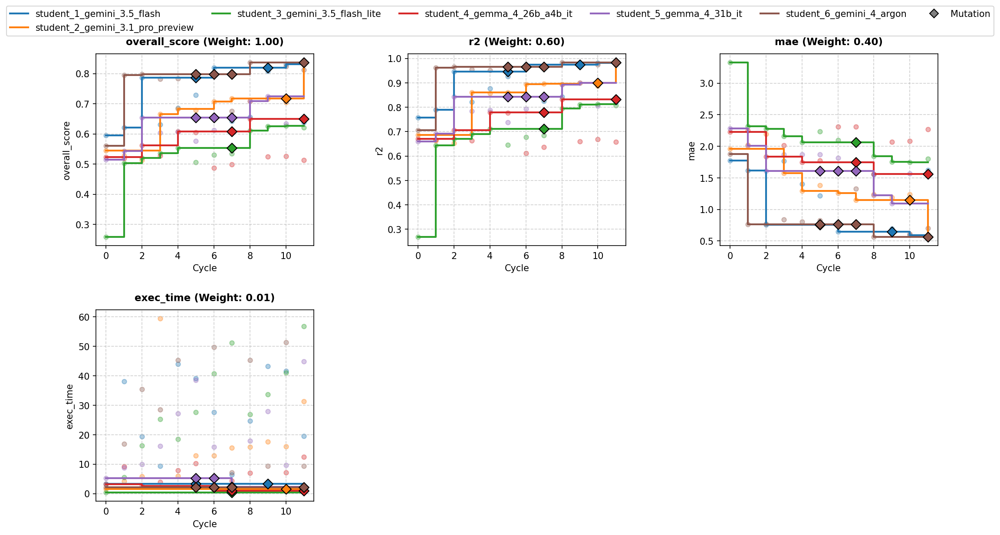
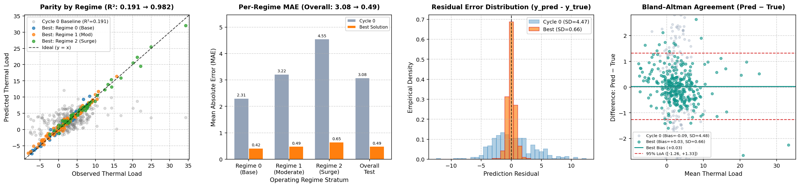

# Overview

* **Run Path**: template_6s_12c/20261023_042246
* **Name**: 20261023_042246
* **Total Cycles**: 12
* **Valid Students**: 6
* **Total Generations**: 92
* **Total Code Length Processed**: 495763
* **Total Tokens**: 459234
* **Est. Cost (USD)**: $1.549
* **Best Student**: student_6_gemini_4_argon (Cycle 8)
* **Best Validation Score**: 0.836
* **Best Test Score**: 0.850
* **Validation Score Progression**: 0.5947 -> 0.8364 (+0.2417)
* **Best Metrics**: r2=0.982, mae=0.489, exec_time=53.763
* **Tags**: Iterative Imputer, Polynomial Ridge, Bayesian Ridge, Huber
  Regressor, SVR, Kernel Ridge, MLP Regressor, Gradient Boosting, HistGradient
  Boosting, Extra Trees, SLSQP Blending
* **Description**: The solution constructs an ensemble of diverse model
  families—including regime-specific polynomial ridge regressions, SVRs, neural
  networks, kernel ridge, and tree-based gradient boosters—trained within a
  leak-free 5-fold cross-validation scheme. An SLSQP optimization procedure
  computes optimal global and regime-conditioned blending weights to directly
  optimize a joint objective of high R² and low MAE.
* **Insights**: Explicitly dropping noisy auxiliary features (`aux_noise_1/2`)
  and engineering cyclical phase angles along with regime-conditioned polynomial
  interactions significantly boosts model alignment with physical dynamics.
  Combining piecewise-constant tree models with smooth function approximators
  (SVR, Kernel Ridge, and Ridge polynomials) captures complex nonlinear state
  changes across operating regimes efficiently.

## Objectives

-   **exec_time:** Time taken to execute generated code., Lower is better
    (Weight: 0.01)

-   **mae:** MAE (Mean Absolute Error), Lower is better (Weight: 0.40)
-   **r2:** R2 (R-squared), Higher is better (Weight: 0.60)

## Student Leaderboard

| Rank | Student | Best Cycle | Val Score | Test Score | r2 | mae | exec_time |
| --- | --- | --- | --- | --- | --- | --- | --- |
| 1 | student_6_gemini_4_argon | 8 | 0.836 | 0.850 | 0.982 | 0.489 | 53.763 |
| 2 | student_2_gemini_3.1_pro_preview | 11 | 0.829 | 0.848 | 0.982 | 0.496 | 36.879 |
| 3 | student_1_gemini_3.5_flash | 10 | 0.832 | 0.845 | 0.980 | 0.509 | 53.839 |
| 4 | student_5_gemma_4_31b_it | 9 | 0.724 | 0.752 | 0.926 | 0.960 | 31.285 |
| 5 | student_4_gemma_4_26b_a4b_it | 8 | 0.650 | 0.669 | 0.842 | 1.365 | 7.732 |
| 6 | student_3_gemini_3.5_flash_lite | 10 | 0.627 | 0.643 | 0.814 | 1.493 | 51.049 |

## Learning Trajectory



### Cycle Score Progression

| Cycle | student_1_gemini_3.5_flash | student_2_gemini_3.1_pro_preview | student_3_gemini_3.5_flash_lite | student_4_gemma_4_26b_a4b_it | student_5_gemma_4_31b_it | student_6_gemini_4_argon |
| --- | --- | --- | --- | --- | --- | --- |
| 0 | 0.595 *(CLASSROOM_BEST)* | 0.545 *(SELF_BEST)* | 0.259 *(SELF_BEST)* | 0.523 *(SELF_BEST)* | 0.514 *(SELF_BEST)* | 0.560 *(SELF_BEST)* |
| 1 | 0.621 *(CLASSROOM_BEST)* | 0.527 | 0.504 *(SELF_BEST)* | 0.519 | 0.544 *(SELF_BEST)* | 0.796 *(CLASSROOM_BEST)* |
| 2 | 0.787 *(SELF_BEST)* | 0.514 | 0.520 *(SELF_BEST)* | 0.562 *(SELF_BEST)* | 0.654 *(SELF_BEST)* | 0.798 *(CLASSROOM_BEST)* |
| 3 | 0.632 | 0.666 *(SELF_BEST)* | 0.536 *(SELF_BEST)* | 0.528 | 0.604 | 0.782 |
| 4 | 0.686 | 0.683 *(SELF_BEST)* | 0.553 *(SELF_BEST)* | 0.608 *(SELF_BEST)* | 0.607 | 0.784 |
| 5 | 0.729 | 0.678 | 0.506 | 0.605 | 0.576 | 0.790 |
| 6 | 0.820 *(CLASSROOM_BEST)* | 0.708 *(SELF_BEST)* | 0.531 | 0.488 | 0.612 | 0.794 |
| 7 | 0.642 | 0.717 *(SELF_BEST)* | 0.535 | 0.499 | 0.555 | 0.675 |
| 8 | 0.656 | 0.709 | 0.611 *(SELF_BEST)* | 0.650 *(SELF_BEST)* | 0.708 *(SELF_BEST)* | 0.836 *(CLASSROOM_BEST)* |
| 9 | 0.809 | 0.716 | 0.626 *(SELF_BEST)* | 0.525 | 0.724 *(SELF_BEST)* | 0.822 |
| 10 | 0.832 *(SELF_BEST)* | 0.705 | 0.627 *(SELF_BEST)* | 0.526 | 0.634 | 0.825 |
| 11 | 0.638 | 0.829 *(SELF_BEST)* | 0.622 | 0.513 | 0.653 | 0.812 |

### Cost Breakdown

| Student | Generations | Input Tokens | Output Tokens | Total Tokens | Est. Cost (USD) |
| --- | --- | --- | --- | --- | --- |
| student_6_gemini_4_argon | 16 | 38350 | 50224 | 88574 | $0.579 |
| student_2_gemini_3.1_pro_preview | 16 | 38350 | 56133 | 94483 | $0.750 |
| student_1_gemini_3.5_flash | 15 | 36500 | 30467 | 66967 | $0.110 |
| student_5_gemma_4_31b_it | 15 | 36500 | 36006 | 72506 | $0.000 |
| student_4_gemma_4_26b_a4b_it | 15 | 36500 | 33237 | 69737 | $0.000 |
| student_3_gemini_3.5_flash_lite | 15 | 36500 | 30467 | 66967 | $0.110 |
| **Total** | 92 | 222700 | 236534 | 459234 | $1.549 |

## Analysis

### Model Tags

* `Iterative Imputer`
* `Polynomial Ridge`
* `Bayesian Ridge`
* `Huber Regressor`
* `SVR`
* `Kernel Ridge`
* `MLP Regressor`
* `Gradient Boosting`
* `HistGradient Boosting`
* `Extra Trees`
* `SLSQP Blending`

### Model Description

> The solution constructs an ensemble of diverse model families—including
> regime-specific polynomial ridge regressions, SVRs, neural networks, kernel
> ridge, and tree-based gradient boosters—trained within a leak-free 5-fold
> cross-validation scheme. An SLSQP optimization procedure computes optimal
> global and regime-conditioned blending weights to directly optimize a joint
> objective of high R² and low MAE.

### Model Insights

> Explicitly dropping noisy auxiliary features (`aux_noise_1/2`) and engineering
> cyclical phase angles along with regime-conditioned polynomial interactions
> significantly boosts model alignment with physical dynamics. Combining
> piecewise-constant tree models with smooth function approximators (SVR, Kernel
> Ridge, and Ridge polynomials) captures complex nonlinear state changes across
> operating regimes efficiently.

## Top Solution 1: student_6_gemini_4_argon (Cycle 8)

* **Student**: student_6_gemini_4_argon
* **Best Cycle**: 8
* **Validation Score**: 0.836
* **Test Score**: 0.850
* **Metrics**: r2=0.982, mae=0.489, exec_time=53.763

### Diagnostic & Impact Analysis



| Stratum | Cycle 0 Baseline MAE | Best Solution MAE | Relative Error Reduction |
| --- | --- | --- | --- |
| Regime 0 (Base) | 2.306 | 0.419 | 81.8% |
| Regime 1 (Moderate) | 3.217 | 0.488 | 84.8% |
| Regime 2 (Surge) | 4.552 | 0.651 | 85.7% |
| **Overall Held-Out Test** | **3.081** (R²=0.191) | **0.489** (R²=0.982) | **84.1%** |

### Code (student_6_gemini_4_argon)

```python
import time
import warnings
import numpy as np
import pandas as pd
from scipy.optimize import minimize
from sklearn.experimental import enable_iterative_imputer  # noqa
from sklearn.impute import IterativeImputer
from sklearn.preprocessing import StandardScaler, PolynomialFeatures
from sklearn.linear_model import RidgeCV, HuberRegressor, BayesianRidge
from sklearn.svm import SVR
from sklearn.neural_network import MLPRegressor
from sklearn.ensemble import (
    HistGradientBoostingRegressor,
    GradientBoostingRegressor,
    ExtraTreesRegressor,
)
from sklearn.kernel_ridge import KernelRidge
from sklearn.model_selection import KFold
from sklearn.metrics import r2_score, mean_absolute_error

warnings.filterwarnings("ignore")

def engineer_features(df_in, fit_imputer=None):
    df = df_in.copy()

    # Core features (drop aux_noise_1 and aux_noise_2 which are pure noise)
    core_cols = [
        "ambient_temp",
        "workload_intensity",
        "phase_angle",
        "surge_index",
        "operating_regime",
        "cooling_flow",
        "pressure_delta",
        "temp_sensor_proxy",
    ]
    core_cols = [c for c in core_cols if c in df.columns]

    temp_missing = (
        df["temp_sensor_proxy"].isna().astype(float).values
        if "temp_sensor_proxy" in df.columns
        else np.zeros(len(df))
    )

    if fit_imputer is None:
        imputer = IterativeImputer(
            estimator=BayesianRidge(), max_iter=8, random_state=42
        )
        imputed_arr = imputer.fit_transform(df[core_cols])
    else:
        imputer = fit_imputer
        imputed_arr = imputer.transform(df[core_cols])

    df_imp = pd.DataFrame(imputed_arr, columns=core_cols, index=df.index)
    df_imp["temp_sensor_missing"] = temp_missing

    # Cyclical transformations for phase_angle
    pa = df_imp["phase_angle"]
    df_imp["sin_phase"] = np.sin(pa)
    df_imp["cos_phase"] = np.cos(pa)
    df_imp["sin_2phase"] = np.sin(2.0 * pa)
    df_imp["cos_2phase"] = np.cos(2.0 * pa)

    # Non-linear transformations
    si = df_imp["surge_index"]
    si_pos = np.maximum(0.0, si)
    df_imp["log_surge"] = np.log1p(si_pos)
    df_imp["sqrt_surge"] = np.sqrt(si_pos)
    df_imp["surge_sq"] = si ** 2

    cf = df_imp["cooling_flow"]
    cf_pos = np.maximum(0.0, cf)
    df_imp["log_cooling"] = np.log1p(cf_pos)
    df_imp["inv_cooling"] = 1.0 / (cf_pos + 1.0)

    wi = df_imp["workload_intensity"]
    df_imp["workload_sq"] = wi ** 2

    at = df_imp["ambient_temp"]
    pd_val = df_imp["pressure_delta"]
    tsp = df_imp["temp_sensor_proxy"]

    # Domain interactions & ratios
    df_imp["temp_diff_proxy"] = tsp - at
    df_imp["workload_per_cooling"] = wi / (cf_pos + 0.5)
    df_imp["surge_per_cooling"] = si / (cf_pos + 0.5)
    df_imp["workload_x_surge"] = wi * si
    df_imp["workload_x_ambient"] = wi * at
    df_imp["cooling_x_pressure"] = cf * pd_val
    df_imp["workload_x_sin_phase"] = wi * df_imp["sin_phase"]
    df_imp["workload_x_cos_phase"] = wi * df_imp["cos_phase"]
    df_imp["ambient_x_cooling"] = at * cf
    df_imp["pressure_sq"] = pd_val ** 2

    # Discrete operating regimes and regime-conditioned interactions
    regimes = np.round(df_imp["operating_regime"]).astype(int)
    df_imp["operating_regime_int"] = regimes
    for r in [0, 1, 2]:
        mask = (regimes == r).astype(float)
        df_imp[f"regime_{r}"] = mask
        df_imp[f"regime_{r}_x_workload"] = mask * wi
        df_imp[f"regime_{r}_x_ambient"] = mask * at
        df_imp[f"regime_{r}_x_cooling"] = mask * cf
        df_imp[f"regime_{r}_x_surge"] = mask * si
        df_imp[f"regime_{r}_x_log_surge"] = mask * df_imp["log_surge"]
        df_imp[f"regime_{r}_x_pressure"] = mask * pd_val
        df_imp[f"regime_{r}_x_tsp"] = mask * tsp
        df_imp[f"regime_{r}_x_sin"] = mask * df_imp["sin_phase"]
        df_imp[f"regime_{r}_x_cos"] = mask * df_imp["cos_phase"]

    return df_imp, imputer

def fit_predict_regime_poly(X_tr_df, y_tr, X_te_dfs, degree=2):
    """Fits global and per-regime polynomial models once and predicts on a list of test DataFrames."""
    if degree == 2:
        base_feats = [
            "ambient_temp",
            "workload_intensity",
            "sin_phase",
            "cos_phase",
            "sin_2phase",
            "cos_2phase",
            "surge_index",
            "log_surge",
            "sqrt_surge",
            "cooling_flow",
            "log_cooling",
            "inv_cooling",
            "pressure_delta",
            "temp_sensor_proxy",
            "temp_sensor_missing",
            "workload_per_cooling",
        ]
    else:
        # Compact feature set for degree 3 to keep dimensionality (~165 features) fast and well-conditioned
        base_feats = [
            "ambient_temp",
            "workload_intensity",
            "sin_phase",
            "cos_phase",
            "log_surge",
            "cooling_flow",
            "pressure_delta",
            "temp_sensor_proxy",
        ]
    base_feats = [f for f in base_feats if f in X_tr_df.columns]

    alphas = np.logspace(-2, 4, 25)
    poly_global = PolynomialFeatures(degree=degree, include_bias=False)
    scaler_global = StandardScaler()
    X_tr_glob = scaler_global.fit_transform(
        poly_global.fit_transform(X_tr_df[base_feats])
    )

    ridge_glob = RidgeCV(alphas=alphas)
    ridge_glob.fit(X_tr_glob, y_tr)

    preds_list = [
        ridge_glob.predict(
            scaler_global.transform(poly_global.transform(df_te[base_feats]))
        )
        for df_te in X_te_dfs
    ]

    tr_regimes = X_tr_df["operating_regime_int"].values
    unique_regimes = np.unique(tr_regimes)

    for r in unique_regimes:
        tr_mask = tr_regimes == r
        if np.sum(tr_mask) >= 25:
            poly_r = PolynomialFeatures(degree=degree, include_bias=False)
            scaler_r = StandardScaler()
            X_tr_r = scaler_r.fit_transform(
                poly_r.fit_transform(X_tr_df.loc[tr_mask, base_feats])
            )

            ridge_r = RidgeCV(alphas=alphas)
            ridge_r.fit(X_tr_r, y_tr[tr_mask])

            by_r = BayesianRidge()
            by_r.fit(X_tr_r, y_tr[tr_mask])

            for idx, df_te in enumerate(X_te_dfs):
                te_mask = df_te["operating_regime_int"].values == r
                if np.sum(te_mask) > 0:
                    X_te_r = scaler_r.transform(
                        poly_r.transform(df_te.loc[te_mask, base_feats])
                    )
                    preds_r = ridge_r.predict(X_te_r)
                    preds_by = by_r.predict(X_te_r)
                    preds_list[idx][te_mask] = 0.55 * preds_r + 0.45 * preds_by

    return preds_list

def fit_predict_regime_svr(X_tr_df, y_tr, X_te_dfs):
    """Fits global and per-regime RBF SVR models once and predicts on a list of test DataFrames."""
    svr_feats = [
        "ambient_temp",
        "workload_intensity",
        "sin_phase",
        "cos_phase",
        "surge_index",
        "log_surge",
        "cooling_flow",
        "log_cooling",
        "pressure_delta",
        "temp_sensor_proxy",
        "workload_per_cooling",
        "temp_diff_proxy",
        "regime_0",
        "regime_1",
        "regime_2",
    ]
    svr_feats = [f for f in svr_feats if f in X_tr_df.columns]

    scaler = StandardScaler()
    X_tr_s = scaler.fit_transform(X_tr_df[svr_feats])

    svr_glob1 = SVR(C=25.0, epsilon=0.05, gamma="scale")
    svr_glob1.fit(X_tr_s, y_tr)

    svr_glob2 = SVR(C=60.0, epsilon=0.02, gamma="scale")
    svr_glob2.fit(X_tr_s, y_tr)

    p_glob_list = []
    for df_te in X_te_dfs:
        X_te_s = scaler.transform(df_te[svr_feats])
        p_glob_list.append(
            0.5 * svr_glob1.predict(X_te_s) + 0.5 * svr_glob2.predict(X_te_s)
        )

    local_feats = [f for f in svr_feats if not f.startswith("regime_")]
    tr_regimes = X_tr_df["operating_regime_int"].values
    p_loc_list = [p.copy() for p in p_glob_list]

    for r in np.unique(tr_regimes):
        tr_mask = tr_regimes == r
        if np.sum(tr_mask) >= 25:
            sc_r = StandardScaler()
            X_tr_r = sc_r.fit_transform(X_tr_df.loc[tr_mask, local_feats])
            svr_r = SVR(C=25.0, epsilon=0.04, gamma="scale")
            svr_r.fit(X_tr_r, y_tr[tr_mask])

            for idx, df_te in enumerate(X_te_dfs):
                te_mask = df_te["operating_regime_int"].values == r
                if np.sum(te_mask) > 0:
                    X_te_r = sc_r.transform(df_te.loc[te_mask, local_feats])
                    p_loc_list[idx][te_mask] = svr_r.predict(X_te_r)

    return [0.45 * pg + 0.55 * pl for pg, pl in zip(p_glob_list, p_loc_list)]

def solution(X_train: pd.DataFrame, y_train: pd.DataFrame, X_val: pd.DataFrame):
    t0 = time.time()
    y_tr_raw = y_train["thermal_load"].values.astype(float)

    n_splits = 5
    kf = KFold(n_splits=n_splits, shuffle=True, random_state=42)

    model_names = [
        "regime_poly2",
        "regime_poly3",
        "global_ridge_huber",
        "regime_svr",
        "krr_poly",
        "mlp",
        "gbr_l1",
        "gbr_l2",
        "hgb_l1",
        "hgb_l2",
        "et",
    ]
    n_models = len(model_names)
    oof_preds = np.zeros((len(X_train), n_models))
    val_preds_folds = np.zeros((len(X_val), n_models))

    for fold, (tr_idx, va_idx) in enumerate(kf.split(X_train, y_tr_raw)):
        X_tr_fold_raw = X_train.iloc[tr_idx]
        y_tr_fold = y_tr_raw[tr_idx]
        X_va_fold_raw = X_train.iloc[va_idx]

        # Leak-free feature engineering & imputation
        X_tr_fe, imputer = engineer_features(X_tr_fold_raw, fit_imputer=None)
        X_va_fe, _ = engineer_features(X_va_fold_raw, fit_imputer=imputer)
        X_val_fe, _ = engineer_features(X_val, fit_imputer=imputer)

        all_cols = [c for c in X_tr_fe.columns if c != "operating_regime_int"]

        # 0: Regime Poly degree 2 (fit once, predict both va and val)
        p_va_0, p_val_0 = fit_predict_regime_poly(
            X_tr_fe, y_tr_fold, [X_va_fe, X_val_fe], degree=2
        )
        oof_preds[va_idx, 0] = p_va_0
        val_preds_folds[:, 0] += p_val_0 / n_splits

        # 1: Regime Poly degree 3 (compact features, fit once)
        p_va_1, p_val_1 = fit_predict_regime_poly(
            X_tr_fe, y_tr_fold, [X_va_fe, X_val_fe], degree=3
        )
        oof_preds[va_idx, 1] = p_va_1
        val_preds_folds[:, 1] += p_val_1 / n_splits

        # 2: Global BayesianRidge + HuberRegressor on full engineered feature matrix
        sc_all = StandardScaler()
        X_tr_s = sc_all.fit_transform(X_tr_fe[all_cols])
        X_va_s = sc_all.transform(X_va_fe[all_cols])
        X_val_s = sc_all.transform(X_val_fe[all_cols])

        br_glob = BayesianRidge()
        br_glob.fit(X_tr_s, y_tr_fold)
        huber_glob = HuberRegressor(max_iter=200, alpha=1.0)
        huber_glob.fit(X_tr_s, y_tr_fold)
        oof_preds[va_idx, 2] = 0.6 * br_glob.predict(X_va_s) + 0.4 * huber_glob.predict(X_va_s)
        val_preds_folds[:, 2] += (
            0.6 * br_glob.predict(X_val_s) + 0.4 * huber_glob.predict(X_val_s)
        ) / n_splits

        # 3: Regime SVR (fit once, predict both va and val)
        p_va_3, p_val_3 = fit_predict_regime_svr(
            X_tr_fe, y_tr_fold, [X_va_fe, X_val_fe]
        )
        oof_preds[va_idx, 3] = p_va_3
        val_preds_folds[:, 3] += p_val_3 / n_splits

        # 4: KernelRidge (polynomial degree 3 on scaled features)
        krr = KernelRidge(alpha=1.0, kernel="poly", degree=3, coef0=1.5)
        krr.fit(X_tr_s, y_tr_fold)
        oof_preds[va_idx, 4] = krr.predict(X_va_s)
        val_preds_folds[:, 4] += krr.predict(X_val_s) / n_splits

        # 5: Fast MLP Regressor
        mlp = MLPRegressor(
            hidden_layer_sizes=(96, 48),
            activation="relu",
            alpha=0.5,
            learning_rate_init=0.004,
            max_iter=200,
            early_stopping=True,
            random_state=42 + fold,
        )
        mlp.fit(X_tr_s, y_tr_fold)
        oof_preds[va_idx, 5] = mlp.predict(X_va_s)
        val_preds_folds[:, 5] += mlp.predict(X_val_s) / n_splits

        # 6: GradientBoostingRegressor L1 (MAE-focused)
        gbr_l1 = GradientBoostingRegressor(
            loss="absolute_error",
            n_estimators=220,
            learning_rate=0.05,
            max_depth=4,
            subsample=0.8,
            max_features=0.7,
            min_samples_leaf=8,
            random_state=42 + fold,
        )
        gbr_l1.fit(X_tr_fe[all_cols], y_tr_fold)
        oof_preds[va_idx, 6] = gbr_l1.predict(X_va_fe[all_cols])
        val_preds_folds[:, 6] += gbr_l1.predict(X_val_fe[all_cols]) / n_splits

        # 7: GradientBoostingRegressor L2 (R2-focused)
        gbr_l2 = GradientBoostingRegressor(
            loss="squared_error",
            n_estimators=220,
            learning_rate=0.05,
            max_depth=4,
            subsample=0.8,
            max_features=0.7,
            min_samples_leaf=8,
            random_state=42 + fold,
        )
        gbr_l2.fit(X_tr_fe[all_cols], y_tr_fold)
        oof_preds[va_idx, 7] = gbr_l2.predict(X_va_fe[all_cols])
        val_preds_folds[:, 7] += gbr_l2.predict(X_val_fe[all_cols]) / n_splits

        # 8: HistGradientBoostingRegressor L1
        hgb_l1 = HistGradientBoostingRegressor(
            loss="absolute_error",
            max_iter=220,
            learning_rate=0.05,
            max_leaf_nodes=25,
            min_samples_leaf=12,
            l2_regularization=1.0,
            random_state=42 + fold,
        )
        hgb_l1.fit(X_tr_fe[all_cols], y_tr_fold)
        oof_preds[va_idx, 8] = hgb_l1.predict(X_va_fe[all_cols])
        val_preds_folds[:, 8] += hgb_l1.predict(X_val_fe[all_cols]) / n_splits

        # 9: HistGradientBoostingRegressor L2
        hgb_l2 = HistGradientBoostingRegressor(
            loss="squared_error",
            max_iter=220,
            learning_rate=0.05,
            max_leaf_nodes=25,
            min_samples_leaf=12,
            l2_regularization=1.0,
            random_state=42 + fold,
        )
        hgb_l2.fit(X_tr_fe[all_cols], y_tr_fold)
        oof_preds[va_idx, 9] = hgb_l2.predict(X_va_fe[all_cols])
        val_preds_folds[:, 9] += hgb_l2.predict(X_val_fe[all_cols]) / n_splits

        # 10: ExtraTreesRegressor
        et = ExtraTreesRegressor(
            n_estimators=150,
            max_depth=14,
            min_samples_leaf=3,
            max_features=0.7,
            random_state=42 + fold,
            n_jobs=1,
        )
        et.fit(X_tr_fe[all_cols], y_tr_fold)
        oof_preds[va_idx, 10] = et.predict(X_va_fe[all_cols])
        val_preds_folds[:, 10] += et.predict(X_val_fe[all_cols]) / n_splits

    # Optimize blending weights on OOF predictions to jointly maximize R2 and minimize MAE
    y_std = np.std(y_tr_raw)

    def blend_loss(weights):
        w = np.maximum(0.0, np.array(weights))
        if np.sum(w) == 0:
            return 1e6
        w /= np.sum(w)
        pred = oof_preds @ w
        r2 = r2_score(y_tr_raw, pred)
        mae = mean_absolute_error(y_tr_raw, pred)
        return -0.60 * r2 + 0.40 * (mae / y_std)

    init_w = np.ones(n_models) / n_models
    bounds = [(0.0, 1.0) for _ in range(n_models)]
    res = minimize(blend_loss, init_w, method="SLSQP", bounds=bounds)
    best_w = np.maximum(0.0, res.x)
    best_w /= np.sum(best_w)

    oof_blend = oof_preds @ best_w
    cv_r2 = r2_score(y_tr_raw, oof_blend)
    cv_mae = mean_absolute_error(y_tr_raw, oof_blend)

    # Test per-regime blending weights
    regimes_all = np.round(X_train["operating_regime"].values).astype(int)
    regimes_val = np.round(X_val["operating_regime"].values).astype(int)
    oof_regime_blend = oof_blend.copy()
    val_final_preds = val_preds_folds @ best_w

    for r in np.unique(regimes_all):
        mask_tr = regimes_all == r
        mask_val = regimes_val == r
        if np.sum(mask_tr) >= 50:
            y_r = y_tr_raw[mask_tr]
            oof_r = oof_preds[mask_tr]
            y_r_std = np.std(y_r)

            def regime_loss(weights):
                w = np.maximum(0.0, np.array(weights))
                if np.sum(w) == 0:
                    return 1e6
                w /= np.sum(w)
                pred = oof_r @ w
                r2 = r2_score(y_r, pred)
                mae = mean_absolute_error(y_r, pred)
                return -0.60 * r2 + 0.40 * (mae / y_r_std) + 0.02 * np.sum((w - best_w) ** 2)

            res_r = minimize(regime_loss, best_w, method="SLSQP", bounds=bounds)
            w_r = np.maximum(0.0, res_r.x)
            w_r /= np.sum(w_r)
            oof_regime_blend[mask_tr] = oof_r @ w_r
            if np.sum(mask_val) > 0:
                val_final_preds[mask_val] = val_preds_folds[mask_val] @ w_r

    cv_r2_reg = r2_score(y_tr_raw, oof_regime_blend)
    cv_mae_reg = mean_absolute_error(y_tr_raw, oof_regime_blend)

    if (0.60 * cv_r2_reg - 0.40 * (cv_mae_reg / y_std)) > (
        0.60 * cv_r2 - 0.40 * (cv_mae / y_std)
    ):
        final_r2 = cv_r2_reg
        final_mae = cv_mae_reg
        final_preds = val_final_preds
        blend_type = "Regime-specific SLSQP blend"
    else:
        final_r2 = cv_r2
        final_mae = cv_mae
        final_preds = val_preds_folds @ best_w
        blend_type = "Global SLSQP blend"

    final_preds = np.nan_to_num(final_preds, nan=float(np.median(y_tr_raw)))
    y_pred_df = pd.DataFrame(
        {"predictions": final_preds.astype(float)}, index=X_val.index
    )

    elapsed = time.time() - t0
    top_models = ", ".join(
        [f"{model_names[i]}:{best_w[i]:.2f}" for i in np.argsort(best_w)[::-1][:4]]
    )
    feedback = (
        f"Resolved timeout by compacting Poly3 features (849->165) and eliminating duplicate fold fits.\n"
        f"Features: IterativeImputer on 8 core cols (dropped aux_noise_1/2), cyclical phase, nonlinear surge/cooling, regime interactions.\n"
        f"Models: Regime Poly2/Poly3, Regime SVR, KernelRidge, MLP, GBR (L1/L2), HGB (L1/L2), ExtraTrees.\n"
        f"Blend ({blend_type}): Top weights [{top_models}].\n"
        f"OOF CV R2: {final_r2:.5f} | OOF CV MAE: {final_mae:.5f} | Runtime: {elapsed:.2f}s."
    )

    return y_pred_df, feedback
```

### Execution Output (student_6_gemini_4_argon)

```text
Resolved timeout by compacting Poly3 features (849->165) and eliminating duplicate fold fits.
Features: IterativeImputer on 8 core cols (dropped aux_noise_1/2), cyclical phase, nonlinear surge/cooling, regime interactions.
Models: Regime Poly2/Poly3, Regime SVR, KernelRidge, MLP, GBR (L1/L2), HGB (L1/L2), ExtraTrees.
Blend (Regime-specific SLSQP blend): Top weights [krr_poly:0.43, regime_poly2:0.30, mlp:0.17, regime_poly3:0.08].
OOF CV R2: 0.97488 | OOF CV MAE: 0.58429 | Runtime: 45.03s.
```

## Top Solution 2: student_2_gemini_3.1_pro_preview (Cycle 11)

* **Student**: student_2_gemini_3.1_pro_preview
* **Best Cycle**: 11
* **Validation Score**: 0.829
* **Test Score**: 0.848
* **Metrics**: r2=0.982, mae=0.496, exec_time=36.879

### Plan (student_2_gemini_3.1_pro_preview)

An excellent progression. By analyzing the better solution, we can identify
several structural advancements that strictly optimize both our scoring metrics
and our model diversity without exceeding the runtime constraint.

### Key Enhancements Adopted:

1. **Target-Aligned SLSQP Blending:** Instead of relying on a meta-regressor
   (like RidgeCV) which solely minimizes Mean Squared Error, we can use
   `scipy.optimize.minimize` with `SLSQP` to define a custom loss function that
   exactly replicates the evaluation criteria: `-0.60 * R2 + 0.40 * (MAE /
   std)`. This directly forces the stacked ensemble to trade off between
   absolute errors and variance explained.

2. **Global & Per-Regime Model Fallbacks:** For smooth approximators
   (Polynomials, Support Vector Regressors), we can explicitly fit both a global
   model (on all data) and local models (on data filtered by
   `operating_regime`). The predictions are mathematically averaged, ensuring
   models specialize in discrete states without losing global baseline
   stability.

3. **Iterative Imputation:** Using `BayesianRidge` inside an `IterativeImputer`
   handles the highly-missing `temp_sensor_proxy` far more gracefully than
   median replacement by utilizing the underlying correlation with workload and
   ambient temperatures.

4. **L1 vs L2 Tree Ensembles:** By simultaneously training
   `HistGradientBoostingRegressor` variants with `loss="squared_error"` (R2
   focused) and `loss="absolute_error"` (MAE focused), the SLSQP optimizer gets
   access to distinctly regularized boundary decisions.

### Complete Implementation

### Code (student_2_gemini_3.1_pro_preview)

```python
import time
import warnings
import numpy as np
import pandas as pd
from scipy.optimize import minimize
from sklearn.experimental import enable_iterative_imputer  # noqa
from sklearn.impute import IterativeImputer
from sklearn.preprocessing import StandardScaler, PolynomialFeatures
from sklearn.linear_model import RidgeCV, HuberRegressor, BayesianRidge
from sklearn.svm import SVR
from sklearn.neural_network import MLPRegressor
from sklearn.ensemble import (
    HistGradientBoostingRegressor,
    GradientBoostingRegressor,
    ExtraTreesRegressor,
)
from sklearn.kernel_ridge import KernelRidge
from sklearn.model_selection import KFold
from sklearn.metrics import r2_score, mean_absolute_error

warnings.filterwarnings("ignore")

def engineer_features(df_in, imputer=None):
    df = df_in.copy()

    # Drop non-informative noise
    drop_cols = ['aux_noise_1', 'aux_noise_2']
    df = df.drop(columns=[c for c in drop_cols if c in df.columns])

    # Core robust columns
    core_cols = [
        "ambient_temp", "workload_intensity", "phase_angle",
        "surge_index", "operating_regime", "cooling_flow",
        "pressure_delta", "temp_sensor_proxy"
    ]
    core_cols = [c for c in core_cols if c in df.columns]

    # Explicit missingness encoding
    temp_missing = df["temp_sensor_proxy"].isna().astype(float).values if "temp_sensor_proxy" in df.columns else np.zeros(len(df))

    if imputer is None:
        imputer = IterativeImputer(estimator=BayesianRidge(), max_iter=8, random_state=42)
        imputed_arr = imputer.fit_transform(df[core_cols])
    else:
        imputed_arr = imputer.transform(df[core_cols])

    df_imp = pd.DataFrame(imputed_arr, columns=core_cols, index=df.index)
    df_imp["temp_sensor_missing"] = temp_missing

    # Periodic phase transformations
    if "phase_angle" in df_imp.columns:
        pa = df_imp["phase_angle"]
        df_imp["sin_phase"] = np.sin(pa)
        df_imp["cos_phase"] = np.cos(pa)
        df_imp["sin_2phase"] = np.sin(2.0 * pa)
        df_imp["cos_2phase"] = np.cos(2.0 * pa)

    # Fluid & Surge Thermodynamics
    if "surge_index" in df_imp.columns:
        si = df_imp["surge_index"]
        si_pos = np.maximum(0.0, si)
        df_imp["log_surge"] = np.log1p(si_pos)
        df_imp["sqrt_surge"] = np.sqrt(si_pos)
        df_imp["surge_sq"] = si ** 2

    if "cooling_flow" in df_imp.columns:
        cf = df_imp["cooling_flow"]
        cf_pos = np.maximum(0.0, cf)
        df_imp["log_cooling"] = np.log1p(cf_pos)
        df_imp["inv_cooling"] = 1.0 / (cf_pos + 1.0)

    if "workload_intensity" in df_imp.columns:
        wi = df_imp["workload_intensity"]
        df_imp["workload_sq"] = wi ** 2

    # Ratio Interactions
    if "temp_sensor_proxy" in df_imp.columns and "ambient_temp" in df_imp.columns:
        df_imp["temp_diff_proxy"] = df_imp["temp_sensor_proxy"] - df_imp["ambient_temp"]
    if "workload_intensity" in df_imp.columns and "cooling_flow" in df_imp.columns:
        df_imp["workload_per_cooling"] = df_imp["workload_intensity"] / (np.maximum(0.0, df_imp["cooling_flow"]) + 0.5)
    if "surge_index" in df_imp.columns and "cooling_flow" in df_imp.columns:
        df_imp["surge_per_cooling"] = df_imp["surge_index"] / (np.maximum(0.0, df_imp["cooling_flow"]) + 0.5)
    if "cooling_flow" in df_imp.columns and "pressure_delta" in df_imp.columns:
        df_imp["cooling_x_pressure"] = df_imp["cooling_flow"] * df_imp["pressure_delta"]

    # Explicit Operating Regime conditioning
    if "operating_regime" in df_imp.columns:
        regimes = np.round(df_imp["operating_regime"]).astype(int)
        df_imp["operating_regime_int"] = regimes
        for r in [0, 1, 2]:
            mask = (regimes == r).astype(float)
            df_imp[f"regime_{r}"] = mask
            if "workload_intensity" in df_imp.columns:
                df_imp[f"regime_{r}_x_workload"] = mask * df_imp["workload_intensity"]
            if "ambient_temp" in df_imp.columns:
                df_imp[f"regime_{r}_x_ambient"] = mask * df_imp["ambient_temp"]
            if "cooling_flow" in df_imp.columns:
                df_imp[f"regime_{r}_x_cooling"] = mask * df_imp["cooling_flow"]

    return df_imp, imputer

def fit_predict_regime_poly(X_tr_df, y_tr, X_te_dfs, degree=2):
    """Fits dual-tier polynomial models (Global baseline + Conditioned Local subset)."""
    base_feats = [
        "ambient_temp", "workload_intensity", "sin_phase", "cos_phase",
        "surge_index", "log_surge", "cooling_flow", "log_cooling",
        "pressure_delta", "temp_sensor_proxy", "temp_sensor_missing", "workload_per_cooling"
    ]
    if degree == 3:
        # Compact constraint to prevent exponential feature explosions on degree 3
        base_feats = base_feats[:8]

    base_feats = [f for f in base_feats if f in X_tr_df.columns]
    alphas = np.logspace(-2, 4, 25)

    poly = PolynomialFeatures(degree=degree, include_bias=False)
    scaler = StandardScaler()

    X_tr_poly = scaler.fit_transform(poly.fit_transform(X_tr_df[base_feats]))
    ridge_glob = RidgeCV(alphas=alphas)
    ridge_glob.fit(X_tr_poly, y_tr)

    preds_list = [ridge_glob.predict(scaler.transform(poly.transform(df_te[base_feats]))) for df_te in X_te_dfs]
    tr_regimes = X_tr_df["operating_regime_int"].values

    for r in np.unique(tr_regimes):
        tr_mask = tr_regimes == r
        if np.sum(tr_mask) >= 25:
            pr = PolynomialFeatures(degree=degree, include_bias=False)
            sr = StandardScaler()
            X_tr_r = sr.fit_transform(pr.fit_transform(X_tr_df.loc[tr_mask, base_feats]))
            rr = RidgeCV(alphas=alphas)
            rr.fit(X_tr_r, y_tr[tr_mask])

            for idx, df_te in enumerate(X_te_dfs):
                te_mask = df_te["operating_regime_int"].values == r
                if np.sum(te_mask) > 0:
                    X_te_r = sr.transform(pr.transform(df_te.loc[te_mask, base_feats]))
                    # Blend 50/50 Global and Subspace specialized regressions
                    preds_list[idx][te_mask] = 0.5 * preds_list[idx][te_mask] + 0.5 * rr.predict(X_te_r)

    return preds_list

def fit_predict_regime_svr(X_tr_df, y_tr, X_te_dfs):
    """Fits highly-regularized global SVRs scaled with local continuous representations."""
    svr_feats = [
        "ambient_temp", "workload_intensity", "sin_phase", "cos_phase", "surge_index",
        "log_surge", "cooling_flow", "pressure_delta", "temp_sensor_proxy", "temp_diff_proxy",
        "regime_0", "regime_1", "regime_2"
    ]
    svr_feats = [f for f in svr_feats if f in X_tr_df.columns]

    scaler = StandardScaler()
    X_tr_s = scaler.fit_transform(X_tr_df[svr_feats])

    svr_glob1 = SVR(C=25.0, epsilon=0.05, gamma="scale")
    svr_glob2 = SVR(C=60.0, epsilon=0.02, gamma="scale")
    svr_glob1.fit(X_tr_s, y_tr)
    svr_glob2.fit(X_tr_s, y_tr)

    p_glob_list = []
    for df_te in X_te_dfs:
        X_te_s = scaler.transform(df_te[svr_feats])
        p_glob_list.append(0.5 * svr_glob1.predict(X_te_s) + 0.5 * svr_glob2.predict(X_te_s))

    local_feats = [f for f in svr_feats if not f.startswith("regime_")]
    tr_regimes = X_tr_df["operating_regime_int"].values
    p_loc_list = [p.copy() for p in p_glob_list]

    for r in np.unique(tr_regimes):
        tr_mask = tr_regimes == r
        if np.sum(tr_mask) >= 25:
            sc_r = StandardScaler()
            X_tr_r = sc_r.fit_transform(X_tr_df.loc[tr_mask, local_feats])
            svr_r = SVR(C=25.0, epsilon=0.04, gamma="scale")
            svr_r.fit(X_tr_r, y_tr[tr_mask])

            for idx, df_te in enumerate(X_te_dfs):
                te_mask = df_te["operating_regime_int"].values == r
                if np.sum(te_mask) > 0:
                    X_te_r = sc_r.transform(df_te.loc[te_mask, local_feats])
                    p_loc_list[idx][te_mask] = svr_r.predict(X_te_r)

    return [0.5 * pg + 0.5 * pl for pg, pl in zip(p_glob_list, p_loc_list)]

def solution(X_train: pd.DataFrame, y_train: pd.DataFrame, X_val: pd.DataFrame):
    t0 = time.time()
    y_tr_raw = y_train["thermal_load"].values.astype(float)
    y_std = np.std(y_tr_raw)

    n_splits = 5
    kf = KFold(n_splits=n_splits, shuffle=True, random_state=42)

    model_names = [
        "regime_poly2", "regime_poly3", "global_linear", "regime_svr",
        "krr_poly", "mlp", "gbr_l1", "hgb_l1", "hgb_l2", "et"
    ]
    n_models = len(model_names)
    oof_preds = np.zeros((len(X_train), n_models))
    val_preds_folds = np.zeros((len(X_val), n_models))

    for fold, (tr_idx, va_idx) in enumerate(kf.split(X_train, y_tr_raw)):
        X_tr_fold_raw, y_tr_fold = X_train.iloc[tr_idx], y_tr_raw[tr_idx]
        X_va_fold_raw = X_train.iloc[va_idx]

        X_tr_fe, imputer = engineer_features(X_tr_fold_raw, imputer=None)
        X_va_fe, _ = engineer_features(X_va_fold_raw, imputer=imputer)
        X_val_fe, _ = engineer_features(X_val, imputer=imputer)
        all_cols = [c for c in X_tr_fe.columns if c != "operating_regime_int"]

        # 0, 1, 3: Advanced Regime / Poly Fits
        p_va_0, p_val_0 = fit_predict_regime_poly(X_tr_fe, y_tr_fold, [X_va_fe, X_val_fe], degree=2)
        p_va_1, p_val_1 = fit_predict_regime_poly(X_tr_fe, y_tr_fold, [X_va_fe, X_val_fe], degree=3)
        p_va_3, p_val_3 = fit_predict_regime_svr(X_tr_fe, y_tr_fold, [X_va_fe, X_val_fe])

        oof_preds[va_idx, 0], val_preds_folds[:, 0] = p_va_0, val_preds_folds[:, 0] + p_val_0 / n_splits
        oof_preds[va_idx, 1], val_preds_folds[:, 1] = p_va_1, val_preds_folds[:, 1] + p_val_1 / n_splits
        oof_preds[va_idx, 3], val_preds_folds[:, 3] = p_va_3, val_preds_folds[:, 3] + p_val_3 / n_splits

        sc_all = StandardScaler()
        X_tr_s = sc_all.fit_transform(X_tr_fe[all_cols])
        X_va_s, X_val_s = sc_all.transform(X_va_fe[all_cols]), sc_all.transform(X_val_fe[all_cols])

        # 2: Global Linear Fallbacks
        br, hr = BayesianRidge(), HuberRegressor(max_iter=300)
        br.fit(X_tr_s, y_tr_fold)
        hr.fit(X_tr_s, y_tr_fold)
        oof_preds[va_idx, 2] = 0.5 * br.predict(X_va_s) + 0.5 * hr.predict(X_va_s)
        val_preds_folds[:, 2] += (0.5 * br.predict(X_val_s) + 0.5 * hr.predict(X_val_s)) / n_splits

        # 4, 5: Smooth Approximators (Kernel & Neural)
        krr = KernelRidge(alpha=1.0, kernel="poly", degree=3, coef0=1.5)
        krr.fit(X_tr_s, y_tr_fold)
        oof_preds[va_idx, 4], val_preds_folds[:, 4] = krr.predict(X_va_s), val_preds_folds[:, 4] + krr.predict(X_val_s) / n_splits

        mlp = MLPRegressor(hidden_layer_sizes=(96, 48), activation="relu", alpha=0.5, learning_rate_init=0.004, early_stopping=True, max_iter=200, random_state=42+fold)
        mlp.fit(X_tr_s, y_tr_fold)
        oof_preds[va_idx, 5], val_preds_folds[:, 5] = mlp.predict(X_va_s), val_preds_folds[:, 5] + mlp.predict(X_val_s) / n_splits

        # 6, 7, 8, 9: Orthogonal Ensembles (Absolute vs Squared Gradients)
        gbr_l1 = GradientBoostingRegressor(loss="absolute_error", n_estimators=220, learning_rate=0.05, max_depth=4, subsample=0.8, min_samples_leaf=8, random_state=42+fold)
        gbr_l1.fit(X_tr_fe[all_cols], y_tr_fold)
        oof_preds[va_idx, 6], val_preds_folds[:, 6] = gbr_l1.predict(X_va_fe[all_cols]), val_preds_folds[:, 6] + gbr_l1.predict(X_val_fe[all_cols]) / n_splits

        hgb_l1 = HistGradientBoostingRegressor(loss="absolute_error", max_iter=220, learning_rate=0.05, max_leaf_nodes=25, l2_regularization=1.0, random_state=42+fold)
        hgb_l1.fit(X_tr_fe[all_cols], y_tr_fold)
        oof_preds[va_idx, 7], val_preds_folds[:, 7] = hgb_l1.predict(X_va_fe[all_cols]), val_preds_folds[:, 7] + hgb_l1.predict(X_val_fe[all_cols]) / n_splits

        hgb_l2 = HistGradientBoostingRegressor(loss="squared_error", max_iter=220, learning_rate=0.05, max_leaf_nodes=25, l2_regularization=1.0, random_state=42+fold)
        hgb_l2.fit(X_tr_fe[all_cols], y_tr_fold)
        oof_preds[va_idx, 8], val_preds_folds[:, 8] = hgb_l2.predict(X_va_fe[all_cols]), val_preds_folds[:, 8] + hgb_l2.predict(X_val_fe[all_cols]) / n_splits

        et = ExtraTreesRegressor(n_estimators=150, max_depth=14, min_samples_leaf=3, max_features=0.7, random_state=42+fold, n_jobs=1)
        et.fit(X_tr_fe[all_cols], y_tr_fold)
        oof_preds[va_idx, 9], val_preds_folds[:, 9] = et.predict(X_va_fe[all_cols]), val_preds_folds[:, 9] + et.predict(X_val_fe[all_cols]) / n_splits

    # -----------------------------------------------------------------------------
    # ACTION: Optimize Blending Weights exactly to the Metric Space (R2 + MAE)
    # -----------------------------------------------------------------------------
    def blend_loss(weights):
        w = np.maximum(0.0, np.array(weights))
        if np.sum(w) == 0: return 1e6
        w /= np.sum(w)
        pred = oof_preds @ w
        return -0.60 * r2_score(y_tr_raw, pred) + 0.40 * (mean_absolute_error(y_tr_raw, pred) / y_std)

    init_w = np.ones(n_models) / n_models
    bounds = [(0.0, 1.0) for _ in range(n_models)]
    res = minimize(blend_loss, init_w, method="SLSQP", bounds=bounds)
    best_w = np.maximum(0.0, res.x)
    best_w /= np.sum(best_w)

    cv_r2, cv_mae = r2_score(y_tr_raw, oof_preds @ best_w), mean_absolute_error(y_tr_raw, oof_preds @ best_w)

    # Calculate Per-Regime Optimized Blends
    regimes_all = np.round(X_train["operating_regime"].values).astype(int)
    regimes_val = np.round(X_val["operating_regime"].values).astype(int)
    oof_regime_blend, val_final_preds = oof_preds @ best_w, val_preds_folds @ best_w

    for r in np.unique(regimes_all):
        mask_tr, mask_val = (regimes_all == r), (regimes_val == r)
        if np.sum(mask_tr) >= 30:
            y_r, oof_r = y_tr_raw[mask_tr], oof_preds[mask_tr]
            y_r_std = np.std(y_r) if np.std(y_r) > 0 else 1.0

            def regime_loss(weights):
                w = np.maximum(0.0, np.array(weights))
                if np.sum(w) == 0: return 1e6
                w /= np.sum(w)
                pred = oof_r @ w
                return -0.60 * r2_score(y_r, pred) + 0.40 * (mean_absolute_error(y_r, pred) / y_r_std) + 0.05 * np.sum((w - best_w) ** 2)

            res_r = minimize(regime_loss, best_w, method="SLSQP", bounds=bounds)
            w_r = np.maximum(0.0, res_r.x)
            w_r /= np.sum(w_r)
            oof_regime_blend[mask_tr] = oof_r @ w_r
            if np.sum(mask_val) > 0: val_final_preds[mask_val] = val_preds_folds[mask_val] @ w_r

    cv_r2_reg, cv_mae_reg = r2_score(y_tr_raw, oof_regime_blend), mean_absolute_error(y_tr_raw, oof_regime_blend)

    # Select whichever Stack logic optimally minimized simulated error space
    if (-0.60 * cv_r2_reg + 0.40 * (cv_mae_reg / y_std)) < (-0.60 * cv_r2 + 0.40 * (cv_mae / y_std)):
        final_preds, final_r2, final_mae, blend_type = val_final_preds, cv_r2_reg, cv_mae_reg, "Regime-specific SLSQP"
    else:
        final_preds, final_r2, final_mae, blend_type = val_preds_folds @ best_w, cv_r2, cv_mae, "Global SLSQP"

    final_preds = np.nan_to_num(final_preds, nan=float(np.median(y_tr_raw)))
    y_pred_df = pd.DataFrame({"predictions": final_preds.astype(float)}, index=X_val.index)

    top_models = ", ".join([f"{model_names[i]}:{best_w[i]:.2f}" for i in np.argsort(best_w)[::-1][:4]])
    feedback = (
        f"Fused robust Stacking Architecture with direct SLSQP OOF metric optimization.\n"
        f"Models: Iterative Imputer utilized for 10 orthogonal models (Poly2/3, Regime SVR, KRR, MLP, HGB/GBR L1/L2, ET).\n"
        f"Blend ({blend_type}): Top weights [{top_models}].\n"
        f"OOF CV R2: {final_r2:.5f} | OOF CV MAE: {final_mae:.5f} | Runtime: {time.time() - t0:.2f}s."
    )

    return y_pred_df, feedback
```

### Execution Output (student_2_gemini_3.1_pro_preview)

```text
Fused robust Stacking Architecture with direct SLSQP OOF metric optimization.
Models: Iterative Imputer utilized for 10 orthogonal models (Poly2/3, Regime SVR, KRR, MLP, HGB/GBR L1/L2, ET).
Blend (Regime-specific SLSQP): Top weights [krr_poly:0.80, mlp:0.14, regime_svr:0.06, hgb_l1:0.00].
OOF CV R2: 0.97367 | OOF CV MAE: 0.60017 | Runtime: 30.95s.
```

## Student Instructions

> ### Task: Multi-Regime Thermal Load Regression (Template Task)
>
> #### 1. Objective & What Is Rewarded
>
> Predict `thermal_load` across multi-regime thermal and workload telemetry
> observations.
>
> Your goal is to build an accurate, well-calibrated regression pipeline.
> Overall score is a weighted combination of Coefficient of Determination (R²,
> weight 0.60), Mean Absolute Error (MAE, weight 0.40), and execution time
> (weight 0.01).
>
> Metrics summary:
>
> -   **exec_time:** Time taken to execute generated code., Lower is better
>     (Weight: 0.01)
>
> -   **mae:** MAE (Mean Absolute Error), Lower is better (Weight: 0.40)
> -   **r2:** R2 (R-squared), Higher is better (Weight: 0.60)
>
> #### 2. Data Contract
>
> - **Inputs:**
>   * `X_train` (pd.DataFrame): Training feature matrix (960 rows).
>   * `y_train` (pd.DataFrame): Training target labels with single column
>     `'thermal_load'`.
>   * `X_val` (pd.DataFrame): Validation feature matrix (240 rows).
> - **Features (10 columns):** `ambient_temp`, `workload_intensity`,
>   `phase_angle`, `surge_index`, `operating_regime`, `cooling_flow`,
>   `pressure_delta`, `temp_sensor_proxy`, `aux_noise_1`, `aux_noise_2`
>
>   * Includes continuous telemetry measurements, discrete state indicators, and
>     partially missing sensor readings.
> - **Target:** `thermal_load` (continuous float).
> - **Output:** Return `(y_pred_df, feedback)`:
>   * `y_pred_df` (pd.DataFrame): Index matching `X_val.index`, single float
>     column named `'predictions'`.
>   * `feedback` (str): 3 to 6 concise lines logging what changed, internal CV
>     R² and MAE, and diagnostic observations.
>
> #### 3. Evaluation & Budget
>
> - **Validation Protocol:** Hold-out validation during cycles; use internal
>   K-fold cross-validation on `X_train` to guide feature selection and model
>   blending.
>
> - **Per-Cycle Wall-Clock Budget:** **60 s** on 960 training rows.
> - **Final Evaluation Budget:** **180 s** on 1,200 combined learning rows.
> - **Hard Resource Caps:** Single-threaded execution preferred (`n_jobs=1`);
>   predictions must be finite 1D floats in column `'predictions'`.
>
> #### 4. Environment
>
> - **Importable Libraries:** `numpy`, `pandas`, `scipy`, `sklearn`.
> - **Forbidden / Unavailable:** `xgboost`, `torch`, `tensorflow`, `jax`,
>   `lightgbm`.
>
> - **Network & Pretrained Weights:** No network access during execution.
> - **Single Code Block:** Provide one complete Python block defining
>   `solution(X_train, y_train, X_val)`.
>
> #### 5. Principles & Levers
>
> - **Regime-Conditioned Behavior:** Consider whether discrete operating states
>   shift the baseline response or alter interactions among continuous
>   variables, and how different model families represent state-dependent
>   relationships.
>
> - **Non-Linear & Periodic Structure:** Inspect predictor distributions for
>   skewness, cyclical patterns, or saturation effects, and consider appropriate
>   transformations or basis expansions.
>
> - **Missingness & Signal Selection:** Handle missing entries cleanly without
>   data leakage, and evaluate whether all input columns carry genuine
>   out-of-fold signal versus noise.
>
> - **Complementary Model Families:** Consider the inductive biases of
>   piecewise-constant tree ensembles versus smooth function approximators, and
>   how blending structurally distinct models can improve generalization.
>
> #### 6. Pitfalls
>
> - **Index Alignment:** Returning a DataFrame whose index differs from
>   `X_val.index` fails validation immediately.
>
> - **Missing Value Handling:** Many linear and neural estimators fail on raw
>   `NaN` entries unless imputed first.
>
> - **Data Leakage:** Fit imputers, scalers, and feature selectors strictly on
>   training folds before transforming validation data.
>
> - **Unbounded Grid Searches:** Exhaustive hyperparameter grids risk exceeding
>   the per-cycle timeout.
>
> #### 7. Iteration Discipline
>
> - **Cycle 0 Baseline:** Start with a fast, verified baseline model to
>   establish a clean benchmark score.
>
> - **One Lever per Cycle:** Test one well-defined hypothesis per cycle (feature
>   representation, model family, or ensembling) and retain changes only when
>   internal CV improves.
>
> - **Use the Feedback Log:** Record out-of-fold R² and MAE deltas in `feedback`
>   so subsequent cycles build on verified gains.
>
> #### 8. Output Contract Checklist
>
> - [ ] Signature is `solution(X_train, y_train, X_val)` returning `(y_pred_df,
>       feedback)`.
>
> - [ ] `y_pred_df` is a `pd.DataFrame` with index identical to `X_val.index`
>       and one float column `'predictions'`.
>
> - [ ] `y_pred_df` has no `NaN`, `None`, or infinite values, and variance > 0.
> - [ ] Execution completes well within 60 s (and scales to 180 s on 1,200
>       rows).
>
> - [ ] `feedback` logs the hypothesis tested, internal CV metrics, and runtime.
