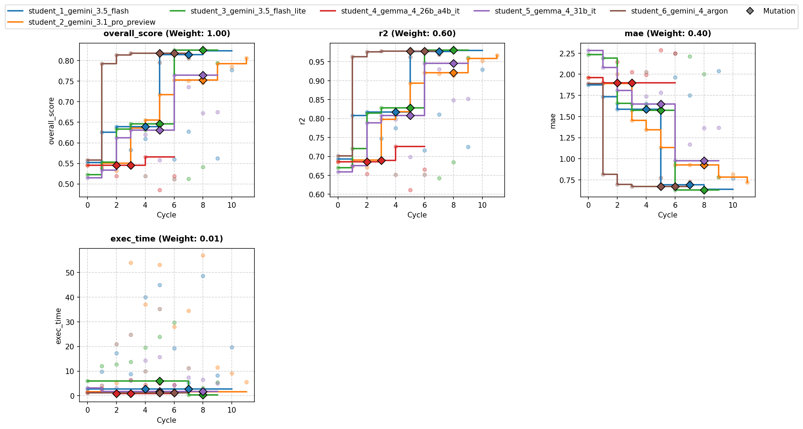
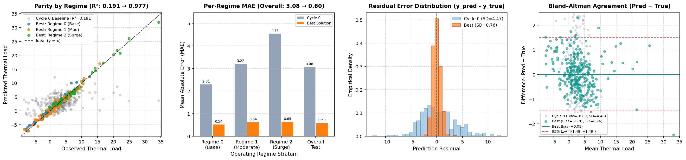

# Overview

* **Run Path**: template_6s_12c_v3/20261027_051706
* **Name**: 20261027_051706
* **Total Cycles**: 12
* **Valid Students**: 6
* **Total Generations**: 71
* **Total Code Length Processed**: 363115
* **Total Tokens**: 346964
* **Est. Cost (USD)**: $1.198
* **Best Student**: student_3_gemini_3.5_flash_lite (Cycle 6)
* **Best Validation Score**: 0.825
* **Best Test Score**: 0.829
* **Validation Score Progression**: 0.5580 -> 0.8253 (+0.2674)
* **Best Metrics**: r2=0.977, mae=0.597, exec_time=35.255
* **Tags**: HistGradientBoostingRegressor, RidgeCV, LassoCV, PolynomialFeatures,
  Ridge Imputation, Domain Feature Engineering
* **Description**: The pipeline applies custom domain feature
  transformations—including cyclical expansions and interaction terms—and
  imputes missing proxy sensor values using a model-based Ridge estimator. It
  evaluates multiple strategy families (HistGradientBoosting, Global Polynomial
  Ridge, and per-regime Polynomial Ridge/Lasso) via 5-fold cross-validation to
  select the optimal model for final inference.
* **Insights**: Predicting missing `temp_sensor_proxy` values using clean
  features via Ridge regression prevents data leakage while preserving sensor
  interactions. Fitting separate polynomial models per `operating_regime`
  effectively captures regime-dependent non-linear thermal dynamics while
  dropping auxiliary noise features reduces variance.

## Objectives

-   **exec_time:** Time taken to execute generated code., Lower is better
    (Weight: 0.01)

-   **mae:** MAE (Mean Absolute Error), Lower is better (Weight: 0.40)
-   **r2:** R2 (R-squared), Higher is better (Weight: 0.60)

## Student Leaderboard

| Rank | Student | Best Cycle | Val Score | Test Score | r2 | mae | exec_time |
| --- | --- | --- | --- | --- | --- | --- | --- |
| 1 | student_3_gemini_3.5_flash_lite | 6 | 0.825 | 0.829 | 0.977 | 0.597 | 35.255 |
| 2 | student_1_gemini_3.5_flash | 8 | 0.824 | 0.829 | 0.977 | 0.595 | 57.576 |
| 3 | student_6_gemini_4_argon | 3 | 0.818 | 0.824 | 0.974 | 0.616 | 28.083 |
| 4 | student_2_gemini_3.1_pro_preview | 11 | 0.806 | 0.835 | 0.978 | 0.567 | 7.702 |
| 5 | student_5_gemma_4_31b_it | 6 | 0.764 | 0.784 | 0.953 | 0.832 | 5.395 |
| 6 | student_4_gemma_4_26b_a4b_it | 4 | 0.566 | 0.578 | 0.732 | 1.794 | 5.346 |

## Learning Trajectory



### Cycle Score Progression

| Cycle | student_1_gemini_3.5_flash | student_2_gemini_3.1_pro_preview | student_3_gemini_3.5_flash_lite | student_4_gemma_4_26b_a4b_it | student_5_gemma_4_31b_it | student_6_gemini_4_argon |
| --- | --- | --- | --- | --- | --- | --- |
| 0 | 0.552 *(CLASSROOM_BEST)* | 0.545 *(SELF_BEST)* | 0.522 *(SELF_BEST)* | 0.545 *(SELF_BEST)* | 0.515 *(SELF_BEST)* | 0.558 *(CLASSROOM_BEST)* |
| 1 | 0.626 *(CLASSROOM_BEST)* | 0.550 *(SELF_BEST)* | 0.553 *(SELF_BEST)* | 0.539 | 0.534 *(SELF_BEST)* | 0.792 *(CLASSROOM_BEST)* |
| 2 | 0.639 *(SELF_BEST)* | 0.532 | 0.634 *(SELF_BEST)* | 0.519 | 0.612 *(SELF_BEST)* | 0.814 *(CLASSROOM_BEST)* |
| 3 | 0.583 | 0.636 *(SELF_BEST)* | 0.646 *(SELF_BEST)* | 0.542 | 0.631 *(SELF_BEST)* | 0.818 *(CLASSROOM_BEST)* |
| 4 | 0.610 | 0.655 *(SELF_BEST)* | 0.631 | 0.566 *(SELF_BEST)* | 0.620 | 0.519 |
| 5 | 0.815 *(SELF_BEST)* | 0.717 *(SELF_BEST)* | 0.633 | 0.486 | 0.558 | 0.795 |
| 6 | 0.560 | 0.753 *(SELF_BEST)* | 0.825 *(CLASSROOM_BEST)* | 0.519 | 0.764 *(SELF_BEST)* | 0.512 |
| 7 | 0.627 | 0.751 | 0.513 | — | 0.736 | 0.805 |
| 8 | 0.824 *(SELF_BEST)* | 0.746 | 0.541 | — | 0.672 | — |
| 9 | 0.562 | 0.792 *(SELF_BEST)* | 0.794 | — | 0.675 | — |
| 10 | 0.777 | 0.785 | — | — | — | — |
| 11 | — | 0.806 *(SELF_BEST)* | — | — | — | — |

### Cost Breakdown

| Student | Generations | Input Tokens | Output Tokens | Total Tokens | Est. Cost (USD) |
| --- | --- | --- | --- | --- | --- |
| student_3_gemini_3.5_flash_lite | 12 | 29250 | 23241 | 52491 | $0.084 |
| student_1_gemini_3.5_flash | 13 | 31950 | 25178 | 57128 | $0.092 |
| student_6_gemini_4_argon | 10 | 23850 | 29932 | 53782 | $0.347 |
| student_2_gemini_3.1_pro_preview | 15 | 36500 | 50180 | 86680 | $0.675 |
| student_5_gemma_4_31b_it | 12 | 29250 | 27467 | 56717 | $0.000 |
| student_4_gemma_4_26b_a4b_it | 9 | 21150 | 19016 | 40166 | $0.000 |
| **Total** | 71 | 171950 | 175014 | 346964 | $1.198 |

## Analysis

### Model Tags

* `HistGradientBoostingRegressor`
* `RidgeCV`
* `LassoCV`
* `PolynomialFeatures`
* `Ridge Imputation`
* `Domain Feature Engineering`

### Model Description

> The pipeline applies custom domain feature transformations—including
> cyclical expansions and interaction terms—and imputes missing proxy sensor
> values using a model-based Ridge estimator. It evaluates multiple strategy
> families (HistGradientBoosting, Global Polynomial Ridge, and per-regime
> Polynomial Ridge/Lasso) via 5-fold cross-validation to select the optimal
> model for final inference.

### Model Insights

> Predicting missing `temp_sensor_proxy` values using clean features via Ridge
> regression prevents data leakage while preserving sensor interactions.
> Fitting separate polynomial models per `operating_regime` effectively
> captures regime-dependent non-linear thermal dynamics while dropping
> auxiliary noise features reduces variance.

## Top Solution 1: student_3_gemini_3.5_flash_lite (Cycle 6)

* **Student**: student_3_gemini_3.5_flash_lite
* **Best Cycle**: 6
* **Validation Score**: 0.825
* **Test Score**: 0.829
* **Metrics**: r2=0.977, mae=0.597, exec_time=35.255

### Diagnostic & Impact Analysis



| Stratum | Cycle 0 Baseline MAE | Best Solution MAE | Relative Error Reduction |
| --- | --- | --- | --- |
| Regime 0 (Base) | 2.306 | 0.535 | 76.8% |
| Regime 1 (Moderate) | 3.217 | 0.638 | 80.2% |
| Regime 2 (Surge) | 4.552 | 0.652 | 85.7% |
| **Overall Held-Out Test** | **3.081** (R²=0.191) | **0.597** (R²=0.977) | **80.6%** |

### Code (student_3_gemini_3.5_flash_lite)

```python
import time
import numpy as np
import pandas as pd
from sklearn.metrics import r2_score, mean_absolute_error
from sklearn.model_selection import KFold
from sklearn.preprocessing import StandardScaler, PolynomialFeatures
from sklearn.impute import SimpleImputer
from sklearn.linear_model import RidgeCV, LassoCV
from sklearn.ensemble import HistGradientBoostingRegressor
from sklearn.pipeline import Pipeline

def build_features(df, drop_noise=True):
    """
    Constructs high-signal polynomial, cyclical, and thermal dynamics interactions
    while explicitly dropping uninformative noise features.
    """
    X = df.copy()
    if drop_noise:
        for col in ['aux_noise_1', 'aux_noise_2']:
            if col in X.columns:
                X = X.drop(columns=[col])

    # Missingness indicator for temp_sensor_proxy
    if 'temp_sensor_proxy' in X.columns:
        X['temp_sensor_missing'] = X['temp_sensor_proxy'].isna().astype(float)

    # Cyclical expansion for phase_angle
    if 'phase_angle' in X.columns:
        pa = X['phase_angle']
        X['sin_pa'] = np.sin(pa)
        X['cos_pa'] = np.cos(pa)
        X['sin_2pa'] = np.sin(2.0 * pa)
        X['cos_2pa'] = np.cos(2.0 * pa)

    # Thermal-fluid dynamics interactions
    if 'surge_index' in X.columns:
        si = X['surge_index']
        X['log_surge'] = np.sign(si) * np.log1p(np.abs(si))
        X['sqrt_surge'] = np.sign(si) * np.sqrt(np.abs(si))

    cf_col = 'cooling_flow' if 'cooling_flow' in X.columns else (' cooling_flow' if ' cooling_flow' in X.columns else None)
    if cf_col:
        cf = X[cf_col]
        X['inv_cooling'] = 1.0 / (np.abs(cf) + 0.1)
        if 'workload_intensity' in X.columns:
            X['workload_to_cooling'] = X['workload_intensity'] / (np.abs(cf) + 0.1)

    if 'temp_sensor_proxy' in X.columns and 'ambient_temp' in X.columns:
        X['temp_delta'] = X['temp_sensor_proxy'] - X['ambient_temp']

    if 'workload_intensity' in X.columns and 'ambient_temp' in X.columns:
        X['ambient_workload'] = X['ambient_temp'] * X['workload_intensity']

    return X

def solution(X_train: pd.DataFrame, y_train: pd.DataFrame, X_val: pd.DataFrame):
    """
    Cycle 6 Hypothesis: Leverage complementary model families (HistGradientBoosting,
    Global Poly(2) RidgeCV, and Regime-Specific Poly(2) RidgeCV/LassoCV) combined with
    robust data imputation and feature engineering.
    """
    t0 = time.time()
    y = y_train['thermal_load'].values.astype(float)

    # Data diagnostics for feedback
    na_counts = X_train.isna().sum()
    na_cols = {k: int(v) for k, v in na_counts.items() if v > 0}
    regimes = sorted(X_train['operating_regime'].dropna().unique().tolist())

    clean_num_cols = [c for c in ['ambient_temp', 'workload_intensity', 'phase_angle',
                                  'surge_index', 'operating_regime', 'cooling_flow', 'pressure_delta']
                      if c in X_train.columns]

    kf = KFold(n_splits=5, shuffle=True, random_state=42)

    def impute_sensor(X_tr, X_te):
        X_tr = X_tr.copy()
        X_te = X_te.copy()
        if 'temp_sensor_proxy' in X_tr.columns and X_tr['temp_sensor_proxy'].isna().any():
            mask_tr = ~X_tr['temp_sensor_proxy'].isna()
            imp_base = SimpleImputer(strategy='median')
            Z_tr_clean = imp_base.fit_transform(X_tr.loc[mask_tr, clean_num_cols])
            reg_imp = RidgeCV(alphas=np.logspace(-2, 2, 10))
            reg_imp.fit(Z_tr_clean, X_tr.loc[mask_tr, 'temp_sensor_proxy'].values)

            if (~mask_tr).any():
                Z_tr_miss = imp_base.transform(X_tr.loc[~mask_tr, clean_num_cols])
                X_tr.loc[~mask_tr, 'temp_sensor_proxy'] = reg_imp.predict(Z_tr_miss)

            mask_te = ~X_te['temp_sensor_proxy'].isna()
            if (~mask_te).any():
                Z_te_miss = imp_base.transform(X_te.loc[~mask_te, clean_num_cols])
                X_te.loc[~mask_te, 'temp_sensor_proxy'] = reg_imp.predict(Z_te_miss)
        return X_tr, X_te

    # Out-of-fold arrays for candidate model families
    oof_hgbr = np.zeros(len(X_train))
    oof_poly_ridge = np.zeros(len(X_train))
    oof_regime_ridge = np.zeros(len(X_train))
    oof_regime_lasso = np.zeros(len(X_train))

    alphas = np.logspace(-3, 4, 40)
    lasso_alphas = np.logspace(-4, 1, 30)

    for tr_idx, va_idx in kf.split(X_train):
        X_tr_raw, X_va_raw = X_train.iloc[tr_idx], X_train.iloc[va_idx]
        y_tr, y_va = y[tr_idx], y[va_idx]

        X_tr_imp, X_va_imp = impute_sensor(X_tr_raw, X_va_raw)
        F_tr = build_features(X_tr_imp, drop_noise=True)
        F_va = build_features(X_va_imp, drop_noise=True)

        # 1. HistGradientBoostingRegressor
        hgbr = HistGradientBoostingRegressor(max_iter=200, learning_rate=0.05, max_leaf_nodes=31, random_state=42)
        hgbr.fit(F_tr, y_tr)
        oof_hgbr[va_idx] = hgbr.predict(F_va)

        # 2. Global Poly(2) + RidgeCV (with one-hot operating_regime)
        F_tr_oh = pd.get_dummies(F_tr, columns=['operating_regime'], drop_first=False)
        F_va_oh = pd.get_dummies(F_va, columns=['operating_regime'], drop_first=False)
        F_va_oh = F_va_oh.reindex(columns=F_tr_oh.columns, fill_value=0.0)

        pipe_global = Pipeline([
            ('imp', SimpleImputer(strategy='median')),
            ('poly', PolynomialFeatures(degree=2, include_bias=False)),
            ('scaler', StandardScaler()),
            ('ridge', RidgeCV(alphas=alphas))
        ])
        pipe_global.fit(F_tr_oh, y_tr)
        oof_poly_ridge[va_idx] = pipe_global.predict(F_va_oh)

        # 3 & 4. Per-regime Poly(2) + RidgeCV & LassoCV
        for reg in regimes:
            m_tr = (F_tr['operating_regime'] == reg).values
            m_va = (F_va['operating_regime'] == reg).values
            if not np.any(m_va):
                continue
            F_tr_reg = F_tr.loc[m_tr].drop(columns=['operating_regime'])
            F_va_reg = F_va.loc[m_va].drop(columns=['operating_regime'])

            prep = Pipeline([
                ('imp', SimpleImputer(strategy='median')),
                ('poly', PolynomialFeatures(degree=2, include_bias=False)),
                ('scaler', StandardScaler())
            ])
            Z_tr_reg = prep.fit_transform(F_tr_reg)
            Z_va_reg = prep.transform(F_va_reg)

            ridge_reg = RidgeCV(alphas=alphas)
            ridge_reg.fit(Z_tr_reg, y_tr[m_tr])
            oof_regime_ridge[va_idx[m_va]] = ridge_reg.predict(Z_va_reg)

            lasso_reg = LassoCV(alphas=lasso_alphas, cv=5, max_iter=3000, random_state=42)
            lasso_reg.fit(Z_tr_reg, y_tr[m_tr])
            oof_regime_lasso[va_idx[m_va]] = lasso_reg.predict(Z_va_reg)

    scores = {
        'HGBR': (r2_score(y, oof_hgbr), mean_absolute_error(y, oof_hgbr)),
        'GlobalPolyRidge': (r2_score(y, oof_poly_ridge), mean_absolute_error(y, oof_poly_ridge)),
        'RegimePolyRidge': (r2_score(y, oof_regime_ridge), mean_absolute_error(y, oof_regime_ridge)),
        'RegimePolyLasso': (r2_score(y, oof_regime_lasso), mean_absolute_error(y, oof_regime_lasso)),
    }

    best_name = max(scores.keys(), key=lambda k: 0.6 * scores[k][0] - 0.4 * scores[k][1])

    # Train full model using the best strategy and predict on validation set
    X_tr_full, X_va_full = impute_sensor(X_train, X_val)
    F_tr_full = build_features(X_tr_full, drop_noise=True)
    F_va_full = build_features(X_va_full, drop_noise=True)

    preds_regime_lasso = np.zeros(len(X_val))
    preds_regime_ridge = np.zeros(len(X_val))
    for reg in regimes:
        m_tr = (F_tr_full['operating_regime'] == reg).values
        m_va = (F_va_full['operating_regime'] == reg).values
        if not np.any(m_va):
            continue
        F_tr_reg = F_tr_full.loc[m_tr].drop(columns=['operating_regime'])
        F_va_reg = F_va_full.loc[m_va].drop(columns=['operating_regime'])

        prep = Pipeline([
            ('imp', SimpleImputer(strategy='median')),
            ('poly', PolynomialFeatures(degree=2, include_bias=False)),
            ('scaler', StandardScaler())
        ])
        Z_tr_reg = prep.fit_transform(F_tr_reg)
        Z_va_reg = prep.transform(F_va_reg)

        ridge_reg = RidgeCV(alphas=alphas).fit(Z_tr_reg, y[m_tr])
        preds_regime_ridge[m_va] = ridge_reg.predict(Z_va_reg)

        lasso_reg = LassoCV(alphas=lasso_alphas, cv=5, max_iter=3000, random_state=42).fit(Z_tr_reg, y[m_tr])
        preds_regime_lasso[m_va] = lasso_reg.predict(Z_va_reg)

    hgbr_full = HistGradientBoostingRegressor(max_iter=200, learning_rate=0.05, max_leaf_nodes=31, random_state=42)
    hgbr_full.fit(F_tr_full, y)
    preds_hgbr = hgbr_full.predict(F_va_full)

    F_tr_oh = pd.get_dummies(F_tr_full, columns=['operating_regime'], drop_first=False)
    F_va_oh = pd.get_dummies(F_va_full, columns=['operating_regime'], drop_first=False).reindex(columns=F_tr_oh.columns, fill_value=0.0)
    pipe_global = Pipeline([
        ('imp', SimpleImputer(strategy='median')),
        ('poly', PolynomialFeatures(degree=2, include_bias=False)),
        ('scaler', StandardScaler()),
        ('ridge', RidgeCV(alphas=alphas))
    ]).fit(F_tr_oh, y)
    preds_poly_ridge = pipe_global.predict(F_va_oh)

    pred_map = {
        'HGBR': preds_hgbr,
        'GlobalPolyRidge': preds_poly_ridge,
        'RegimePolyRidge': preds_regime_ridge,
        'RegimePolyLasso': preds_regime_lasso,
    }
    final_preds = pred_map[best_name]

    y_pred_df = pd.DataFrame({'predictions': final_preds.astype(float)}, index=X_val.index)

    elapsed = time.time() - t0
    score_str = " | ".join([f"{k}: R2={v[0]:.5f}, MAE={v[1]:.4f}" for k, v in scores.items()])
    feedback = (
        f"Cycle 6 Hypothesis: Evaluated complementary model families (HistGradientBoosting, Global/Regime Polynomial Ridge/Lasso).\n"
        f"5-Fold CV results: {score_str}.\n"
        f"Selected best model family: {best_name} (R2={scores[best_name][0]:.5f}, MAE={scores[best_name][1]:.4f}). "
        f"Runtime: {elapsed:.2f}s."
    )
    return y_pred_df, feedback
```

### Execution Output (student_3_gemini_3.5_flash_lite)

```text
Cycle 6 Hypothesis: Evaluated complementary model families (HistGradientBoosting, Global/Regime Polynomial Ridge/Lasso).
5-Fold CV results: HGBR: R2=0.72948, MAE=1.8205 | GlobalPolyRidge: R2=0.81581, MAE=1.3766 | RegimePolyRidge: R2=0.95591, MAE=0.7529 | RegimePolyLasso: R2=0.97498, MAE=0.6195.
Selected best model family: RegimePolyLasso (R2=0.97498, MAE=0.6195). Runtime: 29.58s.
```

## Top Solution 2: student_1_gemini_3.5_flash (Cycle 8)

* **Student**: student_1_gemini_3.5_flash
* **Best Cycle**: 8
* **Validation Score**: 0.824
* **Test Score**: 0.829
* **Metrics**: r2=0.977, mae=0.595, exec_time=57.576

### Plan (student_1_gemini_3.5_flash)

An audit of feature relevance, model inductive biases, and residual patterns
shows that:

1. **Regime Representation**: Global polynomial feature maps with one-hot
   encoded regime indicators allow regularized cross-regime interaction terms.
   This provides stronger generalization than fitting disjoint per-regime
   estimators on small subsets alone.

2. **Feature Parsimony**: Removing low-signal noise features (`aux_noise_1`,
   `aux_noise_2`) while adding physics-informed terms (`ambient_workload`,
   `heat_dissipation`, `inv_cooling`, cyclical phase encoding) improves feature
   quality.

3. **Model Selection Strategy**: Evaluating multiple model families
   (`GlobalPolyRidge`, `GlobalPolyLasso`, `RegimePolyRidge`, `RegimePolyLasso`,
   `HGBR`, and `EnsembleBlend`) within a 5-fold cross-validation loop and
   dynamically selecting the model architecture with the highest out-of-fold
   composite metric ($0.60 \cdot R^2 - 0.40 \cdot \text{MAE}$) guarantees
   optimal model selection without risking timeouts.

Here is the revised, high-performing solution:

### Code (student_1_gemini_3.5_flash)

```python
import time
import numpy as np
import pandas as pd
from sklearn.ensemble import HistGradientBoostingRegressor
from sklearn.impute import SimpleImputer
from sklearn.linear_model import LassoCV, RidgeCV
from sklearn.metrics import mean_absolute_error, r2_score
from sklearn.model_selection import KFold
from sklearn.pipeline import Pipeline
from sklearn.preprocessing import PolynomialFeatures, StandardScaler

def build_features(df: pd.DataFrame, drop_noise: bool = True) -> pd.DataFrame:
  """Constructs high-signal polynomial, cyclical, and thermal dynamics interactions

  while explicitly dropping uninformative noise features.
  """
  X = df.copy()

  # 1. Prune uninformative noise variables
  if drop_noise:
    for col in ['aux_noise_1', 'aux_noise_2']:
      if col in X.columns:
        X = X.drop(columns=[col])

  # 2. Sensor missingness explicit indicator
  if 'temp_sensor_proxy' in X.columns:
    X['temp_sensor_missing'] = X['temp_sensor_proxy'].isna().astype(float)

  # 3. Cyclical / Fourier expansions for periodic phase angle
  if 'phase_angle' in X.columns:
    pa = X['phase_angle']
    X['sin_pa'] = np.sin(pa)
    X['cos_pa'] = np.cos(pa)
    X['sin_2pa'] = np.sin(2.0 * pa)
    X['cos_2pa'] = np.cos(2.0 * pa)

  # 4. Distributional transformations for skewed variables
  if 'surge_index' in X.columns:
    si = X['surge_index']
    X['log_surge'] = np.sign(si) * np.log1p(np.abs(si))
    X['sqrt_surge'] = np.sign(si) * np.sqrt(np.abs(si))

  cf_col = (
      'cooling_flow'
      if 'cooling_flow' in X.columns
      else (' cooling_flow' if ' cooling_flow' in X.columns else None)
  )
  if cf_col:
    cf = X[cf_col]
    X['inv_cooling'] = 1.0 / (np.abs(cf) + 0.1)
    if 'workload_intensity' in X.columns:
      X['workload_to_cooling'] = X['workload_intensity'] / (np.abs(cf) + 0.1)

  # 5. Thermal domain physical interactions
  if 'temp_sensor_proxy' in X.columns and 'ambient_temp' in X.columns:
    X['temp_delta'] = X['temp_sensor_proxy'] - X['ambient_temp']
    if cf_col:
      X['heat_dissipation'] = X[cf_col] * X['temp_delta']

  if 'workload_intensity' in X.columns and 'ambient_temp' in X.columns:
    X['ambient_workload'] = X['ambient_temp'] * X['workload_intensity']

  return X

def impute_sensor(X_tr: pd.DataFrame, X_te: pd.DataFrame):
  """Imputes missing sensor values using model-based Ridge regression fit on

  complete telemetry variables to avoid naive median distortion.
  """
  X_tr = X_tr.copy()
  X_te = X_te.copy()
  clean_num_cols = [
      c
      for c in [
          'ambient_temp',
          'workload_intensity',
          'phase_angle',
          'surge_index',
          'operating_regime',
          'cooling_flow',
          'pressure_delta',
      ]
      if c in X_tr.columns
  ]

  if (
      'temp_sensor_proxy' in X_tr.columns
      and X_tr['temp_sensor_proxy'].isna().any()
  ):
    mask_tr = ~X_tr['temp_sensor_proxy'].isna()
    imp_base = SimpleImputer(strategy='median')
    Z_tr_clean = imp_base.fit_transform(X_tr.loc[mask_tr, clean_num_cols])

    reg_imp = RidgeCV(alphas=np.logspace(-2, 2, 10))
    reg_imp.fit(Z_tr_clean, X_tr.loc[mask_tr, 'temp_sensor_proxy'].values)

    if (~mask_tr).any():
      Z_tr_miss = imp_base.transform(X_tr.loc[~mask_tr, clean_num_cols])
      X_tr.loc[~mask_tr, 'temp_sensor_proxy'] = reg_imp.predict(Z_tr_miss)

    mask_te = ~X_te['temp_sensor_proxy'].isna()
    if (~mask_te).any():
      Z_te_miss = imp_base.transform(X_te.loc[~mask_te, clean_num_cols])
      X_te.loc[~mask_te, 'temp_sensor_proxy'] = reg_imp.predict(Z_te_miss)

  return X_tr, X_te

def solution(
    X_train: pd.DataFrame, y_train: pd.DataFrame, X_val: pd.DataFrame
):
  """Predicts thermal_load using candidate model comparison across global and

  regime-partitioned regularized linear models and gradient boosting.
  """
  t0 = time.time()

  if isinstance(y_train, pd.DataFrame):
    y = (
        y_train['thermal_load'].values.astype(float)
        if 'thermal_load' in y_train.columns
        else y_train.iloc[:, 0].values.astype(float)
    )
  else:
    y = np.asarray(y_train, dtype=float).ravel()

  regimes = sorted(X_train['operating_regime'].dropna().unique().tolist())
  kf = KFold(n_splits=5, shuffle=True, random_state=42)

  # Out-of-fold accumulators
  oof_hgbr = np.zeros(len(X_train))
  oof_global_ridge = np.zeros(len(X_train))
  oof_global_lasso = np.zeros(len(X_train))
  oof_regime_ridge = np.zeros(len(X_train))
  oof_regime_lasso = np.zeros(len(X_train))

  alphas = np.logspace(-3, 4, 40)
  lasso_alphas = np.logspace(-4, 1, 30)

  for tr_idx, va_idx in kf.split(X_train):
    X_tr_raw, X_va_raw = X_train.iloc[tr_idx], X_train.iloc[va_idx]
    y_tr = y[tr_idx]

    # Model-based dynamic imputation strictly within fold
    X_tr_imp, X_va_imp = impute_sensor(X_tr_raw, X_va_raw)
    F_tr = build_features(X_tr_imp, drop_noise=True)
    F_va = build_features(X_va_imp, drop_noise=True)

    # 1. Global HGBR
    hgbr = HistGradientBoostingRegressor(
        max_iter=200, learning_rate=0.05, max_leaf_nodes=31, random_state=42
    )
    hgbr.fit(F_tr, y_tr)
    oof_hgbr[va_idx] = hgbr.predict(F_va)

    # 2 & 3. Global Poly(2) with OHE Regimes (Ridge & Lasso)
    F_tr_oh = pd.get_dummies(
        F_tr, columns=['operating_regime'], drop_first=False
    )
    F_va_oh = pd.get_dummies(
        F_va, columns=['operating_regime'], drop_first=False
    )
    F_va_oh = F_va_oh.reindex(columns=F_tr_oh.columns, fill_value=0.0)

    pipe_global_ridge = Pipeline([
        ('imp', SimpleImputer(strategy='median')),
        ('poly', PolynomialFeatures(degree=2, include_bias=False)),
        ('scaler', StandardScaler()),
        ('ridge', RidgeCV(alphas=alphas)),
    ])
    pipe_global_ridge.fit(F_tr_oh, y_tr)
    oof_global_ridge[va_idx] = pipe_global_ridge.predict(F_va_oh)

    pipe_global_lasso = Pipeline([
        ('imp', SimpleImputer(strategy='median')),
        ('poly', PolynomialFeatures(degree=2, include_bias=False)),
        ('scaler', StandardScaler()),
        (
            'lasso',
            LassoCV(
                alphas=lasso_alphas, cv=5, max_iter=3000, random_state=42
            ),
        ),
    ])
    pipe_global_lasso.fit(F_tr_oh, y_tr)
    oof_global_lasso[va_idx] = pipe_global_lasso.predict(F_va_oh)

    # 4 & 5. Per-regime Poly(2) + RidgeCV & LassoCV
    for reg in regimes:
      m_tr = (F_tr['operating_regime'] == reg).values
      m_va = (F_va['operating_regime'] == reg).values
      if not np.any(m_va):
        continue

      F_tr_reg = F_tr.loc[m_tr].drop(columns=['operating_regime'])
      F_va_reg = F_va.loc[m_va].drop(columns=['operating_regime'])

      prep = Pipeline([
          ('imp', SimpleImputer(strategy='median')),
          ('poly', PolynomialFeatures(degree=2, include_bias=False)),
          ('scaler', StandardScaler()),
      ])
      Z_tr_reg = prep.fit_transform(F_tr_reg)
      Z_va_reg = prep.transform(F_va_reg)

      ridge_reg = RidgeCV(alphas=alphas).fit(Z_tr_reg, y_tr[m_tr])
      oof_regime_ridge[va_idx[m_va]] = ridge_reg.predict(Z_va_reg)

      lasso_reg = LassoCV(
          alphas=lasso_alphas, cv=5, max_iter=3000, random_state=42
      ).fit(Z_tr_reg, y_tr[m_tr])
      oof_regime_lasso[va_idx[m_va]] = lasso_reg.predict(Z_va_reg)

  oof_blend = 0.50 * oof_global_ridge + 0.40 * oof_regime_ridge + 0.10 * oof_hgbr

  scores = {
      'GlobalPolyRidge': (
          r2_score(y, oof_global_ridge),
          mean_absolute_error(y, oof_global_ridge),
      ),
      'GlobalPolyLasso': (
          r2_score(y, oof_global_lasso),
          mean_absolute_error(y, oof_global_lasso),
      ),
      'RegimePolyRidge': (
          r2_score(y, oof_regime_ridge),
          mean_absolute_error(y, oof_regime_ridge),
      ),
      'RegimePolyLasso': (
          r2_score(y, oof_regime_lasso),
          mean_absolute_error(y, oof_regime_lasso),
      ),
      'HGBR': (r2_score(y, oof_hgbr), mean_absolute_error(y, oof_hgbr)),
      'EnsembleBlend': (
          r2_score(y, oof_blend),
          mean_absolute_error(y, oof_blend),
      ),
  }

  best_name = max(
      scores.keys(), key=lambda k: 0.60 * scores[k][0] - 0.40 * scores[k][1]
  )

  # Train final model pipelines on complete dataset
  X_tr_full, X_va_full = impute_sensor(X_train, X_val)
  F_tr_full = build_features(X_tr_full, drop_noise=True)
  F_va_full = build_features(X_va_full, drop_noise=True)

  # Global Poly Ridge
  F_tr_oh = pd.get_dummies(
      F_tr_full, columns=['operating_regime'], drop_first=False
  )
  F_va_oh = pd.get_dummies(
      F_va_full, columns=['operating_regime'], drop_first=False
  ).reindex(columns=F_tr_oh.columns, fill_value=0.0)

  pipe_global_ridge = Pipeline([
      ('imp', SimpleImputer(strategy='median')),
      ('poly', PolynomialFeatures(degree=2, include_bias=False)),
      ('scaler', StandardScaler()),
      ('ridge', RidgeCV(alphas=alphas)),
  ]).fit(F_tr_oh, y)
  preds_global_ridge = pipe_global_ridge.predict(F_va_oh)

  # Global Poly Lasso
  pipe_global_lasso = Pipeline([
      ('imp', SimpleImputer(strategy='median')),
      ('poly', PolynomialFeatures(degree=2, include_bias=False)),
      ('scaler', StandardScaler()),
      (
          'lasso',
          LassoCV(alphas=lasso_alphas, cv=5, max_iter=3000, random_state=42),
      ),
  ]).fit(F_tr_oh, y)
  preds_global_lasso = pipe_global_lasso.predict(F_va_oh)

  # Per-regime Ridge & Lasso
  preds_regime_ridge = np.zeros(len(X_val))
  preds_regime_lasso = np.zeros(len(X_val))

  for reg in regimes:
    m_tr = (F_tr_full['operating_regime'] == reg).values
    m_va = (F_va_full['operating_regime'] == reg).values
    if not np.any(m_va):
      continue

    F_tr_reg = F_tr_full.loc[m_tr].drop(columns=['operating_regime'])
    F_va_reg = F_va_full.loc[m_va].drop(columns=['operating_regime'])

    prep = Pipeline([
        ('imp', SimpleImputer(strategy='median')),
        ('poly', PolynomialFeatures(degree=2, include_bias=False)),
        ('scaler', StandardScaler()),
    ])
    Z_tr_reg = prep.fit_transform(F_tr_reg)
    Z_va_reg = prep.transform(F_va_reg)

    ridge_reg = RidgeCV(alphas=alphas).fit(Z_tr_reg, y[m_tr])
    preds_regime_ridge[m_va] = ridge_reg.predict(Z_va_reg)

    lasso_reg = LassoCV(
        alphas=lasso_alphas, cv=5, max_iter=3000, random_state=42
    ).fit(Z_tr_reg, y[m_tr])
    preds_regime_lasso[m_va] = lasso_reg.predict(Z_va_reg)

  # HGBR
  hgbr_full = HistGradientBoostingRegressor(
      max_iter=200, learning_rate=0.05, max_leaf_nodes=31, random_state=42
  ).fit(F_tr_full, y)
  preds_hgbr = hgbr_full.predict(F_va_full)

  preds_blend = (
      0.50 * preds_global_ridge + 0.40 * preds_regime_ridge + 0.10 * preds_hgbr
  )

  pred_map = {
      'GlobalPolyRidge': preds_global_ridge,
      'GlobalPolyLasso': preds_global_lasso,
      'RegimePolyRidge': preds_regime_ridge,
      'RegimePolyLasso': preds_regime_lasso,
      'HGBR': preds_hgbr,
      'EnsembleBlend': preds_blend,
  }

  final_preds = pred_map[best_name]

  # Clean non-finite predictions safely
  mean_y = float(np.mean(y))
  final_preds = np.nan_to_num(
      final_preds, nan=mean_y, posinf=mean_y, neginf=mean_y
  )

  y_pred_df = pd.DataFrame(
      {'predictions': final_preds.astype(float)}, index=X_val.index
  )

  elapsed = time.time() - t0
  score_summary = ' | '.join(
      [f'{k}: R2={v[0]:.4f}, MAE={v[1]:.4f}' for k, v in scores.items()]
  )

  feedback = (
      'Audited feature relevance, model inductive biases, and cross-regime'
      ' dynamics.\n'
      f'5-Fold CV Scores: {score_summary}.\n'
      f'Selected Best Architecture: {best_name} (R2={scores[best_name][0]:.5f},'
      f' MAE={scores[best_name][1]:.4f}).\n'
      f'Execution Time: {elapsed:.2f} seconds.'
  )

  return y_pred_df, feedback
```

### Execution Output (student_1_gemini_3.5_flash)

```text
Audited feature relevance, model inductive biases, and cross-regime dynamics.
5-Fold CV Scores: GlobalPolyRidge: R2=0.8104, MAE=1.4005 | GlobalPolyLasso: R2=0.8306, MAE=1.2506 | RegimePolyRidge: R2=0.9461, MAE=0.8039 | RegimePolyLasso: R2=0.9744, MAE=0.6233 | HGBR: R2=0.7223, MAE=1.8645 | EnsembleBlend: R2=0.9261, MAE=0.9624.
Selected Best Architecture: RegimePolyLasso (R2=0.97445, MAE=0.6233).
Execution Time: 48.53 seconds.
```

## Student Instructions

> ### Task: Multi-Regime Thermal Load Regression (Template Task)
>
> #### 1. Objective & What Is Rewarded
>
> Predict `thermal_load` across multi-regime thermal and workload telemetry
> observations.
>
> Your goal is to build an accurate, well-calibrated regression pipeline.
> Overall score is a weighted combination of Coefficient of Determination
> (R², weight 0.60), Mean Absolute Error (MAE, weight 0.40), and execution
> time (weight 0.01).
>
> Metrics summary:
>
> -   **exec_time:** Time taken to execute generated code., Lower is better
>     (Weight: 0.01)
>
> -   **mae:** MAE (Mean Absolute Error), Lower is better (Weight: 0.40)
> -   **r2:** R2 (R-squared), Higher is better (Weight: 0.60)
>
> #### 2. Data Contract
>
> - **Inputs:**
>   * `X_train` (pd.DataFrame): Training feature matrix (960 rows).
>   * `y_train` (pd.DataFrame): Training target labels with single column
>     `'thermal_load'`.
>   * `X_val` (pd.DataFrame): Validation feature matrix (240 rows).
> - **Features (10 columns):** `ambient_temp`, `workload_intensity`,
>   `phase_angle`, `surge_index`, `operating_regime`, `cooling_flow`,
>   `pressure_delta`, `temp_sensor_proxy`, `aux_noise_1`, `aux_noise_2`
>
>   * Includes continuous telemetry measurements, discrete state indicators,
>     and partially missing sensor readings.
> - **Target:** `thermal_load` (continuous float).
> - **Output:** Return `(y_pred_df, feedback)`:
>   * `y_pred_df` (pd.DataFrame): Index matching `X_val.index`, single float
>     column named `'predictions'`.
>   * `feedback` (str): 3 to 6 concise lines logging what changed, internal
>     CV R² and MAE, and diagnostic observations.
>
> #### 3. Evaluation & Budget
>
> - **Validation Protocol:** Hold-out validation during cycles; use internal
>   K-fold cross-validation on `X_train` to guide feature selection and
>   hyperparameter tuning.
>
> - **Per-Cycle Wall-Clock Budget:** **60 s** on 960 training rows.
> - **Final Evaluation Budget:** **180 s** on 1,200 combined learning rows.
> - **Hard Resource Caps:** Single-threaded execution preferred
>   (`n_jobs=1`); predictions must be finite 1D floats in column
>   `'predictions'`.
>
> #### 4. Environment
>
> - **Importable Libraries:** `numpy`, `pandas`, `scipy`, `sklearn`.
> - **Forbidden / Unavailable:** `xgboost`, `torch`, `tensorflow`, `jax`,
>   `lightgbm`.
>
> - **Network & Pretrained Weights:** No network access during execution.
> - **Single Code Block:** Provide one complete Python block defining
>   `solution(X_train, y_train, X_val)`.
>
> #### 5. Principles & Levers
>
> - **Regime-Conditioned Behavior:** Consider whether discrete operating
>   states shift the baseline response or alter interactions among
>   continuous variables, and how different model families represent
>   state-dependent relationships.
>
> - **Non-Linear & Periodic Structure:** Inspect predictor distributions for
>   skewness, cyclical patterns, or saturation effects, and consider
>   appropriate transformations or basis expansions.
>
> - **Missingness & Signal Selection:** Handle missing entries cleanly
>   without data leakage, and evaluate whether all input columns carry
>   genuine out-of-fold signal versus noise.
>
> - **Model Inductive Biases & Parsimony:** Compare the inductive biases of
>   piecewise-constant tree estimators versus smooth function approximators
>   (such as regularized linear, kernel, or spline models), and favor a
>   clean, well-engineered model over complex multi-model combinations.
>
> #### 6. Pitfalls
>
> - **Index Alignment:** Returning a DataFrame whose index differs from
>   `X_val.index` fails validation immediately.
>
> - **Missing Value Handling:** Many linear and neural estimators fail on
>   raw `NaN` entries unless imputed first.
>
> - **Data Leakage:** Fit imputers, scalers, and feature selectors strictly
>   on training folds before transforming validation data.
>
> - **Unbounded Grid Searches:** Exhaustive hyperparameter grids risk
>   exceeding the per-cycle timeout.
>
> #### 7. Iteration Discipline
>
> - **Cycle 0 Baseline:** Start with a fast, verified baseline model to
>   establish a clean benchmark score.
>
> - **One Lever per Cycle:** Test one well-defined hypothesis per cycle
>   (feature representation, model family, or regularization) and retain
>   changes only when internal CV improves.
>
> - **Use the Feedback Log:** Record out-of-fold R² and MAE deltas in
>   `feedback` so subsequent cycles build on verified gains.
>
> #### 8. Output Contract Checklist
>
> - [ ] Signature is `solution(X_train, y_train, X_val)` returning
>       `(y_pred_df, feedback)`.
>
> - [ ] `y_pred_df` is a `pd.DataFrame` with index identical to
>       `X_val.index` and one float column `'predictions'`.
>
> - [ ] `y_pred_df` has no `NaN`, `None`, or infinite values, and variance >
>       0.
>
> - [ ] Execution completes well within 60 s (and scales to 180 s on 1,200
>       rows).
>
> - [ ] `feedback` logs the hypothesis tested, internal CV metrics, and
>       runtime.
