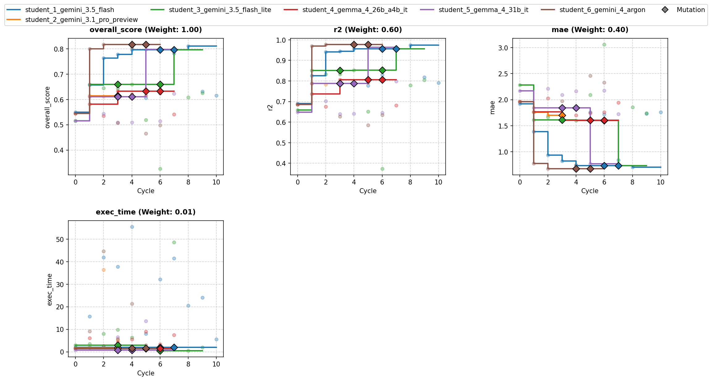
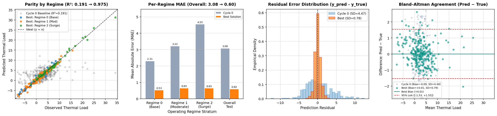

# Overview

* **Run Path**: template_6s_12c_v4/20261027_194342
* **Name**: 20261027_194342
* **Total Cycles**: 11
* **Valid Students**: 6
* **Total Generations**: 62
* **Total Code Length Processed**: 245811
* **Total Tokens**: 259758
* **Est. Cost (USD)**: $0.602
* **Best Student**: student_6_gemini_4_argon (Cycle 2)
* **Best Validation Score**: 0.817
* **Best Test Score**: 0.827
* **Validation Score Progression**: 0.5491 -> 0.8167 (+0.2676)
* **Best Metrics**: r2=0.975, mae=0.598, exec_time=61.071
* **Tags**: Per-Regime Models, RidgeCV, LassoCV, HuberRegressor,
  GradientBoostingRegressor, SVR, Polynomial Features, Ensemble Blending
* **Description**: The approach applies iterative imputation and domain-specific
  feature engineering (trigonometric and non-linear transforms) followed by
  regime-conditioned modeling where separate estimators are fit for each
  operating regime. A grid search optimizes simplex weights over the top
  cross-validated models—including Polynomial Ridge, Lasso, and Gradient
  Boosting—to form a weighted ensemble.
* **Insights**: Conditioning the models per operating regime and filtering out
  noise variables significantly improves prediction accuracy across linear and
  non-linear families. Incorporating sine/cosine transformations for phase
  angles and domain ratios like workload-to-cooling flow allows polynomial
  models to effectively capture system physics.

## Objectives

-   **exec_time:** Time taken to execute generated code., Lower is better
    (Weight: 0.01)

-   **mae:** MAE (Mean Absolute Error), Lower is better (Weight: 0.40)
-   **r2:** R2 (R-squared), Higher is better (Weight: 0.60)

## Student Leaderboard

| Rank | Student | Best Cycle | Val Score | Test Score | r2 | mae | exec_time |
| --- | --- | --- | --- | --- | --- | --- | --- |
| 1 | student_6_gemini_4_argon | 2 | 0.817 | 0.827 | 0.975 | 0.598 | 61.071 |
| 2 | student_1_gemini_3.5_flash | 8 | 0.812 | 0.814 | 0.968 | 0.657 | 28.640 |
| 3 | student_5_gemma_4_31b_it | 5 | 0.797 | 0.827 | 0.974 | 0.598 | 19.403 |
| 4 | student_3_gemini_3.5_flash_lite | 7 | 0.796 | 0.831 | 0.974 | 0.569 | 58.132 |
| 5 | student_4_gemma_4_26b_a4b_it | 3 | 0.633 | 0.647 | 0.812 | 1.435 | 4.620 |
| 6 | student_2_gemini_3.1_pro_preview | 1 | 0.615 | 0.646 | 0.811 | 1.459 | 3.009 |

## Learning Trajectory



### Cycle Score Progression

| Cycle | student_1_gemini_3.5_flash | student_2_gemini_3.1_pro_preview | student_3_gemini_3.5_flash_lite | student_4_gemma_4_26b_a4b_it | student_5_gemma_4_31b_it | student_6_gemini_4_argon |
| --- | --- | --- | --- | --- | --- | --- |
| 0 | 0.549 *(CLASSROOM_BEST)* | 0.545 *(SELF_BEST)* | 0.515 *(SELF_BEST)* | 0.545 *(SELF_BEST)* | 0.515 *(SELF_BEST)* | 0.545 *(SELF_BEST)* |
| 1 | 0.657 *(CLASSROOM_BEST)* | 0.615 *(SELF_BEST)* | 0.659 *(CLASSROOM_BEST)* | 0.582 *(SELF_BEST)* | 0.611 *(SELF_BEST)* | 0.800 *(CLASSROOM_BEST)* |
| 2 | 0.764 *(SELF_BEST)* | 0.612 | 0.645 | 0.535 | 0.544 | 0.817 *(CLASSROOM_BEST)* |
| 3 | 0.778 *(SELF_BEST)* | 0.611 | 0.644 | 0.633 *(SELF_BEST)* | 0.509 | 0.507 |
| 4 | 0.796 *(SELF_BEST)* | — | 0.660 *(SELF_BEST)* | 0.620 | 0.510 | 0.805 |
| 5 | 0.606 | — | 0.519 | 0.616 | 0.797 *(SELF_BEST)* | 0.465 |
| 6 | 0.639 | — | 0.327 | 0.624 | 0.514 | 0.499 |
| 7 | 0.782 | — | 0.796 *(SELF_BEST)* | 0.541 | 0.623 | — |
| 8 | 0.812 *(SELF_BEST)* | — | 0.608 | — | — | — |
| 9 | 0.631 | — | 0.625 | — | — | — |
| 10 | 0.615 | — | — | — | — | — |

### Cost Breakdown

| Student | Generations | Input Tokens | Output Tokens | Total Tokens | Est. Cost (USD) |
| --- | --- | --- | --- | --- | --- |
| student_6_gemini_4_argon | 9 | 21150 | 21442 | 42592 | $0.257 |
| student_1_gemini_3.5_flash | 15 | 35650 | 23124 | 58774 | $0.087 |
| student_5_gemma_4_31b_it | 10 | 23850 | 18219 | 42069 | $0.000 |
| student_3_gemini_3.5_flash_lite | 13 | 31100 | 20041 | 51141 | $0.076 |
| student_4_gemma_4_26b_a4b_it | 10 | 23850 | 16818 | 40668 | $0.000 |
| student_2_gemini_3.1_pro_preview | 5 | 11200 | 13314 | 24514 | $0.182 |
| **Total** | 62 | 146800 | 112958 | 259758 | $0.602 |

## Analysis

### Model Tags

* `Per-Regime Models`
* `RidgeCV`
* `LassoCV`
* `HuberRegressor`
* `GradientBoostingRegressor`
* `SVR`
* `Polynomial Features`
* `Ensemble Blending`

### Model Description

> The approach applies iterative imputation and domain-specific feature
> engineering (trigonometric and non-linear transforms) followed by
> regime-conditioned modeling where separate estimators are fit for each
> operating regime. A grid search optimizes simplex weights over the top
> cross-validated models—including Polynomial Ridge, Lasso, and Gradient
> Boosting—to form a weighted ensemble.

### Model Insights

> Conditioning the models per operating regime and filtering out noise
> variables significantly improves prediction accuracy across linear and
> non-linear families. Incorporating sine/cosine transformations for phase
> angles and domain ratios like workload-to-cooling flow allows polynomial
> models to effectively capture system physics.

## Top Solution 1: student_6_gemini_4_argon (Cycle 2)

* **Student**: student_6_gemini_4_argon
* **Best Cycle**: 2
* **Validation Score**: 0.817
* **Test Score**: 0.827
* **Metrics**: r2=0.975, mae=0.598, exec_time=61.071

### Diagnostic & Impact Analysis



| Stratum | Cycle 0 Baseline MAE | Best Solution MAE | Relative Error Reduction |
| --- | --- | --- | --- |
| Regime 0 (Base) | 2.306 | 0.529 | 77.1% |
| Regime 1 (Moderate) | 3.217 | 0.650 | 79.8% |
| Regime 2 (Surge) | 4.552 | 0.648 | 85.8% |
| **Overall Held-Out Test** | **3.081** (R²=0.191) | **0.598** (R²=0.975) | **80.6%** |

### Code (student_6_gemini_4_argon)

```python
import time
import warnings
import numpy as np
import pandas as pd
from sklearn.base import BaseEstimator, TransformerMixin
from sklearn.ensemble import GradientBoostingRegressor
from sklearn.experimental import enable_iterative_imputer  # noqa
from sklearn.impute import IterativeImputer
from sklearn.linear_model import RidgeCV, HuberRegressor, LassoCV
from sklearn.metrics import mean_absolute_error, r2_score
from sklearn.model_selection import KFold
from sklearn.pipeline import Pipeline
from sklearn.preprocessing import StandardScaler, PolynomialFeatures
from sklearn.svm import SVR

warnings.filterwarnings("ignore")

class ThermalFeatureEngineer(BaseEstimator, TransformerMixin):
    def __init__(self, drop_noise=True, include_interactions=True):
        self.drop_noise = drop_noise
        self.include_interactions = include_interactions

    def fit(self, X, y=None):
        X_df = X.copy()
        self.num_cols_ = [c for c in X_df.columns if c != "operating_regime"]
        if self.drop_noise:
            self.num_cols_ = [c for c in self.num_cols_ if not c.startswith("aux_noise")]

        # Check phase_angle scale (radians vs degrees)
        pa = X_df["phase_angle"].dropna()
        self.pa_in_degrees_ = (pa.max() - pa.min()) > 10.0

        # Fit IterativeImputer on continuous columns + operating_regime
        imp_cols = self.num_cols_ + ["operating_regime"]
        self.imputer_ = IterativeImputer(random_state=42, max_iter=15)
        self.imputer_.fit(X_df[imp_cols])
        self.imp_cols_ = imp_cols

        self.regimes_ = sorted(X_df["operating_regime"].dropna().unique())
        return self

    def transform(self, X):
        X_df = X.copy()
        missing_proxy = X_df["temp_sensor_proxy"].isna().astype(float).values.reshape(-1, 1)

        imp_arr = self.imputer_.transform(X_df[self.imp_cols_])
        df_imp = pd.DataFrame(imp_arr, columns=self.imp_cols_, index=X_df.index)

        feats = {}
        for c in self.num_cols_:
            feats[c] = df_imp[c].values

        feats["temp_sensor_proxy_isna"] = missing_proxy.ravel()

        # Phase angle periodic transforms
        pa = df_imp["phase_angle"].values
        pa_rad = np.deg2rad(pa) if self.pa_in_degrees_ else pa
        feats["sin_pa1"] = np.sin(pa_rad)
        feats["cos_pa1"] = np.cos(pa_rad)
        feats["sin_pa2"] = np.sin(2.0 * pa_rad)
        feats["cos_pa2"] = np.cos(2.0 * pa_rad)

        # Non-linear transforms for potentially skewed/saturated variables
        for c in ["surge_index", "workload_intensity", "cooling_flow", "pressure_delta"]:
            if c in df_imp:
                v = df_imp[c].values
                feats[f"{c}_signed_log"] = np.sign(v) * np.log1p(np.abs(v))
                feats[f"{c}_sqrt"] = np.sign(v) * np.sqrt(np.abs(v))

        # Domain ratios & products
        if "workload_intensity" in df_imp and "cooling_flow" in df_imp:
            cf = df_imp["cooling_flow"].values
            wi = df_imp["workload_intensity"].values
            feats["wi_per_flow"] = wi / (np.abs(cf) + 1.0)
            feats["wi_x_flow"] = wi * cf
        if "ambient_temp" in df_imp and "temp_sensor_proxy" in df_imp:
            feats["temp_diff"] = df_imp["temp_sensor_proxy"].values - df_imp["ambient_temp"].values

        base_df = pd.DataFrame(feats, index=X_df.index)

        # One-hot encode operating_regime and create regime interactions
        reg = X_df["operating_regime"].fillna(self.regimes_[0]).values
        out_df = base_df.copy()
        base_cols = list(base_df.columns)

        for r in self.regimes_:
            mask = (reg == r).astype(float)
            out_df[f"regime_{r}"] = mask
            if self.include_interactions:
                for c in base_cols:
                    out_df[f"r{r}_{c}"] = mask * base_df[c].values

        return out_df

def fit_predict_per_regime(X_tr, y_tr, X_te, model_fn):
    """Fits a separate pipeline per operating_regime state."""
    preds = np.zeros(len(X_te), dtype=float)
    regimes = X_tr["operating_regime"].unique()
    for r in regimes:
        tr_mask = (X_tr["operating_regime"] == r).values
        te_mask = (X_te["operating_regime"] == r).values
        if not np.any(te_mask):
            continue
        if np.sum(tr_mask) < 10:
            m = model_fn()
            m.fit(X_tr, y_tr)
            preds[te_mask] = m.predict(X_te.iloc[te_mask])
        else:
            m = model_fn()
            m.fit(X_tr.iloc[tr_mask], y_tr[tr_mask])
            preds[te_mask] = m.predict(X_te.iloc[te_mask])
    return preds

def solution(X_train: pd.DataFrame, y_train: pd.DataFrame, X_val: pd.DataFrame):
    t0 = time.time()
    y_arr = y_train["thermal_load"].values.astype(float)

    kf = KFold(n_splits=5, shuffle=True, random_state=42)

    # Define candidate model builders
    def make_poly_ridge(drop_noise=True):
        return Pipeline([
            ("fe", ThermalFeatureEngineer(drop_noise=drop_noise, include_interactions=False)),
            ("scaler", StandardScaler()),
            ("poly", PolynomialFeatures(degree=2, include_bias=False)),
            ("scaler2", StandardScaler()),
            ("reg", RidgeCV(alphas=np.logspace(-2, 4, 25))),
        ])

    def make_poly_lasso(drop_noise=True):
        return Pipeline([
            ("fe", ThermalFeatureEngineer(drop_noise=drop_noise, include_interactions=False)),
            ("scaler", StandardScaler()),
            ("poly", PolynomialFeatures(degree=2, include_bias=False)),
            ("scaler2", StandardScaler()),
            ("reg", LassoCV(alphas=np.logspace(-3, 2, 25), cv=3, random_state=42, max_iter=2000)),
        ])

    def make_gbr(drop_noise=True):
        return Pipeline([
            ("fe", ThermalFeatureEngineer(drop_noise=drop_noise, include_interactions=False)),
            ("reg", GradientBoostingRegressor(
                n_estimators=300, learning_rate=0.04, max_depth=4,
                subsample=0.8, min_samples_leaf=5, random_state=42
            )),
        ])

    def make_huber_poly(drop_noise=True):
        return Pipeline([
            ("fe", ThermalFeatureEngineer(drop_noise=drop_noise, include_interactions=False)),
            ("scaler", StandardScaler()),
            ("poly", PolynomialFeatures(degree=2, include_bias=False)),
            ("scaler2", StandardScaler()),
            ("reg", HuberRegressor(max_iter=500, alpha=10.0)),
        ])

    def make_svr(drop_noise=True):
        return Pipeline([
            ("fe", ThermalFeatureEngineer(drop_noise=drop_noise, include_interactions=False)),
            ("scaler", StandardScaler()),
            ("reg", SVR(C=50.0, epsilon=0.1, gamma="scale")),
        ])

    candidates = {
        "regime_poly_ridge_nonoise": lambda X_tr, y_tr, X_te: fit_predict_per_regime(
            X_tr, y_tr, X_te, lambda: make_poly_ridge(drop_noise=True)
        ),
        "regime_poly_ridge_withnoise": lambda X_tr, y_tr, X_te: fit_predict_per_regime(
            X_tr, y_tr, X_te, lambda: make_poly_ridge(drop_noise=False)
        ),
        "regime_poly_lasso_nonoise": lambda X_tr, y_tr, X_te: fit_predict_per_regime(
            X_tr, y_tr, X_te, lambda: make_poly_lasso(drop_noise=True)
        ),
        "regime_huber_poly": lambda X_tr, y_tr, X_te: fit_predict_per_regime(
            X_tr, y_tr, X_te, lambda: make_huber_poly(drop_noise=True)
        ),
        "regime_gbr": lambda X_tr, y_tr, X_te: fit_predict_per_regime(
            X_tr, y_tr, X_te, lambda: make_gbr(drop_noise=True)
        ),
        "global_gbr": lambda X_tr, y_tr, X_te: make_gbr(drop_noise=True).fit(X_tr, y_tr).predict(X_te),
        "regime_svr": lambda X_tr, y_tr, X_te: fit_predict_per_regime(
            X_tr, y_tr, X_te, lambda: make_svr(drop_noise=True)
        ),
    }

    oof_preds = {name: np.zeros(len(X_train), dtype=float) for name in candidates}

    for tr_idx, va_idx in kf.split(X_train):
        X_tr, y_tr = X_train.iloc[tr_idx], y_arr[tr_idx]
        X_va = X_train.iloc[va_idx]
        for name, fn in candidates.items():
            oof_preds[name][va_idx] = fn(X_tr, y_tr, X_va)

    scores = {}
    for name, preds in oof_preds.items():
        r2 = r2_score(y_arr, preds)
        mae = mean_absolute_error(y_arr, preds)
        scores[name] = (r2, mae)

    # Sort models by R2
    ranked = sorted(scores.items(), key=lambda x: x[1][0], reverse=True)
    best_single_name, (best_r2, best_mae) = ranked[0]

    # Optimize non-negative weights across top models via simplex search
    top_names = [k for k, v in ranked[:4] if v[0] > best_r2 - 0.05]
    best_weights = np.zeros(len(top_names))
    best_weights[0] = 1.0
    best_blend_oof = oof_preds[top_names[0]].copy()
    best_blend_obj = 0.6 * best_r2 - 0.4 * (best_mae / (np.std(y_arr) + 1e-8))

    if len(top_names) > 1:
        oof_mat = np.column_stack([oof_preds[n] for n in top_names])
        grid = np.linspace(0, 1, 21)
        for w0 in grid:
            for w1 in grid:
                if w0 + w1 > 1.0 + 1e-9:
                    continue
                if len(top_names) == 2:
                    w = np.array([w0, 1.0 - w0])
                else:
                    w2 = max(0.0, 1.0 - w0 - w1)
                    w = np.zeros(len(top_names))
                    w[0], w[1], w[2] = w0, w1, w2
                blend = oof_mat @ w
                r2_b = r2_score(y_arr, blend)
                mae_b = mean_absolute_error(y_arr, blend)
                obj = 0.6 * r2_b - 0.4 * (mae_b / (np.std(y_arr) + 1e-8))
                if obj > best_blend_obj:
                    best_blend_obj = obj
                    best_weights = w
                    best_blend_oof = blend

    blend_r2 = r2_score(y_arr, best_blend_oof)
    blend_mae = mean_absolute_error(y_arr, best_blend_oof)

    # Generate validation predictions using active models in best_weights
    val_pred = np.zeros(len(X_val), dtype=float)
    active_summary = []
    for name, w in zip(top_names, best_weights):
        if w > 1e-5:
            p_val = candidates[name](X_train, y_arr, X_val)
            val_pred += w * p_val
            active_summary.append(f"{name}:{w:.2f}")

    # Safety fallback for NaN/inf
    if not np.all(np.isfinite(val_pred)):
        val_pred = np.nan_to_num(val_pred, nan=float(np.median(y_arr)))

    y_pred_df = pd.DataFrame({"predictions": val_pred.astype(float)}, index=X_val.index)
    elapsed = time.time() - t0

    top3_str = ", ".join([f"{k} (R2={v[0]:.4f}, MAE={v[1]:.3f})" for k, v in ranked[:3]])
    feedback = (
        f"Cycle fix & regime-conditioned modeling: iterative imputation + periodic phase_angle + signed-log/ratio features.\n"
        f"Noise drop test: no-noise R2={scores['regime_poly_ridge_nonoise'][0]:.4f} vs with-noise R2={scores['regime_poly_ridge_withnoise'][0]:.4f}.\n"
        f"Top single models (5-fold CV): {top3_str}.\n"
        f"Selected ensemble ({', '.join(active_summary)}) achieved OOF R2={blend_r2:.4f}, MAE={blend_mae:.4f} in {elapsed:.2f}s."
    )

    return y_pred_df, feedback
```

### Execution Output (student_6_gemini_4_argon)

```text
Cycle fix & regime-conditioned modeling: iterative imputation + periodic phase_angle + signed-log/ratio features.
Noise drop test: no-noise R2=0.9531 vs with-noise R2=0.9431.
Top single models (5-fold CV): regime_poly_lasso_nonoise (R2=0.9710, MAE=0.673), regime_poly_ridge_nonoise (R2=0.9531, MAE=0.774), regime_huber_poly (R2=0.9441, MAE=0.826).
Selected ensemble (regime_poly_lasso_nonoise:0.85, regime_poly_ridge_nonoise:0.15) achieved OOF R2=0.9712, MAE=0.6647 in 44.46s.
```

## Top Solution 2: student_1_gemini_3.5_flash (Cycle 8)

* **Student**: student_1_gemini_3.5_flash
* **Best Cycle**: 8
* **Validation Score**: 0.812
* **Test Score**: 0.814
* **Metrics**: r2=0.968, mae=0.657, exec_time=28.640

### Code (student_1_gemini_3.5_flash)

```python
import time
import numpy as np
import pandas as pd
from scipy.optimize import minimize
from sklearn.base import BaseEstimator, TransformerMixin, clone
from sklearn.ensemble import ExtraTreesRegressor, HistGradientBoostingRegressor
from sklearn.impute import SimpleImputer
from sklearn.linear_model import RidgeCV
from sklearn.metrics import mean_absolute_error, r2_score
from sklearn.model_selection import KFold
from sklearn.pipeline import Pipeline
from sklearn.preprocessing import PolynomialFeatures, SplineTransformer, StandardScaler

class ThermalFeatureEngineer(BaseEstimator, TransformerMixin):
    """Physics-informed thermal feature engineering with regime-conditioned interaction expansion."""

    def __init__(self):
        self.num_cols_ = []
        self.regimes_ = []
        self.imputer_ = SimpleImputer(strategy="median")

    def fit(self, X, y=None):
        X_df = pd.DataFrame(X).copy()
        all_cols = X_df.columns.tolist()

        # Prune uninformative noise variables
        self.num_cols_ = [
            c
            for c in all_cols
            if c not in ["operating_regime", "aux_noise_1", "aux_noise_2"]
        ]

        if "operating_regime" in all_cols:
            self.regimes_ = sorted(X_df["operating_regime"].dropna().unique())

        # Fit median imputer on raw numerical features
        num_data = X_df[self.num_cols_]
        self.imputer_.fit(num_data)
        return self

    def transform(self, X):
        X_df = pd.DataFrame(X).copy()

        # 1. Prune noise columns
        X_df = X_df.drop(
            columns=[c for c in ["aux_noise_1", "aux_noise_2"] if c in X_df.columns]
        )

        # 2. Impute raw numerical features
        num_imputed = pd.DataFrame(
            self.imputer_.transform(X_df[self.num_cols_]),
            columns=self.num_cols_,
            index=X_df.index,
        )
        for c in self.num_cols_:
            X_df[c] = num_imputed[c]

        # 3. Cyclical phase angle transformations
        if "phase_angle" in X_df.columns:
            pa = X_df["phase_angle"]
            rad = np.radians(pa) if pa.max() > 7.0 else pa
            X_df["sin_phase"] = np.sin(rad)
            X_df["cos_phase"] = np.cos(rad)

        # 4. Domain physics & interaction features
        if "temp_sensor_proxy" in X_df.columns and "ambient_temp" in X_df.columns:
            X_df["temp_diff"] = X_df["temp_sensor_proxy"] - X_df["ambient_temp"]

            if "cooling_flow" in X_df.columns:
                X_df["heat_flux"] = X_df["cooling_flow"] * X_df["temp_diff"]

        if "workload_intensity" in X_df.columns:
            if "ambient_temp" in X_df.columns:
                X_df["workload_temp"] = X_df["workload_intensity"] * X_df["ambient_temp"]

            if "cooling_flow" in X_df.columns:
                X_df["workload_flow_ratio"] = X_df["workload_intensity"] / (
                    np.abs(X_df["cooling_flow"]) + 0.1
                )
                X_df["workload_flow"] = X_df["workload_intensity"] * X_df["cooling_flow"]

            if "surge_index" in X_df.columns:
                X_df["surge_workload"] = X_df["workload_intensity"] * (
                    1.0 + X_df["surge_index"]
                )

        if "cooling_flow" in X_df.columns and "pressure_delta" in X_df.columns:
            X_df["flow_pressure"] = X_df["cooling_flow"] * X_df["pressure_delta"]

        # 5. Regime-conditioned interaction expansion
        if "operating_regime" in X_df.columns:
            reg_col = X_df["operating_regime"].fillna(
                self.regimes_[0] if self.regimes_ else 0
            )
            current_num_cols = [c for c in X_df.columns if c != "operating_regime"]

            for r in self.regimes_:
                mask = (reg_col == r).astype(float)
                X_df[f"regime_{r}_bias"] = mask
                for c in current_num_cols:
                    X_df[f"regime_{r}_{c}"] = mask * X_df[c]

            X_df = X_df.drop(columns=["operating_regime"])

        return X_df

def solution(X_train: pd.DataFrame, y_train: pd.DataFrame, X_val: pd.DataFrame):
    """
    Multi-Regime Thermal Load Regression Pipeline.

    Strategy:
    - Domain Physics Feature Engineering (cyclical phase angle, heat flux, power interactions).
    - Fully expanded state-dependent regime conditioning (Regime OHE Bias * Continuous Telemetry Features).
    - Unified Polynomial-Ridge smooth quadratic surface fitting paired with Spline Ridge and Tree Ensembles.
    - Standardized MAE/R2 metric alignment for SLSQP out-of-fold weight optimization.
    """
    start_time = time.time()

    y_train_arr = (
        y_train["thermal_load"].values.astype(float)
        if isinstance(y_train, pd.DataFrame)
        else np.asarray(y_train, dtype=float).ravel()
    )

    # Fit feature engineer on training data
    fe = ThermalFeatureEngineer()
    X_train_fe = fe.fit_transform(X_train)
    X_val_fe = fe.transform(X_val)

    # Complementary model pipelines
    poly_ridge = Pipeline(
        [
            ("imputer", SimpleImputer(strategy="median")),
            ("scaler1", StandardScaler()),
            ("poly", PolynomialFeatures(degree=2, include_bias=False)),
            ("scaler2", StandardScaler()),
            ("ridge", RidgeCV(alphas=np.logspace(-3, 5, 30))),
        ]
    )

    spline_ridge = Pipeline(
        [
            ("imputer", SimpleImputer(strategy="median")),
            ("scaler1", StandardScaler()),
            (
                "spline",
                SplineTransformer(
                    degree=3, n_knots=5, extrapolation="continue", include_bias=False
                ),
            ),
            ("scaler2", StandardScaler()),
            ("ridge", RidgeCV(alphas=np.logspace(-3, 5, 30))),
        ]
    )

    hist_gb = Pipeline(
        [
            ("imputer", SimpleImputer(strategy="median")),
            (
                "model",
                HistGradientBoostingRegressor(
                    max_iter=350,
                    learning_rate=0.04,
                    max_depth=6,
                    min_samples_leaf=10,
                    l2_regularization=0.1,
                    random_state=42,
                ),
            ),
        ]
    )

    extra_trees = Pipeline(
        [
            ("imputer", SimpleImputer(strategy="median")),
            ("scaler", StandardScaler()),
            (
                "model",
                ExtraTreesRegressor(
                    n_estimators=200,
                    max_depth=16,
                    min_samples_split=4,
                    random_state=42,
                    n_jobs=1,
                ),
            ),
        ]
    )

    models = {
        "poly_ridge": poly_ridge,
        "spline_ridge": spline_ridge,
        "hist_gb": hist_gb,
        "extra_trees": extra_trees,
    }
    model_names = list(models.keys())
    num_models = len(model_names)

    # 5-Fold Cross Validation for OOF predictions
    kf = KFold(n_splits=5, shuffle=True, random_state=42)
    oof_preds = {name: np.zeros(len(X_train_fe)) for name in model_names}

    for train_idx, val_idx in kf.split(X_train_fe):
        xt, xv = X_train_fe.iloc[train_idx], X_train_fe.iloc[val_idx]
        yt, yv = y_train_arr[train_idx], y_train_arr[val_idx]

        for name, model_obj in models.items():
            m = clone(model_obj)
            m.fit(xt, yt)
            oof_preds[name][val_idx] = m.predict(xv)

    # Evaluate individual OOF scores
    indiv_scores = {}
    for name in model_names:
        r2_val = r2_score(y_train_arr, oof_preds[name])
        mae_val = mean_absolute_error(y_train_arr, oof_preds[name])
        indiv_scores[name] = (r2_val, mae_val)

    # SLSQP Weight Optimization targeting scaled metric evaluation: 0.60 * R2 - 0.40 * (MAE / y_std)
    y_std = np.std(y_train_arr)
    oof_mat = np.column_stack([oof_preds[name] for name in model_names])

    def loss_objective(weights):
        pred = oof_mat @ weights
        r2_val = r2_score(y_train_arr, pred)
        mae_val = mean_absolute_error(y_train_arr, pred)
        return -(0.60 * r2_val - 0.40 * (mae_val / (y_std + 1e-6)))

    bounds = [(0.0, 1.0) for _ in range(num_models)]
    constraints = {"type": "eq", "fun": lambda w: np.sum(w) - 1.0}
    init_w = np.ones(num_models) / num_models

    res = minimize(
        loss_objective, init_w, bounds=bounds, constraints=constraints, method="SLSQP"
    )
    best_weights = res.x if res.success else init_w
    best_weights = np.maximum(0, best_weights)
    best_weights /= np.sum(best_weights)

    # Full Dataset Training & Prediction
    val_predictions = np.zeros(len(X_val_fe))
    for idx, name in enumerate(model_names):
        m = clone(models[name])
        m.fit(X_train_fe, y_train_arr)
        val_predictions += best_weights[idx] * m.predict(X_val_fe)

    y_pred_df = pd.DataFrame(
        {"predictions": val_predictions}, index=X_val.index, dtype=float
    )

    elapsed_time = time.time() - start_time

    blend_oof = oof_mat @ best_weights
    blend_r2 = r2_score(y_train_arr, blend_oof)
    blend_mae = mean_absolute_error(y_train_arr, blend_oof)

    indiv_str = " | ".join(
        [f"{n}: R2={r2:.4f}, MAE={mae:.4f}" for n, (r2, mae) in indiv_scores.items()]
    )
    weights_str = ", ".join(
        [f"{n}: {w:.3f}" for n, w in zip(model_names, best_weights)]
    )

    feedback = (
        f"Hypothesis: Multi-regime polynomial surface modeling & metric-aligned blending.\n"
        f"Individual CV Metrics: {indiv_str}\n"
        f"Optimized Ensemble Weights: {weights_str}\n"
        f"5-Fold CV Ensemble Performance: R2={blend_r2:.4f}, MAE={blend_mae:.4f}\n"
        f"Execution Time: {elapsed_time:.2f} s"
    )

    return y_pred_df, feedback
```

### Execution Output (student_1_gemini_3.5_flash)

```text
Hypothesis: Multi-regime polynomial surface modeling & metric-aligned blending.
Individual CV Metrics: poly_ridge: R2=0.9594, MAE=0.7444 | spline_ridge: R2=-11.3876, MAE=2.1869 | hist_gb: R2=0.8482, MAE=1.4098 | extra_trees: R2=0.8159, MAE=1.5618
Optimized Ensemble Weights: poly_ridge: 0.889, spline_ridge: 0.000, hist_gb: 0.101, extra_trees: 0.010
5-Fold CV Ensemble Performance: R2=0.9613, MAE=0.7315
Execution Time: 20.36 s
```

## Student Instructions

> ### Task: Multi-Regime Thermal Load Regression (Template Task)
>
> #### 1. Objective & What Is Rewarded
>
> Predict `thermal_load` across multi-regime thermal and workload telemetry
> observations.
>
> Your goal is to build an accurate, well-calibrated regression pipeline.
> Overall score is a weighted combination of Coefficient of Determination
> (R², weight 0.60), Mean Absolute Error (MAE, weight 0.40), and execution
> time (weight 0.01).
>
> Metrics summary:
>
> -   **exec_time:** Time taken to execute generated code., Lower is better
>     (Weight: 0.01)
>
> -   **mae:** MAE (Mean Absolute Error), Lower is better (Weight: 0.40)
> -   **r2:** R2 (R-squared), Higher is better (Weight: 0.60)
>
> #### 2. Data Contract
>
> - **Inputs:**
>   * `X_train` (pd.DataFrame): Training feature matrix (960 rows).
>   * `y_train` (pd.DataFrame): Training target labels with single column
>     `'thermal_load'`.
>   * `X_val` (pd.DataFrame): Validation feature matrix (240 rows).
> - **Features (10 columns):** `ambient_temp`, `workload_intensity`,
>   `phase_angle`, `surge_index`, `operating_regime`, `cooling_flow`,
>   `pressure_delta`, `temp_sensor_proxy`, `aux_noise_1`, `aux_noise_2`
>
>   * Includes continuous telemetry measurements, discrete state indicators,
>     and partially missing sensor readings.
> - **Target:** `thermal_load` (continuous float).
> - **Output:** Return `(y_pred_df, feedback)`:
>   * `y_pred_df` (pd.DataFrame): Index matching `X_val.index`, single float
>     column named `'predictions'`.
>   * `feedback` (str): 3 to 6 concise lines logging what changed, internal
>     CV R² and MAE, and diagnostic observations.
>
> #### 3. Evaluation & Budget
>
> - **Validation Protocol:** Hold-out validation during cycles; use internal
>   K-fold cross-validation on `X_train` to guide feature selection and
>   hyperparameter tuning.
>
> - **Per-Cycle Wall-Clock Budget:** **60 s** on 960 training rows.
> - **Final Evaluation Budget:** **180 s** on 1,200 combined learning rows.
> - **Hard Resource Caps:** Single-threaded execution preferred
>   (`n_jobs=1`); predictions must be finite 1D floats in column
>   `'predictions'`.
>
> #### 4. Environment
>
> - **Importable Libraries:** `numpy`, `pandas`, `scipy`, `sklearn`.
> - **Forbidden / Unavailable:** `xgboost`, `torch`, `tensorflow`, `jax`,
>   `lightgbm`.
>
> - **Network & Pretrained Weights:** No network access during execution.
> - **Single Code Block:** Provide one complete Python block defining
>   `solution(X_train, y_train, X_val)`.
>
> #### 5. Principles & Levers
>
> - **Regime-Conditioned Behavior:** Consider whether discrete operating
>   states shift the baseline response or alter interactions among
>   continuous variables, and how different model families represent
>   state-dependent relationships.
>
> - **Non-Linear & Periodic Structure:** Inspect predictor distributions for
>   skewness, cyclical patterns, or saturation effects, and consider
>   appropriate transformations or basis expansions.
>
> - **Missingness & Signal Selection:** Handle missing entries cleanly
>   without data leakage, and evaluate whether all input columns carry
>   genuine out-of-fold signal versus noise.
>
> - **Model Inductive Biases & Parsimony:** Compare the inductive biases of
>   piecewise-constant tree estimators versus smooth function approximators
>   (such as regularized linear, kernel, or spline models), and favor a
>   clean, well-engineered model over complex multi-model combinations.
>
> #### 6. Pitfalls
>
> - **Index Alignment:** Returning a DataFrame whose index differs from
>   `X_val.index` fails validation immediately.
>
> - **Missing Value Handling:** Many linear and neural estimators fail on
>   raw `NaN` entries unless imputed first.
>
> - **Data Leakage:** Fit imputers, scalers, and feature selectors strictly
>   on training folds before transforming validation data.
>
> - **Unbounded Grid Searches:** Exhaustive hyperparameter grids risk
>   exceeding the per-cycle timeout.
>
> #### 7. Iteration Discipline
>
> - **Cycle 0 Baseline:** Start with a fast, verified baseline model to
>   establish a clean benchmark score.
>
> - **One Lever per Cycle:** Test one well-defined hypothesis per cycle
>   (feature representation, model family, or regularization) and retain
>   changes only when internal CV improves.
>
> - **Use the Feedback Log:** Record out-of-fold R² and MAE deltas in
>   `feedback` so subsequent cycles build on verified gains.
>
> #### 8. Output Contract Checklist
>
> - [ ] Signature is `solution(X_train, y_train, X_val)` returning
>       `(y_pred_df, feedback)`.
>
> - [ ] `y_pred_df` is a `pd.DataFrame` with index identical to
>       `X_val.index` and one float column `'predictions'`.
>
> - [ ] `y_pred_df` has no `NaN`, `None`, or infinite values, and variance >
>       0.
>
> - [ ] Execution completes well within 60 s (and scales to 180 s on 1,200
>       rows).
>
> - [ ] `feedback` logs the hypothesis tested, internal CV metrics, and
>       runtime.
