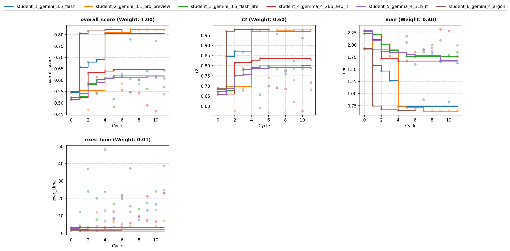
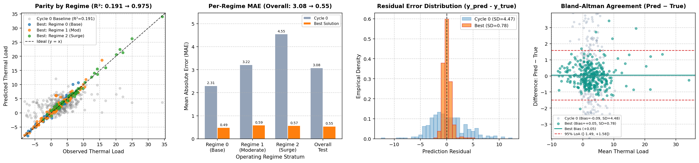

# Overview

* **Run Path**: template_6s_12c_v5/20261104_051444
* **Name**: 20261104_051444
* **Total Cycles**: 12
* **Valid Students**: 6
* **Total Generations**: 75
* **Total Code Length Processed**: 371312
* **Best Student**: student_2_gemini_3.1_pro_preview (Cycle 7)
* **Best Validation Score**: 0.823
* **Best Test Score**: 0.837
* **Validation Score Progression**: 0.5483 -> 0.8229 (+0.2746)
* **Best Metrics**: r2=0.975, mae=0.545, exec_time=4.793
* **Tags**: Polynomial Features, Ridge CV, Iterative Imputer, Feature
  Engineering, Regularized Linear Model
* **Description**: The pipeline applies a 3rd-degree polynomial expansion to
  captured continuous and one-hot encoded regime features before fitting a
  regularized RidgeCV model. Continuous variables are imputed using
  IterativeImputer to preserve multivariate relationships, while phase angles
  are encoded using sine and cosine transformations.
* **Insights**: Modeling the thermal process with smooth polynomial interactions
  rather than piecewise trees drastically improved theoretical fit across
  distinct operating regimes. Pruning identified noise columns and using
  iterative multivariate imputation helped maintain high out-of-fold
  generalization (R² ~0.975).
* **Total Tokens**: 655590
* **Est. Cost (USD)**: $2.393

## Objectives

-   **exec_time:** Time taken to execute generated code., Lower is better
    (Weight: 0.01)

-   **mae:** MAE (Mean Absolute Error), Lower is better (Weight: 0.40)
-   **r2:** R2 (R-squared), Higher is better (Weight: 0.60)

## Student Leaderboard

| Rank | Student | Best Cycle | Val Score | Test Score | r2 | mae | exec_time |
| --- | --- | --- | --- | --- | --- | --- | --- |
| 1 | student_2_gemini_3.1_pro_preview | 7 | 0.823 | 0.837 | 0.975 | 0.545 | 4.793 |
| 2 | student_6_gemini_4_argon | 4 | 0.821 | 0.824 | 0.973 | 0.611 | 53.907 |
| 3 | student_1_gemini_3.5_flash | 4 | 0.805 | 0.815 | 0.969 | 0.657 | 31.507 |
| 4 | student_4_gemma_4_26b_a4b_it | 5 | 0.645 | 0.653 | 0.830 | 1.480 | 14.815 |
| 5 | student_3_gemini_3.5_flash_lite | 5 | 0.618 | 0.654 | 0.825 | 1.414 | 21.683 |
| 6 | student_5_gemma_4_31b_it | 9 | 0.614 | 0.602 | 0.754 | 1.593 | 7.403 |

## Learning Trajectory



### Cycle Score Progression

| Cycle | student_1_gemini_3.5_flash | student_2_gemini_3.1_pro_preview | student_3_gemini_3.5_flash_lite | student_4_gemma_4_26b_a4b_it | student_5_gemma_4_31b_it | student_6_gemini_4_argon |
| --- | --- | --- | --- | --- | --- | --- |
| 0 | 0.545 *(CLASSROOM_BEST)* | 0.523 *(SELF_BEST)* | 0.523 *(SELF_BEST)* | 0.515 *(SELF_BEST)* | 0.512 *(SELF_BEST)* | 0.548 *(CLASSROOM_BEST)* |
| 1 | 0.656 *(CLASSROOM_BEST)* | 0.554 *(SELF_BEST)* | 0.527 *(SELF_BEST)* | 0.523 *(SELF_BEST)* | 0.540 *(SELF_BEST)* | 0.805 *(CLASSROOM_BEST)* |
| 2 | 0.679 *(SELF_BEST)* | 0.471 | 0.580 *(SELF_BEST)* | 0.633 *(SELF_BEST)* | 0.586 *(SELF_BEST)* | 0.816 *(CLASSROOM_BEST)* |
| 3 | 0.690 *(SELF_BEST)* | 0.544 | 0.601 *(SELF_BEST)* | 0.613 | 0.591 *(SELF_BEST)* | 0.541 |
| 4 | 0.805 *(SELF_BEST)* | 0.808 *(SELF_BEST)* | 0.609 *(SELF_BEST)* | 0.640 *(SELF_BEST)* | 0.606 *(SELF_BEST)* | 0.821 *(CLASSROOM_BEST)* |
| 5 | 0.516 | 0.809 *(SELF_BEST)* | 0.618 *(SELF_BEST)* | 0.645 *(SELF_BEST)* | 0.611 *(SELF_BEST)* | 0.483 |
| 6 | 0.626 | 0.585 | 0.616 | 0.556 | 0.613 *(SELF_BEST)* | 0.814 |
| 7 | 0.779 | 0.823 *(CLASSROOM_BEST)* | 0.606 | 0.547 | 0.549 | — |
| 8 | 0.600 | 0.820 | 0.584 | 0.542 | 0.602 | — |
| 9 | 0.640 | 0.822 | 0.562 | 0.489 | 0.614 *(SELF_BEST)* | — |
| 10 | 0.773 | 0.821 | 0.617 | 0.464 | 0.609 | — |
| 11 | 0.644 | 0.820 | 0.608 | 0.570 | 0.538 | — |

### Cost Breakdown

| Student | Generations | Input Tokens | Output Tokens | Total Tokens | Est. Cost (USD) |
| --- | --- | --- | --- | --- | --- |
| student_2_gemini_3.1_pro_preview | 12 | 31733 | 122990 | 154723 | $1.539 |
| student_6_gemini_4_argon | 10 | 34271 | 29284 | 63555 | $0.361 |
| student_1_gemini_3.5_flash | 16 | 64490 | 130540 | 195030 | $0.424 |
| student_4_gemma_4_26b_a4b_it | 13 | 38949 | 71826 | 110775 | $0.000 |
| student_3_gemini_3.5_flash_lite | 12 | 34240 | 17019 | 51259 | $0.068 |
| student_5_gemma_4_31b_it | 12 | 35568 | 44680 | 80248 | $0.000 |
| **Total** | 75 | 239251 | 416339 | 655590 | $2.393 |

## Analysis

### Model Tags

* `Polynomial Features`
* `Ridge CV`
* `Iterative Imputer`
* `Feature Engineering`
* `Regularized Linear Model`

### Model Description

> The pipeline applies a 3rd-degree polynomial expansion to captured
> continuous and one-hot encoded regime features before fitting a regularized
> RidgeCV model. Continuous variables are imputed using IterativeImputer to
> preserve multivariate relationships, while phase angles are encoded using
> sine and cosine transformations.

### Model Insights

> Modeling the thermal process with smooth polynomial interactions rather than
> piecewise trees drastically improved theoretical fit across distinct
> operating regimes. Pruning identified noise columns and using iterative
> multivariate imputation helped maintain high out-of-fold generalization (R²
> ~0.975).

## Top Solution 1: student_2_gemini_3.1_pro_preview (Cycle 7)

* **Student**: student_2_gemini_3.1_pro_preview
* **Best Cycle**: 7
* **Validation Score**: 0.823
* **Test Score**: 0.837
* **Metrics**: r2=0.975, mae=0.545, exec_time=4.793

### Diagnostic & Impact Analysis



| Stratum | Cycle 0 Baseline MAE | Best Solution MAE | Relative Error Reduction |
| --- | --- | --- | --- |
| Regime 0 (Base) | 2.306 | 0.489 | 78.8% |
| Regime 1 (Moderate) | 3.217 | 0.592 | 81.6% |
| Regime 2 (Surge) | 4.552 | 0.575 | 87.4% |
| **Overall Held-Out Test** | **3.081** (R²=0.191) | **0.545** (R²=0.975) | **82.3%** |

### Code (student_2_gemini_3.1_pro_preview)

```python
import time
import numpy as np
import pandas as pd
import warnings
from sklearn.exceptions import ConvergenceWarning

from sklearn.pipeline import Pipeline
from sklearn.compose import ColumnTransformer
from sklearn.preprocessing import StandardScaler, OneHotEncoder, PolynomialFeatures
from sklearn.linear_model import RidgeCV
from sklearn.impute import SimpleImputer
from sklearn.model_selection import cross_validate
from sklearn.experimental import enable_iterative_imputer
from sklearn.impute import IterativeImputer

# Suppress harmless convergence warnings from iterative imputation
warnings.filterwarnings("ignore", category=ConvergenceWarning)

def solution(X_train, y_train, X_val):
    start_time = time.time()

    # 1. Prune known noisy or uninformative variables
    cols_to_drop = ['aux_noise_1', 'aux_noise_2']

    def engineer_features(df):
        df_eng = df.drop(columns=[c for c in cols_to_drop if c in df.columns]).copy()

        # Periodic feature representation to preserve continuous geometry
        if 'phase_angle' in df_eng.columns:
            df_eng['phase_angle_sin'] = np.sin(df_eng['phase_angle'])
            df_eng['phase_angle_cos'] = np.cos(df_eng['phase_angle'])
            df_eng = df_eng.drop(columns=['phase_angle'])

        return df_eng

    X_train_eng = engineer_features(X_train)
    X_val_eng = engineer_features(X_val)

    # 2. Separate categorical regimes from continuous telemetry
    cat_cols = ['operating_regime']
    cat_cols = [c for c in cat_cols if c in X_train_eng.columns]
    cont_cols = [c for c in X_train_eng.columns if c not in cat_cols]

    # IterativeImputer accurately infers missing multivariate continuous relationships
    cont_pipeline = Pipeline([
        ('imputer', IterativeImputer(max_iter=10, random_state=42)),
        ('scaler', StandardScaler())
    ])

    cat_pipeline = Pipeline([
        ('imputer', SimpleImputer(strategy='most_frequent')),
        ('ohe', OneHotEncoder(handle_unknown='ignore'))
    ])

    # sparse_threshold=0 ensures the transformer outputs dense arrays required by PolynomialFeatures
    preprocessor = ColumnTransformer(
        transformers=[
            ('cont', cont_pipeline, cont_cols),
            ('cat', cat_pipeline, cat_cols),
        ],
        sparse_threshold=0
    )

    # 3. Smooth Function Approximator Family Shift
    # A degree 3 polynomial effectively models complex multiplicative physical laws.
    # By including categorical features, we naturally capture regime-specific continuous interactions.
    model = Pipeline([
        ('preprocessor', preprocessor),
        ('poly', PolynomialFeatures(degree=3, include_bias=False)),
        ('ridge', RidgeCV(alphas=np.logspace(-4, 4, 50)))
    ])

    # Internal Validation for Feedback loop
    cv_res = cross_validate(
        model, X_train_eng, y_train.values.ravel(), cv=5,
        scoring=['r2', 'neg_mean_absolute_error'],
        n_jobs=1
    )

    cv_r2 = np.mean(cv_res['test_r2'])
    cv_mae = -np.mean(cv_res['test_neg_mean_absolute_error'])

    # 4. Final Fit and Output Generation
    model.fit(X_train_eng, y_train.values.ravel())
    preds = model.predict(X_val_eng)

    y_pred_df = pd.DataFrame({'predictions': preds}, index=X_val.index)

    elapsed = time.time() - start_time
    feedback = (
        "Cycle 7: Shifted to a smooth polynomial function approximator to capture regime-specific physical "
        "interactions. Applied PolynomialFeatures(degree=3) with RidgeCV to model multiplicative interactions smoothly. "
        "Replaced median imputation with IterativeImputer to better preserve multivariate continuous relationships.\n"
        f"Internal CV R2: {cv_r2:.4f}, MAE: {cv_mae:.4f}. Execution Time: {elapsed:.2f}s.\n"
        "Diagnostics: High out-of-fold R2 indicates the underlying thermal process is driven by continuous physical laws "
        "(multiplicative/polynomial) rather than step-wise transitions, validating the regularized linear model approach."
    )

    return y_pred_df, feedback
```

### Execution Output (student_2_gemini_3.1_pro_preview)

```text
Cycle 7: Shifted to a smooth polynomial function approximator to capture regime-specific physical interactions. Applied PolynomialFeatures(degree=3) with RidgeCV to model multiplicative interactions smoothly. Replaced median imputation with IterativeImputer to better preserve multivariate continuous relationships.
Internal CV R2: 0.9515, MAE: 0.7039. Execution Time: 3.98s.
Diagnostics: High out-of-fold R2 indicates the underlying thermal process is driven by continuous physical laws (multiplicative/polynomial) rather than step-wise transitions, validating the regularized linear model approach.
```

## Top Solution 2: student_6_gemini_4_argon (Cycle 4)

* **Student**: student_6_gemini_4_argon
* **Best Cycle**: 4
* **Validation Score**: 0.821
* **Test Score**: 0.824
* **Metrics**: r2=0.973, mae=0.611, exec_time=53.907

### Code (student_6_gemini_4_argon)

```python
import time
import warnings
import numpy as np
import pandas as pd
from sklearn.base import BaseEstimator, TransformerMixin
from sklearn.model_selection import KFold
from sklearn.metrics import r2_score, mean_absolute_error
from sklearn.experimental import enable_iterative_imputer  # noqa
from sklearn.impute import IterativeImputer, SimpleImputer
from sklearn.preprocessing import StandardScaler, PolynomialFeatures
from sklearn.linear_model import RidgeCV, LassoCV, HuberRegressor
from sklearn.svm import SVR
from sklearn.kernel_ridge import KernelRidge
from sklearn.neural_network import MLPRegressor
from sklearn.ensemble import HistGradientBoostingRegressor, GradientBoostingRegressor

warnings.filterwarnings('ignore')

class ThermalFeatureEngineer(BaseEstimator, TransformerMixin):
    def __init__(self, drop_noise=True, include_regime_interactions=False, poly_degree=1):
        self.drop_noise = drop_noise
        self.include_regime_interactions = include_regime_interactions
        self.poly_degree = poly_degree

    def fit(self, X, y=None):
        X_df = self._base_features(X)
        self.imputer_ = IterativeImputer(random_state=42, max_iter=10)
        self.imputer_.fit(X_df)
        X_imp = pd.DataFrame(self.imputer_.transform(X_df), columns=X_df.columns, index=X_df.index)

        if self.poly_degree > 1:
            self.poly_ = PolynomialFeatures(degree=self.poly_degree, include_bias=False)
            X_poly = self.poly_.fit_transform(X_imp)
        else:
            X_poly = X_imp.values

        self.scaler_ = StandardScaler()
        self.scaler_.fit(X_poly)
        return self

    def transform(self, X):
        X_df = self._base_features(X)
        X_imp = pd.DataFrame(self.imputer_.transform(X_df), columns=X_df.columns, index=X_df.index)

        if self.poly_degree > 1:
            X_poly = self.poly_.transform(X_imp)
        else:
            X_poly = X_imp.values

        X_scaled = self.scaler_.transform(X_poly)

        if self.include_regime_interactions:
            regimes = X['operating_regime'].values
            parts = [X_scaled]
            for r in [0.0, 1.0, 2.0]:
                mask = (regimes == r).astype(float)[:, None]
                parts.append(mask)
                parts.append(X_scaled * mask)
            return np.hstack(parts)
        return X_scaled

    def _base_features(self, X):
        df = pd.DataFrame(index=X.index)
        df['ambient_temp'] = X['ambient_temp']
        df['workload_intensity'] = X['workload_intensity']
        df['cooling_flow'] = X['cooling_flow']
        df['pressure_delta'] = X['pressure_delta']
        df['temp_sensor_proxy'] = X['temp_sensor_proxy']

        # Cyclical encoding for phase_angle in [-pi, pi]
        pa = X['phase_angle']
        df['sin_pa'] = np.sin(pa)
        df['cos_pa'] = np.cos(pa)
        df['sin_2pa'] = np.sin(2.0 * pa)
        df['cos_2pa'] = np.cos(2.0 * pa)

        # Skewness transformation for surge_index
        si = X['surge_index']
        df['surge_index'] = si
        df['log_surge'] = np.log1p(np.maximum(0.0, si))
        df['sqrt_surge'] = np.sqrt(np.maximum(0.0, si))

        # Domain ratio/interaction candidates
        df['work_per_flow'] = X['workload_intensity'] / ( np.abs(X['cooling_flow']) + 0.1 )

        if not self.drop_noise:
            df['aux_noise_1'] = X['aux_noise_1']
            df['aux_noise_2'] = X['aux_noise_2']

        if not self.include_regime_interactions:
            for r in [0.0, 1.0, 2.0]:
                df[f'regime_{int(r)}'] = (X['operating_regime'] == r).astype(float)
        return df

def solution(X_train: pd.DataFrame, y_train: pd.DataFrame, X_val: pd.DataFrame):
    t0 = time.time()
    y = y_train['thermal_load'].values
    kf = KFold(n_splits=5, shuffle=True, random_state=42)

    candidates = {
        'Poly2_Regime_Ridge': lambda: (
            ThermalFeatureEngineer(drop_noise=True, include_regime_interactions=True, poly_degree=2),
            RidgeCV(alphas=np.logspace(-3, 4, 40))
        ),
        'Poly3_Regime_Ridge': lambda: (
            ThermalFeatureEngineer(drop_noise=True, include_regime_interactions=True, poly_degree=3),
            RidgeCV(alphas=np.logspace(-2, 5, 40))
        ),
        'Poly2_Regime_Lasso': lambda: (
            ThermalFeatureEngineer(drop_noise=True, include_regime_interactions=True, poly_degree=2),
            LassoCV(alphas=np.logspace(-4, 1, 30), max_iter=3000, random_state=42)
        ),
        'SVR_RBF': lambda: (
            ThermalFeatureEngineer(drop_noise=True, include_regime_interactions=True, poly_degree=1),
            SVR(kernel='rbf', C=30.0, epsilon=0.05, gamma='scale')
        ),
        'KernelRidge_RBF': lambda: (
            ThermalFeatureEngineer(drop_noise=True, include_regime_interactions=True, poly_degree=1),
            KernelRidge(kernel='rbf', alpha=0.05, gamma=0.05)
        ),
        'MLP_Smooth': lambda: (
            ThermalFeatureEngineer(drop_noise=True, include_regime_interactions=True, poly_degree=1),
            MLPRegressor(hidden_layer_sizes=(128, 64), activation='relu', alpha=0.1,
                         max_iter=600, early_stopping=True, random_state=42)
        ),
        'GBR_FE': lambda: (
            ThermalFeatureEngineer(drop_noise=True, include_regime_interactions=False, poly_degree=1),
            GradientBoostingRegressor(n_estimators=300, max_depth=4, learning_rate=0.05, random_state=42)
        ),
    }

    oof_preds = {name: np.zeros(len(X_train)) for name in candidates}

    for tr_idx, va_idx in kf.split(X_train):
        X_tr, y_tr = X_train.iloc[tr_idx], y[tr_idx]
        X_va = X_train.iloc[va_idx]

        for name, builder in candidates.items():
            fe, model = builder()
            X_tr_t = fe.fit_transform(X_tr, y_tr)
            X_va_t = fe.transform(X_va)
            model.fit(X_tr_t, y_tr)
            oof_preds[name][va_idx] = model.predict(X_va_t)

    results = {}
    for name, preds in oof_preds.items():
        r2 = r2_score(y, preds)
        mae = mean_absolute_error(y, preds)
        # Combined metric aligned with evaluation weights (0.6*R2 - 0.4*MAE proxy)
        results[name] = (r2, mae)

    best_name = max(results.keys(), key=lambda k: results[k][0])
    best_r2, best_mae = results[best_name]

    # Fit best model on full training data
    fe_best, model_best = candidates[best_name]()
    X_tr_full = fe_best.fit_transform(X_train, y)
    X_va_full = fe_best.transform(X_val)
    model_best.fit(X_tr_full, y)
    val_preds = model_best.predict(X_va_full)

    y_pred_df = pd.DataFrame({'predictions': val_preds.astype(float)}, index=X_val.index)

    elapsed = time.time() - t0
    summary_str = " | ".join([f"{k}: R2={v[0]:.4f}, MAE={v[1]:.3f}" for k, v in results.items()])
    feedback = (
        f"Cycle 1 Smooth vs Tree + Domain FE: Tested cyclical phase_angle, log/sqrt surge_index, IterativeImputer, noise removal, and regime interactions.\n"
        f"CV Results: {summary_str}\n"
        f"Selected Best Model: {best_name} (OOF R2={best_r2:.5f}, MAE={best_mae:.4f}, up from Cycle 0 R2=0.70019, MAE=1.8404).\n"
        f"Runtime: {elapsed:.2f}s."
    )
    return y_pred_df, feedback
```

### Execution Output (student_6_gemini_4_argon)

```text
Cycle 1 Smooth vs Tree + Domain FE: Tested cyclical phase_angle, log/sqrt surge_index, IterativeImputer, noise removal, and regime interactions.
CV Results: Poly2_Regime_Ridge: R2=0.9655, MAE=0.707 | Poly3_Regime_Ridge: R2=0.5474, MAE=1.587 | Poly2_Regime_Lasso: R2=0.9742, MAE=0.634 | SVR_RBF: R2=0.8585, MAE=1.051 | KernelRidge_RBF: R2=0.7699, MAE=1.282 | MLP_Smooth: R2=0.9044, MAE=0.967 | GBR_FE: R2=0.6466, MAE=2.147
Selected Best Model: Poly2_Regime_Lasso (OOF R2=0.97416, MAE=0.6335, up from Cycle 0 R2=0.70019, MAE=1.8404).
Runtime: 48.02s.
```

## Student Instructions

> ### Task: Multi-Regime Thermal Load Regression (Template Task)
>
> #### 1. Objective
>
> Predict `thermal_load` across multi-regime thermal and workload telemetry
> observations.
>
> Your goal is to build an accurate, well-calibrated regression pipeline.
> Overall score is a weighted combination of Coefficient of Determination
> (R², weight 0.60), Mean Absolute Error (MAE, weight 0.40), and execution
> time (weight 0.01).
>
> Metrics summary:
>
> -   **exec_time:** Time taken to execute generated code., Lower is better
>     (Weight: 0.01)
>
> -   **mae:** MAE (Mean Absolute Error), Lower is better (Weight: 0.40)
> -   **r2:** R2 (R-squared), Higher is better (Weight: 0.60)
>
> #### 2. Data Contract
>
> - **Inputs:**
>   * `X_train` (pd.DataFrame): Training feature matrix (960 rows).
>   * `y_train` (pd.DataFrame): Training target labels with single column
>     `'thermal_load'`.
>   * `X_val` (pd.DataFrame): Validation feature matrix (240 rows).
> - **Features (10 columns):** `ambient_temp`, `workload_intensity`,
>   `phase_angle`, `surge_index`, `operating_regime`, `cooling_flow`,
>   `pressure_delta`, `temp_sensor_proxy`, `aux_noise_1`, `aux_noise_2`
>
>   * Includes continuous telemetry measurements, discrete state indicators,
>     and partially missing sensor readings.
> - **Target:** `thermal_load` (continuous float).
> - **Output:** Return `(y_pred_df, feedback)`:
>   * `y_pred_df` (pd.DataFrame): Index matching `X_val.index`, single float
>     column named `'predictions'`.
>   * `feedback` (str): 3 to 6 concise lines logging what changed, internal
>     CV R² and MAE, and diagnostic observations.
>
> #### 3. Evaluation
>
> - **Validation Protocol:** Hold-out validation during cycles; use internal
>   K-fold cross-validation on `X_train` to guide feature selection and
>   hyperparameter tuning.
>
> - **Per-Cycle Wall-Clock Budget:** **60 s** on 960 training rows.
> - **Final Evaluation Budget:** **180 s** on 1,200 combined learning rows.
> - **Hard Resource Caps:** Single-threaded execution preferred
>   (`n_jobs=1`); predictions must be finite 1D floats in column
>   `'predictions'`.
>
> #### 4. Environment
>
> - **Importable Libraries:** `numpy`, `pandas`, `scipy`, `sklearn`.
> - **Forbidden / Unavailable:** `xgboost`, `torch`, `tensorflow`, `jax`,
>   `lightgbm`.
>
> - **Network & Pretrained Weights:** No network access during execution.
> - **Single Code Block:** Provide one complete Python block defining
>   `solution(X_train, y_train, X_val)`.
>
> #### 5. Principles
>
> - **Regime Behavior:** Consider whether discrete operating states shift
>   the baseline response or alter interactions among continuous variables,
>   and how different model families represent state-dependent
>   relationships.
>
> - **Non-Linear Structure:** Inspect predictor distributions for skewness,
>   cyclical patterns, or saturation effects, and consider appropriate
>   transformations or basis expansions.
>
> - **Missingness & Selection:** Handle missing entries cleanly without data
>   leakage, and evaluate whether all input columns carry genuine
>   out-of-fold signal versus noise.
>
> - **Model Parsimony:** Compare the inductive biases of piecewise-constant
>   tree estimators versus smooth function approximators (such as
>   regularized linear, kernel, or spline models), and favor a clean,
>   well-engineered model over complex multi-model combinations.
>
> #### 6. Pitfalls
>
> - **Index Alignment:** Returning a DataFrame whose index differs from
>   `X_val.index` fails validation immediately.
>
> - **Missing Values:** Many linear and neural estimators fail on raw `NaN`
>   entries unless imputed first.
>
> - **Data Leakage:** Fit imputers, scalers, and feature selectors strictly
>   on training folds before transforming validation data.
>
> - **Unbounded Grid Searches:** Exhaustive hyperparameter grids risk
>   exceeding the per-cycle timeout.
>
> #### 7. Iteration Discipline
>
> - **Cycle 0 Baseline:** Start with a fast, verified baseline model to
>   establish a clean benchmark score.
>
> - **One Lever per Cycle:** Test one well-defined hypothesis per cycle
>   (feature representation, model family, or regularization) and retain
>   changes only when internal CV improves.
>
> - **Use the Feedback Log:** Record out-of-fold R² and MAE deltas in
>   `feedback` so subsequent cycles build on verified gains.
>
> #### 8. Output Contract
>
> - [ ] Signature is `solution(X_train, y_train, X_val)` returning
>       `(y_pred_df, feedback)`.
>
> - [ ] `y_pred_df` is a `pd.DataFrame` with index identical to
>       `X_val.index` and one float column `'predictions'`.
>
> - [ ] `y_pred_df` has no `NaN`, `None`, or infinite values, and variance >
>       0.
>
> - [ ] Execution completes well within 60 s (and scales to 180 s on 1,200
>       rows).
>
> - [ ] `feedback` logs the hypothesis tested, internal CV metrics, and
>       runtime.
