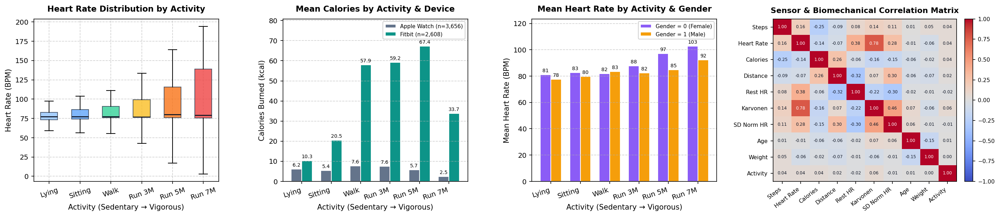
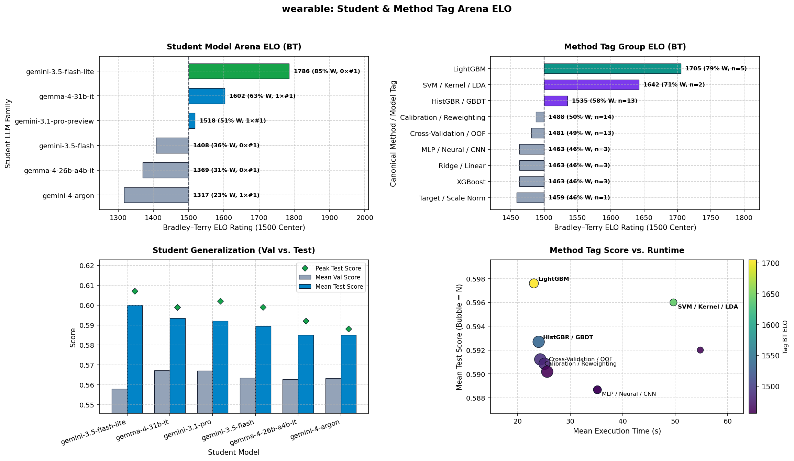

# Wearable Activity Classification

[](https://colab.research.google.com/github/google-research/codegen-classroom/blob/main/codegen_classroom/tasks/wearable/wearable.ipynb)

## Overview

Classify physical activity type into 6 discrete intensity classes from
one-row-per-sample wearable sensor summaries. This benchmark evaluates
autonomous LLM student agents on cross-person generalization using Apple Watch
and Fitbit biometric measurements. Crucially, **evaluation participants are
never seen during training**, preventing models from relying on subject-level
demographic memorization.

Because the benchmark evaluates a joint objective balancing overall **Accuracy**
(weight `1.00`) and **Macro-F1** (weight `0.50`), models must avoid collapsing
minority activity classes while navigating sedentary postures (`Lying`,
`Sitting`), `Self-paced walking`, and ascending running intensities (`3`, `5`,
and `7 METs`) across two distinct sensor hardware profiles.

## Files

-   [`config.py`](config.py): Task constants (`RUN_DEFAULTS`,
    `DEFAULT_METRIC_WEIGHTS`), student prompt template
    (`STUDENT_INSTRUCTIONS_TEMPLATE`), and refinement strategies.
-   [`data_loader.py`](data_loader.py): Dataset download/staging
    (`download_wearable_data`, `ensure_data`), preprocessing
    (`clean_and_encode`, `load_preprocessed_wearable_data`), and deterministic
    splitting (`split_wearable_data`, `load_wearable_data`).
-   [`run_wearable.py`](run_wearable.py): Headless classroom runner, held-out
    test evaluator, diagnostic plot generator, and solution exporter.
-   [`run_wearable_test.py`](run_wearable_test.py): Hermetic unit tests covering
    data loading, split invariants, prompt contracts, and budget invariants.
-   [`wearable.ipynb`](wearable.ipynb): Interactive Jupyter/Colab walkthrough
    notebook.
-   [`leaderboard.tsv`](leaderboard.tsv): Benchmark leaderboard tracking
    validation and held-out test metrics across runs.
-   [`solutions/`](solutions/): Archived top run reports and progress plots.

## Dataset

-   **Code License:** Apache License 2.0 (see repository root `LICENSE`).
-   **Dataset License:** CC0: Public Domain.
-   **Source:** Apple Watch and Fitbit data (Harvard Dataverse /
    [Kaggle mirror](https://www.kaggle.com/datasets/aleespinosa/apple-watch-and-fitbit-data)).
-   **Samples:** 6,264 valid summary rows across 49 unique participants.
-   **Features (17 columns):**
    *   **Demographics (4):** `age`, `gender`, `height`, `weight`.
    *   **Device Context (1):** `device_encoded` (`0` = Apple Watch, `1` =
        Fitbit).
    *   **Biometric & Motion (12):** `steps`, `heart_rate`, `calories`,
        `distance`, `resting_heart`, `norm_heart`, `intensity_karvonen`,
        `sd_norm_heart`, `entropy_heart`, `entropy_steps`, `corr_heart_steps`,
        `steps_times_distance`.
-   **Activity Classes (6 classes):**

| ID | Activity Label | Physiological Regime | Count | Share |
| :---: | :--- | :--- | :---: | :---: |
| `0` | `Lying` | Sedentary (resting / baseline) | 1,379 | 22.0% |
| `1` | `Running 3 METs` | Light endurance running (jog) | 950 | 15.2% |
| `2` | `Running 5 METs` | Moderate endurance running | 1,002 | 16.0% |
| `3` | `Running 7 METs` | Vigorous aerobic running | 1,114 | 17.8% |
| `4` | `Self-paced walking` | Locomotion / intermediate exertion | 889 | 14.2% |
| `5` | `Sitting` | Sedentary (upright resting) | 930 | 14.8% |

-   **Splits (`VAL_SEED = 42`):**
    *   **Learning Set (80%, 5,020 rows across 39 participants):** Partitioned
        into **Train** (3,760 rows / 29 participants) and **Validation** (1,260
        rows / 10 participants) during iterative learning cycles.
    *   **Held-Out Final Test Set (20%, 1,244 rows across 10 unseen
        participants):** Evaluated once at the end after refitting on the full
        5,020-row learning set.


*Figure: Four-panel overview illustrating heart rate across exercise
intensities, device-specific calorie expenditure, demographic distributions,
and sensor correlation structure.*

## Scoring

Students maximize a weighted composite score balancing classification accuracy,
macro-averaged F1, and execution speed:

```text
Score = (1.00 * Accuracy + 0.50 * F1_macro + 0.01 / (1 + exec_time)) / 1.51
```

## Configuration

| Constant | Value | Rationale |
| :--- | :--- | :--- |
| `DEFAULT_NUM_STUDENTS` | `6` | Diverse classroom (Gemini 4 Argon, Gemini Pro, Flash, Flash-Lite, Gemma 4 26B, Gemma 4 31B) |
| `DEFAULT_NUM_CYCLES` | `15` | Multi-cycle hill-climbing for physiological feature exploration and grouped CV |
| `EARLY_STOPPING_PATIENCE` | `3` | Convergence patience before peer crossover or self-best mutation |
| `MAX_MUTATION_COUNT` | `8` | Maximum evolutionary mutations per student before retirement |
| `DEFAULT_TIMEOUT_S` | `60` | Per-cycle validation budget; allows tree ensembles and grouped CV on 3.7k rows |
| `FINAL_EVAL_TIMEOUT_S` | `180` | 3x margin for refitting on the full 5,020-row learning set |
| `DEFAULT_MAX_OUTPUT_TOKENS` | `32768` | Prevents code truncation on feature-rich pipelines |

## Results

| Model / Run | Test Accuracy | Test F1-Macro | Test Time | Overall Score |
| :--- | :---: | :---: | :---: | :---: |
| Logistic Regression Baseline | ~0.520 | ~0.480 | ~1.5 s | ~0.503 |
| HistGradientBoosting Baseline (Cycle 0) | ~0.600 | ~0.590 | ~4.5 s | ~0.593 |
| [`wearable_6s_15c`](solutions/wearable_6s_15c_20261105.md) (`gemini-4-argon`, Cycle 10) | 0.596 | 0.583 | 17.0 s | 0.588 |
| [`wearable_6s_12c`](solutions/wearable_6s_12c_20261105.md) (`gemma-4-31b-it`, Cycle 1) | 0.606 | 0.593 | 26.6 s | 0.598 |
| [`wearable_6s_12c_v4`](solutions/wearable_6s_12c_v4_20261105.md) (`gemini-3.1-pro-preview`, Cycle 0) | **0.614** | **0.602** | **5.1 s** | **0.607** |



-   **Student Leaderboard:** Across 9 runs, `gemini-3.5-flash-lite` leads
    Bradley–Terry Arena ELO (`1786`, `85.4%` win rate, max Test Score `0.607`),
    followed by `gemma-4-31b-it` (`1602`, `63.4%` win rate) and
    `gemini-3.1-pro-preview` (`1518`, `50.7%` win rate, peak Test Accuracy
    `0.614` / Test Macro-F1 `0.602`), demonstrating strong cross-participant
    generalization.
-   **Top Strategies:** High-ELO solutions combine `LightGBM` (Arena ELO `1705`,
    `78.7%` win rate) or `HistGradientBoostingClassifier` (`1535`, `57.6%` win
    rate) with demographic-grouped cross-validation (`StratifiedGroupKFold`),
    device context calibration (`device_encoded`), and physiological interaction
    ratios (Karvonen HR reserve, BMI, metabolic step interactions).
-   **Diagnostic Highlights:** Top solutions maintain balanced performance
    across hardware profiles (Apple Watch `55.0%` vs. Fitbit `72.6%` on unseen
    test subjects) and sharpen discrimination between adjacent running tiers
    (`3 / 5 / 7 METs`), avoiding minority class collapse without transductive
    test-batch leakage (see
    [`wearable_6s_12c_v4`](solutions/wearable_6s_12c_v4_20261105.md)).

## Quickstart

```bash
# 1. Stage dataset (also formats automatically on first run):
python -m codegen_classroom.tasks.wearable.data_loader data/

# 2. Run hermetic unit tests:
pytest codegen_classroom/tasks/wearable/run_wearable_test.py

# 3. Run fast offline smoke test with mock students (1 cycle):
python -m codegen_classroom.tasks.wearable.run_wearable \
  --mock_students \
  --num_cycles=1 \
  --experiment_name=smoke_test

# 4. Run full 6-student, 15-cycle classroom benchmark:
python -m codegen_classroom.tasks.wearable.run_wearable \
  --num_students=6 \
  --num_cycles=15 \
  --experiment_name=wearable_6s_15c

# 5. Verify task readiness:
python -m codegen_classroom.verify_task --task wearable --strict
```
