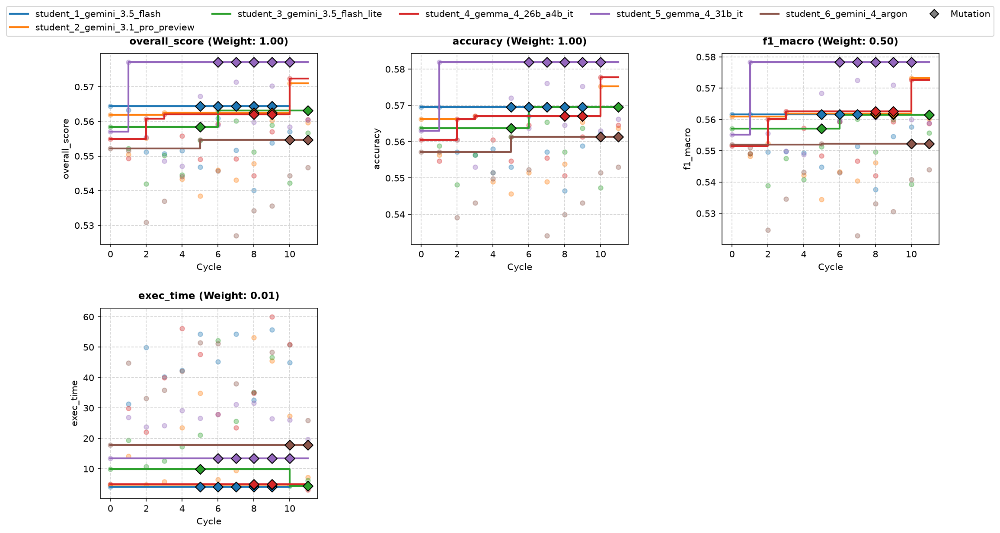
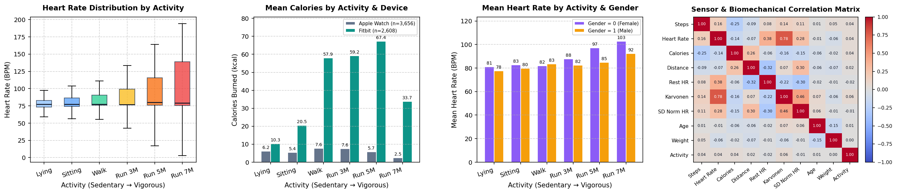
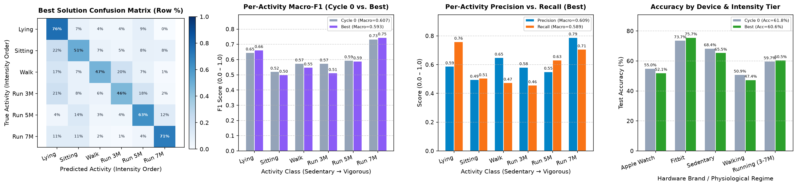

# Overview

* **Run Path**: wearable_6s_12c/headless_20261105_032949
* **Name**: headless_20261105_032949
* **Total Cycles**: 12
* **Valid Students**: 6
* **Total Generations**: 88
* **Total Code Length Processed**: 432130
* **Best Student**: student_5_gemma_4_31b_it (Cycle 1)
* **Best Validation Score**: 0.577
* **Best Test Score**: 0.598
* **Validation Score Progression**: 0.5644 -> 0.5771 (+0.0126)
* **Best Metrics**: accuracy=0.606, f1_macro=0.593, exec_time=26.583
* **Tags**: HistGradientBoosting, Feature Engineering, StratifiedGroupKFold,
  Gradient Boosting
* **Description**: The approach utilizes a HistGradientBoostingClassifier tuned
  with balanced class weights and L2 regularization to classify physical
  activity levels. Cross-validation is conducted using StratifiedGroupKFold
  based on demographic-derived participant proxies to evaluate generalization to
  unseen individuals.
* **Insights**: Engineered physiological features such as BMI, Heart Rate
  Reserve, and stride length proxies provide robust context for activity
  tracking. Additionally, motion-cardiovascular interaction terms (e.g., steps
  multiplied by normalized heart rate) help separate distinct running intensity
  classes, while device-encoded interaction terms adjust for sensor biases
  across brands.
* **Total Tokens**: 1005028
* **Est. Cost (USD)**: $3.240

## Objectives

-   **accuracy:** Accuracy, Higher is better (Weight: 1.00)
-   **exec_time:** Time taken to execute generated code., Lower is better
    (Weight: 0.01)

-   **f1_macro:** F1 Score (Macro), Higher is better (Weight: 0.50)

## Student Leaderboard

| Rank | Student | Best Cycle | Val Score | Test Score | accuracy | f1_macro | exec_time |
| --- | --- | --- | --- | --- | --- | --- | --- |
| 1 | student_5_gemma_4_31b_it | 1 | 0.577 | 0.598 | 0.606 | 0.593 | 26.583 |
| 2 | student_4_gemma_4_26b_a4b_it | 10 | 0.572 | 0.592 | 0.599 | 0.590 | 54.784 |
| 3 | student_2_gemini_3.1_pro_preview | 10 | 0.571 | 0.597 | 0.605 | 0.591 | 29.304 |
| 4 | student_1_gemini_3.5_flash | 0 | 0.564 | 0.599 | 0.605 | 0.595 | 4.552 |
| 5 | student_3_gemini_3.5_flash_lite | 6 | 0.563 | 0.607 | 0.615 | 0.603 | 51.130 |
| 6 | student_6_gemini_4_argon | 5 | 0.555 | 0.585 | 0.595 | 0.576 | 50.189 |

## Learning Trajectory



### Cycle Score Progression

| Cycle | student_1_gemini_3.5_flash | student_2_gemini_3.1_pro_preview | student_3_gemini_3.5_flash_lite | student_4_gemma_4_26b_a4b_it | student_5_gemma_4_31b_it | student_6_gemini_4_argon |
| --- | --- | --- | --- | --- | --- | --- |
| 0 | 0.564 *(CLASSROOM_BEST)* | 0.562 *(SELF_BEST)* | 0.558 *(SELF_BEST)* | 0.555 *(SELF_BEST)* | 0.557 *(SELF_BEST)* | 0.552 *(SELF_BEST)* |
| 1 | 0.563 | 0.550 | 0.552 | 0.549 | 0.577 *(CLASSROOM_BEST)* | 0.552 |
| 2 | 0.551 | 0.555 | 0.542 | 0.561 *(SELF_BEST)* | 0.555 | 0.531 |
| 3 | 0.551 | 0.563 *(SELF_BEST)* | 0.550 | 0.562 *(SELF_BEST)* | 0.549 | 0.537 |
| 4 | 0.552 | 0.543 | 0.545 | 0.556 | 0.547 | 0.544 |
| 5 | 0.547 | 0.539 | 0.555 | 0.549 | 0.567 | 0.555 *(SELF_BEST)* |
| 6 | 0.561 | 0.546 | 0.563 *(SELF_BEST)* | 0.559 | 0.559 | 0.546 |
| 7 | 0.552 | 0.543 | 0.560 | 0.549 | 0.571 | 0.527 |
| 8 | 0.540 | 0.548 | 0.551 | 0.544 | 0.560 | 0.534 |
| 9 | 0.554 | 0.560 | 0.559 | 0.557 | 0.570 | 0.536 |
| 10 | 0.557 | 0.571 *(SELF_BEST)* | 0.542 | 0.572 *(SELF_BEST)* | 0.558 | 0.544 |
| 11 | — | 0.560 | 0.557 | 0.561 | 0.560 | 0.547 |

### Cost Breakdown

| Student | Generations | Input Tokens | Output Tokens | Total Tokens | Est. Cost (USD) |
| --- | --- | --- | --- | --- | --- |
| student_5_gemma_4_31b_it | 12 | 85005 | 42453 | 127458 | $0.000 |
| student_4_gemma_4_26b_a4b_it | 13 | 76569 | 82739 | 159308 | $0.000 |
| student_2_gemini_3.1_pro_preview | 13 | 79658 | 115787 | 195445 | $1.549 |
| student_1_gemini_3.5_flash | 14 | 103569 | 76249 | 179818 | $0.281 |
| student_3_gemini_3.5_flash_lite | 13 | 73175 | 22280 | 95455 | $0.103 |
| student_6_gemini_4_argon | 19 | 145972 | 101572 | 247544 | $1.308 |
| **Total** | 84 | 563948 | 441080 | 1005028 | $3.240 |

## Analysis

### Model Tags

* `HistGradientBoosting`
* `Feature Engineering`
* `StratifiedGroupKFold`
* `Gradient Boosting`

### Model Description

> The approach utilizes a HistGradientBoostingClassifier tuned with balanced
> class weights and L2 regularization to classify physical activity levels.
> Cross-validation is conducted using StratifiedGroupKFold based on
> demographic-derived participant proxies to evaluate generalization to unseen
> individuals.

### Model Insights

> Engineered physiological features such as BMI, Heart Rate Reserve, and
> stride length proxies provide robust context for activity tracking.
> Additionally, motion-cardiovascular interaction terms (e.g., steps
> multiplied by normalized heart rate) help separate distinct running
> intensity classes, while device-encoded interaction terms adjust for sensor
> biases across brands.

## Top Solution 1: student_5_gemma_4_31b_it (Cycle 1)

* **Student**: student_5_gemma_4_31b_it
* **Best Cycle**: 1
* **Validation Score**: 0.577
* **Test Score**: 0.598
* **Metrics**: accuracy=0.606, f1_macro=0.593, exec_time=26.583

### Diagnostic & Impact Analysis





| Diagnostic Metric (Unseen Test Participants) | Cycle 0 Baseline | Best Solution | Improvement |
| :--- | :---: | :---: | :---: |
| **Overall Test Accuracy** | 61.76% | **60.58%** | -1.18% |
| **Test Macro-F1 (6 Classes)** | 0.6072 | **0.5925** | -0.0147 |
| **Apple Watch Accuracy (`device=0`)** | 55.0% | **52.1%** | -2.9% |
| **Fitbit Accuracy (`device=1`)** | 73.7% | **75.7%** | +2.0% |
| **Sedentary Recall (`Lying` / `Sitting`)** | 68.4% | **65.5%** | -2.9% |
| **Running Tiers Recall (`3 / 5 / 7 METs`)** | 59.7% | **60.5%** | +0.8% |

### Plan (student_5_gemma_4_31b_it)

Physiological feature engineering (BMI, HR reserve, and device-specific
interactions) combined with a tuned HistGradientBoostingClassifier and
participant-grouped CV.

### Code (student_5_gemma_4_31b_it)

```python
import numpy as np
import pandas as pd
from sklearn.ensemble import HistGradientBoostingClassifier
from sklearn.model_selection import StratifiedGroupKFold
from sklearn.metrics import accuracy_score, f1_score, recall_score
import time

def engineer_features(df):
    """
    Creates physiological and device-calibration features.
    All operations are row-wise to ensure inductive inference.
    """
    df = df.copy()

    # 1. Physiological Normalization
    # Body Mass Index
    df['bmi'] = df['weight'] / ((df['height'] / 100) ** 2)

    # Heart Rate Reserve (HRR) - Absolute and Relative
    df['hr_reserve'] = df['heart_rate'] - df['resting_heart']
    df['hr_ratio'] = df['heart_rate'] / (df['resting_heart'] + 1e-5)

    # Estimated Max HR (Fox formula) and % of Max
    df['est_max_hr'] = 220 - df['age']
    df['pct_max_hr'] = df['heart_rate'] / (df['est_max_hr'] + 1e-5)

    # Metabolic cost proxy
    df['cal_per_kg'] = df['calories'] / (df['weight'] + 1e-5)

    # Stride efficiency proxy
    df['stride_len'] = df['distance'] / (df['steps'] + 1e-5)

    # 2. Intensity Interactions (Crucial for separating Running classes 1, 2, 3)
    # Combining motion (steps) with cardiovascular effort (norm_heart)
    df['motion_intensity'] = df['steps'] * df['norm_heart']
    df['metabolic_intensity'] = df['steps'] * df['intensity_karvonen']

    # 3. Device Calibration
    # Sensors from different brands often have different biases for HR and Steps
    df['device_hr_inter'] = df['device_encoded'] * df['heart_rate']
    df['device_steps_inter'] = df['device_encoded'] * df['steps']
    df['device_norm_hr_inter'] = df['device_encoded'] * df['norm_heart']

    return df

def solution(X_train, y_train, X_val):
    start_time = time.time()

    # Apply Feature Engineering
    X_train_eng = engineer_features(X_train)
    X_val_eng = engineer_features(X_val)

    # Participant Proxy for Grouped CV
    def get_group_proxy(df):
        return df[['age', 'gender', 'height', 'weight']].astype(str).agg('-'.join, axis=1)

    groups_train = get_group_proxy(X_train)
    y_train_arr = y_train['activity_encoded'].values

    # Internal Participant-Grouped CV
    sgkf = StratifiedGroupKFold(n_splits=3, shuffle=True, random_state=42)
    cv_accs = []
    cv_f1s = []
    all_recalls = np.zeros(6)

    for train_idx, val_idx in sgkf.split(X_train_eng, y_train_arr, groups=groups_train):
        X_tr, X_va = X_train_eng.iloc[train_idx], X_train_eng.iloc[val_idx]
        y_tr, y_va = y_train_arr[train_idx], y_train_arr[val_idx]

        # Tuned HistGradientBoostingClassifier
        model_cv = HistGradientBoostingClassifier(
            class_weight='balanced',
            max_iter=150,
            learning_rate=0.1,
            max_leaf_nodes=31,
            l2_regularization=1.0,
            random_state=42
        )
        model_cv.fit(X_tr, y_tr)
        preds_cv = model_cv.predict(X_va)

        cv_accs.append(accuracy_score(y_va, preds_cv))
        cv_f1s.append(f1_score(y_va, preds_cv, average='macro'))
        all_recalls += recall_score(y_va, preds_cv, average=None, zero_division=0)

    avg_acc = np.mean(cv_accs)
    avg_f1 = np.mean(cv_f1s)
    avg_recalls = all_recalls / 3

    # Final Model Training on full engineered X_train
    final_model = HistGradientBoostingClassifier(
        class_weight='balanced',
        max_iter=250, # Increase iterations for final fit
        learning_rate=0.1,
        max_leaf_nodes=31,
        l2_regularization=1.0,
        random_state=42
    )
    final_model.fit(X_train_eng, y_train_arr)

    # Inductive Inference on X_val
    val_predictions = final_model.predict(X_val_eng)

    y_pred_df = pd.DataFrame(
        {'predictions': val_predictions.astype(int)},
        index=X_val.index
    )

    execution_time = time.time() - start_time

    # Construct Feedback String
    recall_str = ", ".join([f"C{i}:{r:.2f}" for i, r in enumerate(avg_recalls)])
    feedback = (
        f"Added physiological features (BMI, HRR, Stride) and device interactions.\n"
        f"CV Results: Acc={avg_acc:.3f}, F1-macro={avg_f1:.3f} (StratifiedGroupKFold).\n"
        f"Recall: {recall_str}. Focus on improving C1/C4/C5 separation.\n"
        f"Execution time: {execution_time:.2f}s. 3-fold CV + final fit completed."
    )

    return y_pred_df, feedback
```

### Execution Output (student_5_gemma_4_31b_it)

```text
Added physiological features (BMI, HRR, Stride) and device interactions.
CV Results: Acc=0.565, F1-macro=0.562 (StratifiedGroupKFold).
Recall: C0:0.63, C1:0.48, C2:0.55, C3:0.68, C4:0.50, C5:0.49. Focus on improving C1/C4/C5 separation.
Execution time: 26.73s. 3-fold CV + final fit completed.
```

## Top Solution 2: student_4_gemma_4_26b_a4b_it (Cycle 10)

* **Student**: student_4_gemma_4_26b_a4b_it
* **Best Cycle**: 10
* **Validation Score**: 0.572
* **Test Score**: 0.592
* **Metrics**: accuracy=0.599, f1_macro=0.590, exec_time=54.784

### Code (student_4_gemma_4_26b_a4b_it)

```python
import pandas as pd
import numpy as np
import time
from sklearn.preprocessing import StandardScaler
from sklearn.model_selection import StratifiedGroupKFold
from sklearn.metrics import accuracy_score, f1_score, recall_score
from sklearn.utils.class_weight import compute_sample_weight
from sklearn.ensemble import HistGradientBoostingClassifier

def engineer_features(df):
    """
    Performs row-wise physiological and motion-based feature engineering.
    Ensures inductive inference by avoiding any cross-row or group-based statistics.
    """
    X = df.copy()
    eps = 1e-6

    # 1. Anthropometrics
    X['bmi'] = X['weight'] / (((X['height'] / 100.0) ** 2) + eps)

    # 2. Cardiovascular Intensity
    X['hr_reserve'] = X['heart_rate'] - X['resting_heart']
    # HR reserve relative to age-based max HR estimate
    X['hr_res_ratio'] = X['hr_reserve'] / ((220 - X['age']) + eps)
    X['hr_per_dist'] = X['heart_rate'] / (X['distance'] + eps)

    # 3. Metabolic & Motion Efficiency
    X['cal_per_step'] = X['calories'] / (X['steps'] + 1.0)
    X['stride_len'] = X['distance'] / (X['steps'] + 1.0)
    X['metabolic_intensity'] = X['steps'] * X['intensity_karvonen']
    X['motion_intensity'] = X['steps'] * X['norm_heart']

    # 4. Device Calibration Interactions
    # Helps the model adjust for different sensor biases (Apple Watch vs Fitbit)
    X['dev_steps_inter'] = X['device_encoded'] * X['steps']
    X['dev_hr_inter'] = X['device_encoded'] * X['heart_rate']

    # Clean up potential numerical instabilities
    X = X.replace([np.inf, -np.inf], np.nan).fillna(0)
    return X

def solution(X_train, y_train, X_val):
    start_time = time.time()

    # 1. Feature Engineering
    X_train_eng = engineer_features(X_train)
    X_val_eng = engineer_features(X_val)
    y_train_arr = y_train['activity_encoded'].values

    # 2. Participant Grouping (Proxy for CV)
    # We use demographic combinations to create unique group IDs for participant-grouped CV
    demo_cols = ['age', 'gender', 'height', 'weight']
    groups = X_train_eng[demo_cols].astype(str).agg('-'.join, axis=1).factorize()[0]

    # 3. Internal StratifiedGroupKFold CV
    sgkf = StratifiedGroupKFold(n_splits=5)
    n_classes = 6
    oof_probs = np.zeros((len(X_train_eng), n_classes))

    cv_accs = []
    cv_f1s = []
    cv_recalls = []

    # Hyperparameters for HistGradientBoosting
    hgb_params = {
        'max_iter': 300,
        'learning_rate': 0.05,
        'max_leaf_nodes': 31,
        'min_samples_leaf': 20,
        'l2_regularization': 1.5,
        'random_state': 42
    }

    for train_idx, val_idx in sgkf.split(X_train_eng, y_train_arr, groups=groups):
        X_tr, X_va = X_train_eng.iloc[train_idx], X_train_eng.iloc[val_idx]
        y_tr, y_va = y_train_arr[train_idx], y_train_arr[val_idx]

        # Balanced sample weights to handle class imbalance in folds
        sw = compute_sample_weight('balanced', y_tr)

        model_cv = HistGradientBoostingClassifier(**hgb_params)
        model_cv.fit(X_tr, y_tr, sample_weight=sw)

        # Store OOF probabilities for threshold optimization
        probs = model_cv.predict_proba(X_va)
        oof_probs[val_idx] = probs

        # Store metrics
        preds = model_cv.predict(X_va)
        cv_accs.append(accuracy_score(y_va, preds))
        cv_f1s.append(f1_score(y_va, preds, average='macro'))
        cv_recalls.append(recall_score(y_va, preds, average=None))

    avg_acc = np.mean(cv_accs)
    avg_f1 = np.mean(cv_f1s)
    avg_rec = np.mean(cv_recalls, axis=0)

    # 4. Probability Threshold Tuning (Prior Power Tuning)
    # Instead of adjusting weights per class, we use a single scalar 'alpha'
    # to adjust the influence of class priors on the OOF predictions.
    # This optimizes for the objective: Accuracy + 0.5 * F1_macro
    class_counts = np.bincount(y_train_arr, minlength=n_classes)
    priors = class_counts / len(y_train_arr)

    best_alpha = 0.0
    best_score = -1.0

    # Search alpha in a range that boosts minority classes (negative alpha)
    # or suppresses them (positive alpha).
    for alpha in np.linspace(-1.0, 0.5, 16):
        # Adjust probabilities based on class priors
        adj_probs = oof_probs * (priors ** alpha)
        adj_preds = np.argmax(adj_probs, axis=1)

        acc = accuracy_score(y_train_arr, adj_preds)
        f1 = f1_score(y_train_arr, adj_preds, average='macro')
        score = acc + 0.5 * f1

        if score > best_score:
            best_score = score
            best_alpha = alpha

    # 5. Final Training on Full Dataset
    sw_full = compute_sample_weight('balanced', y_train_arr)
    final_model = HistGradientBoostingClassifier(**hgb_params)
    final_model.fit(X_train_eng, y_train_arr, sample_weight=sw_full)

    # 6. Inference on Validation Set
    # Apply the same optimized threshold adjustment used in CV
    val_probs = final_model.predict_proba(X_val_eng)
    val_adj_probs = val_probs * (priors ** best_alpha)
    y_pred = np.argmax(val_adj_probs, axis=1)

    y_pred_df = pd.DataFrame({'predictions': y_pred.astype(int)}, index=X_val.index)

    elapsed_time = time.time() - start_time

    # 7. Feedback Construction
    recall_str = ", ".join([f"C{i}:{r:.2f}" for i, r in enumerate(avg_rec)])
    feedback = (
        f"Cycle 10: Added physiological ratios (hr_res_ratio, metabolic_intensity, etc.) and device interactions. "
        f"Implemented OOF probability threshold tuning via prior power scaling (best alpha: {best_alpha:.2f}).\n"
        f"Internal CV (StratifiedGroupKFold): Acc={avg_acc:.4f}, F1-macro={avg_f1:.4f}\n"
        f"Per-class Recall: {recall_str}\n"
        f"Wall-clock: {elapsed_time:.2f}s, Model: HistGradientBoosting"
    )

    return y_pred_df, feedback
```

### Execution Output (student_4_gemma_4_26b_a4b_it)

```text
Cycle 10: Added physiological ratios (hr_res_ratio, metabolic_intensity, etc.) and device interactions. Implemented OOF probability threshold tuning via prior power scaling (best alpha: -0.20).
Internal CV (StratifiedGroupKFold): Acc=0.5826, F1-macro=0.5765
Per-class Recall: C0:0.66, C1:0.48, C2:0.55, C3:0.72, C4:0.55, C5:0.48
Wall-clock: 50.83s, Model: HistGradientBoosting
```

## Student Instructions

> ### Task: Wearable Sensor Physical Activity Classification
>
> #### 1. Objective
>
> Classify physical activity type into 6 discrete intensity classes from
> one-row-per-sample wearable sensor summaries.
>
> Score = accuracy (1.00) + F1-macro (0.50) - execution time penalty (0.01).
>
> **Objective Priority:** F1-macro rewards performance across all 6 classes
> equally, including low-frequency minority activities. Most importantly,
> **evaluation users are completely unseen during training**. What is
> rewarded is physiological generalization across different individuals, not
> memorizing specific participant characteristics.
>
> Metrics summary:
>
> -   **accuracy:** Accuracy, Higher is better (Weight: 1.00)
> -   **exec_time:** Time taken to execute generated code., Lower is better
>     (Weight: 0.01)
>
> -   **f1_macro:** F1 Score (Macro), Higher is better (Weight: 0.50)
>
> #### 2. Data Contract
>
> - **Inputs:**
>   * `X_train` (pd.DataFrame): Training features (3,773 samples from 29
>     participants).
>   * `y_train` (pd.DataFrame): Target class labels with single column
>     `'activity_encoded'`.
>   * `X_val` (pd.DataFrame): Validation features (1,215 samples from 9
>     unseen participants).
> - **Features (17 columns):**
> | Feature | Description |
> | :--- | :--- |
> | `age` | Participant age in years |
> | `gender` | Biological sex (0 = female, 1 = male) |
> | `height` | Body height in centimeters |
> | `weight` | Body weight in kilograms |
> | `device_encoded` | Device brand (0 = Apple Watch, 1 = Fitbit) |
> | `steps` | Total steps recorded in observation window |
> | `heart_rate` | Mean heart rate (beats per minute) |
> | `calories` | Estimated calories burned in window |
> | `distance` | Estimated distance traversed |
> | `resting_heart` | Estimated baseline resting heart rate |
> | `norm_heart` | Heart rate normalized relative to resting rate |
> | `intensity_karvonen` | Karvonen cardiovascular reserve intensity |
> | `sd_norm_heart` | Standard deviation of normalized heart rate |
> | `entropy_heart` | Approximate sample entropy of heart rate series |
> | `entropy_steps` | Approximate sample entropy of step dynamics |
> | `corr_heart_steps` | Correlation between heart rate and step rate |
> | `steps_times_distance` | Interaction term between step count and distance |
>
> - **Feature Grouping:**
>   * **Demographics:** `age`, `gender`, `height`, `weight`
>   * **Device Context:** `device_encoded` (0: Apple Watch, 1: Fitbit)
>   * **Biometrics & Motion:** `steps`, `heart_rate`, `calories`,
>     `distance`, `resting_heart`, `norm_heart`, `intensity_karvonen`,
>     `sd_norm_heart`, `entropy_heart`, `entropy_steps`, `corr_heart_steps`,
>     `steps_times_distance`
>
> - **Target Classes (6 classes, integer IDs 0 to 5 from alphabetical
>   `LabelEncoder`):**
> | Class ID | Activity Label | Description |
> | :---: | :--- | :--- |
> | **0** | `Lying (resting / sedentary)` | Class index in `predictions` |
> | **1** | `Running at 3 METs (light run)` | Class index in `predictions` |
> | **2** | `Running at 5 METs (moderate)` | Class index in `predictions` |
> | **3** | `Running at 7 METs (vigorous)` | Class index in `predictions` |
> | **4** | `Self-paced walking` | Class index in `predictions` |
> | **5** | `Sitting (sedentary)` | Class index in `predictions` |
>
> - **Output:** A tuple `(y_pred_df, feedback)`:
>   * `y_pred_df` (pd.DataFrame): Must have identical index to `X_val.index`
>     and a single column named `'predictions'` containing integer class IDs
>     (0..5).
>   * `feedback` (str): Mandatory experiment log.
>
> **Required Feedback Format:**
> Your function returns `(y_pred_df, feedback)`. The `feedback` string is
> your experiment log and will be provided back to you in the next cycle's
> Performance Feedback. It MUST contain 3 to 6 concise lines covering:
>
> - What changed vs. previous cycle (model architecture, preprocessing,
>   class balancing, or feature lever applied)
>
> - Internal participant-grouped CV F1-macro and overall accuracy
> - Per-class recall / error analysis across the 6 classes (especially
>   worst-confused activities)
>
> - Wall-clock execution time used and iterations/models completed
> Do NOT leave feedback empty; without your own diagnostic notes, subsequent
> cycles have only scalar metric values to guide refinement.
>
> #### 3. Evaluation
>
> - **Validation Protocol:** Strict participant-grouped evaluation:
>   validation samples belong to participants not present in the training
>   set. Validate internally using `StratifiedGroupKFold` on a participant
>   proxy derived from the 4 demographic columns (`age`, `gender`, `height`,
>   `weight`).
>
> - **Inductive Inference:** Each row in `X_val` represents an independent
>   sensor observation that must be predicted without referencing other rows
>   in `X_val`. All feature scalers, imputers, and encoders must be fit on
>   `X_train` and applied via `.transform(X_val)`. Never group `X_val` by
>   participant (`groupby` on demographic proxies) or compute
>   per-participant statistics (`mean`, `std`, `min`, `max`, `rank`) across
>   multiple rows of `X_val`.
>
> - **Per-Cycle Wall-Clock Budget:** **60 s** (hard execution timeout) on
>   3,773 training rows.
>
> - **Final Evaluation Budget:** **180 s** when retraining on the combined
>   learning set (4,988 rows across 38 participants).
>
> - **Budgeting Strategy:** Time your first iteration or epoch, then plan
>   iterations by a deadline with at least a 15% safety margin. Do not train
>   by fixed high iteration counts that risk timing out. A timeout scores 0
>   for that cycle.
>
> - **Hard Resource Caps:**
>   * Single core CPU execution (set n_jobs=1 or threads=1)
>   * Predictions must be integers in range [0, 5]
>
> #### 4. Environment
>
> - **Importable Libraries:** `numpy`, `pandas`, `scipy`, `sklearn`,
>   `lightgbm`.
>
> - **Forbidden Libraries:** `xgboost`, `torch`, `tensorflow`, `jax` (do NOT
>   import or use; will raise ModuleNotFoundError or cause validator
>   failure).
>
> - **Network Access:** No internet access; no downloading pretrained model
>   weights or external files during execution.
>
> - **Single Code Block:** Provide exactly one complete python code block
>   containing all imports, helpers, and the `solution` function.
>
> - scikit-learn and NumPy are fully supported. Avoid deprecated or removed
>   scikit-learn keyword arguments.
>
> - Do NOT attempt to implement neural networks or gradient boosting from
>   scratch in pure NumPy/JAX; standard library implementations are 100x
>   faster and far more accurate.
>
> - Restrict parallel threads (`n_jobs=1`) to avoid execution timeout in
>   containerized evaluation environments.
>
> #### 5. Principles
>
> - **Candidate Models:**
>   * Tree Ensembles:
>     HistGradientBoostingClassifier(class_weight='balanced'), LightGBM
>     (LGBMClassifier), ExtraTreesClassifier, and RandomForestClassifier are
>     fast and handle non-linear physiological interactions naturally.
>   * Linear and Kernel Models: Regularized LogisticRegression,
>     RidgeClassifier, and SVC with RBF kernel on standardized features
>     provide smooth, low-variance decision boundaries across subjects.
>   * Neural Networks: Multi-Layer Perceptrons (MLPClassifier) with scaled
>     inputs capture non-linear sensor manifolds without memorizing
>     demographic IDs.
>   * **Model Architecture:** Prefer a well-tuned model or parsimonious
>     pipeline over heavy multi-model ensembles that consume the runtime
>     budget for marginal gain.
> - **Physiological Feature Engineering:** Construct normalized
>   physiological ratios (such as BMI, heart rate reserve relative to
>   estimated max HR, heart rate elevation above resting baseline, calories
>   per kg or per step, stride length relative to height, and
>   `device_encoded` interactions) to augment the raw sensor and demographic
>   features. The demographic columns (`age`, `height`, `weight`, `gender`)
>   and baseline `resting_heart` provide vital physiological context for
>   interpreting raw sensor readings; retain them alongside derived ratios,
>   and only prune redundant or noisy engineered features if
>   participant-grouped CV confirms an empirical gain.
>
> - **Device Calibration:** Apple Watch and Fitbit sensors have different
>   hardware sensitivities and error characteristics. Features that capture
>   `device_encoded` interactions or calibration (fit strictly on `X_train`
>   and applied to `X_val`) help generalize sensor readings across brands.
>
> - **Ordinal Running Intensities:** Classes 1, 2, and 3 represent ascending
>   running intensities (3, 5, 7 METs), whereas classes 0 and 5 are
>   sedentary (Lying, Sitting) and class 4 is walking. Monotonic intensity
>   features (step rate × normalized heart rate, metabolic cost per step)
>   separate adjacent running classes far better than categorical
>   classification alone.
>
> - **Grouped Validation:** Always evaluate internally with
>   `StratifiedGroupKFold` grouped by participant. Random K-Fold leaks
>   participant identities and produces optimistic F1 scores inflated by
>   ~0.10 that collapse on the true test set.
>
> - **Peer Collaboration:** When learning from peer solutions, synthesize
>   complementary feature and preprocessing discoveries (e.g. combining
>   physiological heart-rate reserve features with device calibration) into
>   your best model rather than copying scripts wholesale. Avoid overfitting
>   to validation folds.
>
> - **Metric Trade-offs:**
>   * Accuracy (weight 1.00) reflects overall correct classification rate
>     across all activity samples.
>   * Macro-F1 (weight 0.50) weights all 6 activity classes equally, heavily
>     penalizing confusion on rare or difficult exercises.
>   * If accuracy is high but Macro-F1 is low, or if balanced class weights
>     over-predict rare classes at the expense of overall accuracy, examine
>     per-class recall in feedback and tune class prior scaling or
>     out-of-fold probability calibration to jointly optimize Accuracy + 0.5
>     * Macro-F1.
>
> #### 6. Pitfalls
>
> - **Transductive Grouping:** Never group `X_val` by participant (`groupby`
>   on demographic columns) or compute per-participant `mean`, `std`, `min`,
>   `max`, or `rank` across rows of `X_val`. Because each lab participant
>   completed all 6 activities in sequence, aggregating across a subject's
>   test rows leaks their full session range and breaks real-time
>   single-window inference. Every row of `X_val` must be transformed
>   independently using only its own single-row values (`resting_heart`,
>   `age`, `weight`, `height`, `gender`) and statistics fit on `X_train`.
>
> - **Temporal Fallacy:** Each sample in this benchmark is an independent
>   summary snapshot. There is NO continuous time axis or timestamp column;
>   do NOT write dead code attempting rolling window statistics or datetime
>   decomposition.
>
> - **From-Scratch Models:** Do not attempt from-scratch NumPy or JAX neural
>   networks; standard library implementations are 100x faster and far more
>   accurate.
>
> - **Deprecated Arguments:** Do not pass removed keyword arguments (such as
>   `multi_class` to `LogisticRegression` on modern scikit-learn; raises
>   TypeError).
>
> - **Random Split Leakage:** Testing on random train/test splits instead of
>   participant-grouped splits inflates validation metrics and masks
>   cross-person failure modes.
>
> - **Probability Outputs:** Output must contain integer class predictions
>   (0..5), not probabilities, logits, or continuous floats.
>
> #### 7. Iteration Discipline
>
> - **Cycle 0 Baseline:** Build the simplest correct baseline that returns a
>   valid prediction dataframe in under half the time budget. Prioritize a
>   working end-to-end pipeline before tuning.
>
> - **One Change at a Time:** Once you have a working baseline, change
>   exactly ONE conceptual component per cycle (e.g. one feature family, one
>   regularization sweep, or one loss formulation).
>
> - **Keep-Best-So-Far:** Track your best score. If a modification degrades
>   performance or adds excessive latency without accuracy gain, revert to
>   your best-so-far solution on the following cycle.
>
> - **Use the Feedback String:** Record your validation findings in the
>   returned feedback string. Use it as an experiment log across cycles.
>
> - **Focus on the Primary Lever:** Spend compute on the lever with the
>   highest expected gain for the primary objective. Avoid architectural
>   rewrites when the headroom is small.
>
> - **Pre-Return Check:** Verify your output dataframe against the checklist
>   in Section 8 before returning.
>
> - **Concise Model Summary:** Start your response with a concise 1-line
>   model/technique summary rather than conversational filler.
>
> #### 8. Output Contract
>
> - [ ] Function signature is exactly `solution(X_train, y_train, X_val)`
>       and returns a tuple `(y_pred_df, feedback)`.
>
> - [ ] `y_pred_df` is a pandas DataFrame with index identical to
>       `X_val.index`.
>
> - [ ] `y_pred_df` has exactly one column named `'predictions'` with dtype
>       `int (0 to 5)`.
>
> - [ ] `y_pred_df` contains no `NaN`, `None`, or infinite values.
> - [ ] Predictions are non-trivial (not a constant value or single class).
> - [ ] Total execution completes comfortably within the 60 s per-cycle
>       limit and scales to 180 s on final evaluation.
>
> - [ ] Output predictions are strictly integers within {0, 1, 2, 3, 4, 5}.
> - [ ] All 6 classes are represented in predictions (not collapsing
>       minority classes).
>
> - [ ] Each row of `X_val` is predicted independently without cross-row
>       participant `groupby` or test-batch rank/min/max aggregation.
>
> - [ ] Validation metrics are computed across unseen participant groups.
> - [ ] Feedback string contains the required items (change, validation
>       score, per-class recall, elapsed wall-clock).
