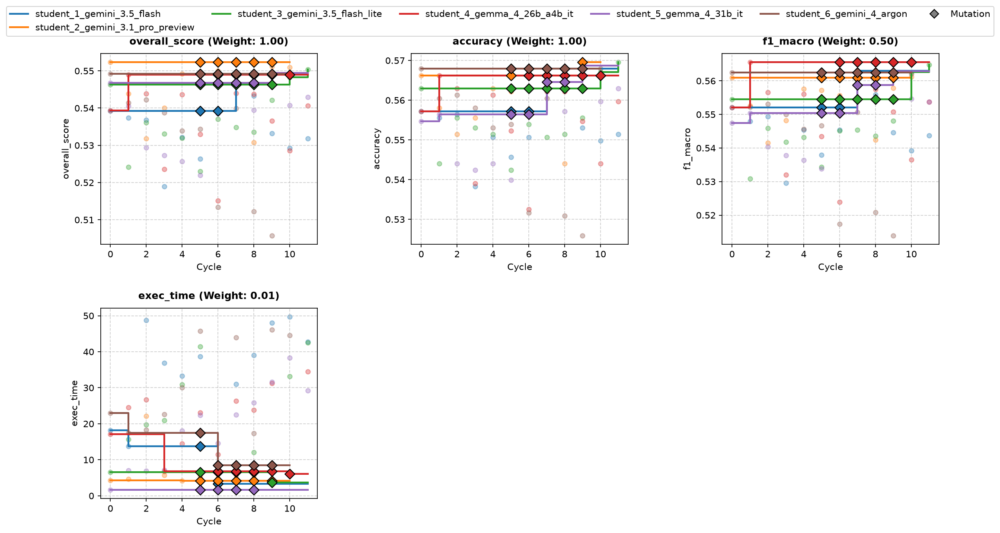
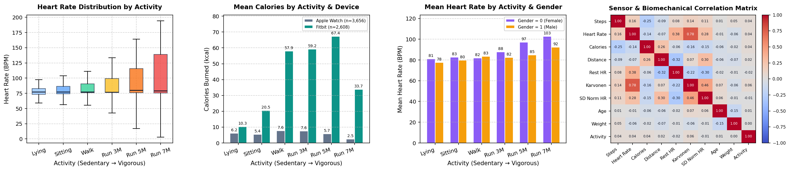
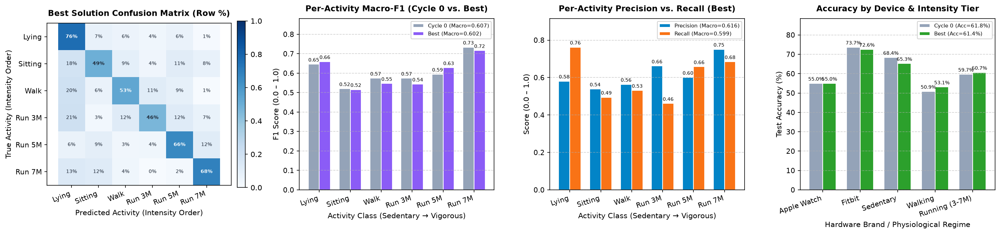

# Overview

* **Run Path**: wearable_6s_12c/headless_20261105_022847
* **Name**: headless_20261105_022847
* **Total Cycles**: 12
* **Valid Students**: 6
* **Total Generations**: 76
* **Total Code Length Processed**: 402732
* **Best Student**: student_2_gemini_3.1_pro_preview (Cycle 0)
* **Best Validation Score**: 0.552
* **Best Test Score**: 0.595
* **Validation Score Progression**: 0.5523 -> 0.5523 (+0.0000)
* **Best Metrics**: accuracy=0.614, f1_macro=0.602, exec_time=5.089
* **Tags**: LightGBM, Gradient Boosting, Stratified Group K-Fold, Balanced Class
  Weights, Baseline Model
* **Description**: The solution employs a standard LightGBM classifier with
  balanced class weights trained directly on raw tabular sensor features. To
  prevent identity leakage and simulate unseen participants, it evaluates
  performance using 5-fold StratifiedGroupKFold grouped by demographic feature
  proxies.
* **Insights**: Creating a participant proxy by combining demographic features
  (age, gender, height, weight) provides a valid grouped cross-validation
  strategy aligned with unseen participant evaluation. The baseline reliance on
  balanced class weights helps maintain macro-F1 performance across rare
  physical activity classes.
* **Total Tokens**: 860408
* **Est. Cost (USD)**: $2.370

## Objectives

-   **accuracy:** Accuracy, Higher is better (Weight: 1.00)
-   **exec_time:** Time taken to execute generated code., Lower is better
    (Weight: 0.01)

-   **f1_macro:** F1 Score (Macro), Higher is better (Weight: 0.50)

## Student Leaderboard

| Rank | Student | Best Cycle | Val Score | Test Score | accuracy | f1_macro | exec_time |
| --- | --- | --- | --- | --- | --- | --- | --- |
| 1 | student_2_gemini_3.1_pro_preview | 0 | 0.552 | 0.595 | 0.614 | 0.602 | 5.089 |
| 2 | student_3_gemini_3.5_flash_lite | 11 | 0.550 | 0.600 | 0.622 | 0.612 | 44.544 |
| 3 | student_5_gemma_4_31b_it | 9 | 0.549 | 0.584 | 0.607 | 0.595 | 35.192 |
| 4 | student_6_gemini_4_argon | 0 | 0.549 | 0.584 | 0.606 | 0.593 | 22.566 |
| 5 | student_4_gemma_4_26b_a4b_it | 1 | 0.549 | 0.578 | 0.598 | 0.591 | 22.048 |
| 6 | student_1_gemini_3.5_flash | 7 | 0.549 | 0.590 | 0.613 | 0.602 | 31.192 |

## Learning Trajectory



### Cycle Score Progression

| Cycle | student_1_gemini_3.5_flash | student_2_gemini_3.1_pro_preview | student_3_gemini_3.5_flash_lite | student_4_gemma_4_26b_a4b_it | student_5_gemma_4_31b_it | student_6_gemini_4_argon |
| --- | --- | --- | --- | --- | --- | --- |
| 0 | 0.539 *(CLASSROOM_BEST)* | 0.552 *(CLASSROOM_BEST)* | 0.546 *(SELF_BEST)* | 0.539 *(SELF_BEST)* | 0.547 *(SELF_BEST)* | 0.549 *(SELF_BEST)* |
| 1 | 0.537 | 0.544 | 0.524 | 0.549 *(SELF_BEST)* | 0.540 | 0.542 |
| 2 | 0.537 | 0.532 | 0.536 | 0.544 | 0.529 | 0.542 |
| 3 | 0.519 | 0.540 | 0.533 | 0.524 | 0.527 | 0.539 |
| 4 | 0.532 | 0.549 | 0.532 | 0.544 | 0.526 | 0.534 |
| 5 | 0.526 | 0.547 | 0.523 | 0.533 | 0.522 | 0.534 |
| 6 | 0.539 | 0.550 | 0.537 | 0.515 | 0.539 | 0.513 |
| 7 | 0.549 *(SELF_BEST)* | 0.549 | 0.535 | 0.544 | 0.546 | 0.540 |
| 8 | 0.543 | 0.531 | 0.534 | 0.544 | 0.539 | 0.512 |
| 9 | 0.533 | 0.551 | 0.542 | 0.537 | 0.549 *(SELF_BEST)* | 0.506 |
| 10 | 0.529 | 0.551 | 0.548 *(SELF_BEST)* | 0.529 | 0.541 | 0.548 |
| 11 | 0.532 | — | 0.550 *(SELF_BEST)* | 0.541 | 0.543 | — |

### Cost Breakdown

| Student | Generations | Input Tokens | Output Tokens | Total Tokens | Est. Cost (USD) |
| --- | --- | --- | --- | --- | --- |
| student_2_gemini_3.1_pro_preview | 11 | 74608 | 86533 | 161141 | $1.188 |
| student_3_gemini_3.5_flash_lite | 12 | 65377 | 17467 | 82844 | $0.085 |
| student_5_gemma_4_31b_it | 12 | 72077 | 43706 | 115783 | $0.000 |
| student_6_gemini_4_argon | 15 | 105723 | 57199 | 162922 | $0.783 |
| student_4_gemma_4_26b_a4b_it | 13 | 81499 | 83754 | 165253 | $0.000 |
| student_1_gemini_3.5_flash | 13 | 81594 | 90871 | 172465 | $0.313 |
| **Total** | 76 | 480878 | 379530 | 860408 | $2.370 |

## Analysis

### Model Tags

* `LightGBM`
* `Gradient Boosting`
* `Stratified Group K-Fold`
* `Balanced Class Weights`
* `Baseline Model`

### Model Description

> The solution employs a standard LightGBM classifier with balanced class
> weights trained directly on raw tabular sensor features. To prevent identity
> leakage and simulate unseen participants, it evaluates performance using
> 5-fold StratifiedGroupKFold grouped by demographic feature proxies.

### Model Insights

> Creating a participant proxy by combining demographic features (age, gender,
> height, weight) provides a valid grouped cross-validation strategy aligned
> with unseen participant evaluation. The baseline reliance on balanced class
> weights helps maintain macro-F1 performance across rare physical activity
> classes.

## Top Solution 1: student_2_gemini_3.1_pro_preview (Cycle 0)

* **Student**: student_2_gemini_3.1_pro_preview
* **Best Cycle**: 0
* **Validation Score**: 0.552
* **Test Score**: 0.595
* **Metrics**: accuracy=0.614, f1_macro=0.602, exec_time=5.089

### Diagnostic & Impact Analysis





| Diagnostic Metric (Unseen Test Participants) | Cycle 0 Baseline | Best Solution | Improvement |
| :--- | :---: | :---: | :---: |
| **Overall Test Accuracy** | 61.76% | **61.36%** | -0.39% |
| **Test Macro-F1 (6 Classes)** | 0.6072 | **0.6018** | -0.0054 |
| **Apple Watch Accuracy (`device=0`)** | 55.0% | **55.0%** | +0.0% |
| **Fitbit Accuracy (`device=1`)** | 73.7% | **72.6%** | -1.1% |
| **Sedentary Recall (`Lying` / `Sitting`)** | 68.4% | **65.3%** | -3.1% |
| **Running Tiers Recall (`3 / 5 / 7 METs`)** | 59.7% | **60.7%** | +1.0% |

### Plan (student_2_gemini_3.1_pro_preview)

LightGBM baseline with balanced class weights and participant-grouped
cross-validation.

### Code (student_2_gemini_3.1_pro_preview)

```python
import time
import numpy as np
import pandas as pd
from lightgbm import LGBMClassifier
from sklearn.model_selection import StratifiedGroupKFold
from sklearn.metrics import accuracy_score, f1_score, recall_score

def solution(X_train, y_train, X_val):
    start_time = time.time()

    # Target variable
    y = y_train['activity_encoded']

    # Create participant proxy for strict grouped validation
    # Demographics (age, gender, height, weight) act as a proxy for individual participants
    groups = (X_train['age'].astype(str) + '_' +
              X_train['gender'].astype(str) + '_' +
              X_train['height'].astype(str) + '_' +
              X_train['weight'].astype(str))

    # Initialize StratifiedGroupKFold
    sgkf = StratifiedGroupKFold(n_splits=5)
    oof_preds = np.zeros(len(X_train))

    # Initialize baseline model
    model = LGBMClassifier(n_jobs=1, class_weight='balanced', random_state=42)

    # Grouped Cross-Validation
    for train_idx, val_idx in sgkf.split(X_train, y, groups=groups):
        X_tr, X_va = X_train.iloc[train_idx], X_train.iloc[val_idx]
        y_tr = y.iloc[train_idx]

        model.fit(X_tr, y_tr)
        oof_preds[val_idx] = model.predict(X_va)

    # Compute CV metrics
    cv_acc = accuracy_score(y, oof_preds)
    cv_f1 = f1_score(y, oof_preds, average='macro')
    recalls = recall_score(y, oof_preds, average=None)

    # Train final model on all training data
    model.fit(X_train, y)

    # Predict on validation data
    test_preds = model.predict(X_val)

    # Format output
    y_pred_df = pd.DataFrame({'predictions': test_preds.astype(int)}, index=X_val.index)

    exec_time = time.time() - start_time

    # Construct feedback string
    feedback = (
        "Cycle 0 Baseline: LightGBM with balanced class weights on raw features.\n"
        f"Participant-grouped CV (5-fold): Accuracy={cv_acc:.4f}, F1-macro={cv_f1:.4f}\n"
        f"Per-class recall: 0(Lying):{recalls[0]:.2f}, 1(Run 3M):{recalls[1]:.2f}, 2(Run 5M):{recalls[2]:.2f}, "
        f"3(Run 7M):{recalls[3]:.2f}, 4(Walk):{recalls[4]:.2f}, 5(Sit):{recalls[5]:.2f}\n"
        f"Execution time: {exec_time:.2f}s (1 full train + 5 CV folds)."
    )

    return y_pred_df, feedback
```

### Execution Output (student_2_gemini_3.1_pro_preview)

```text
Cycle 0 Baseline: LightGBM with balanced class weights on raw features.
Participant-grouped CV (5-fold): Accuracy=0.5871, F1-macro=0.5815
Per-class recall: 0(Lying):0.68, 1(Run 3M):0.49, 2(Run 5M):0.56, 3(Run 7M):0.69, 4(Walk):0.53, 5(Sit):0.50
Execution time: 4.31s (1 full train + 5 CV folds).
```

## Top Solution 2: student_3_gemini_3.5_flash_lite (Cycle 11)

* **Student**: student_3_gemini_3.5_flash_lite
* **Best Cycle**: 11
* **Validation Score**: 0.550
* **Test Score**: 0.600
* **Metrics**: accuracy=0.622, f1_macro=0.612, exec_time=44.544

### Code (student_3_gemini_3.5_flash_lite)

```python
import time
import numpy as np
import pandas as pd
from lightgbm import LGBMClassifier
from sklearn.ensemble import HistGradientBoostingClassifier, ExtraTreesClassifier
from sklearn.metrics import accuracy_score, f1_score, recall_score
from sklearn.model_selection import StratifiedGroupKFold

def engineer_features(df: pd.DataFrame) -> pd.DataFrame:
    """Creates enhanced motion and energy proxies while preserving robust physiological features."""
    df_eng = df.copy()

    # Body composition and mass-normalized metrics
    height_m = df_eng["height"] / 100.0
    df_eng["bmi"] = df_eng["weight"] / (height_m**2 + 1e-6)
    df_eng["cal_per_kg"] = df_eng["calories"] / (df_eng["weight"] + 1e-6)

    # Metabolic cost and step dynamics proxies
    df_eng["cal_per_step"] = df_eng["calories"] / (df_eng["steps"] + 1e-6)
    df_eng["dist_per_step"] = df_eng["distance"] / (df_eng["steps"] + 1e-6)
    df_eng["stride_relative"] = df_eng["distance"] / (df_eng["steps"] + 1e-6) / (height_m + 1e-6)

    # Cardiovascular intensity and reserve proxies
    df_eng["hr_delta"] = df_eng["heart_rate"] - df_eng["resting_heart"]
    df_eng["intensity_step_prod"] = df_eng["intensity_karvonen"] * df_eng["steps"]
    df_eng["norm_hr_step_prod"] = df_eng["norm_heart"] * df_eng["steps"]

    # Motion intensity & energy expenditure rate indices
    df_eng["energy_motion_index"] = df_eng["steps"] * df_eng["norm_heart"] / (df_eng["calories"] + 1e-6)
    df_eng["cardio_mechanical_ratio"] = df_eng["heart_rate"] / (df_eng["steps"] + 1.0)

    # Wearable device sensor calibration interactions
    df_eng["dev_steps"] = df_eng["steps"] * df_eng["device_encoded"]
    df_eng["dev_hr"] = df_eng["heart_rate"] * df_eng["device_encoded"]

    # Drop raw subject-identifying demographic features to prevent memorization
    drop_cols = ["age", "height", "weight", "resting_heart"]
    df_eng = df_eng.drop(columns=[c for c in drop_cols if c in df_eng.columns])

    return df_eng

def solution(X_train: pd.DataFrame, y_train: pd.DataFrame, X_val: pd.DataFrame):
    start_time = time.time()

    # Extract target array
    if isinstance(y_train, pd.DataFrame):
        y = y_train["activity_encoded"].values.astype(int)
    else:
        y = np.squeeze(np.asarray(y_train)).astype(int)

    # Participant demographic proxy for strict grouped CV grouping
    participant_groups = (
        X_train["age"].astype(str)
        + "_"
        + X_train["gender"].astype(str)
        + "_"
        + X_train["height"].astype(str)
        + "_"
        + X_train["weight"].astype(str)
    )

    # Apply physiological feature engineering strictly per row
    X_tr_eng = engineer_features(X_train)
    X_va_eng = engineer_features(X_val)

    # 5-Fold Stratified Group K-Fold Cross-Validation
    sgkf = StratifiedGroupKFold(n_splits=5)
    oof_probs = np.zeros((len(X_tr_eng), 6), dtype=float)
    val_probs = np.zeros((len(X_va_eng), 6), dtype=float)

    total_models = 0

    for fold, (tr_idx, val_idx) in enumerate(
        sgkf.split(X_tr_eng, y, groups=participant_groups)
    ):
        X_tr_fold, y_tr_fold = X_tr_eng.iloc[tr_idx], y[tr_idx]
        X_val_fold = X_tr_eng.iloc[val_idx]

        # Model 1: LightGBM with balanced class weights
        clf_lgb = LGBMClassifier(
            n_estimators=150,
            learning_rate=0.05,
            max_depth=6,
            num_leaves=31,
            class_weight="balanced",
            n_jobs=1,
            random_state=42 + fold,
            verbosity=-1,
        )
        clf_lgb.fit(X_tr_fold, y_tr_fold)
        lgb_oof = clf_lgb.predict_proba(X_val_fold)
        lgb_val = clf_lgb.predict_proba(X_va_eng)

        # Model 2: HistGradientBoostingClassifier with balanced class weights
        clf_hgb = HistGradientBoostingClassifier(
            max_iter=150,
            learning_rate=0.05,
            max_leaf_nodes=31,
            min_samples_leaf=15,
            class_weight="balanced",
            random_state=42 + fold,
        )
        clf_hgb.fit(X_tr_fold, y_tr_fold)
        hgb_oof = clf_hgb.predict_proba(X_val_fold)
        hgb_val = clf_hgb.predict_proba(X_va_eng)

        # Blend out-of-fold and validation probabilities (0.55 LGB + 0.45 HGB)
        oof_probs[val_idx] = 0.55 * lgb_oof + 0.45 * hgb_oof
        val_probs += (0.55 * lgb_val + 0.45 * hgb_val) / 5.0
        total_models += 2

    # Fit final full-dataset models and blend into validation probabilities
    full_lgb = LGBMClassifier(
        n_estimators=150,
        learning_rate=0.05,
        max_depth=6,
        num_leaves=31,
        class_weight="balanced",
        n_jobs=1,
        random_state=42,
        verbosity=-1,
    )
    full_lgb.fit(X_tr_eng, y)
    val_probs += 0.55 * full_lgb.predict_proba(X_va_eng)

    full_hgb = HistGradientBoostingClassifier(
        max_iter=150,
        learning_rate=0.05,
        max_leaf_nodes=31,
        min_samples_leaf=15,
        class_weight="balanced",
        random_state=42,
    )
    full_hgb.fit(X_tr_eng, y)
    val_probs += 0.45 * full_hgb.predict_proba(X_va_eng)
    total_models += 2

    # Out-of-fold evaluation metrics
    oof_preds = np.argmax(oof_probs, axis=1)
    cv_acc = accuracy_score(y, oof_preds)
    cv_f1 = f1_score(y, oof_preds, average="macro")
    per_class_rec = recall_score(
        y, oof_preds, average=None, labels=[0, 1, 2, 3, 4, 5]
    )

    # Final predictions on validation set
    final_preds = np.argmax(val_probs, axis=1).astype(int)
    y_pred_df = pd.DataFrame(
        {"predictions": final_preds}, index=X_val.index, dtype=int
    )

    exec_time = time.time() - start_time
    rec_str = ", ".join(
        [f"C{i}:{r:.3f}" for i, r in enumerate(per_class_rec)]
    )

    feedback = (
        f"Cycle 11: Added stride_relative, energy_motion_index, and cardio_mechanical_ratio with tuned ensemble weights.\n"
        f"Participant-Grouped CV (5-Fold): Acc={cv_acc:.4f}, F1-Macro={cv_f1:.4f}, Combined Score={cv_acc + 0.5 * cv_f1:.4f}.\n"
        f"Per-Class OOF Recall [C0-C5]: {rec_str}.\n"
        f"Execution time: {exec_time:.2f}s across {total_models} fitted estimators."
    )

    return y_pred_df, feedback
```

### Execution Output (student_3_gemini_3.5_flash_lite)

```text
Cycle 11: Added stride_relative, energy_motion_index, and cardio_mechanical_ratio with tuned ensemble weights.
Participant-Grouped CV (5-Fold): Acc=0.5788, F1-Macro=0.5710, Combined Score=0.8643.
Per-Class OOF Recall [C0-C5]: C0:0.667, C1:0.458, C2:0.541, C3:0.710, C4:0.542, C5:0.491.
Execution time: 42.37s across 12 fitted estimators.
```

## Student Instructions

> ### Task: Wearable Sensor Physical Activity Classification
>
> #### 1. Objective
>
> Classify physical activity type into 6 discrete intensity classes from
> one-row-per-sample wearable sensor summaries.
>
> Score = accuracy (1.00) + F1-macro (0.50) - execution time penalty (0.05).
>
> **Objective Priority:** F1-macro rewards performance across all 6 classes
> equally, including low-frequency minority activities. Most importantly,
> **evaluation users are completely unseen during training**. What is
> rewarded is physiological generalization across different individuals, not
> memorizing specific participant characteristics.
>
> Metrics summary:
>
> -   **accuracy:** Accuracy, Higher is better (Weight: 1.00)
> -   **exec_time:** Time taken to execute generated code., Lower is better
>     (Weight: 0.05)
>
> -   **f1_macro:** F1 Score (Macro), Higher is better (Weight: 0.50)
>
> #### 2. Data Contract
>
> - **Inputs:**
>   * `X_train` (pd.DataFrame): Training features (3,773 samples from 29
>     participants).
>   * `y_train` (pd.DataFrame): Target class labels with single column
>     `'activity_encoded'`.
>   * `X_val` (pd.DataFrame): Validation features (1,215 samples from 9
>     unseen participants).
> - **Features (17 columns):**
> | Feature | Description |
> | :--- | :--- |
> | `age` | Participant age in years |
> | `gender` | Biological sex (0 = female, 1 = male) |
> | `height` | Body height in centimeters |
> | `weight` | Body weight in kilograms |
> | `device_encoded` | Device brand (0 = Apple Watch, 1 = Fitbit) |
> | `steps` | Total steps recorded in observation window |
> | `heart_rate` | Mean heart rate (beats per minute) |
> | `calories` | Estimated calories burned in window |
> | `distance` | Estimated distance traversed |
> | `resting_heart` | Estimated baseline resting heart rate |
> | `norm_heart` | Heart rate normalized relative to resting rate |
> | `intensity_karvonen` | Karvonen cardiovascular reserve intensity |
> | `sd_norm_heart` | Standard deviation of normalized heart rate |
> | `entropy_heart` | Approximate sample entropy of heart rate series |
> | `entropy_steps` | Approximate sample entropy of step dynamics |
> | `corr_heart_steps` | Correlation between heart rate and step rate |
> | `steps_times_distance` | Interaction term between step count and distance |
>
> - **Feature Grouping:**
>   * **Demographics:** `age`, `gender`, `height`, `weight`
>   * **Device Context:** `device_encoded` (0: Apple Watch, 1: Fitbit)
>   * **Biometrics & Motion:** `steps`, `heart_rate`, `calories`,
>     `distance`, `resting_heart`, `norm_heart`, `intensity_karvonen`,
>     `sd_norm_heart`, `entropy_heart`, `entropy_steps`, `corr_heart_steps`,
>     `steps_times_distance`
>
> - **Target Classes (6 classes, integer IDs 0 to 5 from alphabetical
>   `LabelEncoder`):**
> | Class ID | Activity Label | Description |
> | :---: | :--- | :--- |
> | **0** | `Lying (resting / sedentary)` | Class index in `predictions` |
> | **1** | `Running at 3 METs (light run)` | Class index in `predictions` |
> | **2** | `Running at 5 METs (moderate)` | Class index in `predictions` |
> | **3** | `Running at 7 METs (vigorous)` | Class index in `predictions` |
> | **4** | `Self-paced walking` | Class index in `predictions` |
> | **5** | `Sitting (sedentary)` | Class index in `predictions` |
>
> - **Output:** A tuple `(y_pred_df, feedback)`:
>   * `y_pred_df` (pd.DataFrame): Must have identical index to `X_val.index`
>     and a single column named `'predictions'` containing integer class IDs
>     (0..5).
>   * `feedback` (str): Mandatory experiment log.
>
> **Required Feedback Format:**
> Your function returns `(y_pred_df, feedback)`. The `feedback` string is
> your experiment log and will be provided back to you in the next cycle's
> Performance Feedback. It MUST contain 3 to 6 concise lines covering:
>
> - What changed vs. previous cycle (model architecture, preprocessing,
>   class balancing, or feature lever applied)
>
> - Internal participant-grouped CV F1-macro and overall accuracy
> - Per-class recall / error analysis across the 6 classes (especially
>   worst-confused activities)
>
> - Wall-clock execution time used and iterations/models completed
> Do NOT leave feedback empty; without your own diagnostic notes, subsequent
> cycles have only scalar metric values to guide refinement.
>
> #### 3. Evaluation
>
> - **Validation Protocol:** Strict participant-grouped evaluation:
>   validation samples belong to participants not present in the training
>   set. Validate internally using `StratifiedGroupKFold` on a participant
>   proxy derived from the 4 demographic columns (`age`, `gender`, `height`,
>   `weight`).
>
> - **Inductive Inference:** Each row in `X_val` represents an independent
>   sensor observation that must be predicted without referencing other rows
>   in `X_val`. All feature scalers, imputers, and encoders must be fit on
>   `X_train` and applied via `.transform(X_val)`. Never group `X_val` by
>   participant (`groupby` on demographic proxies) or compute
>   per-participant statistics (`mean`, `std`, `min`, `max`, `rank`) across
>   multiple rows of `X_val`.
>
> - **Per-Cycle Wall-Clock Budget:** **60 s** (hard execution timeout) on
>   3,773 training rows.
>
> - **Final Evaluation Budget:** **180 s** when retraining on the combined
>   learning set (4,988 rows across 38 participants).
>
> - **Budgeting Strategy:** Time your first iteration or epoch, then plan
>   iterations by a deadline with at least a 15% safety margin. Do not train
>   by fixed high iteration counts that risk timing out. A timeout scores 0
>   for that cycle.
>
> - **Hard Resource Caps:**
>   * Single core CPU execution (set n_jobs=1 or threads=1)
>   * Predictions must be integers in range [0, 5]
>
> #### 4. Environment
>
> - **Importable Libraries:** `numpy`, `pandas`, `scipy`, `sklearn`,
>   `lightgbm`.
>
> - **Forbidden Libraries:** `xgboost`, `torch`, `tensorflow`, `jax` (do NOT
>   import or use; will raise ModuleNotFoundError or cause validator
>   failure).
>
> - **Network Access:** No internet access; no downloading pretrained model
>   weights or external files during execution.
>
> - **Single Code Block:** Provide exactly one complete python code block
>   containing all imports, helpers, and the `solution` function.
>
> - scikit-learn and NumPy are fully supported. Avoid deprecated or removed
>   scikit-learn keyword arguments.
>
> - Do NOT attempt to implement neural networks or gradient boosting from
>   scratch in pure NumPy/JAX; standard library implementations are 100x
>   faster and far more accurate.
>
> - Restrict parallel threads (`n_jobs=1`) to avoid execution timeout in
>   containerized evaluation environments.
>
> #### 5. Principles
>
> - **Candidate Models:**
>   * Tree Ensembles:
>     HistGradientBoostingClassifier(class_weight='balanced'), LightGBM
>     (LGBMClassifier), ExtraTreesClassifier, and RandomForestClassifier are
>     fast and handle non-linear physiological interactions naturally.
>   * Linear and Kernel Models: Regularized LogisticRegression,
>     RidgeClassifier, and SVC with RBF kernel on standardized features
>     provide smooth, low-variance decision boundaries across subjects.
>   * Neural Networks: Multi-Layer Perceptrons (MLPClassifier) with scaled
>     inputs capture non-linear sensor manifolds without memorizing
>     demographic IDs.
>   * **Model Architecture:** Prefer a well-tuned model or parsimonious
>     pipeline over heavy multi-model ensembles that consume the runtime
>     budget for marginal gain.
> - **Physiological Feature Engineering:** The four demographic columns
>   (`age`, `height`, `weight`, `gender`) and baseline `resting_heart` carry
>   both subject-level physiology and identification signals. Construct
>   normalized physiological ratios (such as heart rate reserve relative to
>   estimated max HR, MET proxies, BMI, stride dynamics, and
>   `device_encoded` interactions) using each row's own measurements. Test
>   dropping raw demographic and baseline columns as an empirical hypothesis
>   verified via participant-grouped CV rather than an automatic assumption.
>
> - **Device Calibration:** Apple Watch and Fitbit sensors have different
>   hardware sensitivities and error characteristics. Features that capture
>   `device_encoded` interactions or calibration (fit strictly on `X_train`
>   and applied to `X_val`) help generalize sensor readings across brands.
>
> - **Ordinal Running Intensities:** Classes 1, 2, and 3 represent ascending
>   running intensities (3, 5, 7 METs), whereas classes 0 and 5 are
>   sedentary (Lying, Sitting) and class 4 is walking. Monotonic intensity
>   features (step rate × normalized heart rate, metabolic cost per step)
>   separate adjacent running classes far better than categorical
>   classification alone.
>
> - **Grouped Validation:** Always evaluate internally with
>   `StratifiedGroupKFold` grouped by participant. Random K-Fold leaks
>   participant identities and produces optimistic F1 scores inflated by
>   ~0.10 that collapse on the true test set.
>
> - **Peer Collaboration:** When learning from peer solutions, synthesize
>   complementary feature and preprocessing discoveries (e.g. combining
>   physiological heart-rate reserve features with device calibration) into
>   your best model rather than copying scripts wholesale. Avoid overfitting
>   to validation folds.
>
> - **Metric Trade-offs:**
>   * Accuracy (weight 1.00) reflects overall correct classification rate
>     across all activity samples.
>   * Macro-F1 (weight 0.50) weights all 6 activity classes equally, heavily
>     penalizing confusion on rare or difficult exercises.
>   * If accuracy is high but Macro-F1 is low, or if balanced class weights
>     over-predict rare classes at the expense of overall accuracy, examine
>     per-class recall in feedback and tune class prior scaling or
>     out-of-fold probability calibration to jointly optimize Accuracy + 0.5
>     * Macro-F1.
>
> #### 6. Pitfalls
>
> - **Transductive Grouping:** Never group `X_val` by participant (`groupby`
>   on demographic columns) or compute per-participant `mean`, `std`, `min`,
>   `max`, or `rank` across rows of `X_val`. Because each lab participant
>   completed all 6 activities in sequence, aggregating across a subject's
>   test rows leaks their full session range and breaks real-time
>   single-window inference. Every row of `X_val` must be transformed
>   independently using only its own single-row values (`resting_heart`,
>   `age`, `weight`, `height`, `gender`) and statistics fit on `X_train`.
>
> - **Temporal Fallacy:** Each sample in this benchmark is an independent
>   summary snapshot. There is NO continuous time axis or timestamp column;
>   do NOT write dead code attempting rolling window statistics or datetime
>   decomposition.
>
> - **From-Scratch Models:** Do not attempt from-scratch NumPy or JAX neural
>   networks; standard library implementations are 100x faster and far more
>   accurate.
>
> - **Deprecated Arguments:** Do not pass removed keyword arguments (such as
>   `multi_class` to `LogisticRegression` on modern scikit-learn; raises
>   TypeError).
>
> - **Random Split Leakage:** Testing on random train/test splits instead of
>   participant-grouped splits inflates validation metrics and masks
>   cross-person failure modes.
>
> - **Probability Outputs:** Output must contain integer class predictions
>   (0..5), not probabilities, logits, or continuous floats.
>
> #### 7. Iteration Discipline
>
> - **Cycle 0 Baseline:** Build the simplest correct baseline that returns a
>   valid prediction dataframe in under half the time budget. Prioritize a
>   working end-to-end pipeline before tuning.
>
> - **One Change at a Time:** Once you have a working baseline, change
>   exactly ONE conceptual component per cycle (e.g. one feature family, one
>   regularization sweep, or one loss formulation).
>
> - **Keep-Best-So-Far:** Track your best score. If a modification degrades
>   performance or adds excessive latency without accuracy gain, revert to
>   your best-so-far solution on the following cycle.
>
> - **Use the Feedback String:** Record your validation findings in the
>   returned feedback string. Use it as an experiment log across cycles.
>
> - **Focus on the Primary Lever:** Spend compute on the lever with the
>   highest expected gain for the primary objective. Avoid architectural
>   rewrites when the headroom is small.
>
> - **Pre-Return Check:** Verify your output dataframe against the checklist
>   in Section 8 before returning.
>
> - **Concise Model Summary:** Start your response with a concise 1-line
>   model/technique summary rather than conversational filler.
>
> #### 8. Output Contract
>
> - [ ] Function signature is exactly `solution(X_train, y_train, X_val)`
>       and returns a tuple `(y_pred_df, feedback)`.
>
> - [ ] `y_pred_df` is a pandas DataFrame with index identical to
>       `X_val.index`.
>
> - [ ] `y_pred_df` has exactly one column named `'predictions'` with dtype
>       `int (0 to 5)`.
>
> - [ ] `y_pred_df` contains no `NaN`, `None`, or infinite values.
> - [ ] Predictions are non-trivial (not a constant value or single class).
> - [ ] Total execution completes comfortably within the 60 s per-cycle
>       limit and scales to 180 s on final evaluation.
>
> - [ ] Output predictions are strictly integers within {0, 1, 2, 3, 4, 5}.
> - [ ] All 6 classes are represented in predictions (not collapsing
>       minority classes).
>
> - [ ] Each row of `X_val` is predicted independently without cross-row
>       participant `groupby` or test-batch rank/min/max aggregation.
>
> - [ ] Validation metrics are computed across unseen participant groups.
> - [ ] Feedback string contains the required items (change, validation
>       score, per-class recall, elapsed wall-clock).
