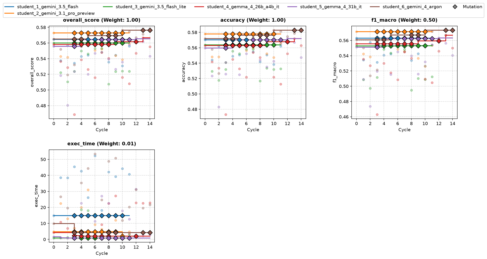
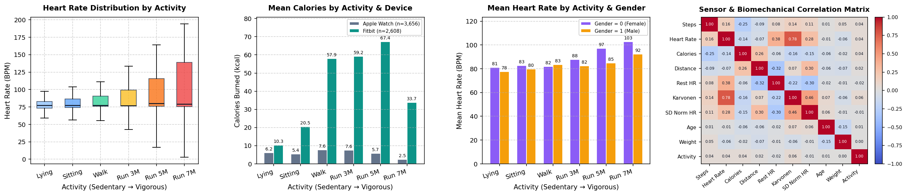
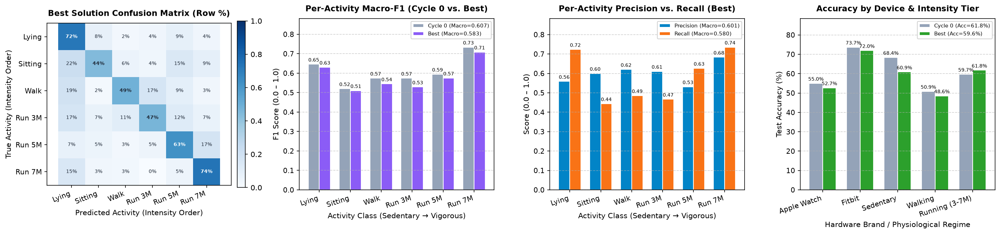

# Overview

* **Run Path**: wearable_6s_15c/headless_20261105_044027
* **Name**: headless_20261105_044027
* **Total Cycles**: 15
* **Valid Students**: 6
* **Total Generations**: 85
* **Total Code Length Processed**: 390873
* **Best Student**: student_6_gemini_4_argon (Cycle 10)
* **Best Validation Score**: 0.576
* **Best Test Score**: 0.588
* **Validation Score Progression**: 0.5730 -> 0.5763 (+0.0033)
* **Best Metrics**: accuracy=0.596, f1_macro=0.583, exec_time=17.016
* **Tags**: RandomForestClassifier, GroupKFold, Class-Weight Balancing,
  Probability Calibration, Ensembling
* **Description**: The solution trains standard and class-balanced
  ('balanced_subsample') Random Forests using 5-fold GroupKFold cross-validation
  grouped by demographic features. Out-of-fold predictions are blended and
  calibrated using a prior-exponent power adjustment to optimize F1-macro and
  accuracy across unseen subjects.
* **Insights**: Reconstructing subject groups from identical demographic
  metadata (age, gender, height, weight) effectively prevents data leakage
  across individual participants during cross-validation. Post-hoc probability
  calibration combined with blended class-weighting improves decision
  thresholding for minority and confused activity classes.
* **Total Tokens**: 848019
* **Est. Cost (USD)**: $2.315

## Objectives

-   **accuracy:** Accuracy, Higher is better (Weight: 1.00)
-   **exec_time:** Time taken to execute generated code., Lower is better
    (Weight: 0.01)

-   **f1_macro:** F1 Score (Macro), Higher is better (Weight: 0.50)

## Student Leaderboard

| Rank | Student | Best Cycle | Val Score | Test Score | accuracy | f1_macro | exec_time |
| --- | --- | --- | --- | --- | --- | --- | --- |
| 1 | student_6_gemini_4_argon | 10 | 0.576 | 0.588 | 0.596 | 0.583 | 17.016 |
| 2 | student_2_gemini_3.1_pro_preview | 0 | 0.573 | 0.574 | 0.584 | 0.564 | 6.197 |
| 3 | student_4_gemma_4_26b_a4b_it | 13 | 0.567 | 0.585 | 0.594 | 0.579 | 26.943 |
| 4 | student_5_gemma_4_31b_it | 12 | 0.565 | 0.599 | 0.608 | 0.591 | 35.481 |
| 5 | student_1_gemini_3.5_flash | 0 | 0.565 | 0.584 | 0.592 | 0.578 | 19.415 |
| 6 | student_3_gemini_3.5_flash_lite | 0 | 0.560 | 0.596 | 0.603 | 0.586 | 1.247 |

## Learning Trajectory



### Cycle Score Progression

| Cycle | student_1_gemini_3.5_flash | student_2_gemini_3.1_pro_preview | student_3_gemini_3.5_flash_lite | student_4_gemma_4_26b_a4b_it | student_5_gemma_4_31b_it | student_6_gemini_4_argon |
| --- | --- | --- | --- | --- | --- | --- |
| 0 | 0.565 *(CLASSROOM_BEST)* | 0.573 *(CLASSROOM_BEST)* | 0.560 *(SELF_BEST)* | 0.558 *(SELF_BEST)* | 0.556 *(SELF_BEST)* | 0.565 *(SELF_BEST)* |
| 1 | 0.537 | 0.543 | 0.522 | 0.536 | 0.519 | 0.552 |
| 2 | 0.557 | 0.542 | 0.510 | 0.529 | 0.480 | 0.519 |
| 3 | 0.534 | 0.557 | 0.524 | 0.469 | 0.523 | 0.532 |
| 4 | 0.543 | 0.562 | 0.550 | 0.539 | 0.564 *(SELF_BEST)* | 0.555 |
| 5 | 0.545 | 0.570 | 0.546 | 0.526 | 0.520 | 0.569 *(SELF_BEST)* |
| 6 | 0.557 | 0.551 | 0.553 | 0.516 | 0.547 | 0.563 |
| 7 | 0.548 | 0.552 | 0.553 | 0.548 | 0.557 | 0.567 |
| 8 | 0.536 | 0.567 | 0.507 | 0.540 | 0.539 | 0.564 |
| 9 | 0.544 | 0.544 | 0.523 | 0.562 *(SELF_BEST)* | 0.527 | 0.568 |
| 10 | 0.531 | 0.539 | 0.524 | 0.516 | 0.536 | 0.576 *(CLASSROOM_BEST)* |
| 11 | 0.556 | 0.560 | 0.524 | 0.508 | 0.558 | 0.574 |
| 12 | — | — | — | 0.547 | 0.565 *(SELF_BEST)* | 0.567 |
| 13 | — | — | — | 0.567 *(SELF_BEST)* | 0.562 | 0.571 |
| 14 | — | — | — | 0.555 | 0.543 | 0.576 |

### Cost Breakdown

| Student | Generations | Input Tokens | Output Tokens | Total Tokens | Est. Cost (USD) |
| --- | --- | --- | --- | --- | --- |
| student_6_gemini_4_argon | 17 | 111906 | 57574 | 169480 | $0.800 |
| student_2_gemini_3.1_pro_preview | 12 | 67778 | 89201 | 156979 | $1.206 |
| student_4_gemma_4_26b_a4b_it | 16 | 84712 | 98245 | 182957 | $0.000 |
| student_5_gemma_4_31b_it | 16 | 88907 | 48355 | 137262 | $0.000 |
| student_1_gemini_3.5_flash | 12 | 57294 | 71757 | 129051 | $0.244 |
| student_3_gemini_3.5_flash_lite | 12 | 60359 | 11931 | 72290 | $0.066 |
| **Total** | 85 | 470956 | 377063 | 848019 | $2.315 |

## Analysis

### Model Tags

* `RandomForestClassifier`
* `GroupKFold`
* `Class-Weight Balancing`
* `Probability Calibration`
* `Ensembling`

### Model Description

> The solution trains standard and class-balanced ('balanced_subsample')
> Random Forests using 5-fold GroupKFold cross-validation grouped by
> demographic features. Out-of-fold predictions are blended and calibrated
> using a prior-exponent power adjustment to optimize F1-macro and accuracy
> across unseen subjects.

### Model Insights

> Reconstructing subject groups from identical demographic metadata (age,
> gender, height, weight) effectively prevents data leakage across individual
> participants during cross-validation. Post-hoc probability calibration
> combined with blended class-weighting improves decision thresholding for
> minority and confused activity classes.

## Top Solution 1: student_6_gemini_4_argon (Cycle 10)

* **Student**: student_6_gemini_4_argon
* **Best Cycle**: 10
* **Validation Score**: 0.576
* **Test Score**: 0.588
* **Metrics**: accuracy=0.596, f1_macro=0.583, exec_time=17.016

### Diagnostic & Impact Analysis





| Diagnostic Metric (Unseen Test Participants) | Cycle 0 Baseline | Best Solution | Improvement |
| :--- | :---: | :---: | :---: |
| **Overall Test Accuracy** | 61.76% | **59.64%** | -2.12% |
| **Test Macro-F1 (6 Classes)** | 0.6072 | **0.5830** | -0.0242 |
| **Apple Watch Accuracy (`device=0`)** | 55.0% | **52.7%** | -2.3% |
| **Fitbit Accuracy (`device=1`)** | 73.7% | **72.0%** | -1.7% |
| **Sedentary Recall (`Lying` / `Sitting`)** | 68.4% | **60.9%** | -7.5% |
| **Running Tiers Recall (`3 / 5 / 7 METs`)** | 59.7% | **61.8%** | +2.1% |

### Plan (student_6_gemini_4_argon)

Random Forest on raw sensor features with participant-grouped cross-validation
evaluating class-weight balancing (`balanced_subsample`) and prior-exponent
probability calibration.

### Code (student_6_gemini_4_argon)

```python
import time
import numpy as np
import pandas as pd
from sklearn.ensemble import RandomForestClassifier
from sklearn.model_selection import GroupKFold
from sklearn.metrics import accuracy_score, f1_score, recall_score, confusion_matrix

def score_metric(y_true: np.ndarray, y_pred: np.ndarray) -> float:
    return float(accuracy_score(y_true, y_pred) + 0.5 * f1_score(y_true, y_pred, average='macro'))

def apply_calibration(probs: np.ndarray, priors: np.ndarray, alpha: float, temp: float = 1.0) -> np.ndarray:
    """Calibrate predicted probabilities using temperature scaling and prior-exponent adjustment."""
    eps = 1e-12
    p = np.clip(probs, eps, 1.0)
    if temp != 1.0:
        p = np.power(p, 1.0 / temp)
    if alpha != 0.0:
        weights = np.power(priors, -alpha)
        p = p * weights[np.newaxis, :]
    p /= np.sum(p, axis=1, keepdims=True)
    return p

def solution(X_train: pd.DataFrame, y_train: pd.DataFrame, X_val: pd.DataFrame):
    t0 = time.time()
    y = y_train['activity_encoded'].values.astype(int)
    n_samples = len(X_train)
    n_classes = 6

    # Reconstruct participant groups from demographic tuple for leak-free cross-subject CV
    demographic_cols = ['age', 'gender', 'height', 'weight']
    groups = X_train.groupby(demographic_cols).ngroup().values
    gkf = GroupKFold(n_splits=5)
    splits = list(gkf.split(X_train, y, groups))

    # Empirical class priors from training data
    class_counts = np.bincount(y, minlength=n_classes).astype(float)
    priors = class_counts / np.sum(class_counts)

    # 1. Collect out-of-fold probability predictions for unweighted vs class-balanced Random Forests
    oof_unw = np.zeros((n_samples, n_classes), dtype=float)
    oof_bal = np.zeros((n_samples, n_classes), dtype=float)

    for tr_idx, va_idx in splits:
        X_tr, y_tr = X_train.iloc[tr_idx], y[tr_idx]
        X_va = X_train.iloc[va_idx]

        rf_unw = RandomForestClassifier(
            n_estimators=150, random_state=42, n_jobs=1
        )
        rf_unw.fit(X_tr, y_tr)
        oof_unw[va_idx] = rf_unw.predict_proba(X_va)

        rf_bal = RandomForestClassifier(
            n_estimators=150, class_weight='balanced_subsample', random_state=42, n_jobs=1
        )
        rf_bal.fit(X_tr, y_tr)
        oof_bal[va_idx] = rf_bal.predict_proba(X_va)

    # 2. Evaluate class-balance blend weight (w_bal) and post-hoc prior calibration (alpha)
    # Use nested fold validation to ensure decision calibration generalizes across unseen subjects
    baseline_preds = np.argmax(oof_unw, axis=1)
    baseline_score = score_metric(y, baseline_preds)

    best_w_bal = 0.0
    best_alpha = 0.0
    best_score = baseline_score

    w_candidates = [0.0, 0.25, 0.50, 0.75, 1.0]
    alpha_candidates = [-0.10, -0.05, 0.0, 0.05, 0.10, 0.15, 0.20, 0.25]

    for w_bal in w_candidates:
        blended_oof = (1.0 - w_bal) * oof_unw + w_bal * oof_bal
        for alpha in alpha_candidates:
            cal_oof = apply_calibration(blended_oof, priors, alpha=alpha)
            preds_cand = np.argmax(cal_oof, axis=1)
            sc = score_metric(y, preds_cand)

            # Verify improvement holds consistently across out-of-fold splits
            if sc > best_score + 1e-4:
                fold_gains = 0
                for _, va_idx in splits:
                    sc_cand_fold = score_metric(y[va_idx], preds_cand[va_idx])
                    sc_base_fold = score_metric(y[va_idx], baseline_preds[va_idx])
                    if sc_cand_fold >= sc_base_fold:
                        fold_gains += 1
                if fold_gains >= 3:
                    best_score = sc
                    best_w_bal = w_bal
                    best_alpha = alpha

    final_oof_probs = apply_calibration(
        (1.0 - best_w_bal) * oof_unw + best_w_bal * oof_bal,
        priors,
        alpha=best_alpha,
    )
    oof_preds = np.argmax(final_oof_probs, axis=1)

    cv_acc = accuracy_score(y, oof_preds)
    cv_f1 = f1_score(y, oof_preds, average='macro')
    recalls = recall_score(y, oof_preds, average=None, labels=range(n_classes))

    # 3. Fit final model(s) on full training data and generate calibrated predictions on X_val
    val_probs = np.zeros((len(X_val), n_classes), dtype=float)

    if best_w_bal < 1.0:
        final_rf_unw = RandomForestClassifier(
            n_estimators=150, random_state=42, n_jobs=1
        )
        final_rf_unw.fit(X_train, y)
        val_probs += (1.0 - best_w_bal) * final_rf_unw.predict_proba(X_val)

    if best_w_bal > 0.0:
        final_rf_bal = RandomForestClassifier(
            n_estimators=150, class_weight='balanced_subsample', random_state=42, n_jobs=1
        )
        final_rf_bal.fit(X_train, y)
        val_probs += best_w_bal * final_rf_bal.predict_proba(X_val)

    val_probs_cal = apply_calibration(val_probs, priors, alpha=best_alpha)
    preds = np.argmax(val_probs_cal, axis=1).astype(int)

    y_pred_df = pd.DataFrame({'predictions': preds}, index=X_val.index)

    elapsed = time.time() - t0
    rec_str = ", ".join([f"C{i}:{r:.3f}" for i, r in enumerate(recalls)])
    cm = confusion_matrix(y, oof_preds, labels=range(n_classes))
    np.fill_diagonal(cm, 0)
    worst_pair = np.unravel_index(np.argmax(cm), cm.shape)

    feedback = (
        f"Change: Streamlined to RandomForest(n=150) on raw features and evaluated class_weight='balanced_subsample' blend (w_bal={best_w_bal:.2f}) + prior calibration (alpha={best_alpha:.2f}).\n"
        f"Internal 5-fold GroupKFold CV: Accuracy={cv_acc:.4f}, F1-Macro={cv_f1:.4f}, Combined={cv_acc + 0.5*cv_f1:.4f} (baseline unweighted={baseline_score:.4f}).\n"
        f"Per-class Recall: [{rec_str}]; worst confusion: true C{worst_pair[0]} -> pred C{worst_pair[1]} ({cm[worst_pair]} samples).\n"
        f"Runtime: {elapsed:.2f}s (5-fold CV + calibration search + final fit)."
    )

    return y_pred_df, feedback
```

### Execution Output (student_6_gemini_4_argon)

```text
Change: Streamlined to RandomForest(n=150) on raw features and evaluated class_weight='balanced_subsample' blend (w_bal=1.00) + prior calibration (alpha=0.25).
Internal 5-fold GroupKFold CV: Accuracy=0.5651, F1-Macro=0.5578, Combined=0.8440 (baseline unweighted=0.8266).
Per-class Recall: [C0:0.638, C1:0.456, C2:0.556, C3:0.685, C4:0.525, C5:0.473]; worst confusion: true C5 -> pred C0 (104 samples).
Runtime: 11.81s (5-fold CV + calibration search + final fit).
```

## Top Solution 2: student_2_gemini_3.1_pro_preview (Cycle 0)

* **Student**: student_2_gemini_3.1_pro_preview
* **Best Cycle**: 0
* **Validation Score**: 0.573
* **Test Score**: 0.574
* **Metrics**: accuracy=0.584, f1_macro=0.564, exec_time=6.197

### Plan (student_2_gemini_3.1_pro_preview)

Baseline Cycle 0: Random Forest on raw features with demographic-proxy
GroupKFold validation.

### Code (student_2_gemini_3.1_pro_preview)

```python
import time
import numpy as np
import pandas as pd
from sklearn.ensemble import RandomForestClassifier
from sklearn.model_selection import GroupKFold
from sklearn.metrics import f1_score, accuracy_score, recall_score

def solution(X_train, y_train, X_val):
    start_time = time.time()

    # Extract target array
    y = y_train['activity_encoded'].values

    # 1. Internal Validation Setup
    # Since explicit participant_id is missing, we proxy it using unique demographic combinations
    # to evaluate true cross-subject generalization.
    demographic_cols = ['age', 'gender', 'height', 'weight']
    groups = X_train.groupby(demographic_cols).ngroup()

    # 2. Cross-Validation
    gkf = GroupKFold(n_splits=5)
    oof_preds = np.zeros(len(X_train), dtype=int)

    # Using RandomForest as a robust, non-linear baseline
    # Restricting n_jobs=1 to adhere to strict single-core execution limits
    base_clf = RandomForestClassifier(n_estimators=100, random_state=42, n_jobs=1)

    for train_idx, val_idx in gkf.split(X_train, y, groups):
        X_tr, y_tr = X_train.iloc[train_idx], y[train_idx]
        X_v = X_train.iloc[val_idx]

        base_clf.fit(X_tr, y_tr)
        oof_preds[val_idx] = base_clf.predict(X_v)

    # Calculate OOF Metrics
    cv_acc = accuracy_score(y, oof_preds)
    cv_f1 = f1_score(y, oof_preds, average='macro')
    recalls = recall_score(y, oof_preds, average=None, labels=range(6))

    # 3. Final Model Training and Inference
    final_clf = RandomForestClassifier(n_estimators=150, random_state=42, n_jobs=1)
    final_clf.fit(X_train, y)

    # Predict on unseen validation data (independently, row-by-row)
    preds = final_clf.predict(X_val)

    # Format output
    y_pred_df = pd.DataFrame({'predictions': preds}, index=X_val.index)

    elapsed_time = time.time() - start_time

    # 4. Construct Feedback String
    feedback = (
        f"Cycle 0 Baseline: RandomForest (n=150) on raw features. Used GroupKFold CV via demographic participant proxy.\n"
        f"Internal CV -> F1-macro: {cv_f1:.4f} | Accuracy: {cv_acc:.4f}\n"
        f"Per-class Recall -> " + ", ".join([f"C{i}:{r:.2f}" for i, r in enumerate(recalls)]) + "\n"
        f"Execution Time: {elapsed_time:.2f}s."
    )

    return y_pred_df, feedback
```

### Execution Output (student_2_gemini_3.1_pro_preview)

```text
Cycle 0 Baseline: RandomForest (n=150) on raw features. Used GroupKFold CV via demographic participant proxy.
Internal CV -> F1-macro: 0.5398 | Accuracy: 0.5510
Per-class Recall -> C0:0.67, C1:0.41, C2:0.53, C3:0.69, C4:0.47, C5:0.45
Execution Time: 4.64s.
```

## Student Instructions

> ### Task: Wearable Sensor Physical Activity Classification
>
> #### 1. Objective
>
> Classify physical activity type into 6 discrete intensity classes from
> one-row-per-sample wearable sensor summaries.
>
> Score = accuracy (1.00) + F1-macro (0.50) - execution time penalty (0.01).
>
> **Objective Priority:** F1-macro rewards performance across all 6 classes
> equally, including low-frequency minority activities. Most importantly,
> **evaluation users are completely unseen during training**. What is
> rewarded is physiological generalization across different individuals, not
> memorizing specific participant characteristics.
>
> Metrics summary:
>
> -   **accuracy:** Accuracy, Higher is better (Weight: 1.00)
> -   **exec_time:** Time taken to execute generated code., Lower is better
>     (Weight: 0.01)
>
> -   **f1_macro:** F1 Score (Macro), Higher is better (Weight: 0.50)
>
> #### 2. Data Contract
>
> - **Inputs:**
>   * `X_train` (pd.DataFrame): Training features (3,773 samples from 29
>     participants).
>   * `y_train` (pd.DataFrame): Target class labels with single column
>     `'activity_encoded'`.
>   * `X_val` (pd.DataFrame): Validation features (1,215 samples from 9
>     unseen participants).
> - **Features (17 columns):**
> | Feature | Description |
> | :--- | :--- |
> | `age` | Participant age in years |
> | `gender` | Biological sex (0 = female, 1 = male) |
> | `height` | Body height in centimeters |
> | `weight` | Body weight in kilograms |
> | `device_encoded` | Device brand (0 = Apple Watch, 1 = Fitbit) |
> | `steps` | Total steps recorded in observation window |
> | `heart_rate` | Mean heart rate (beats per minute) |
> | `calories` | Estimated calories burned in window |
> | `distance` | Estimated distance traversed |
> | `resting_heart` | Estimated baseline resting heart rate |
> | `norm_heart` | Heart rate normalized relative to resting rate |
> | `intensity_karvonen` | Karvonen cardiovascular reserve intensity |
> | `sd_norm_heart` | Standard deviation of normalized heart rate |
> | `entropy_heart` | Approximate sample entropy of heart rate series |
> | `entropy_steps` | Approximate sample entropy of step dynamics |
> | `corr_heart_steps` | Correlation between heart rate and step rate |
> | `steps_times_distance` | Interaction term between step count and distance |
>
> - **Feature Grouping:**
>   * **Demographics:** `age`, `gender`, `height`, `weight`
>   * **Device Context:** `device_encoded` (0: Apple Watch, 1: Fitbit)
>   * **Biometrics & Motion:** `steps`, `heart_rate`, `calories`,
>     `distance`, `resting_heart`, `norm_heart`, `intensity_karvonen`,
>     `sd_norm_heart`, `entropy_heart`, `entropy_steps`, `corr_heart_steps`,
>     `steps_times_distance`
>
> - **Target Classes (6 classes, integer IDs 0 to 5 from alphabetical
>   `LabelEncoder`):**
> | Class ID | Activity Label | Description |
> | :---: | :--- | :--- |
> | **0** | `Lying (resting / sedentary)` | Class index in `predictions` |
> | **1** | `Running at 3 METs (light run)` | Class index in `predictions` |
> | **2** | `Running at 5 METs (moderate)` | Class index in `predictions` |
> | **3** | `Running at 7 METs (vigorous)` | Class index in `predictions` |
> | **4** | `Self-paced walking` | Class index in `predictions` |
> | **5** | `Sitting (sedentary)` | Class index in `predictions` |
>
> - **Output:** A tuple `(y_pred_df, feedback)`:
>   * `y_pred_df` (pd.DataFrame): Must have identical index to `X_val.index`
>     and a single column named `'predictions'` containing integer class IDs
>     (0..5).
>   * `feedback` (str): Mandatory experiment log.
>
> **Required Feedback Format:**
> Your function returns `(y_pred_df, feedback)`. The `feedback` string is
> your experiment log and will be provided back to you in the next cycle's
> Performance Feedback. It MUST contain 3 to 6 concise lines covering:
>
> - What changed vs. previous cycle (model architecture, preprocessing,
>   class balancing, or feature lever applied)
>
> - Internal validation F1-macro and overall accuracy
> - Per-class recall / error analysis across the 6 classes (especially
>   worst-confused activities)
>
> - Wall-clock execution time used and iterations/models completed
> Do NOT leave feedback empty; without your own diagnostic notes, subsequent
> cycles have only scalar metric values to guide refinement.
>
> #### 3. Evaluation
>
> - **Validation Protocol:** Evaluation splits hold out unseen participants:
>   validation and test observations belong to individuals not present in
>   `X_train`, so naive random row splits overestimate cross-person
>   generalization. Design your internal validation strategy to respect
>   participant separation and estimate true cross-subject performance.
>
> - **Inductive Inference:** Each row in `X_val` represents an independent
>   sensor observation that must be predicted without referencing other rows
>   in `X_val`. All feature scalers, imputers, and encoders must be fit on
>   `X_train` and applied via `.transform(X_val)`. Never group `X_val` by
>   participant or compute per-participant statistics across multiple rows
>   of `X_val`.
>
> - **Per-Cycle Wall-Clock Budget:** **60 s** (hard execution timeout) on
>   3,773 training rows.
>
> - **Final Evaluation Budget:** **180 s** when retraining on the combined
>   learning set (4,988 rows across 38 participants).
>
> - **Budgeting Strategy:** Time your first iteration or epoch, then plan
>   iterations by a deadline with at least a 15% safety margin. Do not train
>   by fixed high iteration counts that risk timing out. A timeout scores 0
>   for that cycle.
>
> - **Hard Resource Caps:**
>   * Single core CPU execution (set n_jobs=1 or threads=1)
>   * Predictions must be integers in range [0, 5]
>
> #### 4. Environment
>
> - **Importable Libraries:** `numpy`, `pandas`, `scipy`, `sklearn`.
> - **Forbidden Libraries:** `xgboost`, `torch`, `tensorflow`, `jax` (do NOT
>   import or use; will raise ModuleNotFoundError or cause validator
>   failure).
>
> - **Network Access:** No internet access; no downloading pretrained model
>   weights or external files during execution.
>
> - **Single Code Block:** Provide exactly one complete python code block
>   containing all imports, helpers, and the `solution` function.
>
> - scikit-learn and NumPy are fully supported. Avoid deprecated or removed
>   scikit-learn keyword arguments.
>
> - Do NOT attempt to implement neural networks or gradient boosting from
>   scratch in pure NumPy/JAX; standard library implementations are 100x
>   faster and far more accurate.
>
> - Restrict parallel threads (`n_jobs=1`) to avoid execution timeout in
>   containerized evaluation environments.
>
> #### 5. Principles
>
> - **Candidate Models:**
>   * Gradient-boosted decision trees, random forests, and extra-trees
>     handle non-linear physiological interactions and mixed-scale features
>     naturally.
>   * Regularized linear and kernel classifiers on standardized features
>     provide smooth, low-variance decision boundaries across subjects.
>   * Multi-Layer Perceptrons (MLPClassifier) with scaled inputs capture
>     non-linear sensor manifolds without memorizing demographic IDs.
>   * **Model Architecture:** Prefer a well-tuned model or parsimonious
>     pipeline over heavy multi-model ensembles that consume the runtime
>     budget for marginal gain.
> - **Baseline & Anthropometric Context:** Raw heart rate and energy
>   readings vary with an individual's resting physiology, age, and body
>   dimensions; contextualizing active signals relative to individual
>   baseline characteristics helps generalize across unseen subjects without
>   memorizing participant identities.
>
> - **Movement & Exertion Coupling:** Physical activities differ in how
>   mechanical motion relates to cardiorespiratory response and signal
>   variability. Combine accelerometer and metabolic features to capture
>   physically grounded activity patterns.
>
> - **Cross-Device Differences:** Apple Watch and Fitbit (`device_encoded`)
>   have distinct sensor sensitivities and bias profiles. Modeling
>   device-aware interactions or brand-specific scaling can harmonize
>   cross-brand measurements.
>
> - **Activity Hierarchy:** Classes span sedentary postures (Lying `0`,
>   Sitting `5`), self-paced walking (`4`), and ascending running
>   intensities (`1`, `2`, `3` corresponding to 3, 5, 7 METs). Inspect
>   confusion patterns between adjacent running tiers and sedentary states.
>
> - **Validation & Metric Balance:** Design internal validation with
>   unseen-participant generalization in mind, and balance overall
>   `Accuracy` (weight 1.00) with `Macro-F1` (weight 0.50) across rarer or
>   harder classes without over-predicting minority activities.
>
> #### 6. Pitfalls
>
> - **Transductive Grouping:** Never group `X_val` by participant or compute
>   per-participant `mean`, `std`, `min`, `max`, or `rank` across rows of
>   `X_val`. Because each lab participant completed all 6 activities in
>   sequence, aggregating across a subject's test rows leaks their full
>   session range and breaks real-time single-window inference. Every row of
>   `X_val` must be transformed independently using only its own single-row
>   values and statistics fit on `X_train`.
>
> - **Temporal Fallacy:** Each sample in this benchmark is an independent
>   summary snapshot. There is NO continuous time axis or timestamp column;
>   do NOT write dead code attempting rolling window statistics or datetime
>   decomposition.
>
> - **From-Scratch Models:** Do not attempt from-scratch NumPy or JAX neural
>   networks; standard library implementations are 100x faster and far more
>   accurate.
>
> - **Deprecated Arguments:** Do not pass removed keyword arguments (such as
>   `multi_class` to `LogisticRegression` on modern scikit-learn; raises
>   TypeError).
>
> - **Random Split Leakage:** Evaluating on random row splits rather than
>   participant-separated splits inflates validation metrics and masks
>   cross-person failure modes.
>
> - **Probability Outputs:** Output must contain integer class predictions
>   (0..5), not probabilities, logits, or continuous floats.
>
> #### 7. Iteration Discipline
>
> - **Cycle 0 Baseline:** Build the simplest correct baseline that returns a
>   valid prediction dataframe in under half the time budget. Prioritize a
>   working end-to-end pipeline before tuning.
>
> - **One Change at a Time:** Once you have a working baseline, change
>   exactly ONE conceptual component per cycle (e.g. one feature family, one
>   regularization sweep, or one loss formulation).
>
> - **Keep-Best-So-Far:** Track your best score. If a modification degrades
>   performance or adds excessive latency without accuracy gain, revert to
>   your best-so-far solution on the following cycle.
>
> - **Use the Feedback String:** Record your validation findings in the
>   returned feedback string. Use it as an experiment log across cycles.
>
> - **Focus on the Primary Lever:** Spend compute on the lever with the
>   highest expected gain for the primary objective. Avoid architectural
>   rewrites when the headroom is small.
>
> - **Pre-Return Check:** Verify your output dataframe against the checklist
>   in Section 8 before returning.
>
> - **Concise Model Summary:** Start your response with a concise 1-line
>   model/technique summary rather than conversational filler.
>
> #### 8. Output Contract
>
> - [ ] Function signature is exactly `solution(X_train, y_train, X_val)`
>       and returns a tuple `(y_pred_df, feedback)`.
>
> - [ ] `y_pred_df` is a pandas DataFrame with index identical to
>       `X_val.index`.
>
> - [ ] `y_pred_df` has exactly one column named `'predictions'` with dtype
>       `int (0 to 5)`.
>
> - [ ] `y_pred_df` contains no `NaN`, `None`, or infinite values.
> - [ ] Predictions are non-trivial (not a constant value or single class).
> - [ ] Total execution completes comfortably within the 60 s per-cycle
>       limit and scales to 180 s on final evaluation.
>
> - [ ] Output predictions are strictly integers within {0, 1, 2, 3, 4, 5}.
> - [ ] All 6 classes are represented in predictions (not collapsing
>       minority classes).
>
> - [ ] Each row of `X_val` is predicted independently without cross-row
>       participant `groupby` or test-batch rank/min/max aggregation.
>
> - [ ] Validation diagnostics and per-class recall are logged in the
>       feedback string.
>
> - [ ] Feedback string contains the required items (change, validation
>       score, per-class recall, elapsed wall-clock).
